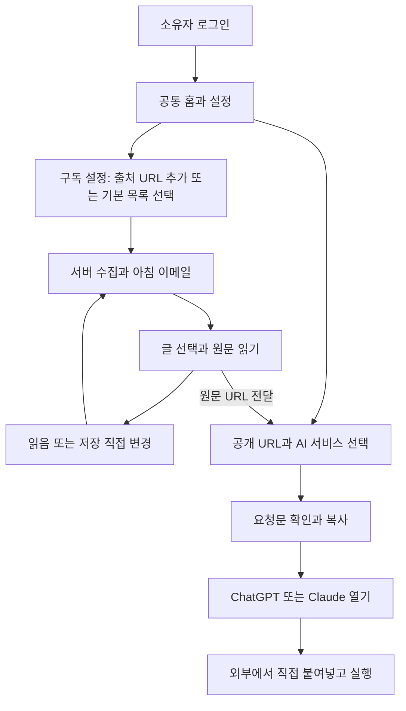
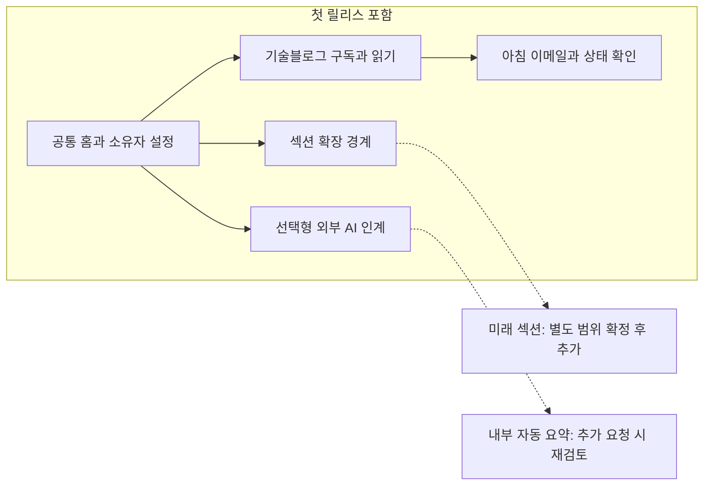
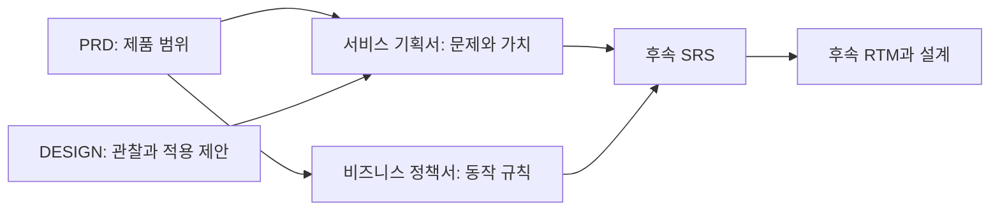

# 서비스 기획서 (Service Planning Document)

> LevelUp의 사용자 문제, 핵심 가치, 첫 릴리스 범위와 검증 방향을 정의한다. PRD의 범위·ID를 유지하며, 동작의 상세 규칙은 비즈니스 정책서에서 관리한다. 아직 승인되지 않은 검토용 초안이다.

| 항목 | 내용 |
|------|------|
| **프로젝트명** | LevelUp — 일상의 편의를 높이는 개인용 웹사이트 |
| **문서 ID** | SPD-LEVELUP-v0.12 |
| **문서 버전** | v0.12 |
| **작성일** | 2026-11-24 |
| **최종 수정일** | 2026-11-26 |
| **작성자** | Codex — 사용자 요청과 프로젝트 문서 기반 초안 작성 |
| **승인자** | 사이트 소유자 — 검토·승인 미실시 |
| **문서 상태** | 초안 / G0 기획 검토 전 |
| **근거 문서** | [PRD-LEVELUP-v0.30](../../PRD.md), [디자인 분석](../../DESIGN.md) |

## 변경 이력

| 버전 | 날짜 | 작성자 | 변경 내용 |
|------|------|--------|-----------|
| v0.1 | 2026-11-24 | Codex | 범용 템플릿을 LevelUp 기획으로 작성. 기술블로그·수동 AI 인계·섹션 확장 범위와 미결 사항 연결 |
| v0.2 | 2026-11-24 | Codex | 사용자 요청에 따라 구독 설정의 URL 직접 추가·삭제, 검증·중복·기존 기록 보존 정책과 AC-017~019 연결 |
| v0.3 | 2026-11-24 | Codex | 채용·행사 모집·기업 소식·홍보 등 전체 콘텐츠 포함, 유형별 자동 제외 제거·AC-020 연결 |
| v0.4 | 2026-11-25 | Codex | 사용자 답변에 따라 Gmail 발신·수신 연결과 남은 운영 미결 반영 |
| v0.5 | 2026-11-25 | Codex | Python 서버·수집 + TypeScript/Vercel 웹과 별도 worker 허용, DEC-001 부분 결정 반영 |
| v0.6 | 2026-11-25 | Codex | CR-UX-001: 홈 미래 기능 준비 카드와 기능별 설정·공통 행 확장 반영 |
| v0.7 | 2026-11-25 | Codex | CR-UX-002: 라이트 비교 기록·첫 릴리스 전환/선택 저장·대비/UI 보완 반영. 범위 사용자 확인, 실행 미검증 |
| v0.8 | 2026-11-25 | Codex | CR-FLOW-001: 첫 등록/재활성·pending 날짜 정정·날짜별 상태·항목 격리/partial·08:10 미시작 이월·기준선 정합화 |
| v0.9 | 2026-11-25 | Codex | CR-MIN-001: Python 호스트 통합·당일 자동 재발송 제외·단일 호출 결과 통합·템플릿 적용 범위 분리 |
| v0.10 | 2026-11-26 | Codex | 확정 PRD v0.28 대조·과거 문구/참조 정정, Mac Chrome + iPhone Safari·모든 글 목록 최신순 확정, 실행 검증과 분리 |
| v0.11 | 2026-11-26 | Codex | 00~04 미결·권장안 통합, 확정/설계/환경/검증/후속 보류 구분·잔여 문구/참조 정정. 권장안 미채택·실행 미검증 |
| v0.12 | 2026-11-26 | Codex | 사용자 채택: Services 한 프로젝트·DB 저장 세션(auth_sessions 추가, 총 14개)·외부 클라우드 자동 백업. 실제 설정/검증은 미완료 |

## 목차

1. [서비스 개요](#1-서비스-개요)
2. [핵심 메커니즘](#2-핵심-메커니즘)
3. [콘텐츠/기능 전략](#3-콘텐츠기능-전략)
4. [수익화 전략](#4-수익화-전략)
5. [MVP 스코프 정의](#5-mvp-스코프-정의)
6. [KPI 가설 검증 프레임워크](#6-kpi-가설-검증-프레임워크)
7. [다음 단계](#7-다음-단계)
8. [관련 문서](#8-관련-문서)

## 1. 서비스 개요

### 1.1 서비스명 및 컨셉

| 항목 | 내용 |
|------|------|
| 서비스명 | LevelUp |
| 기술블로그 브리핑명 | 모닝 테크 |
| 한 줄 설명 | 필요한 정보와 생활 도구를 기능별 섹션으로 모아 반복 작업을 줄이는 개인용 웹사이트 |
| 서비스 유형 | 본인만 사용하는 웹 대시보드 |
| 대상 플랫폼 | 데스크톱·모바일 웹 |

**서비스 컨셉 설명:** 소유자가 여러 기업의 기술블로그를 직접 순회하는 대신, 새 글을 모아 매일 아침 이메일로 확인하고 관심 글의 원문을 읽는다. 문서의 핵심을 파악하고 싶을 때는 리포트 분석에서 URL과 요약 요청문을 준비해 ChatGPT 또는 Claude로 가져간다. 미래의 생활·업무 기능은 공통 홈과 메뉴 아래 별도 섹션으로 추가한다. 사이트 전체를 기술블로그 데이터와 화면에 종속시키지 않는다.

**배경 및 동기:** 사용자가 기술블로그 통합·다음 날 아침 알림, 선택형 AI 요약 연결, 추후 섹션 확장을 직접 요청했다. 확인된 근거는 본 프로젝트의 대화와 PRD이며, 시장 조사나 다수 사용자 인터뷰를 수행한 것으로 간주하지 않는다.

#### 사용자 문제와 근거

| 문제 ID | 사용자·상황·겪는 문제 | 현재 대안과 한계 | 관찰 근거 | 확인 상태·다음 검증 |
| --- | --- | --- | --- | --- |
| OBJ-001 | 본인이 아침에 기업별 블로그의 새 글을 확인해야 함 | 개별 북마크 방문으로 반복 탐색 발생 | PRD 1.1 및 사용자의 새 글 알림 요청 | 요구 확인. 시범 운영 후 탐색 부담과 아침 읽기 편의를 정성 평가 |
| OBJ-002 | 관심 문서마다 요약 요청문과 URL을 다시 준비함 | AI 서비스에 매번 직접 입력 | PRD 2.1의 외부 서비스 직접 실행 선택 | 방식 확인. 요청문 재사용의 편의는 검증 전 |
| OBJ-003 | 생활 개선 기능을 같은 사이트에 추가하고 싶음 | 블로그 전용 구조는 다른 기능과 결합되기 쉬움 | PRD 6장 및 사용자의 후속 섹션 추가 요청 | 방향 확인. 구체적인 다음 섹션은 미결 |

### 1.2 핵심 가치 제안 (Value Proposition)

| 항목 | 내용 |
|------|------|
| 핵심 가치 | 반복 탐색과 요청문 준비를 줄이고 읽기·판단에 시간을 쓰게 함 |
| 차별점 | 본인의 구독·아침 루틴에 맞춘 블로그 섹션과 다른 생활 기능을 담는 공통 구조 |
| 대안 대비 목표 | 개별 사이트 순회와 수동 프롬프트 작성보다 준비 부담을 줄임. 실제 절감 효과는 미측정 |

| 구분 | 내용 |
|------|------|
| 사용자의 할 일 (Jobs) | 관심 기업의 기술 글을 놓치지 않고, 읽을 글과 문서를 선택 |
| 사용자의 고통 (Pains) | 반복 방문, 읽을 글 분산, 동일한 요약 요청 작성 |
| 사용자의 이득 (Gains) | 아침 브리핑, 다시 찾는 저장 목록, 재사용 가능한 요청문 |
| 고통 해결제 (Pain Relievers) | 자동 수집·이메일·검색·저장·URL 기반 요청문 준비 |
| 이득 생성제 (Gain Creators) | 같은 계정과 공통 메뉴로 후속 섹션 이용 |

### 1.3 타겟 사용자 정의

#### 1.3.1 주요 사용자 페르소나

| 항목 | 내용 |
|------|------|
| 사용자 | 실제 사이트 소유자 본인 1명 |
| 연령·직업 | 미수집. 기능 정의에 필요하지 않음 |
| 핵심 목표 | 기술 정보 탐색을 줄이고 필요한 글을 꾸준히 읽기 |
| 사용 시나리오 | 아침 이메일에서 원문 열기, 웹에서 저장한 글 확인, 필요할 때 AI 요청문 준비 |
| 성공 경험 | 블로그를 순회하지 않고 관심 글을 발견하고, 문서 요약 요청을 쉽게 준비함 |

#### 1.3.2 사용자 세그먼트

| 세그먼트 | 설명 | 규모 | 우선순위 | MVP 포함 |
|----------|------|------|----------|----------|
| 소유자 | 사이트 설정·구독·읽기·분석 인계를 사용하는 본인 | 1명 | P1 | Y |

다른 사용자를 위한 회원가입·조직 역할·요금제를 만들지 않는다.

#### 1.3.3 비사용자 (Anti-Persona)

| 비사용자 | 이유 | 현재 대안 |
|----------|------|-----------|
| 일반 방문자·외부 회원 | 개인 데이터와 설정은 소유자 전용 | 원문 사이트 직접 이용 |
| 팀 공동 큐레이션 사용자 | 공동 편집·역할 분담이 범위 밖 | 기존 팀 도구 사용 |
| 사이트 내부 자동 요약을 원하는 사용자 | 첫 버전은 외부 AI 수동 실행 방식 | 선택한 AI 서비스에서 직접 실행 |

## 2. 핵심 메커니즘

### 2.1 서비스 작동 원리

**핵심 루프:** 구독 설정에서 기본 출처 선택 또는 URL 직접 추가 → 서버가 새 글 수집 → 오전 8시 이메일 → 제목 확인·원문 읽기 → 읽음·저장 상태 직접 관리 → 다음 브리핑 확인. 수집할 출처는 같은 화면에서 켜기·끄기·삭제한다.

**보조 루프:** 리포트 분석 진입 → 공개 URL 입력 또는 글에서 이동 → AI 서비스 선택 → 요약 요청문 확인·수정·복사 → 외부 서비스 열기 → 사용자가 붙여 넣고 실행.

AI 연결은 요청문 인계까지다. 외부 결과를 받아 저장하거나 ‘요약 완료’를 자동 표시하지 않는다. 상세 조건은 정책서의 BP-AI 규칙을 따른다.

### 2.2 전체 서비스 플로우

### 2.3 핵심 사용자 여정 (Key User Journey)

#### 여정 1: 첫 설정과 아침 읽기

| 단계 | 사용자 행동 | 시스템 반응 | 감정 목표 | 확인 항목 |
|------|------------|------------|-----------|-----------|
| 설정 | 로그인 후 기본 출처 선택 또는 블로그/피드 URL 입력·추가, 로그인 Google 계정의 Gmail 권한 확인·동일 계정 발신/수신 설정 | 연결·중복 확인, 초기 글 구분, 테스트 메일 제공 | 수집 대상 통제 | MVP-001·002·003·007 |
| 수집 | 별도 조작 없이 대기 | 기존 글을 과거 글로 구분하고 이후 새 글 수집 | 반복 작업 감소 | MVP-003 |
| 아침 | 이메일에서 제목 확인·원문 열기 | 기업별 목록과 직접 원문 링크 | 빠른 선택 | MVP-004·005 |
| 정리 | 읽음·나중에 읽기 직접 변경 | 개인 상태 유지 | 다시 찾기 쉬움 | MVP-006 |

#### 여정 2: 리포트 분석

| 단계 | 사용자 행동 | 시스템 반응 | 감정 목표 | 확인 항목 |
|------|------------|------------|-----------|-----------|
| 진입 | 메뉴·글별 버튼 또는 직접 주소 선택 | 별도 활성화 없이 분석 화면 표시 | 바로 사용 | BP-AI-001 |
| 준비 | URL 입력·AI 서비스 선택 | 요약 요청문 표시 | 반복 작성 감소 | BP-AI-002·004·005 |
| 인계 | 요청문 복사 후 공식 서비스 열기 | 복사 성공 표시·새 탭 연결 | 다음 행동이 명확함 | BP-AI-006 |
| 실행 | 외부에서 직접 붙여넣고 실행 | 외부 결과를 사이트가 수신하지 않음 | 역할과 한계를 이해 | BP-AI-007 |

## 3. 콘텐츠/기능 전략

### 3.1 핵심 기능 방향

| 기능 영역 | 전략 방향 | 우선순위 | MVP 포함 | 비고 |
|-----------|-----------|----------|----------|------|
| 공통 홈·인증·설정 | 본인 전용 접근과 섹션별 진입 제공 | P1 | Y | MVP-001 |
| 기술블로그 | 구독·수집·읽기·아침 이메일에 집중 | P1/P2 | Y | MVP-002~007 |
| 리포트 분석 | 필요할 때 직접 사용하는 수동 AI 인계 | P2 | Y | MVP-008 |
| 섹션 확장 경계 | 공통 기능과 개별 기능의 책임 분리 | P1 | Y | MVP-009 |
| 미래 생활 기능 | 문제와 범위를 정한 뒤 별도 기획 | 미정 | N | EX-008 |

**의사결정 기록:** 개인용과 이메일·매일 오전 8시·기술 동향 포함은 기존 확인 사항이다. AI 인계 방식, 공개 웹페이지·텍스트형 PDF 대상, 첫 버전 제공은 PRD 2.1에 반영된 사용자 답변이다. P2도 이번 릴리스에 포함한다.

### 3.2 섹션 확장 전략

공통 홈·상위 메뉴·인증·설정을 기반으로 기술블로그와 리포트 분석을 독립 모듈로 구분한다. 메뉴와 홈은 같은 섹션 등록 정보를 사용하고, 리포트 분석은 게시글 DB 없이 URL 직접 입력으로 사용할 수 있어야 한다. 후속 섹션은 자체 화면·데이터·작업을 소유하며 블로그 수집·발송 코드를 바꾸지 않고 연결한다. 게이미피케이션·범용 플러그인 플랫폼은 첫 릴리스에 추가하지 않는다.

### 3.3 콘텐츠 전략

| 항목 | 내용 |
|------|------|
| 기본 제공 출처 | NAVER D2, 카카오테크, 우아한형제들, 삼성SDS, SK플래닛 TECH TOPIC. 고정 수집 목록이 아니라 선택 가능한 기본 목록 |
| 사용자 추가 출처 | 구독 설정에서 공개 기술 블로그·글 목록·RSS/Atom URL 직접 입력·추가. 기본 목록 외 출처도 가능 |
| 출처 관리 | 연결 확인 → 필요 시 발견한 피드 선택 → 추가. 구독 켜기·끄기·삭제 제공. 기본 출처도 삭제 가능 |
| 포함 콘텐츠 | 구독한 출처의 모든 새 글. 기술 글·채용·행사 모집·일반 기업 소식·기술 설명 없는 홍보 포함 |
| 수집 범위 기준 | 선택한 공개 피드·목록의 글을 유형으로 제외하지 않음. 구독·날짜·초기 과거 글·중복 조건 유지 |
| 수집·갱신 | RSS·Atom 직접 등록·자동 탐색 우선, 피드가 없으면 기존 지원 수집기가 있는 공개 목록만 등록. 시간당 수집과 오전 7시 30분 최종 수집 |
| 목록 구성 | 제목·기업·게시일·원문 링크, 제공된 태그·소개. 본문 전체 재게시 제외 |
| 품질 관리 | 중복 판정·출처별 오류 표시. 카테고리는 수집 제외 조건으로 사용하지 않고 원하지 않는 글은 수동 목록 숨김 제공 |

구독·신규 판정·게시일·이메일의 동작은 정책서 BP-CONTENT·BP-RESET·BP-NOTI에서 정의한다.

URL을 입력하는 것만으로 수집하지 않고 ‘연결 확인’ 조작 이후에 조회한다. 연결 실패·미지원·중복을 안내하고 등록 완료와 구분한다. 출처 삭제는 이후 수집·미발송 알림을 중단하지만 기존 글·읽음·저장·발송 기록은 보존한다. 삭제한 출처를 자동 복원하거나 재추가 시 과거 글을 중복·소급 알림하지 않는다. 임의 HTML 사이트의 수집기를 자동 생성하는 기능은 첫 버전에 포함하지 않는다.

### 3.4 브랜드/톤앤매너

| 항목 | 내용 |
|------|------|
| 브랜드 톤 | 개인의 읽기·준비 작업을 돕는 차분하고 실용적인 표현 |
| 안내 문구 | 짧은 존댓말. 원문 열기·읽음·저장·분석 인계를 별도 동작으로 표시 |
| 시각적 기준 | DESIGN.md의 daily.dev 문서 탐색 구조와 앱 피드 관찰을 구분해 적용 |
| 주요 패턴 | 어두운 중립 표면, 보라색 주요 동작·선택, 파란색 본문 링크, 일관된 글자·간격 |
| 모바일·접근성 | 한 열 본문, 접히는 메뉴, 주요 클릭 영역 44 × 44px 이상, 키보드 포커스·입력 라벨 |
| 캐릭터·보상 | 해당 없음. 첫 버전 요구사항에 없음 |

DESIGN.md의 라이트 테마 관찰과 AI 요약 도구 상자는 각각 테마 전환 기능·자동 요약 기능을 추가하라는 요구가 아니다. 이후 사용자 확인 CR-UX-002로 첫 릴리스의 다크·라이트 전환·선택 저장을 포함한다. 비교 당시 제안과 현재 결정은 화면설계서 7.5·7.6으로 구분한다.

## 4. 수익화 전략

### 4.1 수익 모델 선택

| 항목 | 내용 |
|------|------|
| 주요·보조 수익 모델 | 해당 없음. 본인 전용 도구로 수익화가 목표가 아님 |
| 무료/유료 경계 | 해당 없음. 회원 등급·유료 기능·사이트 결제 없음 |
| 운영 비용 | 월 운영비 0원·무료만 허용(PRD 8.3). 호스팅·DB·이메일 무료 한도 내 적합성은 DEC-001·002에서 확인 |
| AI 비용 경계 | 사이트의 AI API 호출 없음. 외부 서비스 이용 조건은 본인 계정에서 확인 |

### 4.2 단계별 수익화 계획

첫 릴리스와 이후 개인용 섹션 추가에 수익화 일정을 두지 않는다. 외부 사용자 공개·유료화를 원하면 EX-006의 재검토 조건에 따라 별도 범위와 비용 정책을 먼저 합의한다.

### 4.3 과금 정책 요약

무료 체험·환불·구독 갱신·결제 수단은 모두 해당 없음이다. 여기서 블로그 ‘구독’은 글 출처 선택을 의미하며 유료 구독이 아니다. 운영비 처리 원칙은 BP-COST-001을 따른다.

## 5. MVP 스코프 정의

### 5.1 MVP 정의 기준

| 항목 | 내용 |
|------|------|
| MVP 목표 | 아침 읽기와 문서 요청문 준비의 반복 작업을 줄이면서 다른 섹션을 추가할 수 있는 기반 검증 |
| MVP 기간 | 고정 출시일·개발 기간 없음. 수용 기준 검증·7일 시범 운영 후 소유자 출시 판단(PRD 10절) |
| 기능 완료 기준 | PRD AC-001~020 검증, 기본 5개 출처와 사용자 추가 URL 등록·삭제 흐름 확인. 아직 실행 결과 없음 |
| 사용 가치 기준 | 6장의 개인 사용 가설을 정성 평가만으로 검토. 수치 목표·사전/사후 측정 의무 없음(PRD 10절) |
| 실패 시 대응 | 누락·중복·인계 실패를 수정하고 재검증. 필수 범위 변경은 소유자와 다시 합의 |

### 5.2 포함 항목 (In-Scope)

P1은 핵심, P2는 보조 중요도다. 아래 9개 모두 첫 릴리스 범위이며, 보조 기능도 구현을 생략하지 않는다. 예상 공수는 구현 작업 분해 시 참고 추정하며, 미추정 상태를 제품 정책 미결이나 출시 조건으로 취급하지 않는다.

| ID | 기능/항목 | 설명 | 우선순위 | 예상 공수 | 비고 |
|----|-----------|------|----------|-----------|------|
| MVP-001 | 개인 계정·공통 홈·메뉴·설정 | 소유자 접근·활성 섹션 진입·지정 미래 기능 준비 카드·다크/라이트 선택 저장 | P1 | 구현 시 참고 추정 | OBJ-003 / BP-AUTH-001·BP-SECTION-001 / AC-001 |
| MVP-002 | 구독 설정의 URL 추가·삭제 | 기본 목록 외 출처 등록·연결 확인·중복 방지, 구독 켜기·끄기·삭제 | P1 | 구현 시 참고 추정 | OBJ-001 / BP-CONTENT-004·007·008·009·010 / AC-003·017·018·019 |
| MVP-003 | 수집·과거 글·중복 방지 | 자동 수집과 신규 판정 | P1 | 구현 시 참고 추정 | OBJ-001 / BP-CONTENT-001·002·003 / AC-002·003·008·020 |
| MVP-004 | 목록·검색·필터·원문 | 오늘의 글·전체 글과 탐색 | P1 | 구현 시 참고 추정 | OBJ-001 / BP-CONTENT-005 / AC-004 |
| MVP-005 | 아침 이메일·발송 기록 | 한국 시간 오전 8시 브리핑 | P1 | 구현 시 참고 추정 | OBJ-001 / BP-NOTI-001·002·003·004 / AC-005·006·007 |
| MVP-006 | 읽음·저장 | 사용자가 직접 상태 변경, 출처 삭제 후 기존 상태 보존 | P2 | 구현 시 참고 추정 | OBJ-001 / BP-CONTENT-006·010 / AC-004·019 |
| MVP-007 | 수집 상태·테스트 메일 | 마지막 성공·오류·발송 결과 | P2 | 구현 시 참고 추정 | OBJ-001 / BP-ERROR-001·BP-NOTI-005 / AC-007·008 |
| MVP-008 | 리포트 분석 | 공개 URL 요청문 생성·복사·외부 AI 열기 | P2 | 구현 시 참고 추정 | OBJ-002 / BP-AI-001·002·003·004·005·006·007 / AC-009~013 |
| MVP-009 | 모듈·섹션 경계 | 화면·데이터·작업 분리와 등록 지점 | P1 | 구현 시 참고 추정 | OBJ-003 / BP-SECTION-001·002 / AC-014·015 |

AC 번호는 [PRD 9장](../../PRD.md#9-수용-기준과-검증-시나리오)을 참조하며 모바일 통합 흐름은 AC-016에서 확인한다. FR·TC는 후속 SRS·테스트 설계에서 실제 ID를 부여한다.

### 5.2.1 홈의 준비 중 미리보기

수신 이메일 요약과 데일리 기사 요약은 홈에만 ‘준비 중 / 아직 상세 설계 전인 기능입니다.’로 표시한다. 링크·버튼·가짜 수치·출시일·수집/요약 실행·권한 요청은 없다. 실제 수신 메일 읽기·자동 기사 요약·결과 저장은 여전히 EX 범위이며 후속 기획이 필요하다. 기존 MVP의 P1·P2는 준비 카드로 대체하지 않는다. 일반/연결 계정/기능별 설정과 공통 목록 행 규칙으로 실제 기능 추가 시의 화면 확장을 준비한다.

### 5.3 제외 항목 (Out-of-Scope) + 제외 근거

| ID | 제외 항목 | 제외 근거 | MVP 대안 | 재검토 조건 |
|----|-----------|-----------|----------|-------------|
| EX-001 | API 자동 호출·API 키·사이트 내부 요약 | 사용자가 외부 서비스 직접 실행 선택 | 요청문 복사·공식 서비스 열기 | 내부 자동 요약 추가 요청 |
| EX-002 | 외부 대화·요약 결과 자동 수신·이력 | 외부 결과는 사이트 관찰 범위 밖 | 외부 서비스에서 결과 확인 | 결과를 사이트에서 관리할 필요 확인 |
| EX-003 | 자체 PDF 다운로드·파싱·OCR·업로드 | URL 기반 수동 인계만 제공 | 외부에서 본문·PDF 직접 제공 | 인계만으로 해결되지 않는 문서가 반복 |
| EX-004 | 인증·유료 문서·비공개 파일 자동 접근 | 공개 문서가 지원 대상 | 본인이 접근 가능한 원문을 외부에서 직접 제공 | 인증·취급 범위 별도 합의 |
| EX-005 | 전체 글·이메일 AI 자동 요약 | 자동 처리 범위·비용을 선택하지 않음 | 필요한 문서만 사용자가 요청 | 자동화·비용·실패 정책 합의 |
| EX-006 | 공개 회원가입·다중 사용자·결제·커뮤니티·추천 | 본인 1명용 제품 | 소유자 접근·수동 기업 선택 | 제품 대상 변경 요청 |
| EX-007 | 카카오톡·텔레그램·웹 푸시 | 이메일 채널 선택 | 일일 이메일 | 추가 채널 요청 |
| EX-008 | 미정인 미래 생활 기능 | 확장 기반과 실제 신규 기능은 별개 | 메뉴는 구현·활성 섹션만, 홈은 지정 준비 카드 2개 예외 허용. 실제 기능 실행은 제외 | 문제·범위·성공 기준을 새로 정의 |

### 5.4 MVP 기능 범위 다이어그램

### 5.5 기술적 MVP 결정사항

| 결정 항목 | MVP 선택·상태 | 근거 | 변경 조건 |
|-----------|---------------|------|-----------|
| 구조 | 하나의 앱 안에서 모듈별 책임 분리 | PRD 6장 | 별도 배포 필요가 입증될 때 |
| 정기 작업 | Vercel Schedules로 Python 작업 예약 | PRD 4.2·8.3 | 채택 확정, 실제 함수 실행량·DB 적합성은 검증 전 |
| AI 인계 | 고정 요청문 템플릿·복사·공식 홈 열기 | 사용자 선택, PRD 5장 | EX-001 재검토 시 |
| 언어·배포 | Python 서버·수집, Next.js TypeScript 웹·FastAPI API Vercel 배포 | Next.js 웹·FastAPI API·PostgreSQL DB 사용자 확인. 무료만 사용 확정. Neon Free 채택 확정. 구성요소 버전·DB 리전/직접 연결/드라이버·운영 계정은 DEC-001 | 구현 환경 확정 전 |
| 이메일 연동 | Gmail 발신·수신 확정, 운영 설정은 DEC-002 미결 | 실제 Gmail·OAuth 동의/지속 운영·계정 한도·사용량 확인 | 이메일 연동 전 |
| 시각 구현 | DESIGN.md를 참고하되 관찰과 제품 적용 구분 | PRD 7장 | DEC-008 검토 후 화면 설계 |

### 5.6 Gmail 연결 확인 사항 (2026-11-25 보완)

소유자는 Gmail을 연결해 알림을 보내고 같은 Gmail로 받는 방식을 선택했다. 설정에서 연결·재연결·해제를 제공하며 연결이 없어도 구독 수집·읽기는 계속된다. 앱은 발송 권한만 사용하고 Gmail 비밀번호·받은편지함 내용은 수집하지 않는 설계안이다. 실제 소유자 ID·지속 운영에 필요한 Google 설정은 아직 구성하지 않았다. 사이트 로그인은 Google로 확정했고 로그인한 계정을 연결 계정에 자동 표시하고 동일 계정의 Gmail만 발신·수신에 사용한다. 첫 로그인에서 발송 권한도 요청하되 권한 거절 시 사이트 이용은 유지한다. 연결 해제 후 일반 로그인만으로 발송을 재연결하지 않는다. 상세 기준은 PRD 8.2다. 제품 범위는 BP-NOTI-006, 연결·token·불명확 발송 처리는 02 설계에 연결한다.

### 5.7 라이트 채택과 테마 범위 (CR-UX-002)

테마의 현재 구현 기준은 화면설계서 7.6을 따른다.

화면설계서 7.6의 테마 적용·저장·실패 처리 규칙을 따른다.

### 5.8 흐름 충돌 해소 (CR-FLOW-001)

수집·날짜·발송 경계는 비즈니스정책서 11.7을 따른다.

| 항목 | 결정·처리 | 보존·한계 |
|---|---|---|
| ① 첫 등록 / 재활성 구분 | first_add는 최초 유효 기준 응답의 글만 baseline으로 제외한다. 이후 늦게 발견한 과거 날짜 글은 후보다. resume/readd는 새 기준 응답 및 새 epoch 시작 전 게시 글을 제외한다 | 기존 baseline·suppressed·notified 글과 수동 상태는 되살리지 않음. 무게시일·식별 불가 항목의 과거 여부는 추정하지 않음 |
| ② 게시일 정정 | pending의 최신 게시일로 eligible_on을 재계산한다. 게시일 있음: max(게시 KST 날짜+1, 최초 발견 KST 날짜). 없음/무효: 최초 발견 KST 날짜+1 | prepared는 전송 직전 재검사·제외/새 revision. sending/unknown/accepted의 snapshot·예약은 보존하며 재알림하지 않음 |
| ③ 날짜별 상태 | 정기는 API-022 날짜별 브리핑 기준, 테스트는 API-015 발송 기록 기준. delivery 없는 날도 표시 | 미확정 건수는 null, 실제 snapshot의 빈 대상만 0. GET은 발송/수집/기록 생성 부작용 없음 |
| ④ 항목 오류 | 응답/문서 전체 오류는 실패. 유효 항목과 격리 항목이 섞이면 partial로 저장하고 정상 항목은 계속 처리 | 초기 partial은 유효 항목 1개 이상이면 기준 확정. 모든 항목 무효이면 기준 미완료. 정상 빈 피드는 완료 가능 |
| ⑤ 발송 시각 | KST [08:00,08:20) 안에 owner 잠금과 최초 snapshot을 확보한 실제 시작 시점으로 대상 확정. 수집 슬롯 완료를 기다리지 않음 | 08:20 정각까지 시작하지 못하면 missed. 다음 정상 아침에 유효 미발송을 합침. 이미 시작한 외부 요청의 늦은 결과는 계속 기록 |
| ⑥ 기준선 | 실행 메뉴에는 활성 기능만, 홈에는 지정 준비 카드 2개를 추가 허용. live 참조·변경 이력 동기화 | CR-UX-002 테마 결정·기존 개인 상태·발송 이력 유지 |

날짜 자격과 실제 snapshot 포함 시점은 비즈니스정책서 11.7의 경계를 따른다.

## 6. KPI 가설 검증 프레임워크

### 6.1 검증할 가설 목록

| ID | 가설 | 검증 방법 | 성공 기준 | 실패 시 대응 | 우선순위 |
|----|------|-----------|----------|-------------|----------|
| H-001 | 아침 브리핑으로 블로그를 직접 순회하는 부담이 줄어든다 | 시범 운영 후 탐색·아침 읽기의 편의를 본인이 검토 | 본인이 탐색 부담이 줄었다고 판단 | 출처·알림 내용·읽기 진입 개선 |
| H-002 | 준비된 요청문으로 문서 요약 요청의 준비 부담이 줄어든다 | 실제 사용 후 요청문 준비·복사·이동의 편의를 본인이 검토 | 본인이 준비 부담이 줄었다고 판단 | 요청문·복사 안내 개선 |
| H-003 | 독립 모듈 구조로 다른 섹션을 붙일 수 있다 | AC-015의 테스트용 임시 섹션 등록 | 블로그 수집·발송 수정 없이 등록 가능 | 모듈 경계 수정 후 재검증 |

H-003은 확장성 요구의 검증이며 사용자 KPI를 대신하지 않는다. 현재 가설은 검증 전이다.

### 6.2 핵심 지표 (Key Metrics)

| KPI ID·가설 | 정성 평가 관점 | 판단 기준 | 대상·평가 시점 | 출처·담당자·판정 |
|---|---|---|---|---|
| KPI-001 / H-001 | 블로그 순회 부담·아침 읽기 편의 | 본인이 부담 감소와 편의를 판단, 수치 목표 없음 | 소유자 1명, 7일 시범 운영 후 | 본인 사용 경험·필요시 간단한 의견 / 소유자 |
| KPI-002 / H-002 | 요청문 준비·복사·외부 AI 이동 편의 | 본인이 준비 부담 감소를 판단, 시간 측정·최소 표본 없음 | 소유자 1명, 시범 운영 중 실제 사용 후 | 본인 사용 경험·필요시 간단한 의견 / 소유자 |

기존 KPI 식별자는 연결을 위해 유지하지만 첫 릴리스에서는 정성 평가 관점으로만 사용한다. 사전/사후 횟수·시간 측정이나 수치 목표는 요구하지 않는다. 개인용이므로 MAU·매출·유료 전환 목표는 해당 없다. 수집 누락·중복 발송·외부 인계 동작은 출시 수용 기준으로 검증하며, 외부 AI의 요약 성공률을 사이트 KPI로 집계하지 않는다.

### 6.3 가설 검증 매트릭스

| 가설 | 결과 시나리오 | 판단 | 다음 액션 |
|------|---------------|------|-----------|
| H-001·002 | 본인이 탐색·요청문 준비가 편리해졌다고 판단 | 사용 가치 지지 | 현재 흐름 유지, 후속 필요 검토 |
| H-001·002 | 불편함이 남아 있지만 개선할 원인 확인 | 개선 후 재관찰 | 수정 범위·재관찰 기간을 소유자와 정함 |
| H-001·002 | 실제 사용 경험이 부족해 판단하기 어려움 | 판단 보류 | 필요할 때 추가 사용 후 의견 확인, 최소 표본 강제 없음 |
| H-003 | AC-015 충족 / 미충족 | 확장 경계 충족 / 재설계 필요 | 테스트용 섹션 제거 / 결합 지점 수정 |

### 6.4 데이터 수집 계획

| 데이터 | 수집 시점 | 도구·방식 | 용도 | MVP 필수 |
|--------|-----------|-----------|------|----------|
| 출처별 수집 결과·마지막 성공 시각 | 수집 작업 실행 시 | 앱 내부 작업 기록, 구체 도구 미결 | AC-002·008, 장애 확인 | Y |
| 브리핑 대상·발송 결과 | 정기·테스트 발송 시 | 앱과 이메일 제공업체 기록 | AC-005~007, 중복 확인 | Y |
| 읽음·저장 상태 | 소유자가 직접 변경 시 | 개인 상태 저장 | AC-004 | Y |
| 탐색·요청문 준비의 불편함/편의 | 시범 운영 후 | 본인이 판단, 필요시 간단한 의견 | KPI-001·002 정성 평가 | 횟수/시간 측정·별도 기록 기능 없음 |

별도 광고 분석 도구, 추적 픽셀, URL·요청문 분석 이력, 외부 대화 수집은 추가하지 않는다. 운영 기록은 PRD 6.2에 따라 첫 릴리스 자동 삭제 없이 보존한다. 무료 용량·백업 복원 검증과 수동 관찰 기록 위치는 DEC-007에서 확인한다.

## 7. 다음 단계

### 7.1 기획 완료 체크리스트

아래는 소유자의 G0 검토 항목이며 작성만으로 완료·승인 처리하지 않는다.

- [ ] 사용자 문제 OBJ-001~003과 근거를 검토한다.
- [ ] MVP-001~009와 EX-001~008의 첫 릴리스 범위를 합의한다.
- [ ] 선택형 AI 인계와 내부 자동 요약의 차이를 확인한다.
- [ ] 정책서의 날짜·구독·발송·AI·섹션 규칙 및 미결 항목을 확인한다.
- [ ] 사용 효과는 수치 목표·최소 표본 없이 시범 운영 후 정성 평가하고, 기능 수용 기준 검증과 구분한다.
- [ ] DEC-001~008의 담당과 결정 시점을 확인한다.
- [ ] 승인된 문서 버전·승인자·날짜·근거를 G0 검토 기록에 남긴다.

### 7.2 v2+ 로드맵

| 버전·단계 | 진입 조건 | 주요 내용 | 목표 |
|-----------|-----------|-----------|------|
| 첫 릴리스 | 기획·요구사항·설계 검토, AC 검증·7일 시범 운영 후 소유자 출시 판단 | 5.2의 전체 범위 | 핵심 읽기·인계 흐름 확인 |
| 안정화 | 7일 시범 운영의 결함·사용 부담 확인 | 누락·중복·UX 개선 | 일상 사용 안정화 |
| 후속 섹션 | 소유자가 새로운 문제·범위·성공 기준 정의 | 독립 모듈 추가, 구체 기능 미정 | 생활 기능 확대 |
| AI 내부 자동화 | EX-001~005 중 필요한 범위를 다시 합의 | API·결과 보관·비용 정책 별도 기획 | 확인된 수동 인계 한계 해결 |

고정 출시일이나 개발 기간을 두지 않는다. 첫 릴리스 전체 범위의 수용 기준을 검증하고 7일 시범 운영을 마친 뒤 소유자가 결과를 확인해 출시 여부를 판단한다. 7일이 지났다는 이유만으로 자동 출시하거나 미해결 결함을 통과로 처리하지 않는다. 시범 운영은 검증 가능한 후보를 배포해 수행하며 실제 시작·종료·판단 일자를 기록한다. 개발 순서는 공통 기반 → 블로그 → 이메일 → 리포트 분석 → 통합 검증이다.

### 7.3 가정·의존성·미결 결정

| ID | 확인할 내용·근거 | 범위·일정 영향 | 담당자·결정 기한 | 상태·결정 기록 |
| --- | --- | --- | --- | --- |
| DEC-001 | Next.js·TypeScript 웹, Python·FastAPI API, PostgreSQL·Neon Free, Google 로그인·동일 Gmail 계정, Vercel 배포·Schedules, 월 운영비 0원 확정. 남은 검토는 구성요소 버전·Neon 프로젝트/리전/직접 연결/드라이버/한도·Vercel Services 한 프로젝트의 작업 실행량/라우팅 검증·OAuth 라이브러리·DB 저장 세션 구현 검증이다. 세션 유지 기간은 PRD 8.2의 7일 고정으로 확정했다 | MVP-001·009, 개발 기반 | 구현 담당 제안·소유자 검토 / 구현 환경 확정 전 | 기술·비용 정책 확정 / 설계 결정 필요·환경 설정 필요·실행 검증 대기(7.4) |
| DEC-002 | Gmail 발신·수신 확정 / OPEN-002. 실제 계정·OAuth 프로젝트/동의 설정·token 갱신·무료 한도·불명확 발송 확인 기록 구현. 소유자가 기한 없이 필요할 때 수동 대조하는 정책은 PRD 4.4에서 확정 | MVP-005·007, 실제 발송 | 소유자·구현 담당 / 이메일 연동 전 | 동일 계정 정책 확정 / 환경 설정 필요·실행 검증 대기, OP-01은 설계 결정 필요(7.4) |
| DEC-003 | 기본·사용자 출처의 피드 탐색·지원 수집기·제공 메타데이터·게시일 시간대·연결 검증 한도 / OPEN-003 | MVP-002~005, 등록·신규 판정 | 구현 담당 / 구독 설정·각 수집기 설계 전 | 수집 정책 확정 / 설계 결정 필요·환경 설정 필요·실행 검증 대기(7.4) |
| DEC-004 | 다음 생활 섹션의 사용자 문제와 기능 / OPEN-004 | EX-008, 후속 범위 | 소유자 / 후속 PRD 작성 전 | 후속 보류 / 첫 릴리스 비차단 |
| DEC-005 | 고정 일정 없음·AC 검증/7일 시범 운영 후 출시 판단·사용 효과 정성 평가만 적용 확정(PRD 10절). 수치 목표/측정 의무 없음 | H-001·002 및 제품 가치 평가 | 소유자 / 시범 운영 후 실제 평가 | 정책 결정 완료 / 실제 시범 운영·정성 평가 실행 검증 대기 |
| DEC-006 | CR-FLOW-001: first_add/resume 구분·pending 최신 게시일·실제 시작 snapshot·08:20 미시작 이월·날짜별 상태 확정 | FR-005·009·010·015·016·018 / ADR-005 | 소유자 정책 선택 2026-11-25·구현 담당 / G3 전 남은 값 검토 | 숨김·구독 중지 대기 억제·전체 통지·목록 정렬·수동 확인 담당/기한은 확정. OP-01 명령/기록 위치는 설계 결정 필요, 실제 동작은 실행 검증 대기(7.4) |
| DEC-007 | 주 1회·최근 성공 백업 4개 보관·장애 확인 후 24시간 이내 복구 목표 확정(PRD 8.4). 핵심 운영 기록의 첫 릴리스 자동 삭제 제외 확정(PRD 6.2). 남은 검토: 무료 용량·백업 실행/보관·복원 실측 검증·수동 기록 위치 | 개인 상태·운영 기록, 정책 BP-ERROR-004 | 소유자·구현 담당 / 데이터 설계·시범 운영 전 | 보존·백업 주기/개수·복구 목표 확정 / 외부 클라우드 자동 백업·GitHub Actions 실행은 확정, 임시 인증 데이터 정리는 설계 결정 필요, 보관 환경은 환경 설정 필요, 무료 용량·복원은 실행 검증 대기(7.4) |
| DEC-008 | 기본 다크 + 다크/라이트 전환·선택 저장·대비 보완 / CR-UX-002 | MVP-001, FR-002·NFR-009, UIX 7.5·7.6 | 소유자 범위 확인 2026-11-25 / 화면 담당은 전체 목업·구현 전 검증 | 테마 범위·네 가지 보완·Pretendard 확정. 브라우저별 localStorage 설계 유지 / 실제 글꼴·렌더링·대비·상태는 실행 검증 대기(7.4) |

각 기한은 단계 기준이다. 실제 검토·구현·시범 운영 일자는 수행 시 기록하고 고정 출시일을 가정하지 않는다. 미결은 승인된 기본값이 아니며 해당 동작을 구현하기 전에 해결한다. G0 승인 근거는 [기획 검토](../08-검토/단계별검토-체크리스트.md#phase-0-기획-검토)에 기록하며, 본 작업에서 다른 단계의 승인 기록을 생성하지 않는다.

### 7.4 PRD 확정 후 순차 검토 (2026-11-26)

PRD v0.30은 소유자 확정 기준선이다. 00의 새로운 제품 정책 미결은 없고, 아래는 00~04에 반복된 구현 결정·환경 설정·검증 항목을 한 번씩 모은 통합 검토 표다. 확정 범위·정책과 개별 문서/단계 승인·실제 실행 결과를 구분한다.

남은 상태는 **설계 결정 필요 / 환경 설정 필요 / 실행 검증 대기 / 후속 보류**로 통일한다. 표본 검증·수용 기준 사례 정리도 해당 검증 항목의 완료 조건이며 새로운 제품 정책 선택으로 취급하지 않는다.

**채택·확인 상태:** 2026-11-26 소유자가 Vercel Services 한 프로젝트·DB 저장 세션·외부 클라우드 주간 자동 백업을 채택했다. 해당 세 행만 채택 상태로 변경한다. 나머지 권장안 기재는 채택을 의미하지 않으며 설계안은 **채택 전**, 실제 환경은 **미구성**, 검증은 **미실행**, 후속 기능은 **보류**다. 이미 PRD에서 확정한 원칙은 그대로 유지하며, 추가 구현안의 선택·설정·측정 결과가 생겼을 때만 이 표와 7.3의 DEC 원장을 갱신한다.

| 단계 | 검토 항목 | 남은 상태 | 권장 처리방식 | DEC 연결 | 채택·확인 상태 |
|---|---|---|---|---|---|
| 00 | 미래 생활 기능의 상세 범위 | 후속 보류 | 준비 카드만 유지하고 도입 시 별도 PRD 작성. 현재 개발을 막지 않음 | DEC-004 | 보류 |
| 01 | 실제 수집 가능한 출처·피드 | 환경 설정 필요 | 기본 5개 출처의 실제 피드 주소·지원 방식·제공 필드를 확인해 기록. 임의 HTML 수집기 자동 생성 제외 | DEC-003 | 미구성 |
| 01 | HTML 수집 범위 | 설계 결정 필요 | 출처별 지원 목록·페이지 범위를 명시. 전체 사이트 탐색으로 확대하지 않고 상한 초과를 정상 완료로 숨기지 않음 | DEC-003 | 채택 전 |
| 01 | 게시일 파싱·시간대 | 설계 결정 필요 | 출처별 명시 형식·시간대만 해석. 근거 없는 날짜 추정 없이 기존 누락·무효 규칙 적용 | DEC-003 | 채택 전 |
| 01 | URL 정규화·중복 판정 | 실행 검증 대기 | 기존 정규화안을 출처별 표본으로 확인. 의미 있는 경로·쿼리를 임의 제거하지 않음 | DEC-003 | 미실행 |
| 01 | 수집 자원 상한 | 설계 결정 필요 | URL 2,048바이트·HTTP 전체 15초·redirect 3회·압축 해제 5MiB·동시 수집 2개 제안값을 표본 검증. 항목·페이지 상한은 표본 후 고정 | DEC-003 | 채택 전 |
| 01 | 빈 브리핑·예외 수용 기준 | 실행 검증 대기 | 정책 재선택 없이 실제 0개·미확정·조회 실패·미시작의 기대 결과를 SRS SC와 연결해 사례화 | DEC-006 | 미실행 |
| 02 | Vercel 프로젝트 구성·라우팅 | 환경 설정 필요 | Vercel Services 한 프로젝트·공통 origin 채택. /api/auth/*·/api/v1/*는 Python, 나머지는 Next.js. SSR/cookie/callback/Schedules·무료 한도 검증 | DEC-001 | 설계 채택(2026-11-26)·미구성 |
| 02 | Schedules 실행 단위 | 설계 결정 필요 | 수집·발송을 분리한 유한 작업으로 구성하고 기존 DB 작업 기록 재사용. 상시 worker·추가 큐 서비스 도입 제외 | DEC-001 | 채택 전 |
| 02 | 무료 실행량·처리 시간 | 실행 검증 대기 | 기본·추가 출처 증가 시 사용량을 계산·측정. 출처별 스케줄 증설 지양. 무료 한도 부족은 정책 변경 검토로 연결하며 자동 과금 금지 | DEC-001 | 미실행 |
| 02 | Neon 리전·DB 연결 | 환경 설정 필요 | Python 실행 환경과 가까운 리전 선택. session 잠금 경로 직접 연결·연결 수·해제·중단 복구 검증 | DEC-001·007 | 미구성 |
| 02 | Google OAuth 운영 설정 | 환경 설정 필요 | 실제 소유자 ID·운영 callback·동의 화면·지속 사용 조건 구성. 동의 거절·권한 철회·동일 계정 재연결 검증 | DEC-002 | 미구성 |
| 02 | 인증·세션 구현 | 환경 설정 필요 | 무작위 token·DB auth_sessions 저장·7일 고정 만료·현재 세션 로그아웃 채택. OAuth 라이브러리(Authlib 제안)·실제 구현은 별도 검토 | DEC-001 | 세션 방식 채택(2026-11-26)·미구성 |
| 02 | 초기 수집 전 홈 상태 | 설계 결정 필요 | 구독 없음/수집 대기/모두 정상/확인 필요/조회 불가 구분. failedCount=0만으로 미수집 출처를 정상 처리하지 않음 | DEC-006·008 | 채택 전 |
| 03 | 불명확 발송 확인 기록 OP-01 | 설계 결정 필요 | 소유자 전용 운영 명령으로 기존 delivery에 판정·근거·시각 기록. 강제 재발송 UI·메일함 읽기 scope 추가 없음 | DEC-002·006 | 채택 전 |
| 03 | 임대·heartbeat·잠금 대기·폴링 | 설계 결정 필요 | 120초·30초·2초·5초 제안값을 표본 검증 후 확정. 화면 이탈 시 polling 중지·외부 send 자동 재시도 금지 | DEC-001·006 | 채택 전 |
| 03 | API 요청 제한 | 설계 결정 필요 | 현재 제안 상한과 실제 polling·출처 등록·테스트 메일의 양립 검증. 429/Retry-After와 사용자 안내 정의 | DEC-002·003 | 채택 전 |
| 03 | 백업 실행·저장 위치·복구 | 환경 설정 필요 | 운영 DB 외부 클라우드 주간 자동·암호화 백업 채택. 성공본 4개·키 분리 유지. GitHub Actions 실행 기록 유지·Artifact 자동 만료와 정상본 보존 양립/무료 용량·요일·복원 검증 | DEC-007 | 보관/자동화 방식 채택(2026-11-26)·미구성 |
| 03 | 비밀값·복구 키 보관 | 환경 설정 필요 | 서버 비밀값은 Vercel 환경변수로 관리하는 안 권장. 복구 키는 백업 파일과 분리해 소유자 보관·복구 절차 확인 | DEC-001·007 | 미구성 |
| 03 | OAuth 임시 상태 정리 | 설계 결정 필요 | 사용·만료된 인증 임시 데이터만 주기 정리. 핵심 글·브리핑·발송·중복 방지 근거 보존과 분리 | DEC-007 | 채택 전 |
| 04 | 런타임·도구·라이브러리 버전 | 설계 결정 필요 | Vercel 지원 안정 버전 고정. 기존 uv·pnpm·Ruff·mypy·pytest·ESLint·Prettier·Vitest·Playwright 제안 우선 검증 | DEC-001 | 채택 전 |
| 04 | 테스트 환경·후보 빌드 식별 | 환경 설정 필요 | 테스트 DB·Gmail mock 운영 격리. 같은 commit·웹/API/작업 배포 버전·DB revision으로 후보 식별 | DEC-001 | 미구성 |
| 04 | 화면·실기기·운영 검증 | 실행 검증 대기 | Mac Chrome·iPhone Safari에서 두 테마·글꼴·클립보드·로그인·메일 진입 확인. AC 검증·7일 시범 운영 후 출시 판단 | DEC-005·008·ISSUE-001 | 미실행 |

설계 담당은 결정/표본 검증을, 환경 담당은 계정/설정을, 구현·검증 담당은 실제 실행 증빙을 기록한다. 최종 범위·정책 변경은 소유자가 판단한다. 담당은 같은 사람이 맡을 수 있으며 별도 조직을 만들지 않는다. 결정 시점은 각 기능 구현 전, 환경 확인은 연동 전, 실제 검증은 후보 빌드·시범 운영 전으로 한다. 고정 출시일을 새로 만들지 않는다.

DB 저장 세션 채택에 따라 auth_sessions 1개를 추가해 현재 설계는 **14개 테이블**이다. 단일 Services 프로젝트·사이트 세션·외부 클라우드 자동 백업의 설계 채택과 실제 배포/복원 성공을 구분한다. 홈 수집 대기 상태의 응답 필드·우선순위도 아직 확정하지 않았으며 현재 API 계약이 보완 완료된 것으로 기록하지 않는다.

근거: [Vercel Services](https://vercel.com/docs/services), [Services 요금·제한](https://vercel.com/docs/services/pricing), [Schedules 제한](https://vercel.com/docs/schedules/limits), [Neon session 연결 제약](https://neon.com/docs/connect/connection-pooling), [Authlib 통합 문서](https://docs.authlib.org/en/stable/oauth2/client/web/index.html). 제공 기능·제약의 확인과 이 프로젝트의 실제 환경 검증을 구분한다.

DEC-004의 미래 기능은 현재 릴리스 비차단이다. 예산·날짜·세션 수명·테마·보존·Mac Chrome/iPhone Safari·목록 최신순은 확정됐으며 재결정하지 않는다. 이번 세 가지 채택 이외의 권장안과 00~04 전체 단계 승인은 미확정이다. 추가 채택은 PRD v0.30에 기록했으며 05~08 템플릿·Figma·앱 코드는 변경하지 않는다.

## 8. 관련 문서

### 8.1 문서 간 관계

### 8.2 SRS와의 역할 분담

| 항목 | 본 서비스 기획서 | 후속 SRS |
|------|------------------|----------|
| 목표·범위 | 왜 만드는지, 포함·제외와 근거 | 각 MVP를 기능·비기능 요구사항으로 구체화 |
| 사용자 | 실제 소유자와 사용 여정 | 인증 조건·입출력·수용 기준 |
| 정책 | 구체 BP 규칙 ID 참조 | FR별 적용 규칙과 예외 연결 |
| 검증 | 개인 가치 가설·판정 계획 | PRD AC를 테스트 가능한 요구와 TC로 연결 |

### 8.3 참조 문서 목록

| 문서 | 위치 | 관계·상태 |
|------|------|-----------|
| PRD | [PRD.md](../../PRD.md) | 소유자 확정 PRD v0.30 / 제품 범위·MVP·EX·AC의 기준선 |
| 디자인 분석 | [DESIGN.md](../../DESIGN.md) | 시각 관찰·측정·적용 제안 |
| 비즈니스 정책서 | [비즈니스정책서.md](비즈니스정책서.md) | 함께 갱신한 BPD-LEVELUP-v0.11, 미승인 |
| 작성 가이드 | [AGENTS.md](../AGENTS.md) | 단계별 작성·근거·미결·승인 기록 기준 |
| SRS | [요구사항명세서-SRS.md](../01-요구사항분석/요구사항명세서-SRS.md) | SRS-LEVELUP-v0.12 초안 작성됨·제품 실행 미완료 |
| 유스케이스 | [유스케이스명세서.md](../01-요구사항분석/유스케이스명세서.md) | UCS-LEVELUP-v0.10 초안 작성됨 |
| RTM | [요구사항추적매트릭스-RTM.md](../01-요구사항분석/요구사항추적매트릭스-RTM.md) | RTM-LEVELUP-v0.12 초안 작성됨·실제 TC/실행 증빙 미착수 |

## 부록

### A. 경쟁 분석

해당 없음. 본인용 문제 해결이 목적이며 이번 작업에서 경쟁사 시장·가격 조사를 수행하지 않았다. DESIGN.md의 레퍼런스는 디자인 근거로만 사용한다.

### B. 용어 정의

| 용어 | 정의 |
|------|------|
| LevelUp | 여러 생활·업무 섹션을 담는 개인용 웹사이트 전체 |
| 모닝 테크 | 기술블로그 섹션의 아침 이메일 브리핑 이름 |
| 구독 | 특정 블로그 출처의 새 글 수신 선택. 유료 계약이 아님 |
| 리포트 분석 | 공개 URL의 요약 요청문을 준비해 외부 AI에 수동 인계하는 기능 |
| 브리핑 | 날짜별 알림 대상 글 묶음. 이메일과 전체 글 보기의 기준 |
| 미결 | 담당자와 결정 시점이 지정되었지만 아직 확정되지 않은 항목 |

### C. 승인

| 역할 | 이름·담당 | 서명·판정 | 날짜 |
|------|-----------|-----------|------|
| 기획·제품 책임 | 사이트 소유자 | 미승인 / G0 검토 전 | 미실시 |
| 기술 검토 | 구현 담당자 — 지정 미결 | 미검토 | 미실시 |

본 문서 작성과 문서 정합성 점검은 제품 승인·구현 완료·테스트 통과를 의미하지 않는다.

### CR-MIN-001 최소 구현 기준

CR-MIN-001(2026-11-25, 배포 부분은 PRD 8.1의 Vercel 웹·FastAPI 결정으로 대체): 당시 사용자 선택에 따라 Vercel 웹 + 한 상시 Python 호스트(API/worker 별도 프로세스)로 배포 대상을 3개에서 2개로 줄인다. 정기 메일의 당일 자동 재발송은 제외하고 명확한 미접수 글은 다음 정상 아침에 합친다. unknown은 확인 전 예약을 유지한다. 사용자 기능·33개 요구사항·22개 API·08:10 미시작 정책·테마/준비 카드는 유지한다. 문서 변경이며 실제 구현/배포·제품 검증은 아니다. 현재 시작 마감은 2026-11-26 사용자 결정에 따라 08:20으로 변경되었으며 PRD 4.4를 우선한다.

단일 외부 호출·실패 이월·불명확 예약은 비즈니스정책서의 CR-MIN-001 규칙을 따른다.
