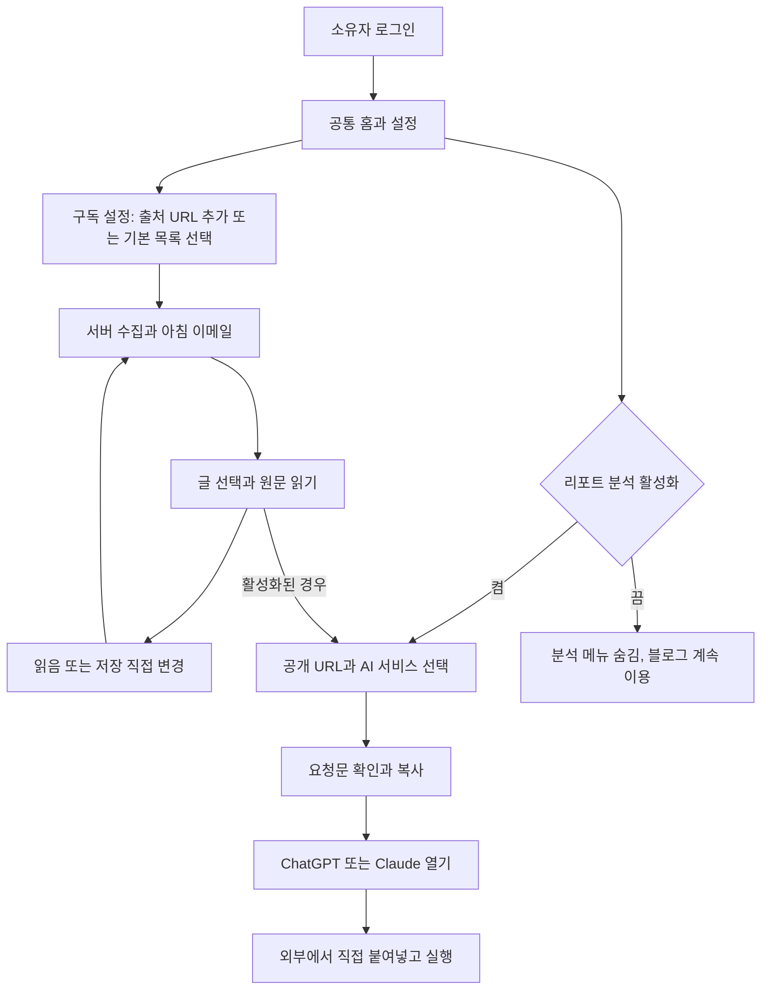
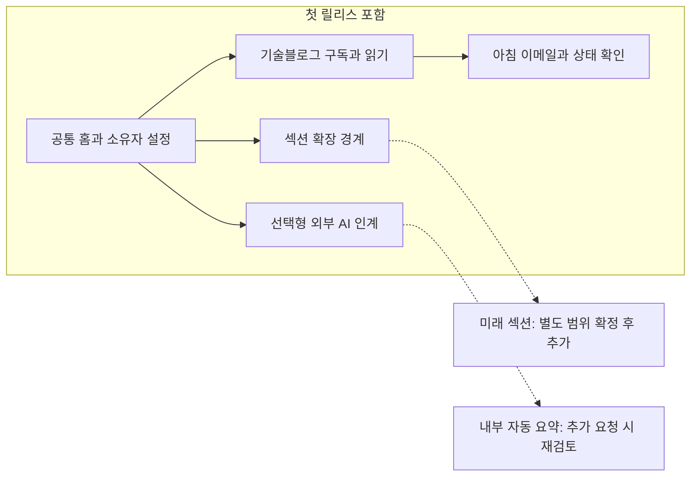
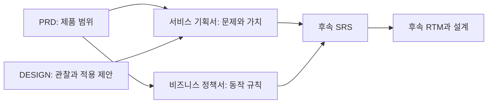

# 서비스 기획서 (Service Planning Document)

> LevelUp의 사용자 문제, 핵심 가치, 첫 릴리스 범위와 검증 방향을 정의한다. PRD의 범위·ID를 유지하며, 동작의 상세 규칙은 비즈니스 정책서에서 관리한다. 아직 승인되지 않은 검토용 초안이다.

| 항목 | 내용 |
|------|------|
| **프로젝트명** | LevelUp — 일상의 편의를 높이는 개인용 웹사이트 |
| **문서 ID** | SPD-LEVELUP-v0.3 |
| **문서 버전** | v0.3 |
| **작성일** | 2026-11-24 |
| **작성자** | Codex — 사용자 요청과 프로젝트 문서 기반 초안 작성 |
| **승인자** | 사이트 소유자 — 검토·승인 미실시 |
| **문서 상태** | 초안 / G0 기획 검토 전 |
| **근거 문서** | [PRD-LEVELUP-v0.3](../../PRD.md), [디자인 분석](../../DESIGN.md) |

## 변경 이력

| 버전 | 날짜 | 작성자 | 변경 내용 |
|------|------|--------|-----------|
| v0.1 | 2026-11-24 | Codex | 범용 템플릿을 LevelUp 기획으로 작성. 기술블로그·수동 AI 인계·섹션 확장 범위와 미결 사항 연결 |
| v0.2 | 2026-11-24 | Codex | 사용자 요청에 따라 구독 설정의 URL 직접 추가·삭제, 검증·중복·기존 기록 보존 정책과 AC-017~019 연결 |
| v0.3 | 2026-11-24 | Codex | 채용·행사 모집·기업 소식·홍보 등 전체 콘텐츠 포함, 유형별 자동 제외 제거·AC-020 연결 |

## 목차

1. [서비스 개요](#1-서비스-개요)
2. [핵심 메커니즘](#2-핵심-메커니즘)
3. [콘텐츠/기능 전략](#3-콘텐츠기능-전략)
4. [수익화 전략](#4-수익화-전략)
5. [MVP 스코프 정의](#5-mvp-스코프-정의)
6. [KPI 가설 검증 프레임워크](#6-kpi-가설-검증-프레임워크)
7. [다음 단계](#7-다음-단계)
8. [관련 문서](#8-관련-문서)

## 1. 서비스 개요

### 1.1 서비스명 및 컨셉

| 항목 | 내용 |
|------|------|
| 서비스명 | LevelUp |
| 기술블로그 브리핑명 | 모닝 테크 |
| 한 줄 설명 | 필요한 정보와 생활 도구를 기능별 섹션으로 모아 반복 작업을 줄이는 개인용 웹사이트 |
| 서비스 유형 | 본인만 사용하는 웹 대시보드 |
| 대상 플랫폼 | 데스크톱·모바일 웹 |

**서비스 컨셉 설명:** 소유자가 여러 기업의 기술블로그를 직접 순회하는 대신, 새 글을 모아 매일 아침 이메일로 확인하고 관심 글의 원문을 읽는다. 문서의 핵심을 파악하고 싶을 때는 선택 기능인 리포트 분석에서 URL과 요약 요청문을 준비해 ChatGPT 또는 Claude로 가져간다. 미래의 생활·업무 기능은 공통 홈과 메뉴 아래 별도 섹션으로 추가한다. 사이트 전체를 기술블로그 데이터와 화면에 종속시키지 않는다.

**배경 및 동기:** 사용자가 기술블로그 통합·다음 날 아침 알림, 선택형 AI 요약 연결, 추후 섹션 확장을 직접 요청했다. 확인된 근거는 본 프로젝트의 대화와 PRD이며, 시장 조사나 다수 사용자 인터뷰를 수행한 것으로 간주하지 않는다.

#### 사용자 문제와 근거

| 문제 ID | 사용자·상황·겪는 문제 | 현재 대안과 한계 | 관찰 근거 | 확인 상태·다음 검증 |
| --- | --- | --- | --- | --- |
| OBJ-001 | 본인이 아침에 기업별 블로그의 새 글을 확인해야 함 | 개별 북마크 방문으로 반복 탐색 발생 | PRD 1.1 및 사용자의 새 글 알림 요청 | 요구 확인. 탐색 빈도·시간은 시범 운영에서 측정 |
| OBJ-002 | 관심 문서마다 요약 요청문과 URL을 다시 준비함 | AI 서비스에 매번 직접 입력 | PRD 2.1의 외부 서비스 직접 실행 선택 | 방식 확인. 요청문 재사용의 편의는 검증 전 |
| OBJ-003 | 생활 개선 기능을 같은 사이트에 추가하고 싶음 | 블로그 전용 구조는 다른 기능과 결합되기 쉬움 | PRD 6장 및 사용자의 후속 섹션 추가 요청 | 방향 확인. 구체적인 다음 섹션은 미결 |

### 1.2 핵심 가치 제안 (Value Proposition)

| 항목 | 내용 |
|------|------|
| 핵심 가치 | 반복 탐색과 요청문 준비를 줄이고 읽기·판단에 시간을 쓰게 함 |
| 차별점 | 본인의 구독·아침 루틴에 맞춘 블로그 섹션과 다른 생활 기능을 담는 공통 구조 |
| 대안 대비 목표 | 개별 사이트 순회와 수동 프롬프트 작성보다 준비 부담을 줄임. 실제 절감 효과는 미측정 |

| 구분 | 내용 |
|------|------|
| 사용자의 할 일 (Jobs) | 관심 기업의 기술 글을 놓치지 않고, 읽을 글과 문서를 선택 |
| 사용자의 고통 (Pains) | 반복 방문, 읽을 글 분산, 동일한 요약 요청 작성 |
| 사용자의 이득 (Gains) | 아침 브리핑, 다시 찾는 저장 목록, 재사용 가능한 요청문 |
| 고통 해결제 (Pain Relievers) | 자동 수집·이메일·검색·저장·URL 기반 요청문 준비 |
| 이득 생성제 (Gain Creators) | 같은 계정과 공통 메뉴로 후속 섹션 이용 |

### 1.3 타겟 사용자 정의

#### 1.3.1 주요 사용자 페르소나

| 항목 | 내용 |
|------|------|
| 사용자 | 실제 사이트 소유자 본인 1명 |
| 연령·직업 | 미수집. 기능 정의에 필요하지 않음 |
| 핵심 목표 | 기술 정보 탐색을 줄이고 필요한 글을 꾸준히 읽기 |
| 사용 시나리오 | 아침 이메일에서 원문 열기, 웹에서 저장한 글 확인, 필요할 때 AI 요청문 준비 |
| 성공 경험 | 블로그를 순회하지 않고 관심 글을 발견하고, 문서 요약 요청을 쉽게 준비함 |

#### 1.3.2 사용자 세그먼트

| 세그먼트 | 설명 | 규모 | 우선순위 | MVP 포함 |
|----------|------|------|----------|----------|
| 소유자 | 사이트 설정·구독·읽기·분석 인계를 사용하는 본인 | 1명 | P1 | Y |

다른 사용자를 위한 회원가입·조직 역할·요금제를 만들지 않는다.

#### 1.3.3 비사용자 (Anti-Persona)

| 비사용자 | 이유 | 현재 대안 |
|----------|------|-----------|
| 일반 방문자·외부 회원 | 개인 데이터와 설정은 소유자 전용 | 원문 사이트 직접 이용 |
| 팀 공동 큐레이션 사용자 | 공동 편집·역할 분담이 범위 밖 | 기존 팀 도구 사용 |
| 사이트 내부 자동 요약을 원하는 사용자 | 첫 버전은 외부 AI 수동 실행 방식 | 선택한 AI 서비스에서 직접 실행 |

## 2. 핵심 메커니즘

### 2.1 서비스 작동 원리

**핵심 루프:** 구독 설정에서 기본 출처 선택 또는 URL 직접 추가 → 서버가 새 글 수집 → 오전 8시 이메일 → 제목 확인·원문 읽기 → 읽음·저장 상태 직접 관리 → 다음 브리핑 확인. 수집할 출처는 같은 화면에서 켜기·끄기·삭제한다.

**보조 루프:** 리포트 분석 활성화 → 공개 URL 입력 또는 글에서 이동 → AI 서비스 선택 → 요약 요청문 확인·수정·복사 → 외부 서비스 열기 → 사용자가 붙여 넣고 실행.

AI 연결은 요청문 인계까지다. 외부 결과를 받아 저장하거나 ‘요약 완료’를 자동 표시하지 않는다. 상세 조건은 정책서의 BP-AI 규칙을 따른다.

### 2.2 전체 서비스 플로우

### 2.3 핵심 사용자 여정 (Key User Journey)

#### 여정 1: 첫 설정과 아침 읽기

| 단계 | 사용자 행동 | 시스템 반응 | 감정 목표 | 확인 항목 |
|------|------------|------------|-----------|-----------|
| 설정 | 로그인 후 기본 출처 선택 또는 블로그/피드 URL 입력·추가, 수신 이메일 설정 | 연결·중복 확인, 초기 글 구분, 테스트 메일 제공 | 수집 대상 통제 | MVP-001·002·003·007 |
| 수집 | 별도 조작 없이 대기 | 기존 글을 과거 글로 구분하고 이후 새 글 수집 | 반복 작업 감소 | MVP-003 |
| 아침 | 이메일에서 제목 확인·원문 열기 | 기업별 목록과 직접 원문 링크 | 빠른 선택 | MVP-004·005 |
| 정리 | 읽음·나중에 읽기 직접 변경 | 개인 상태 유지 | 다시 찾기 쉬움 | MVP-006 |

#### 여정 2: 선택형 리포트 분석

| 단계 | 사용자 행동 | 시스템 반응 | 감정 목표 | 확인 항목 |
|------|------------|------------|-----------|-----------|
| 켜기 | 설정에서 분석 활성화 | 메뉴와 글별 진입 버튼 표시 | 통제감 | BP-AI-001 |
| 준비 | URL 입력·AI 서비스 선택 | 요약 요청문 표시 | 반복 작성 감소 | BP-AI-002·004·005 |
| 인계 | 요청문 복사 후 공식 서비스 열기 | 복사 성공 표시·새 탭 연결 | 다음 행동이 명확함 | BP-AI-006 |
| 실행 | 외부에서 직접 붙여넣고 실행 | 외부 결과를 사이트가 수신하지 않음 | 역할과 한계를 이해 | BP-AI-007 |

## 3. 콘텐츠/기능 전략

### 3.1 핵심 기능 방향

| 기능 영역 | 전략 방향 | 우선순위 | MVP 포함 | 비고 |
|-----------|-----------|----------|----------|------|
| 공통 홈·인증·설정 | 본인 전용 접근과 섹션별 진입 제공 | P1 | Y | MVP-001 |
| 기술블로그 | 구독·수집·읽기·아침 이메일에 집중 | P1/P2 | Y | MVP-002~007 |
| 리포트 분석 | 기본 비활성화, 필요할 때 켜는 수동 AI 인계 | P2 | Y | MVP-008 |
| 섹션 확장 경계 | 공통 기능과 개별 기능의 책임 분리 | P1 | Y | MVP-009 |
| 미래 생활 기능 | 문제와 범위를 정한 뒤 별도 기획 | 미정 | N | EX-008 |

**의사결정 기록:** 개인용과 이메일·매일 오전 8시·기술 동향 포함은 기존 확인 사항이다. AI 인계 방식, 공개 웹페이지·텍스트형 PDF 대상, 첫 버전 선택 기능 제공은 PRD 2.1에 반영된 사용자 답변이다. P2도 이번 릴리스에 포함한다.

### 3.2 섹션 확장 전략

공통 홈·상위 메뉴·인증·설정을 기반으로 기술블로그와 리포트 분석을 독립 모듈로 구분한다. 메뉴와 홈은 같은 섹션 등록 정보를 사용하고, 리포트 분석은 게시글 DB 없이 URL 직접 입력으로 사용할 수 있어야 한다. 후속 섹션은 자체 화면·데이터·작업을 소유하며 블로그 수집·발송 코드를 바꾸지 않고 연결한다. 게이미피케이션·범용 플러그인 플랫폼은 첫 릴리스에 추가하지 않는다.

### 3.3 콘텐츠 전략

| 항목 | 내용 |
|------|------|
| 기본 제공 출처 | NAVER D2, 카카오테크, 우아한형제들, 삼성SDS, SK플래닛 TECH TOPIC. 고정 수집 목록이 아니라 선택 가능한 기본 목록 |
| 사용자 추가 출처 | 구독 설정에서 공개 기술 블로그·글 목록·RSS/Atom URL 직접 입력·추가. 기본 목록 외 출처도 가능 |
| 출처 관리 | 연결 확인 → 필요 시 발견한 피드 선택 → 추가. 구독 켜기·끄기·삭제 제공. 기본 출처도 삭제 가능 |
| 포함 콘텐츠 | 구독한 출처의 모든 새 글. 기술 글·채용·행사 모집·일반 기업 소식·기술 설명 없는 홍보 포함 |
| 수집 범위 기준 | 선택한 공개 피드·목록의 글을 유형으로 제외하지 않음. 구독·날짜·초기 과거 글·중복 조건 유지 |
| 수집·갱신 | RSS·Atom 직접 등록·자동 탐색 우선, 피드가 없으면 기존 지원 수집기가 있는 공개 목록만 등록. 시간당 수집과 오전 7시 30분 최종 수집 |
| 목록 구성 | 제목·기업·게시일·원문 링크, 제공된 태그·소개. 본문 전체 재게시 제외 |
| 품질 관리 | 중복 판정·출처별 오류 표시. 카테고리는 수집 제외 조건으로 사용하지 않고 원하지 않는 글은 수동 목록 숨김 제공 |

구독·신규 판정·게시일·이메일의 동작은 정책서 BP-CONTENT·BP-RESET·BP-NOTI에서 정의한다.

URL을 입력하는 것만으로 수집하지 않고 ‘연결 확인’ 조작 이후에 조회한다. 연결 실패·미지원·중복을 안내하고 등록 완료와 구분한다. 출처 삭제는 이후 수집·미발송 알림을 중단하지만 기존 글·읽음·저장·발송 기록은 보존한다. 삭제한 출처를 자동 복원하거나 재추가 시 과거 글을 중복·소급 알림하지 않는다. 임의 HTML 사이트의 수집기를 자동 생성하는 기능은 첫 버전에 포함하지 않는다.

### 3.4 브랜드/톤앤매너

| 항목 | 내용 |
|------|------|
| 브랜드 톤 | 개인의 읽기·준비 작업을 돕는 차분하고 실용적인 표현 |
| 안내 문구 | 짧은 존댓말. 원문 열기·읽음·저장·분석 인계를 별도 동작으로 표시 |
| 시각적 기준 | DESIGN.md의 daily.dev 문서 탐색 구조와 앱 피드 관찰을 구분해 적용 |
| 주요 패턴 | 어두운 중립 표면, 보라색 주요 동작·선택, 파란색 본문 링크, 일관된 글자·간격 |
| 모바일·접근성 | 한 열 본문, 접히는 메뉴, 주요 클릭 영역 44 × 44px 이상, 키보드 포커스·입력 라벨 |
| 캐릭터·보상 | 해당 없음. 첫 버전 요구사항에 없음 |

DESIGN.md의 라이트 테마 관찰과 AI 요약 도구 상자는 각각 테마 전환 기능·자동 요약 기능을 추가하라는 요구가 아니다. 테마 구현 범위는 DEC-008에서 확인한다.

## 4. 수익화 전략

### 4.1 수익 모델 선택

| 항목 | 내용 |
|------|------|
| 주요·보조 수익 모델 | 해당 없음. 본인 전용 도구로 수익화가 목표가 아님 |
| 무료/유료 경계 | 해당 없음. 회원 등급·유료 기능·사이트 결제 없음 |
| 운영 비용 | 호스팅·DB·이메일 비용과 예산은 미결 DEC-001·002 |
| AI 비용 경계 | 사이트의 AI API 호출 없음. 외부 서비스 이용 조건은 본인 계정에서 확인 |

### 4.2 단계별 수익화 계획

첫 릴리스와 이후 개인용 섹션 추가에 수익화 일정을 두지 않는다. 외부 사용자 공개·유료화를 원하면 EX-006의 재검토 조건에 따라 별도 범위와 비용 정책을 먼저 합의한다.

### 4.3 과금 정책 요약

무료 체험·환불·구독 갱신·결제 수단은 모두 해당 없음이다. 여기서 블로그 ‘구독’은 글 출처 선택을 의미하며 유료 구독이 아니다. 운영비 처리 원칙은 BP-COST-001을 따른다.

## 5. MVP 스코프 정의

### 5.1 MVP 정의 기준

| 항목 | 내용 |
|------|------|
| MVP 목표 | 아침 읽기와 문서 요청문 준비의 반복 작업을 줄이면서 다른 섹션을 추가할 수 있는 기반 검증 |
| MVP 기간 | 개발 일정·공수 미결 DEC-005. 구현 후 7일 시범 운영은 PRD 기준 |
| 기능 완료 기준 | PRD AC-001~020 검증, 기본 5개 출처와 사용자 추가 URL 등록·삭제 흐름 확인. 아직 실행 결과 없음 |
| 사용 가치 기준 | 6장의 개인 사용 가설로 검토. 정량 목표는 DEC-005에서 시범 운영 전 합의 |
| 실패 시 대응 | 누락·중복·인계 실패를 수정하고 재검증. 필수 범위 변경은 소유자와 다시 합의 |

### 5.2 포함 항목 (In-Scope)

P1은 핵심, P2는 보조 중요도다. 아래 9개 모두 첫 릴리스 범위이며, 선택 기능도 구현을 생략하는 의미가 아니다. 예상 공수는 모두 미결 DEC-005다.

| ID | 기능/항목 | 설명 | 우선순위 | 예상 공수 | 비고 |
|----|-----------|------|----------|-----------|------|
| MVP-001 | 개인 계정·공통 홈·메뉴·설정 | 소유자 접근과 활성 섹션 진입 | P1 | 미결 | OBJ-003 / BP-AUTH-001·BP-SECTION-001 / AC-001 |
| MVP-002 | 구독 설정의 URL 추가·삭제 | 기본 목록 외 출처 등록·연결 확인·중복 방지, 구독 켜기·끄기·삭제 | P1 | 미결 | OBJ-001 / BP-CONTENT-004·007·008·009·010 / AC-003·017·018·019 |
| MVP-003 | 수집·과거 글·중복 방지 | 자동 수집과 신규 판정 | P1 | 미결 | OBJ-001 / BP-CONTENT-001·002·003 / AC-002·003·008·020 |
| MVP-004 | 목록·검색·필터·원문 | 오늘의 글·전체 글과 탐색 | P1 | 미결 | OBJ-001 / BP-CONTENT-005 / AC-004 |
| MVP-005 | 아침 이메일·발송 기록 | 한국 시간 오전 8시 브리핑 | P1 | 미결 | OBJ-001 / BP-NOTI-001·002·003·004 / AC-005·006·007 |
| MVP-006 | 읽음·저장 | 사용자가 직접 상태 변경, 출처 삭제 후 기존 상태 보존 | P2 | 미결 | OBJ-001 / BP-CONTENT-006·010 / AC-004·019 |
| MVP-007 | 수집 상태·테스트 메일 | 마지막 성공·오류·발송 결과 | P2 | 미결 | OBJ-001 / BP-ERROR-001·BP-NOTI-005 / AC-007·008 |
| MVP-008 | 선택형 리포트 분석 | 공개 URL 요청문 생성·복사·외부 AI 열기 | P2 | 미결 | OBJ-002 / BP-AI-001·002·003·004·005·006·007 / AC-009~013 |
| MVP-009 | 모듈·섹션 경계 | 화면·데이터·작업 분리와 등록 지점 | P1 | 미결 | OBJ-003 / BP-SECTION-001·002 / AC-014·015 |

AC 번호는 [PRD 9장](../../PRD.md#9-수용-기준과-검증-시나리오)을 참조하며 모바일 통합 흐름은 AC-016에서 확인한다. FR·TC는 후속 SRS·테스트 설계에서 실제 ID를 부여한다.

### 5.3 제외 항목 (Out-of-Scope) + 제외 근거

| ID | 제외 항목 | 제외 근거 | MVP 대안 | 재검토 조건 |
|----|-----------|-----------|----------|-------------|
| EX-001 | API 자동 호출·API 키·사이트 내부 요약 | 사용자가 외부 서비스 직접 실행 선택 | 요청문 복사·공식 서비스 열기 | 내부 자동 요약 추가 요청 |
| EX-002 | 외부 대화·요약 결과 자동 수신·이력 | 외부 결과는 사이트 관찰 범위 밖 | 외부 서비스에서 결과 확인 | 결과를 사이트에서 관리할 필요 확인 |
| EX-003 | 자체 PDF 다운로드·파싱·OCR·업로드 | URL 기반 수동 인계만 제공 | 외부에서 본문·PDF 직접 제공 | 인계만으로 해결되지 않는 문서가 반복 |
| EX-004 | 인증·유료 문서·비공개 파일 자동 접근 | 공개 문서가 지원 대상 | 본인이 접근 가능한 원문을 외부에서 직접 제공 | 인증·취급 범위 별도 합의 |
| EX-005 | 전체 글·이메일 AI 자동 요약 | 자동 처리 범위·비용을 선택하지 않음 | 필요한 문서만 사용자가 요청 | 자동화·비용·실패 정책 합의 |
| EX-006 | 공개 회원가입·다중 사용자·결제·커뮤니티·추천 | 본인 1명용 제품 | 소유자 접근·수동 기업 선택 | 제품 대상 변경 요청 |
| EX-007 | 카카오톡·텔레그램·웹 푸시 | 이메일 채널 선택 | 일일 이메일 | 추가 채널 요청 |
| EX-008 | 미정인 미래 생활 기능 | 확장 기반과 실제 신규 기능은 별개 | 구현한 섹션만 홈·메뉴에 표시 | 문제·범위·성공 기준을 새로 정의 |

### 5.4 MVP 기능 범위 다이어그램

### 5.5 기술적 MVP 결정사항

| 결정 항목 | MVP 선택·상태 | 근거 | 변경 조건 |
|-----------|---------------|------|-----------|
| 구조 | 하나의 앱 안에서 모듈별 책임 분리 | PRD 6장 | 별도 배포 필요가 입증될 때 |
| 정기 작업 | 브라우저와 독립된 서버 작업 | PRD 4.2 | 실행 방식은 시스템 설계에서 선택 |
| AI 인계 | 고정 요청문 템플릿·복사·공식 홈 열기 | 사용자 선택, PRD 5장 | EX-001 재검토 시 |
| 프레임워크·DB·로그인·호스팅 | 미결 DEC-001 | 기존 코드·설정 없음 | 후속 시스템 설계에서 확정 |
| 이메일 제공업체·발신 도메인 | 미결 DEC-002 | 운영 계정·예산 확인 필요 | 이메일 연동 전 |
| 시각 구현 | DESIGN.md를 참고하되 관찰과 제품 적용 구분 | PRD 7장 | DEC-008 검토 후 화면 설계 |

## 6. KPI 가설 검증 프레임워크

### 6.1 검증할 가설 목록

| ID | 가설 | 검증 방법 | 성공 기준 | 실패 시 대응 | 우선순위 |
|----|------|-----------|----------|-------------|----------|
| H-001 | 아침 브리핑으로 블로그를 직접 순회하는 부담이 줄어든다 | 시범 운영 전·후 본인 탐색 빈도와 부담 기록 | 정량 목표 미결 DEC-005 + 본인의 감소 평가 | 출처·알림 내용·읽기 진입 개선 |
| H-002 | 준비된 요청문으로 문서 요약 요청의 준비 부담이 줄어든다 | 직접 작성과 복사·이동 흐름의 수동 비교 | 정량 목표 미결 DEC-005 + 인계 편의 평가 | 요청문·복사 안내 개선 |
| H-003 | 독립 모듈 구조로 다른 섹션을 붙일 수 있다 | AC-015의 테스트용 임시 섹션 등록 | 블로그 수집·발송 수정 없이 등록 가능 | 모듈 경계 수정 후 재검증 |

H-003은 확장성 요구의 검증이며 사용자 KPI를 대신하지 않는다. 현재 가설은 검증 전이다.

### 6.2 핵심 지표 (Key Metrics)

| KPI ID·가설 | 지표·산식과 분모 | 기준값·목표값 | 대상·기간·최소 표본 | 출처·담당자·판정 |
|---|---|---|---|---|
| KPI-001 / H-001 / North Star | 직접 블로그 순회 횟수 합 ÷ 관찰한 일수 | 기준 미측정, 목표 DEC-005 | 소유자 1명, 출시 후 7일 기록. 사전 비교 기간도 DEC-005에서 확정 | 본인 수동 기록 / 소유자 / 시범 운영 종료 후 |
| KPI-002 / H-002 | URL·요청문 준비와 서비스 진입에 걸린 시간 합 ÷ 비교 시도 수 | 기준 미측정, 목표·최소 표본 DEC-005 | 실제 사용 시 수동 비교. 정식 관찰 전 표본 기준 결정 | 본인 수동 기록 / 소유자 / 정한 관찰 종료 후 |

개인용이므로 MAU·매출·유료 전환 목표는 해당 없다. 수집 누락·중복 발송·외부 인계 동작은 출시 수용 기준으로 검증하며, 외부 AI의 요약 성공률을 사이트 KPI로 집계하지 않는다.

### 6.3 가설 검증 매트릭스

| 가설 | 결과 시나리오 | 판단 | 다음 액션 |
|------|---------------|------|-----------|
| H-001·002 | 사전 합의한 목표와 본인 편의 평가 충족 | 사용 가치 지지 | 현재 흐름 유지, 후속 필요 검토 |
| H-001·002 | 목표 미달이지만 개선할 원인 확인 | 개선 후 재관찰 | 수정 범위·재관찰 기간을 소유자와 정함 |
| H-001·002 | 측정 목표·기준값·표본이 없거나 기록 오류 | 판단 보류 | DEC-005 해소 또는 수집 보완 후 평가 |
| H-003 | AC-015 충족 / 미충족 | 확장 경계 충족 / 재설계 필요 | 테스트용 섹션 제거 / 결합 지점 수정 |

### 6.4 데이터 수집 계획

| 데이터 | 수집 시점 | 도구·방식 | 용도 | MVP 필수 |
|--------|-----------|-----------|------|----------|
| 출처별 수집 결과·마지막 성공 시각 | 수집 작업 실행 시 | 앱 내부 작업 기록, 구체 도구 미결 | AC-002·008, 장애 확인 | Y |
| 브리핑 대상·발송 결과 | 정기·테스트 발송 시 | 앱과 이메일 제공업체 기록 | AC-005~007, 중복 확인 | Y |
| 읽음·저장 상태 | 소유자가 직접 변경 시 | 개인 상태 저장 | AC-004 | Y |
| 순회 빈도·요청문 준비 부담 | 비교·시범 운영 시 | 소유자의 수동 관찰 기록 | KPI-001·002 | 검증 시 필요 |

별도 광고 분석 도구, 추적 픽셀, URL·요청문 분석 이력, 외부 대화 수집은 추가하지 않는다. 수동 관찰 기록 위치와 운영 기록 보존 기간은 DEC-007에서 확정한다.

## 7. 다음 단계

### 7.1 기획 완료 체크리스트

아래는 소유자의 G0 검토 항목이며 작성만으로 완료·승인 처리하지 않는다.

- [ ] 사용자 문제 OBJ-001~003과 근거를 검토한다.
- [ ] MVP-001~009와 EX-001~008의 첫 릴리스 범위를 합의한다.
- [ ] 선택형 AI 인계와 내부 자동 요약의 차이를 확인한다.
- [ ] 정책서의 날짜·구독·발송·AI·섹션 규칙 및 미결 항목을 확인한다.
- [ ] KPI 기준값 수집 계획·목표·표본·판정 시점을 합의한다.
- [ ] DEC-001~008의 담당과 결정 시점을 확인한다.
- [ ] 승인된 문서 버전·승인자·날짜·근거를 G0 검토 기록에 남긴다.

### 7.2 v2+ 로드맵

| 버전·단계 | 진입 조건 | 주요 내용 | 목표 |
|-----------|-----------|-----------|------|
| 첫 릴리스 | 기획·요구사항·설계 검토와 AC 검증 후 출시 판단 | 5.2의 전체 범위 | 핵심 읽기·인계 흐름 확인 |
| 안정화 | 7일 시범 운영의 결함·사용 부담 확인 | 누락·중복·UX 개선 | 일상 사용 안정화 |
| 후속 섹션 | 소유자가 새로운 문제·범위·성공 기준 정의 | 독립 모듈 추가, 구체 기능 미정 | 생활 기능 확대 |
| AI 내부 자동화 | EX-001~005 중 필요한 범위를 다시 합의 | API·결과 보관·비용 정책 별도 기획 | 확인된 수동 인계 한계 해결 |

확정되지 않은 출시일·고정 개발 기간을 간트 차트로 만들지 않는다. 개발 순서는 공통 기반 → 블로그 → 이메일 → 리포트 분석 → 통합 검증이다.

### 7.3 가정·의존성·미결 결정

| ID | 확인할 내용·근거 | 범위·일정 영향 | 담당자·결정 기한 | 상태·결정 기록 |
| --- | --- | --- | --- | --- |
| DEC-001 | 프레임워크·DB·호스팅·소유자 로그인 / PRD OPEN-001 | MVP-001·009, 개발 기반 | 구현 담당 제안·소유자 검토 / 시스템 설계 확정 전 | 미결 |
| DEC-002 | 이메일 제공업체·발신 도메인·운영 예산 / OPEN-002 | MVP-005·007, 실제 발송 | 소유자·구현 담당 / 이메일 연동 전 | 미결 |
| DEC-003 | 기본·사용자 출처의 피드 탐색·지원 수집기·제공 메타데이터·게시일 시간대·연결 검증 한도 / OPEN-003 | MVP-002~005, 등록·신규 판정 | 구현 담당 / 구독 설정·각 수집기 설계 전 | 미결. URL 직접 등록·삭제의 제품 범위는 확정 요구 |
| DEC-004 | 다음 생활 섹션의 사용자 문제와 기능 / OPEN-004 | EX-008, 후속 범위 | 소유자 / 후속 PRD 작성 전 | 미결. 첫 릴리스 비차단 |
| DEC-005 | 개발 일정·공수, KPI 기준 관찰 기간·목표·최소 표본 / OPEN-005 | MVP 전체 일정과 H-001·002 판정 | 소유자·구현 담당 / 일정은 구현 계획 전, 지표는 시범 운영 전 | 미결. 날짜 미정 |
| DEC-006 | 브리핑 대상 확정 시점·발송 경계 동시 변경·숨김 글의 이메일 포함 여부 | MVP-003~005, 중복·누락·표시 | 소유자·구현 담당 / SRS 승인 전 | PRD에 세부 조건 없음. 본 정책서에서도 미결 유지 |
| DEC-007 | 데이터·작업 기록 보존 기간, 수동 관찰 기록 위치 | 개인 상태·운영 기록, 정책 BP-ERROR-004 | 소유자·구현 담당 / 데이터 설계·시범 운영 전 | 미결. 일일 자동 삭제 가정 없음 |
| DEC-008 | 초기 테마·라이트 전환·한국어 폰트 적용 범위 | 화면 설계와 DESIGN.md 적용 | 소유자·화면 구현 담당 / UI 설계 확정 전 | 미결. 원본 관찰을 추가 기능으로 자동 해석하지 않음 |

각 기한은 단계 기준이다. 실제 달력 날짜는 DEC-005의 일정 합의 후 기록한다. 미결은 승인된 기본값이 아니며 해당 동작을 구현하기 전에 해결한다. G0 승인 근거는 [기획 검토](../08-검토/단계별검토-체크리스트.md#phase-0-기획-검토)에 기록하며, 본 작업에서 다른 단계의 승인 기록을 생성하지 않는다.

## 8. 관련 문서

### 8.1 문서 간 관계

### 8.2 SRS와의 역할 분담

| 항목 | 본 서비스 기획서 | 후속 SRS |
|------|------------------|----------|
| 목표·범위 | 왜 만드는지, 포함·제외와 근거 | 각 MVP를 기능·비기능 요구사항으로 구체화 |
| 사용자 | 실제 소유자와 사용 여정 | 인증 조건·입출력·수용 기준 |
| 정책 | 구체 BP 규칙 ID 참조 | FR별 적용 규칙과 예외 연결 |
| 검증 | 개인 가치 가설·판정 계획 | PRD AC를 테스트 가능한 요구와 TC로 연결 |

### 8.3 참조 문서 목록

| 문서 | 위치 | 관계·상태 |
|------|------|-----------|
| PRD | [PRD.md](../../PRD.md) | 제품 범위·MVP·EX·AC의 근거 초안 |
| 디자인 분석 | [DESIGN.md](../../DESIGN.md) | 시각 관찰·측정·적용 제안 |
| 비즈니스 정책서 | [비즈니스정책서.md](비즈니스정책서.md) | 함께 갱신한 BPD-LEVELUP-v0.3, 미승인 |
| 작성 가이드 | [AGENTS.md](../AGENTS.md) | 단계별 작성·근거·미결·승인 기록 기준 |
| SRS | [요구사항명세서-SRS.md](../01-요구사항분석/요구사항명세서-SRS.md) | 현재 범용 템플릿, 후속 작성 대상 |
| 유스케이스 | [유스케이스명세서.md](../01-요구사항분석/유스케이스명세서.md) | 현재 범용 템플릿 |
| RTM | [요구사항추적매트릭스-RTM.md](../01-요구사항분석/요구사항추적매트릭스-RTM.md) | 현재 범용 템플릿 |

## 부록

### A. 경쟁 분석

해당 없음. 본인용 문제 해결이 목적이며 이번 작업에서 경쟁사 시장·가격 조사를 수행하지 않았다. DESIGN.md의 레퍼런스는 디자인 근거로만 사용한다.

### B. 용어 정의

| 용어 | 정의 |
|------|------|
| LevelUp | 여러 생활·업무 섹션을 담는 개인용 웹사이트 전체 |
| 모닝 테크 | 기술블로그 섹션의 아침 이메일 브리핑 이름 |
| 구독 | 특정 블로그 출처의 새 글 수신 선택. 유료 계약이 아님 |
| 리포트 분석 | 공개 URL의 요약 요청문을 준비해 외부 AI에 수동 인계하는 선택 기능 |
| 선택 기능 | 첫 릴리스에 구현하되 사용자가 활성화 여부를 정하는 기능 |
| 브리핑 | 날짜별 알림 대상 글 묶음. 이메일과 전체 글 보기의 기준 |
| 미결 | 담당자와 결정 시점이 지정되었지만 아직 확정되지 않은 항목 |

### C. 승인

| 역할 | 이름·담당 | 서명·판정 | 날짜 |
|------|-----------|-----------|------|
| 기획·제품 책임 | 사이트 소유자 | 미승인 / G0 검토 전 | 미실시 |
| 기술 검토 | 구현 담당자 — 지정 미결 | 미검토 | 미실시 |

본 문서 작성과 문서 정합성 점검은 제품 승인·구현 완료·테스트 통과를 의미하지 않는다.
