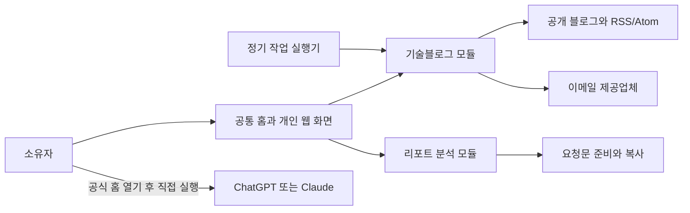

# 소프트웨어 요구사항 명세서 (SRS)

> LevelUp의 관찰 가능한 동작과 검증 조건을 정의한다. 상위 기획은 미승인 초안이며, 사용자 요청에 따라 요구사항 초안을 작성한다. 문서 작성은 G0·G1 승인이나 구현·테스트 완료를 뜻하지 않는다.

## 문서 정보

| 항목 | 내용 |
| --- | --- |
| 프로젝트명 | LevelUp |
| 문서 번호 | SRS-LEVELUP-v0.2 |
| 버전 | v0.2 |
| 작성일 | 2026-11-24 |
| 작성자 | Codex — 사용자 요청과 프로젝트 자료 기반 초안 |
| 상태 | 초안 / G0·G1 승인 기록 없음 |
| 대상 릴리스 | 첫 릴리스 — P1·P2 모두 포함 |
| 근거 | PRD-LEVELUP-v0.3, SPD-LEVELUP-v0.3, BPD-LEVELUP-v0.3, DESIGN.md |

## 변경 이력

| 버전 | 날짜 | 변경 내용 | 작성자 | 승인자 |
| --- | --- | --- | --- | --- |
| v0.1 | 2026-11-24 | LevelUp 요구사항·정상/대안/예외·추적 연결 초안 작성 | Codex | 미승인 |
| v0.2 | 2026-11-24 | 전체 콘텐츠 포함, FR-008·013·AC-020·UC·추적 링크 갱신 | Codex | 미승인 |

## 목차

1. [문서 개요](#1-문서-개요)
2. [전체 시스템 설명](#2-전체-시스템-설명)
3. [기능 요구사항](#3-기능-요구사항)
4. [비기능 요구사항](#4-비기능-요구사항)
5. [외부 인터페이스 요구사항](#5-외부-인터페이스-요구사항)
6. [데이터 요구사항](#6-데이터-요구사항)
7. [제약 조건](#7-제약-조건)
8. [승인 내역](#8-승인-내역)

## 1. 문서 개요

### 1.1 목적

개인용 웹사이트 LevelUp의 기술블로그·아침 이메일·선택형 외부 AI 인계를 구현·검증할 기준을 정의한다. 사용자 요구와 정책을 기능/비기능 ID, UC, 수용 기준으로 분해하며 상세 설계·코드·TC 참조는 후속 단계에서 채운다.

### 1.2 범위

포함 범위는 PRD의 MVP-001~009 전체다. P2인 저장·테스트 메일·리포트 분석도 첫 릴리스에서 임의로 제외하지 않는다. 구독 설정의 공개 URL 직접 추가·삭제는 기본 출처 선택과 같은 P1 범위다.

제외 범위는 PRD EX-001~008을 유지한다: 내부 AI API/요약, 결과 이력, 자체 PDF/OCR/파일 업로드, 비공개 문서 자동 접근, 일괄 AI 요약, 공개 회원/결제/커뮤니티/추천, 추가 알림 채널, 미정 생활 기능. 임의 HTML의 수집기를 자동 생성하지 않으며 기존 수집기·피드가 없는 주소는 미지원으로 안내한다.

### 1.3 용어 정의

| 용어 | 정의 |
| --- | --- |
| 소유자 | 본인 1명. 공개 회원·관리자 계층 없음 |
| 구독 | 출처의 새 글 수신 선택. 유료 계약과 무관 |
| 브리핑 | 날짜별 대상 글 묶음. 이메일 표시 상한과 전체 건수는 다름 |
| 출처 삭제 | 이후 수집·미발송 중단, 기존 글·읽음·저장·발송 기록 보존 |
| 수동 AI 인계 | 요청문 복사와 공식 홈 열기 후 사용자가 외부에서 실행 |
| SC-FR / SC-NFR | 이 SRS의 자체 수용 기준 ID. PRD AC와 연결하며 실행 TC가 아님 |
| DEC | 서비스 기획서 7.3의 미결 결정. 이 문서에서 임의 확정하지 않음 |

### 1.4 참고 문서

| 문서 | 위치 | 기준·상태 |
| --- | --- | --- |
| PRD | [PRD.md](../../PRD.md) | v0.2 초안 / 제품 범위·AC-001~020 |
| 서비스 기획서 | [서비스기획서.md](../00-기획/서비스기획서.md) | v0.2 초안 / OBJ·MVP·EX·DEC |
| 비즈니스 정책서 | [비즈니스정책서.md](../00-기획/비즈니스정책서.md) | v0.2 초안 / 구체 BP 규칙 36개 |
| 디자인 분석 | [DESIGN.md](../../DESIGN.md) | 관찰·측정·적용 제안 구분 |
| 작성 가이드 | [AGENTS.md](../AGENTS.md) | 출처·미결·단계 승인 기준 |

함께 작성한 [유스케이스 명세서](유스케이스명세서.md)와 [RTM](요구사항추적매트릭스-RTM.md)은 v0.2 초안이다. 후속 화면·DB·API·테스트 문서는 아직 범용 템플릿이다.

### 1.5 우선순위 정의

P1은 핵심, P2는 보조 중요도이며 현재의 두 등급 모두 첫 릴리스 포함이다. P3를 일정에 따라 임의 도입하지 않는다. 제외 범위는 EX로 관리하고 포함 요구사항의 분모에 넣지 않는다. 모든 요구사항은 초안이며 미결 영향이 있으면 관련 DEC를 함께 검토한다.

## 2. 전체 시스템 설명

### 2.1 시스템 관점도

AI 서비스에서 사이트로 결과를 되돌리는 연계는 없다. 작업 실행기는 시스템 내부 자동 트리거이며 별도 사용자 권한을 뜻하지 않는다.

### 2.2 사용자 유형 및 특성

주요 액터는 ACT-01 소유자다. 보조 액터는 ACT-S01 정기 실행 트리거, ACT-S02 공개 출처, ACT-S03 이메일 제공업체, ACT-S04 외부 AI 서비스다. 보조 시스템은 사이트의 로그인 사용자 역할이 아니다. ACT-S04의 로그인·결과는 사이트 관찰 범위 밖이다.

### 2.3 운영 환경

- 서버는 브라우저 종료와 독립된 수집·발송 작업 및 개인 상태 저장을 제공해야 한다.
- 프레임워크·DB·호스팅·인증은 DEC-001, 이메일 제공업체는 DEC-002에서 정한다. 캐시·큐·별도 서비스·특정 SDK를 필수로 지정하지 않는다.
- 데스크톱·모바일 웹을 대상으로 한다. 네이티브 앱·오프라인 편집은 범위 밖이다. 정확한 브라우저/기기 조합은 ISSUE-001 미결이다.

### 2.4 제약사항

한국 시간, 개인용 접근, 직접 URL 관리, 외부 AI 수동 인계, 첫 릴리스 전체 범위와 상위 미결 결정을 유지한다. 실제 외부 사이트 수집·AI 읽기 성공을 무조건 보장하지 않는다. G0 승인 이력이 없으므로 G1 확정 기준선으로 표시하지 않는다.

### 2.5 가정 및 전제 조건

소유자가 수신 이메일과 외부 AI 계정을 스스로 이용한다. 출처는 공개 피드/목록 또는 지원 수집기가 있어야 한다. 외부 변경·제공업체 제한은 실제 연동 단계에서 확인하며 예시 가용성 수치나 비용을 확정값으로 사용하지 않는다.

## 3. 기능 요구사항

### 3.1 기능 요구사항 요약 목록

| FR-ID | 기능명 | 우선순위 | 관련 UC | 상태 |
| --- | --- | --- | --- | --- |
| FR-001 | 소유자 인증과 개인 영역 접근 제어 | P1 | UC-001 | 초안 |
| FR-002 | 공통 홈·메뉴와 활성 섹션 진입 | P1 | UC-002, UC-012 | 초안 |
| FR-003 | 구독 URL 연결 확인과 피드 선택 | P1 | UC-003 | 초안 |
| FR-004 | 출처 추가·중복 방지와 초기 기준 설정 | P1 | UC-003 | 초안 |
| FR-005 | 출처 구독 켜기·끄기와 재개 | P1 | UC-004 | 초안 |
| FR-006 | 출처 삭제와 진행 중 작업 차단 | P1 | UC-005 | 초안 |
| FR-007 | 서버 정기 수집과 출처별 상태 갱신 | P1 | UC-006 | 초안 |
| FR-008 | 전체 콘텐츠 수집·게시글 중복과 수정 처리 | P1 | UC-006 | 초안 |
| FR-009 | 게시일·발견일 기반 브리핑 후보 판정 | P1 | UC-007 | 초안 |
| FR-010 | 오늘의 글·전체 글·브리핑 전체 목록 | P1 | UC-008 | 초안 |
| FR-011 | 제목 검색·출처·읽음 필터 | P1 | UC-008 | 초안 |
| FR-012 | 읽음·저장 상태 직접 변경 | P2 | UC-009 | 초안 |
| FR-013 | 목록에서 글 숨김 | P1 | UC-009 | 초안 |
| FR-014 | 수신 이메일과 알림 중지·재개 | P1 | UC-010 | 초안 |
| FR-015 | 매일 아침 브리핑 구성과 이메일 발송 | P1 | UC-007 | 초안 |
| FR-016 | 발송 중복 방지·실패·성공 불명확 처리 | P1 | UC-007, UC-011 | 초안 |
| FR-017 | 테스트 이메일 발송 | P2 | UC-010 | 초안 |
| FR-018 | 출처 수집과 이메일 상태 조회 | P2 | UC-011 | 초안 |
| FR-019 | 선택형 리포트 분석 활성화 | P2 | UC-012 | 초안 |
| FR-020 | 공개 문서 URL과 요약 요청문 준비 | P2 | UC-013 | 초안 |
| FR-021 | 현재 요청문 복사와 공식 AI 서비스 열기 | P2 | UC-013 | 초안 |
| FR-022 | 외부 AI 실행 안내와 결과 경계 | P2 | UC-013 | 초안 |
| FR-023 | 원문 직접 열기 | P1 | UC-008 | 초안 |

### 3.2 FR-001: 소유자 인증과 개인 영역 접근 제어

| 항목 | 내용 |
| --- | --- |
| ID | FR-001 |
| 출처 | MVP-001 / BP-AUTH-001 |
| 우선순위·상태 | P1 / 초안 |
| 관련 UC | UC-001 |
| 상위 수용 기준 | AC-001 |
| 입력 | 접근 요청과 소유자 인증 상태 |
| 처리 로직 | 개인 화면·설정·데이터 요청마다 소유자 권한을 확인한다. 공개 회원가입·다른 사용자 역할은 만들지 않는다. 인증 방식은 DEC-001에서 결정한다 |
| 출력 | 허용된 개인 화면 또는 접근 거절·인증 안내 |
| 수용 기준 ID | SC-FR-001 |
| 수용 기준 | 인증된 소유자는 개인 영역에 접근하고 미인증·비소유자 요청은 개인 데이터와 변경 권한을 받지 못한다 |
| 미결·제약 | DEC-001 |

### 3.3 FR-002: 공통 홈·메뉴와 활성 섹션 진입

| 항목 | 내용 |
| --- | --- |
| ID | FR-002 |
| 출처 | MVP-001, MVP-009 / BP-SECTION-001, BP-AI-001 |
| 우선순위·상태 | P1 / 초안 |
| 관련 UC | UC-002, UC-012 |
| 상위 수용 기준 | AC-009, AC-014, AC-015 |
| 입력 | 등록된 섹션과 활성화 설정 |
| 처리 로직 | 공통 홈·상위 메뉴가 동일한 등록 정보로 활성 섹션을 표시한다. 블로그 하위 메뉴를 해당 섹션에 둔다. 미정 섹션의 빈 메뉴는 생성하지 않는다 |
| 출력 | 공통 홈과 섹션별 진입 링크 |
| 수용 기준 ID | SC-FR-002 |
| 수용 기준 | 리포트 분석을 끄면 메뉴·글별 진입 버튼이 숨겨지고 직접 접근은 설정 안내가 되며 기술블로그는 계속 이용 가능하다 |
| 미결·제약 | 없음 |

### 3.4 FR-003: 구독 URL 연결 확인과 피드 선택

| 항목 | 내용 |
| --- | --- |
| ID | FR-003 |
| 출처 | MVP-002 / BP-CONTENT-007, BP-CONTENT-008 |
| 우선순위·상태 | P1 / 초안 |
| 관련 UC | UC-003 |
| 상위 수용 기준 | AC-017, AC-018 |
| 입력 | 공개 블로그·글 목록·RSS/Atom URL, 연결 확인 조작 |
| 처리 로직 | 입력만으로 조회하지 않는다. 연결 확인 후 공개 주소를 검증하고 피드를 탐색한다. 여러 피드면 선택하게 하며 피드 없는 출처는 지원 수집기가 있을 때만 허용한다 |
| 출력 | 출처명·입력/수집 URL·피드 선택지 또는 실패/미지원 안내 |
| 수용 기준 ID | SC-FR-003 |
| 수용 기준 | 직접 피드와 피드 탐색 가능한 블로그를 확인할 수 있고 다중 피드 선택이 가능하다. 잘못된·내부·미지원 주소를 성공으로 표시하지 않는다 |
| 미결·제약 | DEC-003 |

### 3.5 FR-004: 출처 추가·중복 방지와 초기 기준 설정

| 항목 | 내용 |
| --- | --- |
| ID | FR-004 |
| 출처 | MVP-002, MVP-003 / BP-CONTENT-003, BP-CONTENT-007, BP-CONTENT-009 |
| 우선순위·상태 | P1 / 초안 |
| 관련 UC | UC-003 |
| 상위 수용 기준 | AC-003, AC-017, AC-018, AC-019 |
| 입력 | 확인·선택된 출처와 추가 조작 |
| 처리 로직 | 저장 시에도 검증·중복 조건을 확인하고 실제 수집 URL의 동일 출처는 재생성하지 않는다. 기본 목록 외 출처도 등록한다. 초기 처리 전 수집 대기 상태를 표시하고 초기 발견 글은 과거 글로 구분한다. 삭제 후 재추가도 기존 글을 재사용한다 |
| 출력 | 등록 출처·구독 상태·초기 대기/준비 상태 또는 기존 항목 안내 |
| 수용 기준 ID | SC-FR-004 |
| 수용 기준 | 동일 피드로 연결되는 블로그/피드 주소를 재등록해도 출처가 하나다. 같은 도메인의 다른 피드는 구분한다. 초기·재추가 과거 글 중복과 소급 알림이 없다 |
| 미결·제약 | DEC-003 |

### 3.6 FR-005: 출처 구독 켜기·끄기와 재개

| 항목 | 내용 |
| --- | --- |
| ID | FR-005 |
| 출처 | MVP-002 / BP-CONTENT-004, BP-CONTENT-010 |
| 우선순위·상태 | P1 / 초안 |
| 관련 UC | UC-004 |
| 상위 수용 기준 | AC-003, AC-019 |
| 입력 | 출처와 희망 구독 상태 |
| 처리 로직 | 항목을 목록에 유지하며 구독 상태를 변경한다. 해제 기간 글은 재구독 시 소급 알림하지 않는다. 이미 대기 중이던 글·발송 경계의 상태 변경은 DEC-006을 따른다 |
| 출력 | 변경된 구독 상태 |
| 수용 기준 ID | SC-FR-005 |
| 수용 기준 | 꺼진 출처는 새 알림에서 제외되고 항목은 목록에 남는다. 재개 시 해제 기간 글을 소급 발송하지 않는다 |
| 미결·제약 | DEC-006 |

### 3.7 FR-006: 출처 삭제와 진행 중 작업 차단

| 항목 | 내용 |
| --- | --- |
| ID | FR-006 |
| 출처 | MVP-002, MVP-005, MVP-006 / BP-CONTENT-010 |
| 우선순위·상태 | P1 / 초안 |
| 관련 UC | UC-005 |
| 상위 수용 기준 | AC-019 |
| 입력 | 기본 또는 사용자 추가 출처의 삭제 조작 |
| 처리 로직 | 활성 구독 목록에서 제거하고 이후 수집·미발송 알림을 중단한다. 진행 중 수집은 반영 직전 삭제 상태를 확인하고 미전송 브리핑은 전송 직전 제외한다. 기존 글·개인 상태·발송 기록을 보존하고 자동 복원하지 않는다 |
| 출력 | 출처 삭제 결과와 보존된 기존 기록 |
| 수용 기준 ID | SC-FR-006 |
| 수용 기준 | 삭제 후 새 결과 반영·미발송 전송이 없고 저장·읽음·과거 브리핑은 유지된다. 제공업체가 이미 접수한 메일은 취소했다고 표시하지 않는다 |
| 미결·제약 | 없음 |

### 3.8 FR-007: 서버 정기 수집과 출처별 상태 갱신

| 항목 | 내용 |
| --- | --- |
| ID | FR-007 |
| 출처 | MVP-003, MVP-007 / BP-CONTENT-002, BP-ERROR-001 |
| 우선순위·상태 | P1 / 초안 |
| 관련 UC | UC-006 |
| 상위 수용 기준 | AC-008, AC-017 |
| 입력 | 등록 출처·수집 설정·정기 실행 시각 |
| 처리 로직 | 브라우저와 독립적으로 매시간 수집하고 07:30 Asia/Seoul 최종 수집을 실행한다. 출처별 결과·마지막 성공을 갱신하고 실패는 다음 수집에서 다시 시도한다 |
| 출력 | 새 글 후보·출처별 성공/실패 결과 |
| 수용 기준 ID | SC-FR-007 |
| 수용 기준 | 브라우저가 닫혀 있어도 작업이 실행되고 한 출처 오류가 다른 출처 수집을 중단하지 않는다 |
| 미결·제약 | DEC-003 |

### 3.9 FR-008: 전체 콘텐츠 수집·게시글 중복과 수정 처리

| 항목 | 내용 |
| --- | --- |
| ID | FR-008 |
| 출처 | MVP-003 / BP-CONTENT-001, BP-CONTENT-002, BP-CONTENT-003, BP-STAT-001 |
| 우선순위·상태 | P1 / 초안 |
| 관련 UC | UC-006 |
| 상위 수용 기준 | AC-002, AC-003, AC-020 |
| 입력 | 출처에서 읽은 모든 글의 ID/URL·제공된 메타데이터 |
| 처리 로직 | 구독 출처의 모든 글을 유형과 관계없이 수집한다. 기술 글·채용·행사 모집·일반 기업 소식·기술 설명 없는 홍보를 자동 제외하지 않는다. 출처 게시물 ID/원문 URL로 중복을 판정하고 기존 글 수정으로 새 알림을 만들지 않는다 |
| 출력 | 전체 유형의 중복 제거 글·메타데이터·과거/신규 판정 |
| 수용 기준 ID | SC-FR-008 |
| 수용 기준 | 같은 신규·구독·날짜 조건의 기술 글·채용·행사 모집·기업 소식·비기술 홍보가 모두 수집·목록·브리핑 후보에 포함된다. 반복 수집·수정으로 글 수·알림이 늘지 않고 초기 과거 글은 알림에서 제외된다 |
| 미결·제약 | DEC-003 |

### 3.10 FR-009: 게시일·발견일 기반 브리핑 후보 판정

| 항목 | 내용 |
| --- | --- |
| ID | FR-009 |
| 출처 | MVP-005 / BP-RESET-001, BP-RESET-002, BP-CONTENT-003, BP-CONTENT-004 |
| 우선순위·상태 | P1 / 초안 |
| 관련 UC | UC-007 |
| 상위 수용 기준 | AC-003, AC-005 |
| 입력 | 게시일·최초 발견일·구독·과거/신규·발송 상태 |
| 처리 로직 | 한국 날짜 기준 전날까지 게시된 미발송 글을 후보로 삼는다. 당일 게시 글은 다음 날, 게시일 누락 글은 발견일 다음 날부터 대상이다. 늦게 발견한 과거 날짜 신규 글은 이후 첫 아침 알림에 넣는다. 초기 과거 글·구독 제외 조건이 우선한다 |
| 출력 | 날짜별 후보와 제외 사유 |
| 수용 기준 ID | SC-FR-009 |
| 수용 기준 | 월요일 신규 글은 화요일 후보, 화요일 00:00 게시 글은 수요일 후보가 된다. 게시일 누락·늦은 발견·초기 과거 글을 구분한다 |
| 미결·제약 | DEC-003·DEC-006 |

### 3.11 FR-010: 오늘의 글·전체 글·브리핑 전체 목록

| 항목 | 내용 |
| --- | --- |
| ID | FR-010 |
| 출처 | MVP-004 / BP-CONTENT-005, BP-STAT-001 |
| 우선순위·상태 | P1 / 초안 |
| 관련 UC | UC-008 |
| 상위 수용 기준 | AC-004, AC-006 |
| 입력 | 목록 종류·브리핑 날짜 |
| 처리 로직 | 오늘의 글은 날짜별 브리핑 전체를, 전체 글은 수집 글을 최신순으로 표시한다. 제목·출처·게시일·원문 링크와 제공된 소개·태그를 표시하고 본문 전체를 재게시하지 않는다 |
| 출력 | 게시글 목록과 전체 건수 |
| 수용 기준 ID | SC-FR-010 |
| 수용 기준 | 이메일에서 20개만 표시한 21개 브리핑의 전체 보기에는 21개가 있고 썸네일·소개가 없는 글도 확인 가능하다 |
| 미결·제약 | DEC-006 |

### 3.12 FR-011: 제목 검색·출처·읽음 필터

| 항목 | 내용 |
| --- | --- |
| ID | FR-011 |
| 출처 | MVP-004 / BP-CONTENT-005 |
| 우선순위·상태 | P1 / 초안 |
| 관련 UC | UC-008 |
| 상위 수용 기준 | AC-004 |
| 입력 | 검색어·출처·읽음 조건 |
| 처리 로직 | 전체 글에서 제목 검색과 출처/읽음 조건을 적용하고 일치하는 글을 표시한다. 결과 없음을 오류와 구분한다 |
| 출력 | 필터링된 목록 또는 결과 없음 |
| 수용 기준 ID | SC-FR-011 |
| 수용 기준 | 확인된 제목·출처·읽음 fixture에 조건을 적용했을 때 일치 글만 나오며 조건 해제 후 기본 목록으로 돌아갈 수 있다 |
| 미결·제약 | 없음 |

### 3.13 FR-012: 읽음·저장 상태 직접 변경

| 항목 | 내용 |
| --- | --- |
| ID | FR-012 |
| 출처 | MVP-006 / BP-CONTENT-006, BP-STAT-002 |
| 우선순위·상태 | P2 / 초안 |
| 관련 UC | UC-009 |
| 상위 수용 기준 | AC-004, AC-019 |
| 입력 | 게시글과 읽음·저장·저장 해제 조작 |
| 처리 로직 | 명시적 조작만 개인 상태로 저장한다. 원문 열기나 분석 이동만으로 읽음을 바꾸지 않으며 저장 목록을 제공한다. 출처 삭제 후에도 상태를 유지한다 |
| 출력 | 변경된 상태·저장 목록 |
| 수용 기준 ID | SC-FR-012 |
| 수용 기준 | 원문 열기만 하면 읽음이 그대로이고 직접 변경·재조회 후 상태가 유지된다. 출처 삭제가 저장 글을 제거하지 않는다 |
| 미결·제약 | 없음 |

### 3.14 FR-013: 목록에서 글 숨김

| 항목 | 내용 |
| --- | --- |
| ID | FR-013 |
| 출처 | MVP-004 / BP-CONTENT-005 |
| 우선순위·상태 | P1 / 초안 |
| 관련 UC | UC-009 |
| 상위 수용 기준 | AC-004 |
| 입력 | 숨길 게시글의 명시적 선택 |
| 처리 로직 | 콘텐츠 유형과 관계없이 원하지 않는 글을 사용자가 목록에서 직접 숨길 수 있게 한다. 숨김의 이메일 영향은 DEC-006 확정 전 임의로 결정하지 않는다 |
| 출력 | 숨김이 반영된 목록 |
| 수용 기준 ID | SC-FR-013 |
| 수용 기준 | 선택한 글이 해당 목록에서 숨겨지고 원문·다른 글이 삭제되지 않는다. 이메일 포함과 적용 목록 범위는 DEC-006에서 확정한다 |
| 미결·제약 | DEC-006 |

### 3.15 FR-014: 수신 이메일과 알림 중지·재개

| 항목 | 내용 |
| --- | --- |
| ID | FR-014 |
| 출처 | MVP-001, MVP-005 / BP-NOTI-003 |
| 우선순위·상태 | P1 / 초안 |
| 관련 UC | UC-010 |
| 상위 수용 기준 | AC-007 |
| 입력 | 수신 이메일·알림 활성 상태 |
| 처리 로직 | 소유자 설정을 저장한다. 이메일만 중지한 동안에도 구독 출처 수집·읽기를 유지하고 재개하면 미발송 글을 다음 알림에 묶는다. 출처 구독 해제와 구분한다 |
| 출력 | 저장된 수신 주소·발송 활성 상태 |
| 수용 기준 ID | SC-FR-014 |
| 수용 기준 | 알림 중지 중 정기 메일이 없고 수집·읽기는 가능하다. 재개 시 유효한 미발송 글이 다음 브리핑 후보가 된다 |
| 미결·제약 | DEC-002·DEC-006 |

### 3.16 FR-015: 매일 아침 브리핑 구성과 이메일 발송

| 항목 | 내용 |
| --- | --- |
| ID | FR-015 |
| 출처 | MVP-005 / BP-NOTI-001, BP-NOTI-002, BP-STAT-001, BP-CONTENT-010 |
| 우선순위·상태 | P1 / 초안 |
| 관련 UC | UC-007 |
| 상위 수용 기준 | AC-005, AC-006, AC-019 |
| 입력 | 날짜별 후보·수신 설정·전송 직전 출처 상태 |
| 처리 로직 | 주말 포함 매일 08:00 Asia/Seoul 발송 작업을 시작한다. 대상 0개는 미발송, 기업/출처별 제목·원문 링크를 묶고 20개 초과는 최신 20개·전체 건수·해당 브리핑 링크를 표시한다. 전송 직전 삭제된 출처는 제외한다 |
| 출력 | 이메일 전송 요청과 날짜별 전체 브리핑 |
| 수용 기준 ID | SC-FR-015 |
| 수용 기준 | 0·20·21개와 주말을 검증한다. 전체 목록 건수는 이메일 표시 상한과 무관하며 받은편지함의 정확한 08:00 도착을 보장하지 않는다 |
| 미결·제약 | DEC-002·DEC-006 |

### 3.17 FR-016: 발송 중복 방지·실패·성공 불명확 처리

| 항목 | 내용 |
| --- | --- |
| ID | FR-016 |
| 출처 | MVP-005, MVP-007 / BP-NOTI-004, BP-ERROR-003 |
| 우선순위·상태 | P1 / 초안 |
| 관련 UC | UC-007, UC-011 |
| 상위 수용 기준 | AC-007 |
| 입력 | 동일 날짜 실행·발송 응답·제공업체 기록 |
| 처리 로직 | 완료 브리핑의 같은 날 재발송을 막고 실패를 완료로 기록하지 않는다. 타임아웃 등 성공 불명확 상태는 제공업체 기록 대조 후 재시도 판단한다. 간격·횟수·이월·담당 기한은 미결을 따른다 |
| 출력 | 완료·실패·성공 여부 확인 필요 상태와 근거 |
| 수용 기준 ID | SC-FR-016 |
| 수용 기준 | 중복 실행으로 메일이 중복 발송되지 않고 실패/응답 불명확을 완료로 표시하지 않는다. 확인 없이 성공 불명확 건을 무조건 재전송하지 않는다 |
| 미결·제약 | DEC-002·DEC-006 |

### 3.18 FR-017: 테스트 이메일 발송

| 항목 | 내용 |
| --- | --- |
| ID | FR-017 |
| 출처 | MVP-007 / BP-NOTI-005 |
| 우선순위·상태 | P2 / 초안 |
| 관련 UC | UC-010 |
| 상위 수용 기준 | AC-007 |
| 입력 | 테스트 메일 요청·현재 수신 설정 |
| 처리 로직 | 테스트 요청을 정기 브리핑과 구분해 실행하고 결과를 표시한다. 정기 대상·발송 완료를 변경하지 않는다 |
| 출력 | 테스트 결과 |
| 수용 기준 ID | SC-FR-017 |
| 수용 기준 | 테스트 성공·실패 전후 정기 브리핑 대상과 발송 상태가 같고 결과를 확인할 수 있다 |
| 미결·제약 | DEC-002 |

### 3.19 FR-018: 출처 수집과 이메일 상태 조회

| 항목 | 내용 |
| --- | --- |
| ID | FR-018 |
| 출처 | MVP-007 / BP-ERROR-001, BP-ERROR-003 |
| 우선순위·상태 | P2 / 초안 |
| 관련 UC | UC-011 |
| 상위 수용 기준 | AC-007, AC-008 |
| 입력 | 상태 화면 조회 |
| 처리 로직 | 출처별 마지막 성공 시각·현재 오류와 최근 이메일 결과를 제공한다. 실패·성공 불명확·정상·초기 대기를 구분하고 실제 기록이 없는 성공을 만들지 않는다 |
| 출력 | 수집·발송 상태 화면 |
| 수용 기준 ID | SC-FR-018 |
| 수용 기준 | 한 출처 실패와 다른 출처 성공이 구분되고 이메일 성공 불명확은 확인 필요로 표시된다 |
| 미결·제약 | DEC-002 |

### 3.20 FR-019: 선택형 리포트 분석 활성화

| 항목 | 내용 |
| --- | --- |
| ID | FR-019 |
| 출처 | MVP-008 / BP-AI-001, BP-COST-001 |
| 우선순위·상태 | P2 / 초안 |
| 관련 UC | UC-012 |
| 상위 수용 기준 | AC-009, AC-014 |
| 입력 | 소유자의 분석 기능 설정 |
| 처리 로직 | 첫 버전 기본 비활성화, 켜면 분석 메뉴·글별 버튼을 표시한다. 끄면 숨기고 직접 접근은 설정 안내로 처리한다. 결제·API 키 입력을 요구하지 않는다 |
| 출력 | 설정과 메뉴·진입 상태 |
| 수용 기준 ID | SC-FR-019 |
| 수용 기준 | 기본 꺼짐·켜기·다시 끄기에서 메뉴와 직접 접근이 일치하고 블로그·아침 이메일은 계속 동작한다 |
| 미결·제약 | 없음 |

### 3.21 FR-020: 공개 문서 URL과 요약 요청문 준비

| 항목 | 내용 |
| --- | --- |
| ID | FR-020 |
| 출처 | MVP-008 / BP-AI-002, BP-AI-003, BP-AI-004, BP-AI-005 |
| 우선순위·상태 | P2 / 초안 |
| 관련 UC | UC-013 |
| 상위 수용 기준 | AC-010, AC-012, AC-014 |
| 입력 | 직접 URL 또는 글의 원문 URL·ChatGPT/Claude 선택 |
| 처리 로직 | 게시글 DB 없이 URL 직접 입력을 지원한다. 공개 HTML/텍스트형 PDF 대상 URL을 문법 검증하고 최초 서비스 선택을 요구한다. 마지막 선택만 기본으로 기억한다. PRD 5.3 템플릿으로 한국어 요청문을 만들고 수정 가능하게 한다. URL 입력·선택으로 외부 요청하지 않는다 |
| 출력 | 현재 요청문·서비스 선택 또는 오류 안내 |
| 수용 기준 ID | SC-FR-020 |
| 수용 기준 | HTML·PDF URL과 블로그 진입 URL이 정확히 들어간다. 잘못된 URL에는 복사·열기가 비활성화되고 입력·선택만으로 원문/AI 조회가 없다 |
| 미결·제약 | 없음 |

### 3.22 FR-021: 현재 요청문 복사와 공식 AI 서비스 열기

| 항목 | 내용 |
| --- | --- |
| ID | FR-021 |
| 출처 | MVP-008 / BP-AI-006, BP-ERROR-002 |
| 우선순위·상태 | P2 / 초안 |
| 관련 UC | UC-013 |
| 상위 수용 기준 | AC-011, AC-012 |
| 입력 | 복사 또는 서비스 열기의 별도 클릭 |
| 처리 로직 | 복사는 화면의 수정된 현재 요청문과 일치하게 실행하고 실제 성공을 표시한다. 별도 열기 클릭으로 선택한 공식 홈을 새 탭에 연다. 쿼리에 문서/요청문을 첨부하지 않고 noopener·noreferrer를 적용한다 |
| 출력 | 복사 결과·새 탭 또는 수동 복사/공식 링크 대안 |
| 수용 기준 ID | SC-FR-021 |
| 수용 기준 | ChatGPT·Claude 각각 올바른 홈이 열리고 URL/요청문이 주소에 붙지 않는다. 복사 거절·새 탭 차단에서 성공 오표시 없이 대안을 제공한다 |
| 미결·제약 | 없음 |

### 3.23 FR-022: 외부 AI 실행 안내와 결과 경계

| 항목 | 내용 |
| --- | --- |
| ID | FR-022 |
| 출처 | MVP-008 / BP-AI-007, BP-STAT-002, BP-COST-001 |
| 우선순위·상태 | P2 / 초안 |
| 관련 UC | UC-013 |
| 상위 수용 기준 | AC-013 |
| 입력 | 요청문 인계와 사용자의 외부 실행 |
| 처리 로직 | 복사→외부 붙여넣기→직접 실행을 안내한다. 외부 로그인·문서 읽기·요약 결과를 수신/확인하지 않는다. 접근 불가 시 본문 붙여넣기·PDF 직접 제공을 안내한다. 내부 API·OCR·파일 업로드·요약 이력을 추가하지 않는다 |
| 출력 | 단계·한계 안내 |
| 수용 기준 ID | SC-FR-022 |
| 수용 기준 | 외부 홈을 연 것만으로 요약 완료나 성공률이 표시되지 않고 사용자 문서·AI 대화가 사이트의 분석 이력으로 저장되지 않는다 |
| 미결·제약 | 없음 |

### 3.24 FR-023: 원문 직접 열기

| 항목 | 내용 |
| --- | --- |
| ID | FR-023 |
| 출처 | MVP-004 / BP-CONTENT-005, BP-CONTENT-006 |
| 우선순위·상태 | P1 / 초안 |
| 관련 UC | UC-008 |
| 상위 수용 기준 | AC-004, AC-016 |
| 입력 | 목록·저장 목록·이메일의 원문 링크 선택 |
| 처리 로직 | 원문 사이트로 직접 이동한다. 링크 자체에 사이트 로그인을 요구하는 중간 읽기 화면을 강제하지 않는다. 원문 열기를 읽음·분석 실행과 분리한다 |
| 출력 | 원문 이동 |
| 수용 기준 ID | SC-FR-023 |
| 수용 기준 | 웹 목록과 이메일에서 실제 원문으로 연결되고 읽음 상태는 변하지 않는다. 사이트에 본문 전체를 재게시하지 않는다 |
| 미결·제약 | 없음 |

## 4. 비기능 요구사항

### 4.1 비기능 요구사항 요약

| NFR-ID | 요구사항명 | 우선순위 | 상태·미결 |
| --- | --- | --- | --- |
| NFR-001 | 소유자 권한의 일관된 적용 | P1 | 초안 / DEC-001 |
| NFR-002 | 자격증명·외부 AI 데이터 최소화 | P1 | 초안 / 없음 |
| NFR-003 | 공개 URL 조회의 내부 네트워크 차단 | P1 | 초안 / DEC-003 |
| NFR-004 | 브라우저 독립 실행과 실패 격리 | P1 | 초안 / 없음 |
| NFR-005 | 기능 모듈 독립성과 섹션 추가 | P1 | 초안 / 없음 |
| NFR-006 | 모바일 접근성과 명확한 상태 | P1 | 초안 / ISSUE-001 |
| NFR-007 | 개인 상태·기존 기록 보존 | P1 | 초안 / DEC-007 |
| NFR-008 | 수집 자원 한도와 성능 목표의 확정 | P1 | 초안 / DEC-002·DEC-003·DEC-006 |
| NFR-009 | 디자인 근거와 공통 UI 일관성 | P1 | 초안 / DEC-008 |
| NFR-010 | 웹·기기 호환성 검증 범위 | P1 | 초안 / ISSUE-001 |

### 4.2 NFR-001: 소유자 권한의 일관된 적용

| 항목 | 내용 |
| --- | --- |
| 출처 | MVP-001 / BP-AUTH-001 |
| 상위 수용 기준 | AC-001 |
| 우선순위·상태 | P1 / 초안 |
| 수용 기준 ID | SC-NFR-001 |
| 검증 조건·판정 기준 | 개인 UI뿐 아니라 직접 데이터 조회·변경 요청에도 소유자 검증을 적용한다. 미인증/비소유자에게 개인 데이터·설정이 노출되지 않는다 |
| 검증 방법 | 비인증·비소유자·소유자 요청을 UI와 서버 경계 각각에서 비교 |
| 미결·제약 | DEC-001 |

### 4.3 NFR-002: 자격증명·외부 AI 데이터 최소화

| 항목 | 내용 |
| --- | --- |
| 출처 | MVP-001, MVP-008 / BP-AUTH-002, BP-AI-003, BP-AI-005, BP-AI-007 |
| 상위 수용 기준 | AC-012, AC-013 |
| 우선순위·상태 | P1 / 초안 |
| 수용 기준 ID | SC-NFR-002 |
| 검증 조건·판정 기준 | 서버 비밀이 저장소·클라이언트·일반 로그에 노출되지 않는다. AI 비밀번호·쿠키·API 키와 요청문/결과 이력을 수집하지 않는다. 구독 URL의 설정 저장과 분석 URL 이력을 구분한다 |
| 검증 방법 | 저장소·브라우저 요청·저장 데이터·로그를 점검. 외부 문서 전달은 사용자의 수동 조작으로 한정 |
| 미결·제약 | 없음 |

### 4.4 NFR-003: 공개 URL 조회의 내부 네트워크 차단

| 항목 | 내용 |
| --- | --- |
| 출처 | MVP-002, MVP-003 / BP-CONTENT-008 |
| 상위 수용 기준 | AC-018 |
| 우선순위·상태 | P1 / 초안 |
| 수용 기준 ID | SC-NFR-003 |
| 검증 조건·판정 기준 | 소유자가 명시한 연결/등록·정기 수집에서만 조회한다. 비HTTP(S)·인증정보·localhost·사설/내부 목적지와 내부로 향하는 DNS/리다이렉트를 차단한다 |
| 검증 방법 | URL·DNS·리다이렉트 fixture로 외부 조회 경계를 검증. 입력만으로 요청 없는지도 확인 |
| 미결·제약 | DEC-003 |

### 4.5 NFR-004: 브라우저 독립 실행과 실패 격리

| 항목 | 내용 |
| --- | --- |
| 출처 | MVP-003, MVP-005, MVP-007, MVP-009 / BP-ERROR-001, BP-SECTION-002 |
| 상위 수용 기준 | AC-008, AC-014 |
| 우선순위·상태 | P1 / 초안 |
| 수용 기준 ID | SC-NFR-004 |
| 검증 조건·판정 기준 | 사용자 브라우저 종료와 무관하게 수집·발송을 실행하고 한 출처 오류·분석 비활성화가 다른 수집·읽기·섹션 화면을 중단하지 않는다 |
| 검증 방법 | 브라우저 종료·단일 출처 오류·분석 꺼짐 조건의 작업 및 화면 관찰 |
| 미결·제약 | 없음 |

### 4.6 NFR-005: 기능 모듈 독립성과 섹션 추가

| 항목 | 내용 |
| --- | --- |
| 출처 | MVP-009 / BP-SECTION-001, BP-SECTION-002 |
| 상위 수용 기준 | AC-014, AC-015 |
| 우선순위·상태 | P1 / 초안 |
| 수용 기준 ID | SC-NFR-005 |
| 검증 조건·판정 기준 | 홈과 메뉴는 같은 등록 정보를 사용하고 기능별 데이터/작업을 분리한다. 임시 섹션 추가에 블로그 수집·발송 로직 수정이 필요하지 않으며 분석 직접 입력은 게시글 DB 없이 동작한다 |
| 검증 방법 | 임시 섹션 등록 실험·의존 관계 검토. 검증용 섹션은 제품에서 제거 |
| 미결·제약 | 없음 |

### 4.7 NFR-006: 모바일 접근성과 명확한 상태

| 항목 | 내용 |
| --- | --- |
| 출처 | MVP-001, MVP-004, MVP-008 / BP-SECTION-003, BP-ERROR-002 |
| 상위 수용 기준 | AC-016 |
| 우선순위·상태 | P1 / 초안 |
| 수용 기준 ID | SC-NFR-006 |
| 검증 조건·판정 기준 | 모바일 주요 동작 영역이 최소 44 × 44px이고 입력 라벨·아이콘 이름·키보드 포커스가 있다. 선택·오류를 색상만으로 구분하지 않으며 URL/제목이 기능을 가리지 않는다 |
| 검증 방법 | 실제 화면에서 영역 측정·키보드 이동·모바일 핵심 여정 점검. 구체 기기 조합은 ISSUE-001 |
| 미결·제약 | ISSUE-001 |

### 4.8 NFR-007: 개인 상태·기존 기록 보존

| 항목 | 내용 |
| --- | --- |
| 출처 | MVP-002, MVP-005, MVP-006, MVP-007 / BP-RESET-001, BP-ERROR-004, BP-CONTENT-010 |
| 상위 수용 기준 | AC-004, AC-019 |
| 우선순위·상태 | P1 / 초안 |
| 수용 기준 ID | SC-NFR-007 |
| 검증 조건·판정 기준 | 날짜 변경·일반 오류·출처 삭제가 읽음·저장·기존 글·발송 기록을 초기화하지 않는다. 삭제된 출처에서 진행 중 결과가 추가 반영되지 않는다. 보존 기간을 임의로 정하지 않는다 |
| 검증 방법 | 자정·오류·삭제 전후 데이터 대조 및 진행 중 수집/전송 경계 점검 |
| 미결·제약 | DEC-007 |

### 4.9 NFR-008: 수집 자원 한도와 성능 목표의 확정

| 항목 | 내용 |
| --- | --- |
| 출처 | MVP-002, MVP-003, MVP-005 / BP-CONTENT-008, BP-ERROR-003 |
| 상위 수용 기준 | AC-018 |
| 우선순위·상태 | P1 / 초안 |
| 수용 기준 ID | SC-NFR-008 |
| 검증 조건·판정 기준 | 외부 조회 시간·응답 크기 상한을 적용하고 초과는 실패로 처리한다. 구체 한도·측정 환경은 DEC-003에서 정한다. 응답시간·동시 사용자·가용성 수치와 발송 재시도 값은 근거 없이 확정하지 않는다 |
| 검증 방법 | 확정한 시간·크기 경계값의 안/밖 테스트와 초과 시 다른 출처 진행 여부 점검. 수치 확정 전 최종 판정 불가 |
| 미결·제약 | DEC-002·DEC-003·DEC-006 |

### 4.10 NFR-009: 디자인 근거와 공통 UI 일관성

| 항목 | 내용 |
| --- | --- |
| 출처 | MVP-001, MVP-004, MVP-008, MVP-009 / BP-SECTION-003 |
| 상위 수용 기준 | AC-016 |
| 우선순위·상태 | P1 / 초안 |
| 수용 기준 ID | SC-NFR-009 |
| 검증 조건·판정 기준 | DESIGN의 관찰·적용 제안을 구분하고 공통 색상·타이포·버튼·상태 표현을 재사용한다. 문서 이미지의 앱 치수를 확정값으로 복사하거나 테마 전환을 자동 추가하지 않는다 |
| 검증 방법 | 각 섹션 공통 UI·구독 상태·선택형 분석 안내를 디자인 근거와 대조 |
| 미결·제약 | DEC-008 |

### 4.11 NFR-010: 웹·기기 호환성 검증 범위

| 항목 | 내용 |
| --- | --- |
| 출처 | MVP-001, MVP-004, MVP-008 / BP-SECTION-003, BP-ERROR-002 |
| 상위 수용 기준 | AC-016 |
| 우선순위·상태 | P1 / 초안 |
| 수용 기준 ID | SC-NFR-010 |
| 검증 조건·판정 기준 | 데스크톱·모바일 웹에서 이메일→원문, 구독 URL 추가/삭제, 요청문 복사→AI 홈 이동을 사용할 수 있어야 한다. 브라우저별 제한은 수동 대안으로 안내한다 |
| 검증 방법 | 지원할 실제 브라우저/OS/너비와 기기 조합을 ISSUE-001로 확정한 뒤 핵심 여정 실행. DESIGN의 측정 너비는 참고값 |
| 미결·제약 | ISSUE-001 |

## 5. 외부 인터페이스 요구사항

### 5.1 사용자 인터페이스 (UI)

화면 ID는 설계 추적을 위한 식별자이며 구현 완료된 화면이 아니다. 경로는 PRD의 제안이다. 입력·확인 중·수집 대기·성공·이미 등록·미지원·실패·발송 확인 필요를 구분한다.

| 화면 ID | 화면명 | 경로·설명 | 관련 FR |
| --- | --- | --- | --- |
| SCR-001 | 소유자 인증 | 인증 진입 — 구체 방식 DEC-001 | FR-001 |
| SCR-002 | 공통 홈 | / — 활성 섹션과 새 글 개수 | FR-002 |
| SCR-003 | 오늘의 글·전체 글 | /tech — 목록·검색·필터·원문·상태 | FR-010, FR-011, FR-012, FR-013, FR-023 |
| SCR-004 | 저장한 글 | /tech/saved — 저장 목록과 해제 | FR-012, FR-023 |
| SCR-005 | 구독 설정 | /tech/subscriptions — 연결 확인·피드 선택·추가·토글·삭제 | FR-003, FR-004, FR-005, FR-006 |
| SCR-006 | 수집·발송 상태 | /tech/status — 마지막 성공·오류·발송 결과 | FR-016, FR-018 |
| SCR-007 | 리포트 분석 | /reports — URL·서비스·요청문·복사·외부 이동 | FR-020, FR-021, FR-022 |
| SCR-008 | 공통 설정 | /settings — 이메일·테스트·선택 기능 | FR-014, FR-017, FR-019 |

디자인 관찰을 제품 필수 기능으로 확대하지 않는다. UI 구현은 NFR-006·009·010 및 DEC-008·ISSUE-001을 따른다. 구독 삭제 설명은 기록 보존을 명확히 하고, 분석 버튼은 자동 요약 완료처럼 표현하지 않는다.

### 5.2 API 인터페이스

인증된 소유자의 설정·출처 관리·글 상태 변경·테스트 메일 요청과 목록/기록 조회가 필요하다. API 스타일·경로·세션 방식·응답 schema는 시스템/API 설계에서 정한다. 이 단계에서 JWT·OAuth·특정 REST 경로나 범용 회원/게시글 CRUD를 확정하지 않는다.

서버는 화면 상태를 신뢰해 권한·URL 목적지·중복 확인을 생략하지 않는다. 연결 확인 후 바뀐 입력은 저장 전에 다시 확인한다. 오류 응답은 잘못된 입력·권한 부족·중복·미지원·작업 실패·성공 불명확을 구분하고 비밀정보를 노출하지 않아야 한다.

### 5.3 외부 시스템 연동

| 연동 ID | 대상 | 입력·출력 | 경계 |
| --- | --- | --- | --- |
| EXT-001 | 공개 블로그·피드 | 공개 HTTP(S) 요청 → 피드/목록/메타데이터 | 명시적 연결 확인·추가·정기 수집. 목적지 검증 필요 |
| EXT-002 | 이메일 제공업체 | 수신 설정·브리핑 → 요청 결과·제공업체 기록 | 제품은 접수와 실제 받은편지함 도착 시각을 구분. 제공업체 DEC-002 |
| EXT-003 | ChatGPT / Claude | 공식 홈 열기만 수행 | https://chatgpt.com/ 및 https://claude.ai/; URL/요청문 쿼리·서버 API·결과 수신 없음 |

## 6. 데이터 요구사항

### 6.1 데이터 모델 개요

소유자 설정 → 섹션 활성 상태·수신 설정, 출처 → 구독·초기 기준·글, 글 → 읽음/저장/목록 상태, 날짜별 브리핑 → 대상 글·발송 기록의 관계를 관리한다. 실제 테이블·자료형·키·트랜잭션·보존 구조는 데이터 설계에서 정한다.

### 6.2 주요 엔티티 설명

| 개념 | 최소 정보·제약 |
| --- | --- |
| 소유자 설정 | 인증 식별, 수신 이메일·알림 상태, 섹션 활성 상태. 인증 방식 미결 |
| 출처·구독 | 출처명·입력/실제 수집 URL·피드/수집 방식·구독/삭제 상태·초기 처리 기준·마지막 성공/오류. 중복·재추가 시 기존 관계 유지 |
| 게시글 | 출처·원문 ID/URL·제목·게시일·최초 발견 시각·제공된 소개/태그·과거/신규. 게시일과 발견일을 덮어쓰지 않음 |
| 개인 읽기 상태 | 소유자의 읽음·저장·숨김 상태. 원문 열기로 읽음 변경 없음 |
| 브리핑·발송 기록 | 한국 날짜별 전체 대상·이메일 표시 부분·건수·전송 상태·확인 근거. 테스트 발송은 별도 취급 |
| AI 인계 상태 | 마지막 선택 서비스만 유지 가능. 분석 URL·수정 요청문·외부 결과 이력 없음 |

### 6.3 데이터 보존 정책

출처 삭제·날짜 변경·일반 실패는 기존 글·읽기·저장·발송 기록 삭제를 의미하지 않는다. 영구 보존·자동 삭제·보존 기간·로그 상세는 DEC-007 확정 대상이다. 수집 URL은 운영 설정으로 저장하며 분석 URL 이력과 구분한다.

### 6.4 백업 정책

백업 수단·보존 기간·복구 목표는 DEC-007과 인프라 설계에서 확정한다. 실제 백업·복구 시험이나 RTO/RPO 수치가 확정된 것으로 기록하지 않는다.

## 7. 제약 조건

### 7.1 기술적 제약

개인용 하나의 앱에서 모듈별 책임을 분리한다. 기본 5개 출처는 고정 화이트리스트가 아니지만 지원 피드·수집기 없이 임의 HTML 자동 수집을 보장하지 않는다. API·DB 세부 설계는 후속 단계에 둔다.

### 7.2 일정 제약

일정·공수는 DEC-005 미결이다. 개발 순서와 출시 범위를 혼동하지 않으며 P2도 포함한다. G1 전 DEC-006 및 수용 기준 결정에 필요한 미결을 검토한다.

### 7.3 비용 제약

운영 예산은 DEC-001·002 미결이다. 사이트 결제·광고·AI API 사용을 추가하지 않는다. 외부 AI의 이용 조건은 본인 계정에서 확인한다.

### 7.4 법규 및 규정 제약

공개 출처 메타데이터와 원문 링크를 사용하고 본문 전체를 재게시하지 않는다. 특정 법률·표준 인증을 충족했다고 주장하지 않는다. 출처 접근 조건은 실제 수집기 연동에서 확인한다.

## 8. 승인 내역

### 8.1 문서 검토

| 대상 | 현재 상태 | 필요한 기록 |
| --- | --- | --- |
| 상위 G0 기획 | 승인 기록 없음 | 소유자의 범위·정책·조건 검토 |
| SRS·UC·RTM v0.1 | 검토용 초안 | 출처·SC·미결 영향·누락 여부 검토 |
| 구현·테스트 | 미착수·미실행 | 후보 빌드와 실제 TC·실행 증빙은 후속 단계 |

### 8.2 최종 승인

소유자의 G1 승인은 아직 없다. 승인 시 [요구사항 검토](../08-검토/단계별검토-체크리스트.md#phase-1-요구사항-검토)에 문서 버전·판정·승인자·날짜·조건과 미결 해소 근거를 기록한다. 문서 정합성 점검은 제품 동작 검증을 대체하지 않는다.

## 부록

### 부록 A: 용어 사전 (확장)

출처 삭제와 구독 끄기, 이메일 일시 중지, 원문 읽기와 읽음 표시, AI 인계와 요약 완료를 각각 구분한다. G0/G1은 단계 승인, SC는 이 문서의 수용 기준, TC는 후속 실행 테스트 케이스다.

### 부록 B: 참고 자료

[유스케이스 명세서](유스케이스명세서.md)·[RTM](요구사항추적매트릭스-RTM.md)·[프로젝트 작성 안내](../README.md)를 함께 관리한다. 후속 설계·테스트 폴더의 템플릿 예시는 확정 자료가 아니다.

### 부록 C: 이슈 및 미결정 사항

| ID | 내용 | 영향 요구사항 | 담당자 | 목표 해결 시점 |
| --- | --- | --- | --- | --- |
| DEC-001 | 인증·스택·DB·호스팅 | FR-001; NFR-001 | 구현 담당 제안·소유자 검토 | 시스템 설계 확정 전 |
| DEC-002 | 이메일 제공업체·발신 도메인·예산·수동 확인 방식 | FR-014~018; NFR-008 | 소유자·구현 담당 | 이메일 연동·운영 설계 전 |
| DEC-003 | 피드/수집기 지원·게시일/메타데이터/정규화 상세·조회 시간/크기 한도 | FR-003, FR-004, FR-007~009; NFR-003, NFR-008 | 구현 담당 | 구독·수집기 설계 전. 수치 포함 수용 기준 확정은 G1 검토에서 확인 |
| DEC-004 | 미래 생활 기능 | EX-008 | 소유자 | 후속 PRD 전, 현재 릴리스 비차단 |
| DEC-005 | 개발 일정·공수·KPI 관찰 기준 | 릴리스 일정·제품 가치 평가 | 소유자·구현 담당 | 구현 계획·시범 운영 전 |
| DEC-006 | 브리핑 대상 확정·상태 변경/재구독 경계·누락 날짜 정렬·숨김/빈 브리핑·재시도 | FR-005, FR-009, FR-010, FR-013~016; NFR-008 | 소유자·구현 담당 | SRS 승인 전. 관련 세부 수용 기준의 G1 미결 |
| DEC-007 | 보존·백업·작업 기록 기간과 수동 기록 위치 | NFR-007 및 데이터 요구 | 소유자·구현 담당 | 데이터·운영 설계와 시범 운영 전 |
| DEC-008 | 초기 테마·전환·한국어 폰트 | NFR-009 | 소유자·화면 구현 담당 | UI 설계 확정 전 |
| ISSUE-001 | 실제 지원 브라우저·OS·기기·화면 검증 조합 | NFR-006, NFR-010 | 소유자·화면 구현 담당 | UI 설계 확정 전, 최종 호환성 테스트 전 |

DEC의 원장은 서비스 기획서 7.3이다. ISSUE-001은 이번 요구사항 분석에서 추가한 검증 범위 미결이며 상위 제품 기능 변경이 아니다. 정확한 달력 날짜는 DEC-005 일정 결정 후 지정한다. 미결 영향이 있는 SC는 조건 확정 전 최종 검증 완료·G1 확정으로 표시하지 않는다.
