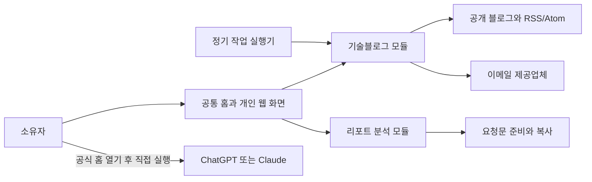

# 소프트웨어 요구사항 명세서 (SRS)

> LevelUp의 관찰 가능한 동작과 검증 조건을 정의한다. 상위 기획은 미승인 초안이며, 사용자 요청에 따라 요구사항 초안을 작성한다. 문서 작성은 G0·G1 승인이나 구현·테스트 완료를 뜻하지 않는다.

## 문서 정보

| 항목 | 내용 |
| --- | --- |
| 프로젝트명 | LevelUp |
| 문서 번호 | SRS-LEVELUP-v0.12 |
| 버전 | v0.12 |
| 작성일 | 2026-11-24 |
| 최종 수정일 | 2026-11-26 |
| 작성자 | Codex — 사용자 요청과 프로젝트 자료 기반 초안 |
| 상태 | 초안 / G0·G1 승인 기록 없음 |
| 대상 릴리스 | 첫 릴리스 — P1·P2 모두 포함 |
| 근거 | PRD-LEVELUP-v0.30, SPD-LEVELUP-v0.12, BPD-LEVELUP-v0.11, DESIGN.md |

## 변경 이력

| 버전 | 날짜 | 변경 내용 | 작성자 | 승인자 |
| --- | --- | --- | --- | --- |
| v0.9 | 2026-11-25 | CR-MIN-001: Python 호스트 통합·당일 자동 재발송 제외·단일 호출 결과 통합·템플릿 적용 범위 분리 | Codex | 변경 범위 사용자 확인·전체 문서 미승인 |
| v0.10 | 2026-11-26 | 확정 PRD v0.28 대조·과거 문구/참조 정정, Mac Chrome + iPhone Safari·모든 글 목록 최신순 확정, 실행 검증과 분리 | Codex | PRD·기기 범위 사용자 확정 / 개별 단계 승인 전 |
| v0.11 | 2026-11-26 | 00~04 미결·권장안 통합, 확정/설계/환경/검증/후속 보류 구분·잔여 문구/참조 정정. 권장안 미채택·실행 미검증 | Codex | 정정 요청 반영 / 개별 문서 미승인 |
| v0.12 | 2026-11-26 | 사용자 채택: Services 한 프로젝트·DB 저장 세션(auth_sessions 추가, 총 14개)·외부 클라우드 자동 백업. 실제 설정/검증은 미완료 | Codex | 세 가지 설계 사용자 채택 / 전체 단계 미승인 |

남은 항목의 상태·권장 처리방식·채택 여부는 [서비스기획서 7.4](../00-기획/서비스기획서.md#74-prd-확정-후-순차-검토-2026-11-26)를 단일 통합 표로 사용한다. 단일 Services 프로젝트·DB 저장 세션·외부 클라우드 주간 자동 백업은 2026-11-26 사용자 채택이며 나머지 권장안은 채택 전이다. 채택과 개별 단계 승인·실제 실행 검증 완료는 구분한다.

## 목차

1. [문서 개요](#1-문서-개요)
2. [전체 시스템 설명](#2-전체-시스템-설명)
3. [기능 요구사항](#3-기능-요구사항)
4. [비기능 요구사항](#4-비기능-요구사항)
5. [외부 인터페이스 요구사항](#5-외부-인터페이스-요구사항)
6. [데이터 요구사항](#6-데이터-요구사항)
7. [제약 조건](#7-제약-조건)
8. [승인 내역](#8-승인-내역)

## 1. 문서 개요

### 1.1 목적

개인용 웹사이트 LevelUp의 기술블로그·아침 이메일·선택형 외부 AI 인계를 구현·검증할 기준을 정의한다. 사용자 요구와 정책을 기능/비기능 ID, UC, 수용 기준으로 분해하며 상세 설계·코드·TC 참조는 후속 단계에서 채운다.

### 1.2 범위

포함 범위는 PRD의 MVP-001~009 전체다. P2인 저장·테스트 메일·리포트 분석도 첫 릴리스에서 임의로 제외하지 않는다. 구독 설정의 공개 URL 직접 추가·삭제는 기본 출처 선택과 같은 P1 범위다.

제외 범위는 PRD EX-001~008을 유지한다: 내부 AI API/요약, 결과 이력, 자체 PDF/OCR/파일 업로드, 비공개 문서 자동 접근, 일괄 AI 요약, 공개 회원/결제/커뮤니티/추천, 추가 알림 채널, 미정 생활 기능. 임의 HTML의 수집기를 자동 생성하지 않으며 기존 수집기·피드가 없는 주소는 미지원으로 안내한다.

### 1.3 용어 정의

| 용어 | 정의 |
| --- | --- |
| 소유자 | 본인 1명. 공개 회원·관리자 계층 없음 |
| 구독 | 출처의 새 글 수신 선택. 유료 계약과 무관 |
| 브리핑 | 날짜별 대상 글 묶음. 이메일 표시 상한과 전체 건수는 다름 |
| 출처 삭제 | 이후 수집·미발송 중단, 기존 글·읽음·저장·발송 기록 보존 |
| 수동 AI 인계 | 요청문 복사와 공식 홈 열기 후 사용자가 외부에서 실행 |
| SC-FR / SC-NFR | 이 SRS의 자체 수용 기준 ID. PRD AC와 연결하며 실행 TC가 아님 |
| DEC | 서비스 기획서 7.3의 미결 결정. 이 문서에서 임의 확정하지 않음 |

### 1.4 참고 문서

| 문서 | 위치 | 기준·상태 |
| --- | --- | --- |
| PRD | [PRD.md](../../PRD.md) | v0.28 소유자 확정 / 제품 범위·AC-001~020 |
| 서비스 기획서 | [서비스기획서.md](../00-기획/서비스기획서.md) | v0.9 초안 / OBJ·MVP·EX·DEC |
| 비즈니스 정책서 | [비즈니스정책서.md](../00-기획/비즈니스정책서.md) | v0.8 초안 / 구체 BP 규칙 37개 |
| 디자인 분석 | [DESIGN.md](../../DESIGN.md) | 관찰·측정·적용 제안 구분 |
| 작성 가이드 | [AGENTS.md](../AGENTS.md) | 출처·미결·단계 승인 기준 |

흐름 기준은 [유스케이스 v0.10](유스케이스명세서.md), 최신 기술 변경/인계 참조는 [RTM v0.12](요구사항추적매트릭스-RTM.md) 초안에 연결한다. 02 화면·DB·API·SAD는 실제 설계 초안에 연결했으며 03 상세 설계·04 구현 계획 초안도 작성됐으며 실제 코드·제품 테스트는 미착수다.

### 1.5 우선순위 정의

P1은 핵심, P2는 보조 중요도이며 현재의 두 등급 모두 첫 릴리스 포함이다. P3를 일정에 따라 임의 도입하지 않는다. 제외 범위는 EX로 관리하고 포함 요구사항의 분모에 넣지 않는다. 모든 요구사항은 초안이며 미결 영향이 있으면 관련 DEC를 함께 검토한다.

## 2. 전체 시스템 설명

### 2.1 시스템 관점도

AI 서비스에서 사이트로 결과를 되돌리는 연계는 없다. 작업 실행기는 시스템 내부 자동 트리거이며 별도 사용자 권한을 뜻하지 않는다.

### 2.2 사용자 유형 및 특성

주요 액터는 ACT-01 소유자다. 보조 액터는 ACT-S01 정기 실행 트리거, ACT-S02 공개 출처, ACT-S03 이메일 제공업체, ACT-S04 외부 AI 서비스다. 보조 시스템은 사이트의 로그인 사용자 역할이 아니다. ACT-S04의 로그인·결과는 사이트 관찰 범위 밖이다.

### 2.3 운영 환경

- 서버는 브라우저 종료와 독립된 수집·발송 작업 및 개인 상태 저장을 제공해야 한다.
- Python 서버·수집 + TypeScript 웹, Next.js 웹·FastAPI API의 Vercel Services 한 프로젝트 배포는 사용자 확정 사항이다. 세션은 무작위 cookie token·DB 저장으로 확정했다. 정기 실행은 Vercel Schedules로 확정했으며 함수·DB 무료 실행 적합성은 미결이다. Next.js 웹·FastAPI API·PostgreSQL DB는 확정이며 Neon Free 호스팅은 확정이며 구성요소 버전·DB 리전/직접 연결/드라이버·API/작업 계정·인증 세부는 DEC-001, Gmail 동일 계정 발신·수신은 사용자 확인 사항이며 실제 계정·OAuth 설정·지속 운영은 DEC-002에서 정한다. 캐시·큐·별도 서비스·특정 SDK를 필수로 지정하지 않는다.
- 데스크톱·모바일 웹을 대상으로 한다. 네이티브 앱·오프라인 편집은 범위 밖이다. 지원·검증 조합은 ISSUE-001의 Mac Chrome + iPhone Safari로 확정했다. OS/브라우저 버전·기기 모델·너비는 실제 테스트 때 기록한다.

### 2.4 제약사항

한국 시간, 개인용 접근, 직접 URL 관리, 외부 AI 수동 인계, 첫 릴리스 전체 범위와 상위 미결 결정을 유지한다. 실제 외부 사이트 수집·AI 읽기 성공을 무조건 보장하지 않는다. G0 승인 이력이 없으므로 G1 확정 기준선으로 표시하지 않는다.

### 2.5 가정 및 전제 조건

소유자가 수신 이메일과 외부 AI 계정을 스스로 이용한다. 출처는 공개 피드/목록 또는 지원 수집기가 있어야 한다. 외부 변경·제공업체 제한은 실제 연동 단계에서 확인하며 예시 가용성 수치나 비용을 확정값으로 사용하지 않는다.

## 3. 기능 요구사항

### 3.1 기능 요구사항 요약 목록

| FR-ID | 기능명 | 우선순위 | 관련 UC | 상태 |
| --- | --- | --- | --- | --- |
| FR-001 | 소유자 인증과 개인 영역 접근 제어 | P1 | UC-001 | 초안 |
| FR-002 | 공통 홈·메뉴와 활성 섹션 진입 | P1 | UC-002, UC-012 | 초안 |
| FR-003 | 구독 URL 연결 확인과 피드 선택 | P1 | UC-003 | 초안 |
| FR-004 | 출처 추가·중복 방지와 초기 기준 설정 | P1 | UC-003 | 초안 |
| FR-005 | 출처 구독 켜기·끄기와 재개 | P1 | UC-004 | 초안 |
| FR-006 | 출처 삭제와 진행 중 작업 차단 | P1 | UC-005 | 초안 |
| FR-007 | 서버 정기 수집과 출처별 상태 갱신 | P1 | UC-006 | 초안 |
| FR-008 | 전체 콘텐츠 수집·게시글 중복과 수정 처리 | P1 | UC-006 | 초안 |
| FR-009 | 게시일·발견일 기반 브리핑 후보 판정 | P1 | UC-007 | 초안 |
| FR-010 | 오늘의 글·전체 글·브리핑 전체 목록 | P1 | UC-008 | 초안 |
| FR-011 | 제목 검색·출처·읽음 필터 | P1 | UC-008 | 초안 |
| FR-012 | 읽음·저장 상태 직접 변경 | P2 | UC-009 | 초안 |
| FR-013 | 목록에서 글 숨김 | P1 | UC-009 | 초안 |
| FR-014 | 수신 이메일과 알림 중지·재개 | P1 | UC-010 | 초안 |
| FR-015 | 매일 아침 브리핑 구성과 이메일 발송 | P1 | UC-007 | 초안 |
| FR-016 | 발송 중복 방지·실패·성공 불명확 처리 | P1 | UC-007, UC-011 | 초안 |
| FR-017 | 테스트 이메일 발송 | P2 | UC-010 | 초안 |
| FR-018 | 출처 수집과 이메일 상태 조회 | P2 | UC-011 | 초안 |
| FR-019 | 리포트 분석 진입 | P2 | UC-012 | 초안 |
| FR-020 | 공개 문서 URL과 요약 요청문 준비 | P2 | UC-013 | 초안 |
| FR-021 | 현재 요청문 복사와 공식 AI 서비스 열기 | P2 | UC-013 | 초안 |
| FR-022 | 외부 AI 실행 안내와 결과 경계 | P2 | UC-013 | 초안 |
| FR-023 | 원문 직접 열기 | P1 | UC-008 | 초안 |

### 3.2 FR-001: 소유자 인증과 개인 영역 접근 제어

| 항목 | 내용 |
| --- | --- |
| ID | FR-001 |
| 출처 | MVP-001 / BP-AUTH-001 |
| 우선순위·상태 | P1 / 초안 |
| 관련 UC | UC-001 |
| 상위 수용 기준 | AC-001 |
| 입력 | 접근 요청과 소유자 인증 상태 |
| 처리 로직 | 개인 화면·설정·데이터 요청마다 소유자 권한을 확인한다. 공개 회원가입·다른 사용자 역할은 만들지 않는다. Google 로그인으로 검증한 sub·verified email을 확인하며 구성된 소유자 sub만 허용한다. 로그인 계정을 Gmail 연결 계정으로 자동 표시한다. 최초 로그인에서 발송 동의를 요청하고 발송 권한 누락은 사이트 로그인과 분리한다. 세션은 로그인 성공부터 7일 고정이며 페이지 방문으로 연장하지 않는다. 만료 시 재인증하고 Gmail 정기 작업은 유지한다. 세션 구현/회전은 DEC-001에서 검증한다 |
| 출력 | 허용된 개인 화면 또는 접근 거절·인증 안내 |
| 수용 기준 ID | SC-FR-001 |
| 수용 기준 | 인증된 소유자는 개인 영역에 접근하고 미인증·비소유자 요청은 개인 데이터와 변경 권한을 받지 못한다 |
| 미결·제약 | 설계 결정 필요: OAuth 라이브러리(DEC-001); DB 저장 세션은 확정·실행 검증 대기. Google·7일 고정 만료는 확정 |

### 3.3 FR-002: 공통 홈·메뉴와 활성 섹션 진입

| 항목 | 내용 |
| --- | --- |
| ID | FR-002 |
| 출처 | MVP-001, MVP-009 / BP-SECTION-001, BP-SECTION-003, BP-AI-001 + CR-UX-002, CR-UX-003 |
| 우선순위·상태 | P1 / 초안 |
| 관련 UC | UC-002, UC-012 |
| 상위 수용 기준 | AC-009, AC-014, AC-015 |
| 입력 | 등록된 제공 중 섹션, 일반 설정의 dark/light 선택·브라우저 저장값 |
| 처리 로직 | 홈/상위 메뉴는 같은 등록 정보를 쓰되 홈에는 ‘홈 표시’로 등록한 활성 기능(첫 릴리스는 기술블로그만)과 지정한 미래 기능 준비 카드 2개를, 메뉴에는 활성 기능만 표시한다(CR-UX-004). 준비 카드는 path/summary=null·정적 문구·비대화형이며 권한/API 실행이 없다. 현재 섹션의 하위 메뉴를 펼치고 미정 기능의 빈 메뉴는 생성하지 않는다. 설정의 radio 또는 상단 바·모바일 메뉴의 테마 전환 버튼으로 dark/light를 바꾸면 공통 루트 테마를 즉시 바꾸고 같은 브라우저 저장값에 저장한다 |
| 출력 | 활성 기능 요약·진입 링크와 두 준비 카드, 선택 테마의 즉시 반영·로컬 저장 결과. 준비 카드는 진입 링크/건수/시각/출시일 없음 |
| 수용 기준 ID | SC-FR-002 |
| 수용 기준 | 리포트 분석 메뉴·글별 진입 버튼은 항상 표시하고 소유자 인증 후 직접 접근도 허용한다. 홈에는 기술블로그 카드(구독 출처 수집 상태 포함)와 준비 카드 2개만 두며 리포트 분석·정기 메일 카드는 없다(CR-UX-004). 수신 이메일 요약·데일리 기사 요약 카드는 기술블로그 카드와 같은 주요 카드 크기로 홈에서 준비 중으로 보이되 클릭/Tab 진입·가짜 수치·API/권한 요청이 없고 메뉴에 나타나지 않는다. 최초 방문/무효 저장값은 다크, 라이트 선택 후 화면 이동·새로고침·재방문에도 동일 브라우저에서 라이트를 유지한다. 저장 차단 시 현재 선택은 적용하되 저장 실패를 안내한다. 두 테마의 글 상태·필터·작성 중 입력은 동일하며 전환만으로 업무 API 요청이 발생하지 않는다. 상단 바·모바일 메뉴 버튼과 설정 radio는 항상 같은 테마를 표시하고 버튼 이름은 바뀔 테마(“라이트로 전환”/“다크로 전환”)로 읽힌다 |
| 미결·제약 | 없음 |

### 3.4 FR-003: 구독 URL 연결 확인과 피드 선택

| 항목 | 내용 |
| --- | --- |
| ID | FR-003 |
| 출처 | MVP-002 / BP-CONTENT-007, BP-CONTENT-008 |
| 우선순위·상태 | P1 / 초안 |
| 관련 UC | UC-003 |
| 상위 수용 기준 | AC-017, AC-018 |
| 입력 | 공개 블로그·글 목록·RSS/Atom URL, 연결 확인 조작 |
| 처리 로직 | 입력만으로 조회하지 않는다. 연결 확인 후 공개 주소를 검증하고 피드를 탐색한다. 여러 피드면 선택하게 하며 피드 없는 출처는 지원 수집기가 있을 때만 허용한다 |
| 출력 | 출처명·입력/수집 URL·피드 선택지 또는 실패/미지원 안내 |
| 수용 기준 ID | SC-FR-003 |
| 수용 기준 | 직접 피드와 피드 탐색 가능한 블로그를 확인할 수 있고 다중 피드 선택이 가능하다. 잘못된·내부·미지원 주소를 성공으로 표시하지 않는다 |
| 미결·제약 | 환경 설정 필요·설계 결정 필요: 실제 피드/지원 adapter·자원 한도(DEC-003) |

### 3.5 FR-004: 출처 추가·중복 방지와 초기 기준 설정

| 항목 | 내용 |
| --- | --- |
| ID | FR-004 |
| 출처 | MVP-002, MVP-003 / BP-CONTENT-003, BP-CONTENT-007, BP-CONTENT-009 |
| 우선순위·상태 | P1 / 초안 |
| 관련 UC | UC-003 |
| 상위 수용 기준 | AC-003, AC-017, AC-018, AC-019 |
| 입력 | 확인·선택된 출처와 추가 조작 |
| 처리 로직 | 저장 시에도 검증·중복 조건을 확인하고 실제 수집 URL의 동일 출처는 재생성하지 않는다. 기본 목록 외 출처도 등록한다. 초기 처리 전 수집 대기 상태를 표시하고 초기 발견 글은 과거 글로 구분한다. 삭제 후 재추가도 기존 글을 재사용한다 |
| 출력 | 등록 출처·구독 상태·초기 대기/준비 상태 또는 기존 항목 안내 |
| 수용 기준 ID | SC-FR-004 |
| 수용 기준 | 동일 피드로 연결되는 블로그/피드 주소를 재등록해도 출처가 하나다. 같은 도메인의 다른 피드는 구분한다. 초기·재추가 과거 글 중복과 소급 알림이 없다 |
| 미결·제약 | 설계 결정 필요·실행 검증 대기: 실제 피드 중복/초기 기준·지원 범위 표본(DEC-003) |

### 3.6 FR-005: 출처 구독 켜기·끄기와 재개

| 항목 | 내용 |
| --- | --- |
| ID | FR-005 |
| 출처 | MVP-002 / BP-CONTENT-004, BP-CONTENT-010 |
| 우선순위·상태 | P1 / 초안 |
| 관련 UC | UC-004 |
| 상위 수용 기준 | AC-003, AC-019 |
| 입력 | 출처와 희망 구독 상태 |
| 처리 로직 | 항목을 목록에 유지하며 구독 상태를 변경한다. 해제 기간 글은 재구독 시 소급 알림하지 않는다. 끄기 전에 발견한 미요청 대기도 모두 suppressed로 바꾸며 재개로 되살리지 않는다. 재개는 새 기준 수집부터 시작한다. prepared는 제외·재구성하고 sending/unknown/accepted는 변경하지 않는다 |
| 출력 | 변경된 구독 상태 |
| 수용 기준 ID | SC-FR-005 |
| 수용 기준 | 꺼진 출처는 새 알림에서 제외되고 항목은 목록에 남는다. 재개 시 해제 기간 글을 소급 발송하지 않는다 |
| 미결·제약 | 실행 검증 대기: 구독 중지 대기 억제·재개·외부 요청 경계. 정책 확정 |

### 3.7 FR-006: 출처 삭제와 진행 중 작업 차단

| 항목 | 내용 |
| --- | --- |
| ID | FR-006 |
| 출처 | MVP-002, MVP-005, MVP-006 / BP-CONTENT-010 |
| 우선순위·상태 | P1 / 초안 |
| 관련 UC | UC-005 |
| 상위 수용 기준 | AC-019 |
| 입력 | 기본 또는 사용자 추가 출처의 삭제 조작 |
| 처리 로직 | 활성 구독 목록에서 제거하고 이후 수집·미발송 알림을 중단한다. 진행 중 수집은 반영 직전 삭제 상태를 확인하고 미전송 브리핑은 전송 직전 제외한다. 기존 글·개인 상태·발송 기록을 보존하고 자동 복원하지 않는다 |
| 출력 | 출처 삭제 결과와 보존된 기존 기록 |
| 수용 기준 ID | SC-FR-006 |
| 수용 기준 | 삭제 후 새 결과 반영·미발송 전송이 없고 저장·읽음·과거 브리핑은 유지된다. 제공업체가 이미 접수한 메일은 취소했다고 표시하지 않는다 |
| 미결·제약 | 없음 |

### 3.8 FR-007: 서버 정기 수집과 출처별 상태 갱신

| 항목 | 내용 |
| --- | --- |
| ID | FR-007 |
| 출처 | MVP-003, MVP-007 / BP-CONTENT-002, BP-ERROR-001 |
| 우선순위·상태 | P1 / 초안 |
| 관련 UC | UC-006 |
| 상위 수용 기준 | AC-008, AC-017 |
| 입력 | 등록 출처·수집 설정·정기 실행 시각 |
| 처리 로직 | 브라우저와 독립적으로 매시간 수집하고 07:30 Asia/Seoul 최종 수집을 실행한다. 출처별 결과·마지막 성공을 갱신하고 실패는 다음 수집에서 다시 시도한다 |
| 출력 | 새 글 후보·출처별 성공/실패 결과 |
| 수용 기준 ID | SC-FR-007 |
| 수용 기준 | 브라우저가 닫혀 있어도 작업이 실행되고 한 출처 오류가 다른 출처 수집을 중단하지 않는다 |
| 미결·제약 | 설계 결정 필요·환경 설정 필요: 출처별 수집 계약과 유한 작업 실행/연결(DEC-001·003) |

### 3.9 FR-008: 전체 콘텐츠 수집·게시글 중복과 수정 처리

| 항목 | 내용 |
| --- | --- |
| ID | FR-008 |
| 출처 | MVP-003 / BP-CONTENT-001, BP-CONTENT-002, BP-CONTENT-003, BP-STAT-001 |
| 우선순위·상태 | P1 / 초안 |
| 관련 UC | UC-006 |
| 상위 수용 기준 | AC-002, AC-003, AC-020 |
| 입력 | 출처에서 읽은 모든 글의 ID/URL·제공된 메타데이터 |
| 처리 로직 | 구독 출처의 모든 글을 유형과 관계없이 수집한다. 기술 글·채용·행사 모집·일반 기업 소식·기술 설명 없는 홍보를 자동 제외하지 않는다. 출처 게시물 ID/원문 URL로 중복을 판정하고 기존 글 수정으로 새 알림을 만들지 않는다. CR-FLOW-001로 개별 항목 오류/alias 충돌은 격리하고 다른 유효 항목은 partial로 저장한다. 초기 응답이 정상 빈 목록이거나 유효 항목 1개 이상이면 기준 확정 가능하다. 모든 항목 무효·응답 손상/절단이면 기준 미완료다. pending의 게시일 정정은 최신 값으로 자격을 재계산한다. |
| 출력 | 전체 유형의 중복 제거 글·메타데이터·과거/신규 판정 |
| 수용 기준 ID | SC-FR-008 |
| 수용 기준 | 같은 신규·구독·날짜 조건의 기술 글·채용·행사 모집·기업 소식·비기술 홍보가 모두 수집·목록·브리핑 후보에 포함된다. 반복 수집·수정으로 글 수·알림이 늘지 않고 초기 과거 글은 알림에서 제외된다 정상 2개+오류 1개는 정상 글 저장·부분 성공·격리 1개로 표시한다. 초기 격리 글이 식별 가능하게 복구돼도 과거 알림을 만들지 않으며 이미 통지한 글은 날짜 변경으로 재알림하지 않는다. |
| 미결·제약 | 실행 검증 대기: 식별/정규화·metadata 표본. 출처별 파싱은 설계 결정 필요(DEC-003) |

### 3.10 FR-009: 게시일·발견일 기반 브리핑 후보 판정

| 항목 | 내용 |
| --- | --- |
| ID | FR-009 |
| 출처 | MVP-005 / BP-RESET-001, BP-RESET-002, BP-CONTENT-003, BP-CONTENT-004 |
| 우선순위·상태 | P1 / 초안 |
| 관련 UC | UC-007 |
| 상위 수용 기준 | AC-003, AC-005 |
| 입력 | 게시일·최초 발견일·구독·과거/신규·발송 상태 |
| 처리 로직 | 한국 날짜 기준 전날까지 게시된 미발송 글을 후보로 삼는다. 당일 게시 글은 다음 날, 게시일 누락 글은 발견일 다음 날부터 대상이다. 늦게 발견한 과거 날짜 신규 글은 이후 첫 아침 알림에 넣는다. 초기 과거 글·구독 제외 조건이 우선한다 첫 등록 기준 이후의 늦은 발견은 허용하며 재구독/재추가의 시작 전 게시 글만 억제한다. pending의 게시일 정정은 최신 날짜로 재계산한다. eligible_on은 최소 자격 날짜, 실제 포함은 작업 시작 snapshot으로 결정한다. |
| 출력 | 날짜별 후보와 제외 사유 |
| 수용 기준 ID | SC-FR-009 |
| 수용 기준 | 월요일 신규 글은 화요일 후보, 화요일 00:00 게시 글은 수요일 후보가 된다. 게시일 누락·늦은 발견·초기 과거 글을 구분한다 어제 날짜에서 오늘 날짜로 정정된 미발송 글은 내일 이후로 연기된다. 반대로 수정된 글도 첫 확정 snapshot에 들어가지 못했다면 다음 정상 아침에 처리한다. prepared는 전송 직전 재검사, sending/unknown/accepted는 snapshot·예약을 보존한다. |
| 미결·제약 | 설계 결정 필요·실행 검증 대기: 출처별 날짜 파싱/시간대 표본(DEC-003). 알림 날짜·첫 등록/재활성 경계는 확정 |

### 3.11 FR-010: 오늘의 글·전체 글·브리핑 전체 목록

| 항목 | 내용 |
| --- | --- |
| ID | FR-010 |
| 출처 | MVP-004 / BP-CONTENT-005, BP-STAT-001 |
| 우선순위·상태 | P1 / 초안 |
| 관련 UC | UC-008 |
| 상위 수용 기준 | AC-004, AC-006 |
| 입력 | 목록 종류·브리핑 날짜 |
| 처리 로직 | 오늘의 글은 날짜별 브리핑 전체를 표시한다. 오늘의 글·전체 글·저장한 글은 게시일 내림차순, 게시일이 없으면 최초 발견 시각, 동률이면 글 ID 내림차순으로 통일한다. 별도 정렬 선택 UI는 제공하지 않는다. 확정 브리핑은 대상 확정 시 정한 순서를 보존한다. 제목·출처·게시일·원문 링크와 제공된 소개·태그를 표시하고 본문 전체를 재게시하지 않는다 |
| 출력 | 게시글 목록과 전체 건수 |
| 수용 기준 ID | SC-FR-010 |
| 수용 기준 | 이메일에서 20개만 표시한 21개 브리핑의 전체 보기에는 21개가 있고 썸네일·소개가 없는 글도 확인 가능하다. 세 목록에 게시일 있음/없음·동률 fixture를 넣어 같은 최신순을 검증한다. 저장 시각은 정렬을 바꾸지 않으며 확정 브리핑 순서는 메타데이터 수정으로 재정렬하지 않는다  실제 empty는 0개·새 글 없음, 미확정/미시작은 null·해당 상태, 조회 실패는 오류 안내로 검증하며 서로 바꾸어 표시하지 않는다 |
| 미결·제약 | 실행 검증 대기: 세 목록 정렬·빈 대상/미확정/조회 실패/미시작 표시. 정책 확정 |

### 3.12 FR-011: 제목 검색·출처·읽음 필터

| 항목 | 내용 |
| --- | --- |
| ID | FR-011 |
| 출처 | MVP-004 / BP-CONTENT-005 |
| 우선순위·상태 | P1 / 초안 |
| 관련 UC | UC-008 |
| 상위 수용 기준 | AC-004 |
| 입력 | 검색어·출처·읽음 조건 |
| 처리 로직 | 전체 글에서 제목 검색과 출처/읽음 조건을 적용하고 일치하는 글을 표시한다. 결과 없음을 오류와 구분한다 |
| 출력 | 필터링된 목록 또는 결과 없음 |
| 수용 기준 ID | SC-FR-011 |
| 수용 기준 | 확인된 제목·출처·읽음 fixture에 조건을 적용했을 때 일치 글만 나오며 조건 해제 후 기본 목록으로 돌아갈 수 있다 |
| 미결·제약 | 없음 |

### 3.13 FR-012: 읽음·저장 상태 직접 변경

| 항목 | 내용 |
| --- | --- |
| ID | FR-012 |
| 출처 | MVP-006 / BP-CONTENT-006, BP-STAT-002 |
| 우선순위·상태 | P2 / 초안 |
| 관련 UC | UC-009 |
| 상위 수용 기준 | AC-004, AC-019 |
| 입력 | 게시글과 읽음·저장·저장 해제 조작 |
| 처리 로직 | 명시적 조작만 개인 상태로 저장한다. 원문 열기나 분석 이동만으로 읽음을 바꾸지 않으며 저장 목록을 제공한다. 출처 삭제 후에도 상태를 유지한다 |
| 출력 | 변경된 상태·저장 목록 |
| 수용 기준 ID | SC-FR-012 |
| 수용 기준 | 원문 열기만 하면 읽음이 그대로이고 직접 변경·재조회 후 상태가 유지된다. 출처 삭제가 저장 글을 제거하지 않는다 |
| 미결·제약 | 없음 |

### 3.14 FR-013: 목록에서 글 숨김

| 항목 | 내용 |
| --- | --- |
| ID | FR-013 |
| 출처 | MVP-004 / BP-CONTENT-005 |
| 우선순위·상태 | P1 / 초안 |
| 관련 UC | UC-009 |
| 상위 수용 기준 | AC-004 |
| 입력 | 숨길 게시글의 명시적 선택 |
| 처리 로직 | 콘텐츠 유형과 관계없이 원하지 않는 글을 사용자가 목록에서 직접 숨길 수 있게 한다. ‘목록에서 숨기기’는 오늘/전체/저장 기본 목록만 변경하고 이메일 자격·읽음·저장은 변경하지 않는다. 숨김 보기에서 확인·복원한다 |
| 출력 | 숨김이 반영된 목록 |
| 수용 기준 ID | SC-FR-013 |
| 수용 기준 | 선택한 글은 오늘/전체/저장 기본 목록에서 숨겨진다. 숨김 보기에서 복원 가능하며 이메일 후보에는 유지된다. 원문·읽음·저장·다른 글은 변경하지 않는다 |
| 미결·제약 | 실행 검증 대기: 오늘/전체/저장 숨김·복원·메일 자격 유지. 정책 확정 |

### 3.15 FR-014: 수신 이메일과 알림 중지·재개

| 항목 | 내용 |
| --- | --- |
| ID | FR-014 |
| 출처 | MVP-001, MVP-005 / BP-NOTI-003, BP-NOTI-006 |
| 우선순위·상태 | P1 / 초안 |
| 관련 UC | UC-010 |
| 상위 수용 기준 | AC-007 |
| 입력 | Gmail 연결·재연결·해제, 알림 활성 상태. 발신·수신 주소는 로그인한 동일 Google 계정의 검증 이메일이며 자유 입력·다른 계정 연결 없음 |
| 처리 로직 | 로그인 이메일을 연결 계정에 자동 표시하고 Gmail Google sub와 로그인 sub 일치를 강제한다. 발송 권한과 refresh token이 없으면 연결 완료로 표시하지 않는다. 해제 후 일반 로그인으로 재연결하지 않는다. 같은 계정으로 보내고 받는다. 발송 권한만 사용하며 token은 서버에서 보호한다. 미연결·만료/철회 시 메일만 중단한다. 알림 중지 중에도 수집·읽기를 유지하고 재개하면 미발송 글을 다음 알림에 묶는다. 출처 구독 해제·사이트 인증과 구분한다 |
| 출력 | 연결된 Gmail 주소(읽기 전용)·연결/재연결 필요 상태·발송 활성 상태 |
| 수용 기준 ID | SC-FR-014 |
| 수용 기준 | 연결 Gmail에서 같은 Gmail로 테스트·정기 요청이 전송된다. 미연결·권한 만료/철회·알림 중지 시 정기 메일 없이 수집·읽기를 유지한다. 재개 시 유효 미발송이 다음 후보가 되며 token·Gmail 비밀번호·메일함 내용이 클라이언트/로그에 노출되지 않는다 |
| 미결·제약 | 환경 설정 필요·실행 검증 대기: Google OAuth·token·동일 계정 연결(DEC-002). 알림 중지/재개 정책 확정 |

### 3.16 FR-015: 매일 아침 브리핑 구성과 이메일 발송

| 항목 | 내용 |
| --- | --- |
| ID | FR-015 |
| 출처 | MVP-005 / BP-NOTI-001, BP-NOTI-002, BP-STAT-001, BP-CONTENT-010 |
| 우선순위·상태 | P1 / 초안 |
| 관련 UC | UC-007 |
| 상위 수용 기준 | AC-005, AC-006, AC-019 |
| 입력 | 날짜별 후보·수신 설정·전송 직전 출처 상태 |
| 처리 로직 | 주말 포함 매일 08:00 Asia/Seoul 발송 작업을 시작한다. 대상 0개는 미발송, 기업/출처별 제목·원문 링크를 묶고 20개 초과는 최신 20개·전체 건수·해당 브리핑 링크를 표시한다. 전송 직전 삭제된 출처는 제외한다 08:00 예약 후 수집과 별도 발송 실행 슬롯에서 우선 처리하고 실제 owner 잠금·snapshot 확보 시 확정한다. KST 08:20 정각까지 시작하지 못하면 missed로 기록하고 다음 정상 아침에 합친다. 이미 시작한 외부 요청 결과는 마감 후에도 반영한다. |
| 출력 | 이메일 전송 요청과 날짜별 전체 브리핑 |
| 수용 기준 ID | SC-FR-015 |
| 수용 기준 | 0·20·21개와 주말을 검증한다. 21개이면 본문 20개·전체 21개다. 접수 확인 후 21개 모두 notified이며 다음 날 미표시 1개를 재알림하지 않는다. 읽음 상태는 유지하고 unknown이면 전체 held다. 전체 목록 건수는 이메일 표시 상한과 무관하며 받은편지함의 정확한 08:00 도착을 보장하지 않는다 08:03 수집 commit/08:05 첫 확정은 당일 포함, 첫 확정 뒤 수집은 다음 날이다. 정확히 08:20 미시작·worker 재기동에서도 과거 메일 일괄 재생 없이 missed와 유효 미발송 이월을 확인한다. |
| 미결·제약 | 설계 결정 필요·실행 검증 대기: 유한 발송 작업·무료 실행량·실제 Gmail 연동(DEC-001·002). 시각·20개 표시/전체 통지 정책 확정 |

### 3.17 FR-016: 발송 중복 방지·실패·성공 불명확 처리

| 항목 | 내용 |
| --- | --- |
| ID | FR-016 |
| 출처 | MVP-005, MVP-007 / BP-NOTI-004, BP-ERROR-003 |
| 우선순위·상태 | P1 / 초안 |
| 관련 UC | UC-007, UC-011 |
| 상위 수용 기준 | AC-007 |
| 입력 | 동일 날짜 실행·발송 응답·제공업체 기록 |
| 처리 로직 | 완료 브리핑의 같은 날 재발송을 막고 실패를 완료로 기록하지 않는다. 타임아웃 등 성공 불명확 상태는 제공업체 기록 대조 후 재시도 판단한다. 당일 자동 재발송은 하지 않고 명확한 미접수는 다음 정상 아침에 이월한다. 불명확 발송은 소유자가 고정 기한 없이 필요할 때 Gmail 보낸편지함과 앱의 제목·시각·수신자·RFC Message-ID를 대조한다. 미확인/근거 부족은 unknown·held를 유지하며 경과 시간만으로 실패 확정·예약 해제·자동 재전송하지 않는다. 확인 기한 알림을 새로 추가하지 않는다. 보류는 해당 글/발송 건에 한정하고 다른 정상 새 글의 수집·브리핑·발송은 계속한다. 확인 결과 기록 구현은 미결을 따른다 |
| 출력 | 완료·실패·성공 여부 확인 필요 상태와 근거 |
| 수용 기준 ID | SC-FR-016 |
| 수용 기준 | 중복 실행으로 메일이 중복 발송되지 않고 실패/응답 불명확을 완료로 표시하지 않는다. 확인 없이 성공 불명확 건을 무조건 재전송하지 않는다 |
| 미결·제약 | 설계 결정 필요: OP-01 운영 명령/기록 방식(DEC-002·006). 중복·unknown 예약·자동 재발송 제외 정책은 확정 |

### 3.18 FR-017: 테스트 이메일 발송

| 항목 | 내용 |
| --- | --- |
| ID | FR-017 |
| 출처 | MVP-007 / BP-NOTI-005 |
| 우선순위·상태 | P2 / 초안 |
| 관련 UC | UC-010 |
| 상위 수용 기준 | AC-007 |
| 입력 | 테스트 메일 요청·현재 수신 설정 |
| 처리 로직 | 테스트 요청을 정기 브리핑과 구분해 실행하고 결과를 표시한다. 정기 대상·발송 완료를 변경하지 않는다 |
| 출력 | 테스트 결과 |
| 수용 기준 ID | SC-FR-017 |
| 수용 기준 | 테스트 성공·실패 전후 정기 브리핑 대상과 발송 상태가 같고 결과를 확인할 수 있다 |
| 미결·제약 | 환경 설정 필요·실행 검증 대기: 실제 Gmail 계정 한도·테스트 요청 제한(DEC-002) |

### 3.19 FR-018: 출처 수집과 이메일 상태 조회

| 항목 | 내용 |
| --- | --- |
| ID | FR-018 |
| 출처 | MVP-007 / BP-ERROR-001, BP-ERROR-003 |
| 우선순위·상태 | P2 / 초안 |
| 관련 UC | UC-011 |
| 상위 수용 기준 | AC-007, AC-008 |
| 입력 | 상태 화면 조회 |
| 처리 로직 | 출처별 마지막 성공 시각·현재 오류와 최근 이메일 결과를 제공한다. 실패·성공 불명확·정상·초기 대기를 구분하고 실제 기록이 없는 성공을 만들지 않는다 정기는 날짜별 브리핑 API-022, 테스트는 발송 API-015를 쓴다. delivery 없는 empty/paused/Gmail 미연결·작업 지연/누락도 날짜별로 구분하고 부분 수집·격리 수를 표시한다. |
| 출력 | 수집·발송 상태 화면 |
| 수용 기준 ID | SC-FR-018 |
| 수용 기준 | 한 출처 실패와 다른 출처 성공이 구분되고 이메일 성공 불명확은 확인 필요로 표시된다 미확정/누락의 fullCount는 null, 실제 빈 snapshot만 0이다. Gmail 미연결이면 delivery 없이 사유를 표시하고 GET으로 새 작업을 만들지 않는다. |
| 미결·제약 | 설계 결정 필요·실행 검증 대기: OP-01 확인 기록 및 실제 연동(DEC-002·006). 날짜별 상태/건수 null·0 구분 확정 |

### 3.20 FR-019: 리포트 분석 진입

| 항목 | 내용 |
| --- | --- |
| ID | FR-019 |
| 출처 | MVP-008 / BP-AI-001, BP-COST-001 |
| 우선순위·상태 | P2 / 초안 |
| 관련 UC | UC-012 |
| 상위 수용 기준 | AC-009, AC-014 |
| 입력 | 소유자의 메뉴·글별 버튼 선택 또는 직접 주소 접근 |
| 처리 로직 | 별도 활성화 설정 없이 분석 화면을 표시한다. 글에서 진입하면 원문 URL을 채운다. 결제·API 키 입력을 요구하지 않는다 |
| 출력 | 분석 입력 화면 |
| 수용 기준 ID | SC-FR-019 |
| 수용 기준 | 메뉴·글별 버튼과 직접 주소에서 진입할 수 있고 블로그·아침 이메일은 사용 여부와 무관하게 동작한다 |
| 미결·제약 | 없음 |

### 3.21 FR-020: 공개 문서 URL과 요약 요청문 준비

| 항목 | 내용 |
| --- | --- |
| ID | FR-020 |
| 출처 | MVP-008 / BP-AI-002, BP-AI-003, BP-AI-004, BP-AI-005 |
| 우선순위·상태 | P2 / 초안 |
| 관련 UC | UC-013 |
| 상위 수용 기준 | AC-010, AC-012, AC-014 |
| 입력 | 직접 URL 또는 글의 원문 URL·ChatGPT/Claude 선택 |
| 처리 로직 | 게시글 DB 없이 URL 직접 입력을 지원한다. 공개 HTML/텍스트형 PDF 대상 URL을 문법 검증하고 최초 서비스 선택을 요구한다. 마지막 선택만 기본으로 기억한다. PRD 5.3 템플릿으로 한국어 요청문을 만들고 수정 가능하게 한다. URL 입력·선택으로 외부 요청하지 않는다 |
| 출력 | 현재 요청문·서비스 선택 또는 오류 안내 |
| 수용 기준 ID | SC-FR-020 |
| 수용 기준 | HTML·PDF URL과 블로그 진입 URL이 정확히 들어간다. 잘못된 URL에는 복사·열기가 비활성화되고 입력·선택만으로 원문/AI 조회가 없다 |
| 미결·제약 | 없음 |

### 3.22 FR-021: 현재 요청문 복사와 공식 AI 서비스 열기

| 항목 | 내용 |
| --- | --- |
| ID | FR-021 |
| 출처 | MVP-008 / BP-AI-006, BP-ERROR-002 |
| 우선순위·상태 | P2 / 초안 |
| 관련 UC | UC-013 |
| 상위 수용 기준 | AC-011, AC-012 |
| 입력 | 복사 또는 서비스 열기의 별도 클릭 |
| 처리 로직 | 복사는 화면의 수정된 현재 요청문과 일치하게 실행하고 실제 성공을 표시한다. 별도 열기 클릭으로 선택한 공식 홈을 새 탭에 연다. 쿼리에 문서/요청문을 첨부하지 않고 noopener·noreferrer를 적용한다 |
| 출력 | 복사 결과·새 탭 또는 수동 복사/공식 링크 대안 |
| 수용 기준 ID | SC-FR-021 |
| 수용 기준 | ChatGPT·Claude 각각 올바른 홈이 열리고 URL/요청문이 주소에 붙지 않는다. 복사 거절·새 탭 차단에서 성공 오표시 없이 대안을 제공한다 |
| 미결·제약 | 없음 |

### 3.23 FR-022: 외부 AI 실행 안내와 결과 경계

| 항목 | 내용 |
| --- | --- |
| ID | FR-022 |
| 출처 | MVP-008 / BP-AI-007, BP-STAT-002, BP-COST-001 |
| 우선순위·상태 | P2 / 초안 |
| 관련 UC | UC-013 |
| 상위 수용 기준 | AC-013 |
| 입력 | 요청문 인계와 사용자의 외부 실행 |
| 처리 로직 | 복사→외부 붙여넣기→직접 실행을 안내한다. 외부 로그인·문서 읽기·요약 결과를 수신/확인하지 않는다. 접근 불가 시 본문 붙여넣기·PDF 직접 제공을 안내한다. 내부 API·OCR·파일 업로드·요약 이력을 추가하지 않는다 |
| 출력 | 단계·한계 안내 |
| 수용 기준 ID | SC-FR-022 |
| 수용 기준 | 외부 홈을 연 것만으로 요약 완료나 성공률이 표시되지 않고 사용자 문서·AI 대화가 사이트의 분석 이력으로 저장되지 않는다 |
| 미결·제약 | 없음 |

### 3.24 FR-023: 원문 직접 열기

| 항목 | 내용 |
| --- | --- |
| ID | FR-023 |
| 출처 | MVP-004 / BP-CONTENT-005, BP-CONTENT-006 |
| 우선순위·상태 | P1 / 초안 |
| 관련 UC | UC-008 |
| 상위 수용 기준 | AC-004, AC-016 |
| 입력 | 목록·저장 목록·이메일의 원문 링크 선택 |
| 처리 로직 | 원문 사이트로 직접 이동한다. 링크 자체에 사이트 로그인을 요구하는 중간 읽기 화면을 강제하지 않는다. 원문 열기를 읽음·분석 실행과 분리한다 |
| 출력 | 원문 이동 |
| 수용 기준 ID | SC-FR-023 |
| 수용 기준 | 웹 목록과 이메일에서 실제 원문으로 연결되고 읽음 상태는 변하지 않는다. 사이트에 본문 전체를 재게시하지 않는다 |
| 미결·제약 | 없음 |

## 4. 비기능 요구사항

### 4.1 비기능 요구사항 요약

| NFR-ID | 요구사항명 | 우선순위 | 상태·미결 |
| --- | --- | --- | --- |
| NFR-001 | 소유자 권한의 일관된 적용 | P1 | 초안 / DEC-001 |
| NFR-002 | 자격증명·외부 AI 데이터 최소화 | P1 | 초안 / 없음 |
| NFR-003 | 공개 URL 조회의 내부 네트워크 차단 | P1 | 초안 / DEC-003 |
| NFR-004 | 브라우저 독립 실행과 실패 격리 | P1 | 초안 / 없음 |
| NFR-005 | 기능 모듈 독립성과 섹션 추가 | P1 | 초안 / 없음 |
| NFR-006 | 모바일 접근성과 명확한 상태 | P1 | 초안 / Mac Chrome + iPhone Safari 범위 확정·실행 전 |
| NFR-007 | 개인 상태·기존 기록 보존 | P1 | 초안 / 보존 확정·백업/임시 데이터 정리 결정·검증 대기 |
| NFR-008 | 수집 자원 한도와 성능 목표의 확정 | P1 | 초안 / 실행 한도 결정·검증 대기(DEC-001·002·003) |
| NFR-009 | 디자인 근거와 공통 UI 일관성 | P1 | 초안 / 테마·글꼴 확정·실행 검증 대기(DEC-008) |
| NFR-010 | 웹·기기 호환성 검증 범위 | P1 | 초안 / Mac Chrome + iPhone Safari 범위 확정·실행 전 |

### 4.2 NFR-001: 소유자 권한의 일관된 적용

| 항목 | 내용 |
| --- | --- |
| 출처 | MVP-001 / BP-AUTH-001 |
| 상위 수용 기준 | AC-001 |
| 우선순위·상태 | P1 / 초안 |
| 수용 기준 ID | SC-NFR-001 |
| 검증 조건·판정 기준 | 개인 UI뿐 아니라 직접 데이터 조회·변경 요청에도 소유자 검증을 적용한다. 미인증/비소유자에게 개인 데이터·설정이 노출되지 않는다 |
| 검증 방법 | 비인증·비소유자·소유자 요청을 UI와 서버 경계 각각에서 비교 |
| 미결·제약 | 설계 결정 필요·실행 검증 대기: 세션 구현·권한 검사(DEC-001). 소유자 Google 인증 정책은 확정 |

### 4.3 NFR-002: 자격증명·외부 AI 데이터 최소화

| 항목 | 내용 |
| --- | --- |
| 출처 | MVP-001, MVP-008 / BP-AUTH-002, BP-AI-003, BP-AI-005, BP-AI-007 |
| 상위 수용 기준 | AC-012, AC-013 |
| 우선순위·상태 | P1 / 초안 |
| 수용 기준 ID | SC-NFR-002 |
| 검증 조건·판정 기준 | 서버 비밀이 저장소·클라이언트·일반 로그에 노출되지 않는다. AI 비밀번호·쿠키·API 키와 요청문/결과 이력을 수집하지 않는다. 구독 URL의 설정 저장과 분석 URL 이력을 구분한다 |
| 검증 방법 | 저장소·브라우저 요청·저장 데이터·로그를 점검. 외부 문서 전달은 사용자의 수동 조작으로 한정 |
| 미결·제약 | 없음 |

### 4.4 NFR-003: 공개 URL 조회의 내부 네트워크 차단

| 항목 | 내용 |
| --- | --- |
| 출처 | MVP-002, MVP-003 / BP-CONTENT-008 |
| 상위 수용 기준 | AC-018 |
| 우선순위·상태 | P1 / 초안 |
| 수용 기준 ID | SC-NFR-003 |
| 검증 조건·판정 기준 | 소유자가 명시한 연결/등록·정기 수집에서만 조회한다. 비HTTP(S)·인증정보·localhost·사설/내부 목적지와 내부로 향하는 DNS/리다이렉트를 차단한다 |
| 검증 방법 | URL·DNS·리다이렉트 fixture로 외부 조회 경계를 검증. 입력만으로 요청 없는지도 확인 |
| 미결·제약 | 설계 결정 필요·실행 검증 대기: 안전 HTTP transport·출처별 자원 한도 표본(DEC-003) |

### 4.5 NFR-004: 브라우저 독립 실행과 실패 격리

| 항목 | 내용 |
| --- | --- |
| 출처 | MVP-003, MVP-005, MVP-007, MVP-009 / BP-ERROR-001, BP-SECTION-002 |
| 상위 수용 기준 | AC-008, AC-014 |
| 우선순위·상태 | P1 / 초안 |
| 수용 기준 ID | SC-NFR-004 |
| 검증 조건·판정 기준 | 사용자 브라우저 종료와 무관하게 수집·발송을 실행하고 한 출처 오류·분석 미사용이 다른 수집·읽기·섹션 화면을 중단하지 않는다 |
| 검증 방법 | 브라우저 종료·단일 출처 오류·분석 미사용 조건의 작업 및 화면 관찰 |
| 미결·제약 | 없음 |

### 4.6 NFR-005: 기능 모듈 독립성과 섹션 추가

| 항목 | 내용 |
| --- | --- |
| 출처 | MVP-009 / BP-SECTION-001, BP-SECTION-002 |
| 상위 수용 기준 | AC-014, AC-015 |
| 우선순위·상태 | P1 / 초안 |
| 수용 기준 ID | SC-NFR-005 |
| 검증 조건·판정 기준 | 홈과 메뉴는 같은 등록 정보를 사용하고 기능별 데이터/작업을 분리한다. 임시 섹션 추가에 블로그 수집·발송 로직 수정이 필요하지 않으며 분석 직접 입력은 게시글 DB 없이 동작한다 |
| 검증 방법 | 테스트 fixture의 임시 등록 정보 검증·의존 관계 검토. 검증용 fixture는 테스트에만 두고 실제 신규 화면/DB/job은 만들지 않음 |
| 미결·제약 | 없음 |

### 4.7 NFR-006: 모바일 접근성과 명확한 상태

| 항목 | 내용 |
| --- | --- |
| 출처 | MVP-001, MVP-004, MVP-008 / BP-SECTION-003, BP-ERROR-002 |
| 상위 수용 기준 | AC-016 |
| 우선순위·상태 | P1 / 초안 |
| 수용 기준 ID | SC-NFR-006 |
| 검증 조건·판정 기준 | 모바일 주요 동작 영역이 최소 44 × 44px이고 입력 라벨·아이콘 이름·키보드 포커스가 있다. 선택·오류를 색상만으로 구분하지 않으며 URL/제목이 기능을 가리지 않는다 |
| 검증 방법 | 실제 화면에서 영역 측정·키보드 이동·모바일 핵심 여정 점검. Mac Chrome + iPhone Safari, 실제 OS/브라우저 버전·모델/너비를 기록 |
| 미결·제약 | 실행 검증 대기: Mac Chrome + iPhone Safari·44px·키보드·실제 기기 정보 기록(ISSUE-001). 범위 확정 |

### 4.8 NFR-007: 개인 상태·기존 기록 보존

| 항목 | 내용 |
| --- | --- |
| 출처 | MVP-002, MVP-005, MVP-006, MVP-007 / BP-RESET-001, BP-ERROR-004, BP-CONTENT-010 |
| 상위 수용 기준 | AC-004, AC-019 |
| 우선순위·상태 | P1 / 초안 |
| 수용 기준 ID | SC-NFR-007 |
| 검증 조건·판정 기준 | 날짜 변경·일반 오류·출처 삭제가 읽음·저장·기존 글·발송 기록을 초기화하지 않는다. 삭제된 출처에서 진행 중 결과가 추가 반영되지 않는다. 첫 릴리스에서 핵심 이력의 자동 삭제가 없고 디버그 로그/원본 응답의 운영 DB 장기 보관이 없는지 확인한다 |
| 검증 방법 | 자정·오류·삭제 전후 데이터 대조 및 진행 중 수집/전송 경계 점검 |
| 미결·제약 | 설계 결정 필요·환경 설정 필요·실행 검증 대기: 백업 실행/보관·임시 인증 데이터 정리·무료 용량/복원(DEC-007). 핵심 기록 보존 정책 확정 |

### 4.9 NFR-008: 수집 자원 한도와 성능 목표의 확정

| 항목 | 내용 |
| --- | --- |
| 출처 | MVP-002, MVP-003, MVP-005 / BP-CONTENT-008, BP-ERROR-003 |
| 상위 수용 기준 | AC-018 |
| 우선순위·상태 | P1 / 초안 |
| 수용 기준 ID | SC-NFR-008 |
| 검증 조건·판정 기준 | 외부 조회 시간·응답 크기 상한을 적용하고 초과는 실패로 처리한다. 구체 한도·측정 환경은 DEC-003에서 정한다. 근거 없는 응답시간·동시 사용자·가용성 목표는 추가하지 않는다. 정기 발송의 당일 자동 재발송 제외는 확정 정책이며 미결 수치로 취급하지 않는다. |
| 검증 방법 | 확정한 시간·크기 경계값의 안/밖 테스트와 초과 시 다른 출처 진행 여부 점검. 수치 확정 전 최종 판정 불가 |
| 미결·제약 | 설계 결정 필요·실행 검증 대기: HTTP/항목/페이지 상한·무료 실행량·Gmail 계정 한도(DEC-001·002·003) |

### 4.10 NFR-009: 디자인 근거와 공통 UI 일관성

| 항목 | 내용 |
| --- | --- |
| 출처 | MVP-001, MVP-004, MVP-008, MVP-009 / BP-SECTION-003 |
| 상위 수용 기준 | AC-016 |
| 우선순위·상태 | P1 / 초안 |
| 수용 기준 ID | SC-NFR-009 |
| 검증 조건·판정 기준 | DESIGN의 관찰·적용 제안을 구분하고 공통 색상·타이포·버튼·상태 표현을 재사용한다. 문서 이미지의 앱 치수를 확정값으로 복사하지 않는다. CR-UX-002로 다크·라이트 전환·선택 저장을 포함한다. 두 테마에서 일반 텍스트 4.5:1 이상, 식별에 필요한 조작 가능 컨트롤/상태 3:1 이상을 실제 합성색으로 검증한다. 읽음·저장·선택·준비 중·포커스·오류·disabled 상태와 레이아웃/기능 동등성을 확인한다. 한국어 Pretendard와 Plus Jakarta Sans의 역할·굵기·한글 대체·긴 제목 줄바꿈을 확인한다. 테마 전환이 입력·필터·개인 상태를 초기화하지 않는다 |
| 검증 방법 | 각 섹션 공통 UI·구독 상태·선택형 분석 안내를 디자인 근거와 대조 |
| 미결·제약 | 실행 검증 대기: 확정 Pretendard 로딩·두 테마 대비/상태(DEC-008). 테마/글꼴 선택 확정 |

### 4.11 NFR-010: 웹·기기 호환성 검증 범위

| 항목 | 내용 |
| --- | --- |
| 출처 | MVP-001, MVP-004, MVP-008 / BP-SECTION-003, BP-ERROR-002 |
| 상위 수용 기준 | AC-016 |
| 우선순위·상태 | P1 / 초안 |
| 수용 기준 ID | SC-NFR-010 |
| 검증 조건·판정 기준 | 데스크톱·모바일 웹에서 이메일→원문, 구독 URL 추가/삭제, 요청문 복사→AI 홈 이동을 사용할 수 있어야 한다. 브라우저별 제한은 수동 대안으로 안내한다 |
| 검증 방법 | Mac Chrome + iPhone Safari에서 핵심 여정 실행. 실제 OS/브라우저 버전·모델·너비를 기록하고 1280/390 목업 점검과 구분 |
| 미결·제약 | 실행 검증 대기: Mac Chrome + iPhone Safari의 실제 OS/브라우저 버전·모델·너비 기록(ISSUE-001). 범위 확정 |

## 5. 외부 인터페이스 요구사항

### 5.1 사용자 인터페이스 (UI)

화면 ID는 설계 추적을 위한 식별자이며 구현 완료된 화면이 아니다. 경로는 PRD의 제안이다. 입력·확인 중·수집 대기·성공·이미 등록·미지원·실패·발송 확인 필요를 구분한다.

| 화면 ID | 화면명 | 경로·설명 | 관련 FR |
| --- | --- | --- | --- |
| SCR-001 | 소유자 인증 | 인증 진입 — 구체 방식 DEC-001 | FR-001 |
| SCR-002 | 공통 홈 | / — 기능별 요약·활성 진입·미래 기능 준비 카드 2개 | FR-002 |
| SCR-003 | 오늘의 글·전체 글 | /tech — 목록·검색·필터·원문·상태 | FR-010, FR-011, FR-012, FR-013, FR-023 |
| SCR-004 | 저장한 글 | /tech/saved — 저장 목록과 해제 | FR-012, FR-023 |
| SCR-005 | 구독 설정 | /tech/subscriptions — 연결 확인·피드 선택·추가·토글·삭제 | FR-003, FR-004, FR-005, FR-006 |
| SCR-006 | 수집·발송 상태 | /tech/status — 마지막 성공·오류·발송 결과 | FR-016, FR-018 |
| SCR-007 | 리포트 분석 | /reports — URL·서비스·요청문·복사·외부 이동 | FR-020, FR-021, FR-022 |
| SCR-008 | 공통 설정 | /settings — 일반·연결 계정·기술블로그 알림/테스트 | FR-014, FR-017, FR-019 |

디자인 관찰을 제품 필수 기능으로 확대하지 않는다. UI 구현은 NFR-006·009·010 및 DEC-008·ISSUE-001을 따른다. 구독 삭제 설명은 기록 보존을 명확히 하고, 분석 버튼은 자동 요약 완료처럼 표현하지 않는다.

### 5.2 API 인터페이스

인증된 소유자의 설정·출처 관리·글 상태 변경·테스트 메일 요청과 목록/기록 조회가 필요하다. API 스타일·경로·세션 방식·응답 schema는 시스템/API 설계에서 정한다. 이 단계에서 JWT·OAuth·특정 REST 경로나 범용 회원/게시글 CRUD를 확정하지 않는다.

서버는 화면 상태를 신뢰해 권한·URL 목적지·중복 확인을 생략하지 않는다. 연결 확인 후 바뀐 입력은 저장 전에 다시 확인한다. 오류 응답은 잘못된 입력·권한 부족·중복·미지원·작업 실패·성공 불명확을 구분하고 비밀정보를 노출하지 않아야 한다.

### 5.3 외부 시스템 연동

| 연동 ID | 대상 | 입력·출력 | 경계 |
| --- | --- | --- | --- |
| EXT-001 | 공개 블로그·피드 | 공개 HTTP(S) 요청 → 피드/목록/메타데이터 | 명시적 연결 확인·추가·정기 수집. 목적지 검증 필요 |
| EXT-002 | Gmail API | 연결한 Gmail에서 같은 Gmail로 브리핑·테스트 전송 → 접수 ID·오류 | OAuth 발송 권한만 사용, 받은편지함 읽기 없음. 접수와 도착 구분. 실제 연동·지속 운영 DEC-002 |
| EXT-003 | ChatGPT / Claude | 공식 홈 열기만 수행 | https://chatgpt.com/ 및 https://claude.ai/; URL/요청문 쿼리·서버 API·결과 수신 없음 |

## 6. 데이터 요구사항

### 6.1 데이터 모델 개요

소유자 설정 → 섹션 활성 상태·수신 설정, 출처 → 구독·초기 기준·글, 글 → 읽음/저장/목록 상태, 날짜별 브리핑 → 대상 글·발송 기록의 관계를 관리한다. 실제 테이블·자료형·키·트랜잭션·보존 구조는 데이터 설계에서 정한다.

### 6.2 주요 엔티티 설명

| 개념 | 최소 정보·제약 |
| --- | --- |
| 소유자 설정 | 인증 식별, 알림 상태. Gmail 연결은 verified 계정·암호화 refresh token·권한/연결 상태를 별도 관리. Google 로그인·DB 저장 세션·7일 고정 만료·현재 세션 로그아웃 확정, 실제 구현 검증 대기 |
| 출처·구독 | 출처명·입력/실제 수집 URL·피드/수집 방식·구독/삭제 상태·초기 처리 기준·마지막 성공/오류. 중복·재추가 시 기존 관계 유지 |
| 게시글 | 출처·원문 ID/URL·제목·게시일·최초 발견 시각·제공된 소개/태그·과거/신규. 최초 발견일은 불변이며 게시일 정정은 최신 메타데이터로 구분·갱신 |
| 개인 읽기 상태 | 소유자의 읽음·저장·숨김 상태. 원문 열기로 읽음 변경 없음 |
| 브리핑·발송 기록 | 한국 날짜별 전체 대상·이메일 표시 부분·건수·전송 상태·확인 근거. 테스트 발송은 별도 취급 |
| AI 인계 상태 | 마지막 선택 서비스만 유지 가능. 분석 URL·수정 요청문·외부 결과 이력 없음 |

### 6.3 데이터 보존 정책

출처 삭제·날짜 변경·일반 실패는 기존 글·읽기·저장·발송 기록 삭제를 의미하지 않는다. 첫 릴리스에서는 글·출처 식별/구독 epoch·읽음·저장·브리핑·발송·중복 방지 근거를 자동 삭제하지 않는다. 상세 디버그 로그와 원본 HTTP 응답은 운영 DB에 장기 보관하지 않고 정제한 오류 코드·요약만 남긴다. 실제 무료 저장 용량을 확인한 뒤 보존 정책을 재검토하며 임의 삭제·자동 유료 전환은 하지 않는다. 수집 URL은 운영 설정으로 저장하며 분석 URL 이력과 구분한다.

### 6.4 백업 정책

DB는 운영 DB 외부 클라우드로 주 1회 자동·암호화 백업하고 최근 성공한 백업 4개를 보관한다. 새 백업의 저장·검증 성공 후에만 초과한 가장 오래된 백업을 정리하며 실패/중단 시 이전 정상본을 지우지 않는다. 이 보관 기준은 백업 파일에만 적용하고 운영 DB의 글·구독·읽음·저장·발송 기록을 삭제하지 않는다. DB 장애로 사이트를 사용할 수 없으면 소유자가 장애를 확인한 시점부터 24시간 이내 복구를 운영 목표로 한다. 장애 확인 시각과 복구 완료 시각을 기록해 목표 충족 여부를 확인한다. 이는 무료 개인 서비스의 대응 목표이며 실제 복구 성능·가용성 보장이나 장애 발생 시점부터의 24시간 보장은 아니다. 외부 클라우드 자동·암호화 보관 방식은 확정했다. 무료 업체/실행 수단·보관 위치·복원 실측 검증은 DEC-007의 환경 구성/실행 검증으로 남긴다. 주간 백업 간격을 실측된 복구 성능이나 RTO/RPO 달성으로 기록하지 않는다.

## 7. 제약 조건

### 7.1 기술적 제약

개인용 하나의 앱에서 모듈별 책임을 분리한다. 기본 5개 출처는 고정 화이트리스트가 아니지만 지원 피드·수집기 없이 임의 HTML 자동 수집을 보장하지 않는다. API·DB 설계는 02의 초안과 연결하고 구현 상세는 후속 단계에서 확정한다.

### 7.2 일정 제약

고정 출시일·개발 기간 없이 수용 기준 검증과 7일 시범 운영 후 소유자가 출시를 판단한다(PRD 10절). 작업 공수는 구현 시 참고 추정한다. 개발 순서와 출시 범위를 혼동하지 않으며 P2도 포함한다. G1 검토에서는 확정 정책의 수용 기준 연결을 확인하고, 남은 구현 결정/환경 설정과 실제 검증은 서비스기획서 7.4의 단계별 완료 조건으로 추적한다.

### 7.3 비용 제약

운영 예산은 월 0원·무료 범위만 허용으로 확정했다(PRD 8.3). DEC-001·002에는 무료 실행 적합성·계정 한도·사용량 검증만 남으며 비용 정책을 다시 선택하지 않는다. 사이트 결제·광고·AI API 사용을 추가하지 않는다. 외부 AI의 이용 조건은 본인 계정에서 확인한다.

### 7.4 법규 및 규정 제약

공개 출처 메타데이터와 원문 링크를 사용하고 본문 전체를 재게시하지 않는다. 특정 법률·표준 인증을 충족했다고 주장하지 않는다. 출처 접근 조건은 실제 수집기 연동에서 확인한다.

## 8. 승인 내역

### 8.1 문서 검토

| 대상 | 현재 상태 | 필요한 기록 |
| --- | --- | --- |
| 상위 G0 기획 | 승인 기록 없음 | 소유자의 범위·정책·조건 검토 |
| SRS v0.12 · UCS v0.10 · RTM v0.12 | 검토용 초안 | 출처·SC·남은 설계 결정·실행 검증·누락 여부 검토 |
| 구현·테스트 | 미착수·미실행 | 후보 빌드와 실제 TC·실행 증빙은 후속 단계 |

### 8.2 최종 승인

소유자의 G1 승인은 아직 없다. 승인 시 [요구사항 검토](../08-검토/단계별검토-체크리스트.md#phase-1-요구사항-검토)에 문서 버전·판정·승인자·날짜·조건과 미결 해소 근거를 기록한다. 문서 정합성 점검은 제품 동작 검증을 대체하지 않는다.

## 부록

### 부록 A: 용어 사전 (확장)

출처 삭제와 구독 끄기, 이메일 일시 중지, 원문 읽기와 읽음 표시, AI 인계와 요약 완료를 각각 구분한다. G0/G1은 단계 승인, SC는 이 문서의 수용 기준, TC는 후속 실행 테스트 케이스다.

### 부록 B: 참고 자료

[유스케이스 명세서](유스케이스명세서.md)·[RTM](요구사항추적매트릭스-RTM.md)·[프로젝트 작성 안내](../README.md)를 함께 관리한다. 후속 설계·테스트 폴더의 템플릿 예시는 확정 자료가 아니다.

### 부록 C: 이슈 및 미결정 사항

| ID | 내용 | 영향 요구사항 | 담당자 | 목표 해결 시점 |
| --- | --- | --- | --- | --- |
| DEC-001 | Next.js·TypeScript 웹, Python·FastAPI API, PostgreSQL·Neon Free, Google 로그인·동일 Gmail 계정, Vercel 배포·Schedules, 월 운영비 0원 확정. 남은 검토는 구성요소 버전·Neon 프로젝트/리전/직접 연결/드라이버/한도·Vercel Services 한 프로젝트의 작업 실행량/라우팅 검증·OAuth 라이브러리·DB 저장 세션 구현 검증이다. 세션 유지 기간은 PRD 8.2의 7일 고정으로 확정했다 | FR-001; NFR-001 | 구현 담당 제안·소유자 검토 | 시스템 설계 확정 전 |
| DEC-002 | Gmail 발신·수신은 사용자 확인. 실제 계정·OAuth 프로젝트/동의·token 갱신·계정 한도·사용량·확인 기록 구현은 미결. 소유자가 기한 없이 필요할 때 확인하는 정책은 확정 | FR-014~018; NFR-008 | 소유자·구현 담당 | 이메일 연동·운영 설계 전 |
| DEC-003 | CR-FLOW-001로 항목 격리·partial·초기 기준 조건 반영. 피드/adapter 지원·날짜 파싱/시간대·정규화·자원 한도는 미결 | FR-003·004·007~009; NFR-003·008 | 구현 담당 | G3 전 남은 출처별 계약 검증 |
| DEC-004 | 미래 생활 기능 | EX-008 | 소유자 | 후속 PRD 전, 현재 릴리스 비차단 |
| DEC-005 | 고정 일정 없음·AC 검증/7일 시범 운영 후 출시 판단·사용 효과 정성 평가만 적용 확정. 수치 목표/측정 의무 없음 | 제품 가치 평가 | 소유자 | 정책 결정 완료·실제 시범 운영/평가 미실시 |
| DEC-006 | CR-FLOW-001로 첫 등록/재활성·pending 날짜 정정·실제 snapshot·08:20 미시작·날짜별 상태 반영. 숨김은 목록 전용·해제 전 미요청 대기는 억제·20개 초과는 전체 통지로 확정. 당일 자동 재발송은 제외하며 전체 목록 정렬은 게시일/최초 발견 시각·글 ID 내림차순으로 확정. 수동 확인 기록의 운영 명령/위치는 설계 결정 필요. 확인 담당/기한은 소유자/고정 기한 없음으로 확정 | FR-005·009·010·013~016·018; NFR-008 | 소유자 정책 선택 2026-11-25·구현 담당 | G3 전 나머지 수용 기준 검토 |
| DEC-007 | 백업 주 1회·성공본 4개·장애 확인 후 24시간 복구 목표 확정. 핵심 운영 기록 자동 삭제 제외 확정. 무료 용량·백업 실행/보관/복원 실측 검증·수동 기록 위치는 미결 | NFR-007 및 데이터 요구 | 소유자·구현 담당 | 데이터·운영 설계와 시범 운영 전 |
| DEC-008 | CR-UX-002로 다크 기본·다크/라이트 전환·선택 저장·네 가지 대비/UI 보완 범위 확인. 한국어 Pretendard 확정. 실제 로딩·전체 화면 대비는 실행 검증 대기 | FR-002; NFR-009 | 소유자 범위 확인 2026-11-25·화면 구현 담당 | UIX 7.6 기준 전체 목업·구현 검증 전 |
| ISSUE-001 | 2026-11-26 소유자 선택: Mac Chrome + iPhone Safari. 실제 OS/브라우저 버전·iPhone 모델·너비는 검증 시 기록 | NFR-006, NFR-010 | 화면 구현·검증 담당 | 범위 확정 / 실제 호환성 테스트 미실시 |

DEC의 원장은 서비스 기획서 7.3이다. ISSUE-001의 지원 범위는 소유자 선택으로 확정했으며 실제 검증 결과는 아직 없다. 실제 검토·시범 운영 날짜는 수행 시 기록하며 고정 출시일은 지정하지 않는다. 미결 영향이 있는 SC는 조건 확정 전 최종 검증 완료·G1 확정으로 표시하지 않는다.

### 시스템 설계 연결 (2026-11-25)

[02 SAD](../02-시스템설계/시스템아키텍처설계서-SAD.md)의 추적표에서 FR-001~023·NFR-001~010을 실제 설계 절·DB·API·SCR에 연결했다. [DB](../02-시스템설계/데이터베이스설계서.md), [API](../02-시스템설계/API설계서.md), [화면](../02-시스템설계/화면설계서.md)은 검토용 초안이다. 설계 제안은 G1/G2 승인·구현·테스트 통과를 의미하지 않는다.

### 구현 언어·배포 변경 참조

[CR-IMP-001](../04-구현/구현-테스트-인계서.md#03-변경-요청-cr-imp-001)에 Python API/worker·TypeScript 웹·Vercel 역할을 기록했다. 같은 origin의 공개 API 경로와 제품 SC는 유지하고 Python 서버가 인증/인가·수집·메일 정책을 담당한다. 실제 코드·QA 환경·실행 증빙은 아직 없다.

### CR-UX-001 표시 요구와 기능 범위

준비 카드는 FR-002/SC-FR-002의 홈 표시 요구로 추가한다. 수신 메일 읽기·자동 기사 요약·권한 확대·AI 결과 저장은 추가하지 않는다. FR-014의 현재 알림 스위치는 기술블로그 정기 메일에 한정한다. 공통 행은 metadata/행동을 기능별로 구성하는 UI 규칙이며 새 범용 데이터 테이블을 요구하지 않는다.

### CR-UX-002 테마 변경의 추적

테마의 현재 구현 기준은 화면설계서 7.6을 따른다.

화면설계서 7.6의 테마 적용·저장·실패 처리 규칙을 따른다.

기존 FR-002/SC-FR-002와 NFR-009/SC-NFR-009를 보완하며 요구사항 ID·분모 33개는 유지한다. API/DB 계정 설정을 추가하지 않는다.

### CR-UX-003 테마 전환 위치의 추적

CR-UX-003(2026-11-25): 소유자가 데스크톱 상단 바의 로그아웃 왼쪽과 모바일 메뉴 아래쪽에 아이콘만 있는 테마 전환 버튼을 두기로 확인했다. 설정 > 일반 > 화면 테마는 유지하며 두 위치는 같은 저장값 `levelup.theme`를 쓴다. 저장·복원·실패 안내·업무 API 미호출 규칙은 CR-UX-002를 그대로 따른다. 상세 원문은 화면설계서 7.8이다.

기존 FR-002/SC-FR-002와 NFR-009/SC-NFR-009를 보완하며 요구사항 ID·분모 33개는 유지한다. API/DB 변경은 없다.

### CR-FLOW-001 수용 기준 보완

수집·날짜·발송 경계는 비즈니스정책서 11.7을 따른다.

| 항목 | 결정·처리 | 보존·한계 |
|---|---|---|
| ① 첫 등록 / 재활성 구분 | first_add는 최초 유효 기준 응답의 글만 baseline으로 제외한다. 이후 늦게 발견한 과거 날짜 글은 후보다. resume/readd는 새 기준 응답 및 새 epoch 시작 전 게시 글을 제외한다 | 기존 baseline·suppressed·notified 글과 수동 상태는 되살리지 않음. 무게시일·식별 불가 항목의 과거 여부는 추정하지 않음 |
| ② 게시일 정정 | pending의 최신 게시일로 eligible_on을 재계산한다. 게시일 있음: max(게시 KST 날짜+1, 최초 발견 KST 날짜). 없음/무효: 최초 발견 KST 날짜+1 | prepared는 전송 직전 재검사·제외/새 revision. sending/unknown/accepted의 snapshot·예약은 보존하며 재알림하지 않음 |
| ③ 날짜별 상태 | 정기는 API-022 날짜별 브리핑 기준, 테스트는 API-015 발송 기록 기준. delivery 없는 날도 표시 | 미확정 건수는 null, 실제 snapshot의 빈 대상만 0. GET은 발송/수집/기록 생성 부작용 없음 |
| ④ 항목 오류 | 응답/문서 전체 오류는 실패. 유효 항목과 격리 항목이 섞이면 partial로 저장하고 정상 항목은 계속 처리 | 초기 partial은 유효 항목 1개 이상이면 기준 확정. 모든 항목 무효이면 기준 미완료. 정상 빈 피드는 완료 가능 |
| ⑤ 발송 시각 | KST [08:00,08:20) 안에 owner 잠금과 최초 snapshot을 확보한 실제 시작 시점으로 대상 확정. 수집 슬롯 완료를 기다리지 않음 | 08:20 정각까지 시작하지 못하면 missed. 다음 정상 아침에 유효 미발송을 합침. 이미 시작한 외부 요청의 늦은 결과는 계속 기록 |
| ⑥ 기준선 | 실행 메뉴에는 활성 기능만, 홈에는 지정 준비 카드 2개를 추가 허용. live 참조·변경 이력 동기화 | CR-UX-002 테마 결정·기존 개인 상태·발송 이력 유지 |

날짜 자격과 실제 snapshot 포함 시점은 비즈니스정책서 11.7의 경계를 따른다.

FR-008·009·015·018과 해당 SC를 보완한다. FR/NFR 33개와 기존 개인 상태/테마 요구는 유지한다. API-022와 격리 이력은 이 요구를 구현하는 계약이며 새 사용자 기능 ID를 만들지 않는다.

### CR-MIN-001 최소 구현 기준

배포 구성·발송 최소화 범위는 서비스기획서의 CR-MIN-001 최소 구현 기준을 따른다.

단일 외부 호출·실패 이월·불명확 예약은 비즈니스정책서의 CR-MIN-001 규칙을 따른다.
