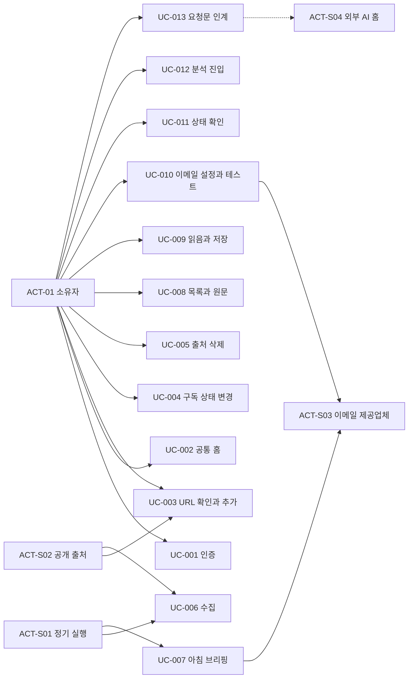
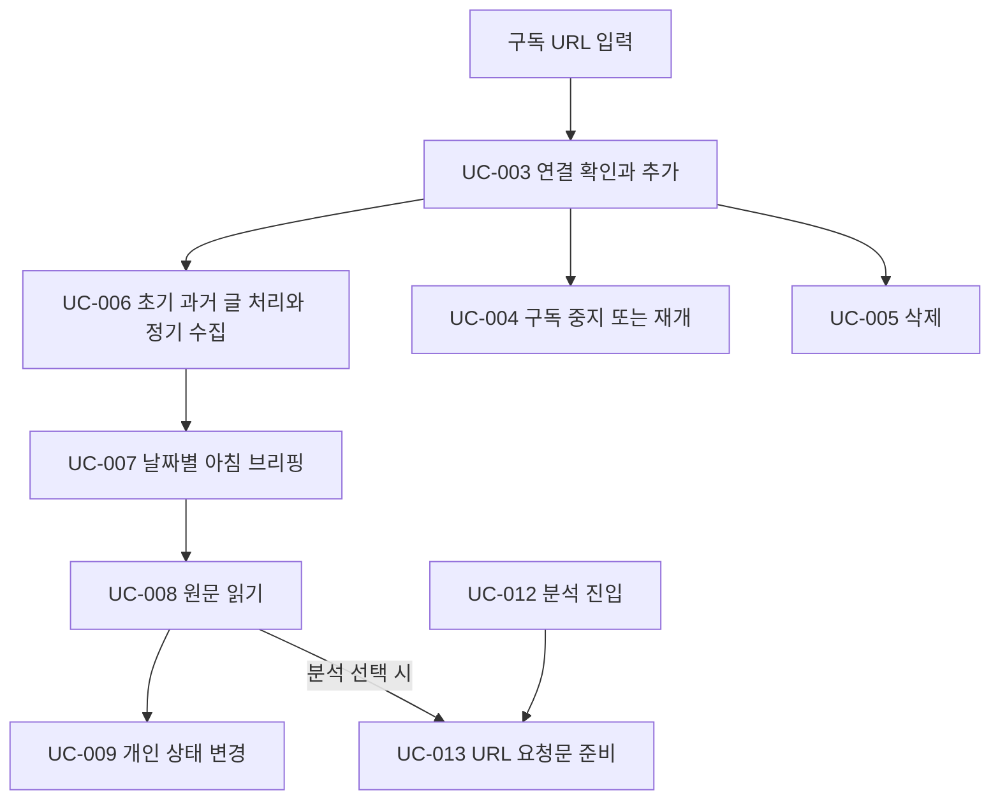

# 유스케이스 명세서

> 소유자의 실제 이용과 정기 서버 작업을 중심으로 작성한 초안이다. 범용 템플릿의 회원가입·게시글 작성·다중 역할 예시는 프로젝트 범위로 채택하지 않는다. 상위 기획·G1 승인 및 실행 결과는 아직 없다.

## 문서 정보

| 항목 | 내용 |
| --- | --- |
| 프로젝트명 | LevelUp |
| 문서 번호 | UCS-LEVELUP-v0.10 |
| 버전 | v0.10 |
| 작성일 | 2026-11-24 |
| 최종 수정일 | 2026-11-26 |
| 작성자 | Codex — 사용자 요청과 프로젝트 자료 기반 초안 |
| 상태 | 초안 / G0·G1 승인 기록 없음 |
| 대상 릴리스 | 첫 릴리스 — P1·P2 모두 포함 |
| 근거 | PRD-LEVELUP-v0.30, SPD-LEVELUP-v0.12, BPD-LEVELUP-v0.11, DESIGN.md |

## 변경 이력

| 버전 | 날짜 | 변경 내용 | 작성자 | 승인자 |
| --- | --- | --- | --- | --- |
| v0.7 | 2026-11-25 | CR-MIN-001: Python 호스트 통합·당일 자동 재발송 제외·단일 호출 결과 통합·템플릿 적용 범위 분리 | Codex | 변경 범위 사용자 확인·전체 문서 미승인 |
| v0.8 | 2026-11-26 | 확정 PRD v0.28 대조·과거 문구/참조 정정, Mac Chrome + iPhone Safari·모든 글 목록 최신순 확정, 실행 검증과 분리 | Codex | PRD·기기 범위 사용자 확정 / 개별 단계 승인 전 |
| v0.9 | 2026-11-26 | 00~04 미결·권장안 통합, 확정/설계/환경/검증/후속 보류 구분·잔여 문구/참조 정정. 권장안 미채택·실행 미검증 | Codex | 정정 요청 반영 / 개별 문서 미승인 |
| v0.10 | 2026-11-26 | 사용자 채택: Services 한 프로젝트·DB 저장 세션(auth_sessions 추가, 총 14개)·외부 클라우드 자동 백업. 실제 설정/검증은 미완료 | Codex | 세 가지 설계 사용자 채택 / 전체 단계 미승인 |

남은 항목의 상태·권장 처리방식·채택 여부는 [서비스기획서 7.4](../00-기획/서비스기획서.md#74-prd-확정-후-순차-검토-2026-11-26)를 단일 통합 표로 사용한다. 단일 Services 프로젝트·DB 저장 세션·외부 클라우드 주간 자동 백업은 2026-11-26 사용자 채택이며 나머지 권장안은 채택 전이다. 채택과 개별 단계 승인·실제 실행 검증 완료는 구분한다.

## 목차

1. [유스케이스 다이어그램](#1-유스케이스-다이어그램)
2. [액터 정의](#2-액터-정의)
3. [유스케이스 목록](#3-유스케이스-목록)
4. [유스케이스 상세 명세](#4-유스케이스-상세-명세)

## 1. 유스케이스 다이어그램

### 1.1 전체 시스템 유스케이스 다이어그램

점선은 사용자의 외부 서비스 이동이다. 외부 AI 결과의 서버 연계·수신을 의미하지 않는다. 정기 실행은 내부 트리거다.

### 1.2 기능 영역별 유스케이스 다이어그램

## 2. 액터 정의

### 2.1 주요 액터 (Primary Actors)

| Actor ID | 이름 | 목표·권한 |
| --- | --- | --- |
| ACT-01 | 사이트 소유자 본인 | 인증 후 개인 데이터·설정·구독·글·문서 인계 사용. 인증 진입 전에는 개인 데이터 접근 불가 |

### 2.2 보조 액터 (Secondary Actors)

| Actor ID | 이름 | 역할·경계 |
| --- | --- | --- |
| ACT-S01 | 정기 작업 실행 트리거 | 시간당·07:30 수집, 08:00 브리핑 시작. 외부 회원 역할 아님 |
| ACT-S02 | 공개 블로그·RSS/Atom 출처 | 검증 가능한 공개 글/목록·피드 응답. 수집기 지원 범위 DEC-003 |
| ACT-S03 | Gmail | 연결 계정에서 동일 계정으로 테스트·정기 메일 전송. 실제 연결·OAuth 운영·불명확 결과 확인은 DEC-002 |
| ACT-S04 | ChatGPT 또는 Claude | 사용자가 공식 홈에서 로그인·붙여넣기·실행. 결과는 사이트 관찰 범위 밖 |

### 2.3 액터 계층 구조

소유자 한 종류만 있다. 비회원→사용자→운영자→관리자 승격 구조와 권한 부여 기능은 없다. 인증은 Google OIDC와 로그인 성공부터 7일 고정 세션으로 확정했다. DB 저장 세션·현재 세션 로그아웃은 확정했다. OAuth 라이브러리와 실제 구현 검증은 DEC-001에 남긴다.

## 3. 유스케이스 목록

| UC-ID | 유스케이스명 | 주요/보조 액터 | 우선순위 | 상태 | 관련 FR |
| --- | --- | --- | --- | --- | --- |
| UC-001 | 소유자 인증과 개인 영역 접근 | ACT-01 | P1 | 초안 | FR-001 |
| UC-002 | 공통 홈과 섹션 탐색 | ACT-01 | P1 | 초안 | FR-002 |
| UC-003 | 구독 URL 확인·추가와 재추가 | ACT-01, ACT-S02 | P1 | 초안 | FR-003, FR-004 |
| UC-004 | 출처 구독 중지와 재개 | ACT-01 | P1 | 초안 | FR-005 |
| UC-005 | 출처 삭제 | ACT-01 | P1 | 초안 | FR-006 |
| UC-006 | 정기 글 수집과 신규 판정 | ACT-S01, ACT-S02 | P1 | 초안 | FR-007, FR-008 |
| UC-007 | 아침 브리핑 구성·발송·결과 확인 | ACT-S01, ACT-S03 | P1 | 초안 | FR-009, FR-015, FR-016 |
| UC-008 | 글 목록 검색과 원문 읽기 | ACT-01 | P1 | 초안 | FR-010, FR-011, FR-023 |
| UC-009 | 읽음·저장·목록 숨김 관리 | ACT-01 | P1 | 초안 | FR-012, FR-013 |
| UC-010 | 이메일 설정·일시 중지·테스트 메일 | ACT-01, ACT-S03 | P1 | 초안 | FR-014, FR-017 |
| UC-011 | 수집·이메일 상태와 확인 필요 건 조회 | ACT-01 | P1 | 초안 | FR-016, FR-018 |
| UC-012 | 리포트 분석 화면 진입 | ACT-01 | P1 | 초안 | FR-002, FR-019 |
| UC-013 | 문서 요약 요청문 준비·복사·외부 AI 열기 | ACT-01, ACT-S04 | P2 | 초안 | FR-020, FR-021, FR-022 |

모든 UC는 검토용 초안이다. ‘완료’는 문서 작성이 아니라 실제 단계 검토·승인 근거가 있을 때 사용한다. 구체 요구사항·수용 기준은 [SRS](요구사항명세서-SRS.md), 추적 상태는 [RTM](요구사항추적매트릭스-RTM.md)에서 확인한다.

## 4. 유스케이스 상세 명세

### 4.1 UC-001: 소유자 인증과 개인 영역 접근

| 항목 | 내용 |
| --- | --- |
| UC-ID | UC-001 |
| 액터 | ACT-01 |
| 우선순위·상태 | P1 / 초안 |
| 트리거 | 개인 영역에 접근 |
| 관련 요구사항 | [FR-001](요구사항명세서-SRS.md#32-fr-001-소유자-인증과-개인-영역-접근-제어) |
| 상위 수용 기준 | AC-001 |
| 미결 | 설계 결정 필요·실행 검증 대기: DB 저장 세션 구현 및 OAuth 라이브러리(DEC-001). 저장 방식은 확정. Google·7일 정책은 확정 |

#### 사전 조건 (Pre-conditions)

Google 로그인은 확정이며 소유자 Google sub를 사전에 구성한다. 로그인 유지 기간은 7일 고정으로 확정했다. 사이트 세션은 무작위 cookie token과 DB 저장으로 확정했고 OAuth 라이브러리·실제 구현 검증은 DEC-001에 남긴다.

#### 기본 흐름 (Main Flow)

| 단계 | 액터·트리거 | 시스템 |
| --- | --- | --- |
| 1 | 소유자가 개인 사이트에 접근한다 | 인증 필요 여부를 확인한다 |
| 2 | Google로 로그인하고 최초 발송 동의 화면을 확인한다 | 검증한 소유자 sub만 허용하고 로그인 이메일을 연결 계정에 자동 표시한다. 발송 권한과 refresh token이 있으면 같은 계정으로 연결한다 |
| 3 | 공통 홈으로 이동한다 | 권한에 맞는 개인 데이터만 제공한다 |

#### 대안 흐름 (Alternative Flow)

**AF-001-01:** 기본 흐름 중 아래 조건을 만나면 해당 단계에서 분기한다. 이미 유효한 소유자 인증이면 개인 영역으로 진입한다. Gmail 발송 권한만 거절한 경우 사이트 이용을 허용하고 ‘발송 권한 필요’를 표시한다. 해제 후 일반 로그인은 발송 연결을 복원하지 않는다.

#### 예외 흐름 (Exception Flow)

**EF-001-01:** 입력 검증·조회·변경·외부 연계 중 해당 오류에서 분기한다. 미인증·비소유자·인증 실패는 개인 데이터 없이 인증 안내 또는 거절한다. 로그인 성공 시점부터 7일 정각이면 세션이 만료되고 Google 재로그인 후 안전한 원래 내부 경로로 복귀한다. 페이지 방문은 만료 시각을 연장하지 않으며 Gmail 정기 작업은 유지한다.

#### 사후 조건 (Post-conditions)

성공 시 소유자 접근 허용. 실패 시 개인 데이터·설정 변경 없음.

#### 비즈니스 규칙

BP-AUTH-001. 규칙의 단일 원문은 [비즈니스 정책서](../00-기획/비즈니스정책서.md)다.

#### UI 참조

| 화면 ID | 화면명 | 상태 |
| --- | --- | --- |
| SCR-001 | 소유자 인증 | UIX·DDS 초안 작성됨 / 실제 구현·브라우저 검증 미실시 |

#### 관련 요구사항 ID (RTM)

| 요구사항 | SRS 수용 기준 | 설계 참조 | 테스트 케이스 |
| --- | --- | --- | --- |
| [FR-001](요구사항명세서-SRS.md#32-fr-001-소유자-인증과-개인-영역-접근-제어) | SC-FR-001 | [SAD FR-001](../02-시스템설계/시스템아키텍처설계서-SAD.md#fr-001) / 설계 초안 | 미작성 — RTM의 검증 조건으로 후속 설계 |

### 4.2 UC-002: 공통 홈과 섹션 탐색

| 항목 | 내용 |
| --- | --- |
| UC-ID | UC-002 |
| 액터 | ACT-01 |
| 우선순위·상태 | P1 / 초안 |
| 트리거 | 공통 홈·상위 메뉴 선택 또는 일반 설정의 테마 선택 |
| 관련 요구사항 | [FR-002](요구사항명세서-SRS.md#33-fr-002-공통-홈메뉴와-활성-섹션-진입) |
| 상위 수용 기준 | AC-009, AC-014, AC-015 |
| 미결 | 없음 |

#### 사전 조건 (Pre-conditions)

소유자 인증 완료.

#### 기본 흐름 (Main Flow)

| 단계 | 액터·트리거 | 시스템 |
| --- | --- | --- |
| 1 | 홈을 연다 | 활성 기능별 요약과 수신 이메일 요약·데일리 기사 요약의 준비 카드를 표시한다 |
| 2 | 원하는 섹션을 선택한다 | 해당 섹션 화면을 연다 |

#### 대안 흐름 (Alternative Flow)

**AF-002-01:** 기본 흐름 중 아래 조건을 만나면 해당 단계에서 분기한다. 리포트 분석은 메뉴·글별 버튼과 직접 주소에서 접근할 수 있다. 홈에는 리포트 분석 카드가 없다(CR-UX-004).

**AF-002-02 (테마):** 설정 > 일반 > 화면 테마에서 다크/라이트를 선택한다. 공통 루트에 즉시 적용하고 `levelup.theme`에 enum만 자동 저장한다. 화면 이동·새로고침·재방문 때 저장값을 적용하며 최초/무효 값은 다크다. 입력·검색·필터·글 상태를 유지하고 업무 API를 호출하지 않는다.

#### 예외 흐름 (Exception Flow)

**EF-002-01:** 입력 검증·조회·변경·외부 연계 중 해당 오류에서 분기한다. 준비 기능의 메뉴·빈 실행 화면을 만들지 않는다. 홈 준비 카드에는 링크·가짜 건수·권한/실행이 없으며 클릭/Tab 진입 대상으로 취급하지 않는다. 한 출처 오류가 다른 섹션 탐색을 막지 않는다.

**EF-002-02 (저장 실패):** localStorage 쓰기가 차단되어도 현재 선택은 메모리로 적용하고 저장 실패를 안내한다. 읽기 실패·키 없음·잘못된 값은 다크로 시작하며 앱 이용을 막지 않는다.

#### 사후 조건 (Post-conditions)

선택한 활성 섹션에만 진입하며 다른 모듈 데이터는 바꾸지 않는다. 준비 카드를 읽는 것은 API/수집/AI/권한 요청을 발생시키지 않는다.

#### 비즈니스 규칙

BP-AI-001, BP-SECTION-001, BP-SECTION-003 + CR-UX-002. 규칙의 단일 원문은 [비즈니스 정책서](../00-기획/비즈니스정책서.md)다.

#### UI 참조

| 화면 ID | 화면명 | 상태 |
| --- | --- | --- |
| SCR-002 | 공통 홈 | 공통 루트 테마 적용 / UIX 7.6 |
| SCR-008 | 일반 설정·화면 테마 | 다크/라이트 선택·자동 저장 / 로컬 동작 |

#### 관련 요구사항 ID (RTM)

| 요구사항 | SRS 수용 기준 | 설계 참조 | 테스트 케이스 |
| --- | --- | --- | --- |
| [FR-002](요구사항명세서-SRS.md#33-fr-002-공통-홈메뉴와-활성-섹션-진입) | SC-FR-002 | [SAD FR-002](../02-시스템설계/시스템아키텍처설계서-SAD.md#fr-002) / 설계 초안 | 미작성 — RTM의 검증 조건으로 후속 설계 |

### 4.3 UC-003: 구독 URL 확인·추가와 재추가

| 항목 | 내용 |
| --- | --- |
| UC-ID | UC-003 |
| 액터 | ACT-01, ACT-S02 |
| 우선순위·상태 | P1 / 초안 |
| 트리거 | 구독 설정에서 연결 확인 또는 추가 선택 |
| 관련 요구사항 | [FR-003](요구사항명세서-SRS.md#34-fr-003-구독-url-연결-확인과-피드-선택), [FR-004](요구사항명세서-SRS.md#35-fr-004-출처-추가중복-방지와-초기-기준-설정) |
| 상위 수용 기준 | AC-003, AC-017, AC-018, AC-019 |
| 미결 | 설계 결정 필요·환경 설정 필요: 실제 피드 탐색·지원 adapter·자원 상한(DEC-003) |

#### 사전 조건 (Pre-conditions)

소유자 인증 완료, 공개 블로그·목록·피드 URL 준비.

#### 기본 흐름 (Main Flow)

| 단계 | 액터·트리거 | 시스템 |
| --- | --- | --- |
| 1 | URL을 입력한다 | 입력만으로 외부 요청하지 않는다 |
| 2 | 연결 확인을 누른다 | 공개 주소·목적지를 검증하고 피드 또는 지원 수집기를 확인한다 |
| 3 | 여러 피드이면 하나를 선택한다 | 출처명·입력 URL·실제 수집 URL을 보여준다 |
| 4 | 추가를 누른다 | 권한·수집 가능 여부·중복을 확인해 구독을 저장한다 |
| 5 | 등록 결과를 확인한다 | 초기 수집 대기와 과거 글 처리 상태를 제공하고 정기 수집 대상으로 연결한다 |

#### 대안 흐름 (Alternative Flow)

**CR-FLOW-001 보완 흐름:** 초기 부분 성공은 유효 항목과 격리 수를 함께 표시하며 등록 성공과 기준 수집 완료/실패를 구분한다.

**AF-003-01:** 기본 흐름 중 아래 조건을 만나면 해당 단계에서 분기한다. 기본 제공 목록을 선택하거나 피드 주소를 직접 등록한다. 같은 피드면 기존 항목을 안내한다. 같은 도메인의 다른 피드는 별도로 추가한다. 삭제 출처 재추가는 기존 글을 재사용하고 새 초기 기준을 잡는다.

#### 예외 흐름 (Exception Flow)

**EF-003-01:** 입력 검증·조회·변경·외부 연계 중 해당 오류에서 분기한다. 잘못된·내부 목적지·연결 실패·피드 없는 미지원 URL은 완료로 저장하지 않고 수정/RSS 입력 대안을 표시한다. 확인·추가 사이 URL이 바뀌면 변경된 입력으로 재확인해야 한다.

#### 사후 조건 (Post-conditions)

성공 시 단일 출처와 구독 설정이 있고 초기/삭제 기간 글은 새 알림에서 제외된다. 실패 시 잘못된 활성 출처가 생기지 않는다.

#### 비즈니스 규칙

BP-CONTENT-003, BP-CONTENT-007, BP-CONTENT-008, BP-CONTENT-009. 규칙의 단일 원문은 [비즈니스 정책서](../00-기획/비즈니스정책서.md)다.

#### UI 참조

| 화면 ID | 화면명 | 상태 |
| --- | --- | --- |
| SCR-005 | 구독 설정 | UIX·DDS 초안 작성됨 / 실제 구현·브라우저 검증 미실시 |

#### 관련 요구사항 ID (RTM)

| 요구사항 | SRS 수용 기준 | 설계 참조 | 테스트 케이스 |
| --- | --- | --- | --- |
| [FR-003](요구사항명세서-SRS.md#34-fr-003-구독-url-연결-확인과-피드-선택) | SC-FR-003 | [SAD FR-003](../02-시스템설계/시스템아키텍처설계서-SAD.md#fr-003) / 설계 초안 | 미작성 — RTM의 검증 조건으로 후속 설계 |
| [FR-004](요구사항명세서-SRS.md#35-fr-004-출처-추가중복-방지와-초기-기준-설정) | SC-FR-004 | [SAD FR-004](../02-시스템설계/시스템아키텍처설계서-SAD.md#fr-004) / 설계 초안 | 미작성 — RTM의 검증 조건으로 후속 설계 |

### 4.4 UC-004: 출처 구독 중지와 재개

| 항목 | 내용 |
| --- | --- |
| UC-ID | UC-004 |
| 액터 | ACT-01 |
| 우선순위·상태 | P1 / 초안 |
| 트리거 | 출처 구독 토글 변경 |
| 관련 요구사항 | [FR-005](요구사항명세서-SRS.md#36-fr-005-출처-구독-켜기끄기와-재개) |
| 상위 수용 기준 | AC-003, AC-019 |
| 미결 | 실행 검증 대기: 구독 끄기·이전 대기 억제·재개·sending 경계. 정책 확정 |

#### 사전 조건 (Pre-conditions)

대상 출처가 목록에 존재.

#### 기본 흐름 (Main Flow)

| 단계 | 액터·트리거 | 시스템 |
| --- | --- | --- |
| 1 | 출처의 구독을 끈다 | 항목·글·읽음·저장은 남기고 끄기 전 발견분을 포함한 모든 미요청 대기를 억제한다 |
| 2 | 필요할 때 다시 켠다 | 새 기준 수집부터 시작한다. 기존 억제 대기를 되살리지 않으며 해제 기간 글은 소급 알림하지 않는다 |

#### 대안 흐름 (Alternative Flow)

**AF-004-01:** 기본 흐름 중 아래 조건을 만나면 해당 단계에서 분기한다. 구독은 유지하고 이메일만 잠시 중지하려면 UC-010을 사용한다.

#### 예외 흐름 (Exception Flow)

**EF-004-01:** 입력 검증·조회·변경·외부 연계 중 해당 오류에서 분기한다. 상태 저장 실패 시 성공으로 표시하지 않는다. prepared의 부적격 글은 제외·재구성한다. 외부 요청이 시작된 sending/unknown/accepted는 취소·변경하지 않는다.

#### 사후 조건 (Post-conditions)

목록 항목과 기존 글은 유지되고 구독 상태만 변경된다.

#### 비즈니스 규칙

BP-CONTENT-004, BP-CONTENT-010. 규칙의 단일 원문은 [비즈니스 정책서](../00-기획/비즈니스정책서.md)다.

#### UI 참조

| 화면 ID | 화면명 | 상태 |
| --- | --- | --- |
| SCR-005 | 구독 설정 | UIX·DDS 초안 작성됨 / 실제 구현·브라우저 검증 미실시 |

#### 관련 요구사항 ID (RTM)

| 요구사항 | SRS 수용 기준 | 설계 참조 | 테스트 케이스 |
| --- | --- | --- | --- |
| [FR-005](요구사항명세서-SRS.md#36-fr-005-출처-구독-켜기끄기와-재개) | SC-FR-005 | [SAD FR-005](../02-시스템설계/시스템아키텍처설계서-SAD.md#fr-005) / 설계 초안 | 미작성 — RTM의 검증 조건으로 후속 설계 |

### 4.5 UC-005: 출처 삭제

| 항목 | 내용 |
| --- | --- |
| UC-ID | UC-005 |
| 액터 | ACT-01 |
| 우선순위·상태 | P1 / 초안 |
| 트리거 | 출처 삭제 선택 |
| 관련 요구사항 | [FR-006](요구사항명세서-SRS.md#37-fr-006-출처-삭제와-진행-중-작업-차단) |
| 상위 수용 기준 | AC-019 |
| 미결 | 없음 |

#### 사전 조건 (Pre-conditions)

기본 또는 사용자 추가 출처가 존재.

#### 기본 흐름 (Main Flow)

| 단계 | 액터·트리거 | 시스템 |
| --- | --- | --- |
| 1 | 삭제할 출처를 선택하고 삭제를 누른다 | 활성 구독 목록에서 제거한다 |
| 2 | 삭제 결과를 확인한다 | 이후 수집·미발송 후보를 중단하고 진행 중 작업 반영/전송 직전에도 삭제 상태를 확인한다 |
| 3 | 기존 저장 글·브리핑을 확인한다 | 기존 글·읽음·저장·과거 발송 기록을 유지한다 |

#### 대안 흐름 (Alternative Flow)

**AF-005-01:** 기본 흐름 중 아래 조건을 만나면 해당 단계에서 분기한다. 재개 가능한 중지는 UC-004로 처리한다. 동일 URL을 다시 추가하면 UC-003의 과거 글·중복 기준을 적용한다.

#### 예외 흐름 (Exception Flow)

**EF-005-01:** 입력 검증·조회·변경·외부 연계 중 해당 오류에서 분기한다. 이미 제공업체가 접수한 메일의 취소를 약속하지 않는다. 삭제 실패 시 완료로 표시하지 않는다.

#### 사후 조건 (Post-conditions)

신규 결과 반영·미발송 알림이 중단되고 출처가 자동 복원되지 않는다. 다른 출처는 영향받지 않는다.

#### 비즈니스 규칙

BP-CONTENT-010. 규칙의 단일 원문은 [비즈니스 정책서](../00-기획/비즈니스정책서.md)다.

#### UI 참조

| 화면 ID | 화면명 | 상태 |
| --- | --- | --- |
| SCR-005 | 구독 설정 | UIX·DDS 초안 작성됨 / 실제 구현·브라우저 검증 미실시 |

#### 관련 요구사항 ID (RTM)

| 요구사항 | SRS 수용 기준 | 설계 참조 | 테스트 케이스 |
| --- | --- | --- | --- |
| [FR-006](요구사항명세서-SRS.md#37-fr-006-출처-삭제와-진행-중-작업-차단) | SC-FR-006 | [SAD FR-006](../02-시스템설계/시스템아키텍처설계서-SAD.md#fr-006) / 설계 초안 | 미작성 — RTM의 검증 조건으로 후속 설계 |

### 4.6 UC-006: 정기 글 수집과 신규 판정

| 항목 | 내용 |
| --- | --- |
| UC-ID | UC-006 |
| 액터 | ACT-S01, ACT-S02 |
| 우선순위·상태 | P1 / 초안 |
| 트리거 | 시간당 또는 07:30 수집 시각 |
| 관련 요구사항 | [FR-007](요구사항명세서-SRS.md#38-fr-007-서버-정기-수집과-출처별-상태-갱신), [FR-008](요구사항명세서-SRS.md#39-fr-008-전체-콘텐츠-수집게시글-중복과-수정-처리) |
| 상위 수용 기준 | AC-002, AC-003, AC-008, AC-017, AC-020 |
| 미결 | 설계 결정 필요·실행 검증 대기: 실제 파싱·정규화·수집 범위/상한(DEC-003) |

#### 사전 조건 (Pre-conditions)

지원되는 출처와 수집 설정 존재. 사용자 브라우저는 필요하지 않음.

#### 기본 흐름 (Main Flow)

| 단계 | 액터·트리거 | 시스템 |
| --- | --- | --- |
| 1 | 실행기가 수집 시각을 알린다 | 활성 수집 대상의 상태를 확인한다 |
| 2 | 공개 출처가 글 목록·피드를 응답한다 | 유형별 제외 없이 모든 글을 수집하고 중복·수정·초기 과거 글을 구분한다 |
| 3 | 작업이 출처별로 종료된다 | 성공 시각·실패와 글 후보를 기록한다 |

#### 대안 흐름 (Alternative Flow)

**CR-FLOW-001 보완 흐름:** 응답 전체 오류는 출처 실패, 개별 항목 오류는 격리·partial이다. 유효 글은 저장하고 초기 정상 글은 baseline으로 제외한다. 식별 가능한 초기 격리 글이 나중에 복구되어도 신규 알림을 만들지 않는다.

**AF-006-01:** 기본 흐름 중 아래 조건을 만나면 해당 단계에서 분기한다. 초기 등록·재추가는 과거 글로 기준을 잡고 다른 피드의 글을 동일 도메인만으로 합치지 않는다.

#### 예외 흐름 (Exception Flow)

**EF-006-01:** 입력 검증·조회·변경·외부 연계 중 해당 오류에서 분기한다. 특정 출처 실패·한도 초과는 해당 출처 실패만 기록하고 다음 수집에서 재시도한다. 실행 중 삭제는 결과 반영을 차단한다.

#### 사후 조건 (Post-conditions)

중복 없는 글과 출처별 관찰 결과가 남고 기존 글 수정은 새 알림을 만들지 않는다.

#### 비즈니스 규칙

BP-CONTENT-001, BP-CONTENT-002, BP-CONTENT-003, BP-ERROR-001, BP-STAT-001. 규칙의 단일 원문은 [비즈니스 정책서](../00-기획/비즈니스정책서.md)다.

#### UI 참조

| 화면 ID | 화면명 | 상태 |
| --- | --- | --- |
| SCR-006 | 수집·발송 상태 | UIX·DDS 초안 작성됨 / 실제 구현·브라우저 검증 미실시 |

#### 관련 요구사항 ID (RTM)

| 요구사항 | SRS 수용 기준 | 설계 참조 | 테스트 케이스 |
| --- | --- | --- | --- |
| [FR-007](요구사항명세서-SRS.md#38-fr-007-서버-정기-수집과-출처별-상태-갱신) | SC-FR-007 | [SAD FR-007](../02-시스템설계/시스템아키텍처설계서-SAD.md#fr-007) / 설계 초안 | 미작성 — RTM의 검증 조건으로 후속 설계 |
| [FR-008](요구사항명세서-SRS.md#39-fr-008-전체-콘텐츠-수집게시글-중복과-수정-처리) | SC-FR-008 | [SAD FR-008](../02-시스템설계/시스템아키텍처설계서-SAD.md#fr-008) / 설계 초안 | 미작성 — RTM의 검증 조건으로 후속 설계 |

### 4.7 UC-007: 아침 브리핑 구성·발송·결과 확인

| 항목 | 내용 |
| --- | --- |
| UC-ID | UC-007 |
| 액터 | ACT-S01, ACT-S03 |
| 우선순위·상태 | P1 / 초안 |
| 트리거 | 매일 08:00 Asia/Seoul |
| 관련 요구사항 | [FR-009](요구사항명세서-SRS.md#310-fr-009-게시일발견일-기반-브리핑-후보-판정), [FR-015](요구사항명세서-SRS.md#316-fr-015-매일-아침-브리핑-구성과-이메일-발송), [FR-016](요구사항명세서-SRS.md#317-fr-016-발송-중복-방지실패성공-불명확-처리) |
| 상위 수용 기준 | AC-003, AC-005, AC-006, AC-007, AC-019 |
| 미결 | 설계 결정 필요·환경 설정 필요·실행 검증 대기: 작업 실행·출처/Gmail 표본·OP-01(DEC-001·002·003·006). 날짜·발송 정책 확정 |

#### 사전 조건 (Pre-conditions)

소유자 수신 설정과 날짜별 수집 결과 존재. 실제 시작 snapshot과 08:20 경계는 CR-FLOW-001, 당일 자동 재발송 제외는 CR-MIN-001을 따른다. unknown은 소유자가 기한 없이 필요할 때 확인하며 기록 명령/위치만 미결이다.

#### 기본 흐름 (Main Flow)

| 단계 | 액터·트리거 | 시스템 |
| --- | --- | --- |
| 1 | 실행기가 아침 발송을 시작한다 | 구독·과거 글·발송 상태·한국 날짜로 후보를 판정한다 |
| 2 | 전송할 묶음을 준비한다 | 출처별 제목·원문 링크와 전체 목록을 구성한다 |
| 3 | 제공업체에 발송을 요청한다 | 전송 직전 출처 삭제 여부를 다시 확인한다 |
| 4 | 제공업체가 결과를 반환한다 | 완료·실패·성공 여부 확인 필요를 구분해 기록한다 |

#### 대안 흐름 (Alternative Flow)

**CR-FLOW-001 보완 흐름:** 08:00에 예약하고 별도 발송 실행 슬롯을 우선 사용한다. 실제 작업 시작 snapshot으로 확정하며 08:20 미시작은 missed·다음 정상 아침 합침이다. pending 게시일 정정은 최신 날짜로 반영하고 sending/unknown/accepted 기록은 바꾸지 않는다.

**AF-007-01:** 기본 흐름 중 아래 조건을 만나면 해당 단계에서 분기한다. 대상 0개·알림 중지면 미발송한다. 20개 초과면 이메일 20개와 전체 건수/링크를 제공한다. 당일·게시일 누락·늦은 발견은 날짜 규칙을 따른다.

#### 예외 흐름 (Exception Flow)

**EF-007-01:** 입력 검증·조회·변경·외부 연계 중 해당 오류에서 분기한다. 중복 실행은 같은 날 완료 건을 재발송하지 않는다. 불명확 응답은 제공업체 기록 확인 전 추정 완료/무조건 재시도하지 않는다. 일부 출처 실패가 유효한 다른 후보의 브리핑을 막지 않는다.

#### 사후 조건 (Post-conditions)

정기 결과와 날짜별 전체 브리핑이 기록된다. 실패는 미발송으로 남고 unknown은 소유자가 기한 없이 필요할 때 확인한다. 근거 부족이면 예약을 유지하고 다른 정상 발송은 계속한다. 확인 기록 구현은 DEC-002·006에서 정한다.

#### 비즈니스 규칙

BP-CONTENT-003, BP-CONTENT-004, BP-CONTENT-010, BP-ERROR-003, BP-NOTI-001, BP-NOTI-002, BP-NOTI-004, BP-RESET-001, BP-RESET-002, BP-STAT-001. 규칙의 단일 원문은 [비즈니스 정책서](../00-기획/비즈니스정책서.md)다.

#### UI 참조

| 화면 ID | 화면명 | 상태 |
| --- | --- | --- |
| SCR-006 | 수집·발송 상태 | UIX·DDS 초안 작성됨 / 실제 구현·브라우저 검증 미실시 |

#### 관련 요구사항 ID (RTM)

| 요구사항 | SRS 수용 기준 | 설계 참조 | 테스트 케이스 |
| --- | --- | --- | --- |
| [FR-009](요구사항명세서-SRS.md#310-fr-009-게시일발견일-기반-브리핑-후보-판정) | SC-FR-009 | [SAD FR-009](../02-시스템설계/시스템아키텍처설계서-SAD.md#fr-009) / 설계 초안 | 미작성 — RTM의 검증 조건으로 후속 설계 |
| [FR-015](요구사항명세서-SRS.md#316-fr-015-매일-아침-브리핑-구성과-이메일-발송) | SC-FR-015 | [SAD FR-015](../02-시스템설계/시스템아키텍처설계서-SAD.md#fr-015) / 설계 초안 | 미작성 — RTM의 검증 조건으로 후속 설계 |
| [FR-016](요구사항명세서-SRS.md#317-fr-016-발송-중복-방지실패성공-불명확-처리) | SC-FR-016 | [SAD FR-016](../02-시스템설계/시스템아키텍처설계서-SAD.md#fr-016) / 설계 초안 | 미작성 — RTM의 검증 조건으로 후속 설계 |

### 4.8 UC-008: 글 목록 검색과 원문 읽기

| 항목 | 내용 |
| --- | --- |
| UC-ID | UC-008 |
| 액터 | ACT-01 |
| 우선순위·상태 | P1 / 초안 |
| 트리거 | 글 목록 또는 이메일의 링크 선택 |
| 관련 요구사항 | [FR-010](요구사항명세서-SRS.md#311-fr-010-오늘의-글전체-글브리핑-전체-목록), [FR-011](요구사항명세서-SRS.md#312-fr-011-제목-검색출처읽음-필터), [FR-023](요구사항명세서-SRS.md#324-fr-023-원문-직접-열기) |
| 상위 수용 기준 | AC-004, AC-006, AC-016 |
| 미결 | 실행 검증 대기: 확정 정렬과 빈 브리핑/미확정/조회 실패 구분. 새 정책 선택 없음 |

#### 사전 조건 (Pre-conditions)

목록은 소유자 인증 후 사용. 이메일 원문 링크는 원문 사이트로 직접 연결.

#### 기본 흐름 (Main Flow)

| 단계 | 액터·트리거 | 시스템 |
| --- | --- | --- |
| 1 | 오늘의 글·전체 글·브리핑 전체를 연다 | 확정된 글 최신순으로 출처·제목·날짜·원문 링크와 제공된 부가 정보 표시 |
| 2 | 검색어·출처·읽음 조건을 선택한다 | 일치하는 글 또는 결과 없음을 표시한다 |
| 3 | 관심 글의 원문 링크를 누른다 | 원문으로 직접 이동하고 읽음·저장 상태를 자동 변경하지 않는다 |

#### 대안 흐름 (Alternative Flow)

**AF-008-01:** 기본 흐름 중 아래 조건을 만나면 해당 단계에서 분기한다. 저장 목록에서도 원문을 열거나 20개 초과 이메일의 전체 브리핑으로 이동할 수 있다.

#### 예외 흐름 (Exception Flow)

**EF-008-01:** 입력 검증·조회·변경·외부 연계 중 해당 오류에서 분기한다. 목록 읽기 실패를 빈 결과와 구분한다. 원문 사이트의 로그인·링크 소멸은 사이트가 우회하지 않는다. 정렬은 모든 목록에서 게시일(없으면 최초 발견 시각)·글 ID 내림차순으로 확정했다. 확정 브리핑 순서는 보존하고 빈 브리핑의 안내는 실제 snapshot 0과 미확정/조회 실패를 구분한다.

#### 사후 조건 (Post-conditions)

원문 이동과 목록 탐색이 가능하고 개인 상태는 명시적 변경 전 유지된다.

#### 비즈니스 규칙

BP-CONTENT-005, BP-CONTENT-006, BP-STAT-001. 규칙의 단일 원문은 [비즈니스 정책서](../00-기획/비즈니스정책서.md)다.

#### UI 참조

| 화면 ID | 화면명 | 상태 |
| --- | --- | --- |
| SCR-003 | 오늘의 글·전체 글 | UIX·DDS 초안 작성됨 / 실제 구현·브라우저 검증 미실시 |
| SCR-004 | 저장한 글 | UIX·DDS 초안 작성됨 / 실제 구현·브라우저 검증 미실시 |

#### 관련 요구사항 ID (RTM)

| 요구사항 | SRS 수용 기준 | 설계 참조 | 테스트 케이스 |
| --- | --- | --- | --- |
| [FR-010](요구사항명세서-SRS.md#311-fr-010-오늘의-글전체-글브리핑-전체-목록) | SC-FR-010 | [SAD FR-010](../02-시스템설계/시스템아키텍처설계서-SAD.md#fr-010) / 설계 초안 | 미작성 — RTM의 검증 조건으로 후속 설계 |
| [FR-011](요구사항명세서-SRS.md#312-fr-011-제목-검색출처읽음-필터) | SC-FR-011 | [SAD FR-011](../02-시스템설계/시스템아키텍처설계서-SAD.md#fr-011) / 설계 초안 | 미작성 — RTM의 검증 조건으로 후속 설계 |
| [FR-023](요구사항명세서-SRS.md#324-fr-023-원문-직접-열기) | SC-FR-023 | [SAD FR-023](../02-시스템설계/시스템아키텍처설계서-SAD.md#fr-023) / 설계 초안 | 미작성 — RTM의 검증 조건으로 후속 설계 |

### 4.9 UC-009: 읽음·저장·목록 숨김 관리

| 항목 | 내용 |
| --- | --- |
| UC-ID | UC-009 |
| 액터 | ACT-01 |
| 우선순위·상태 | P1 / 초안 |
| 트리거 | 글별 상태 버튼 선택 |
| 관련 요구사항 | [FR-012](요구사항명세서-SRS.md#313-fr-012-읽음저장-상태-직접-변경), [FR-013](요구사항명세서-SRS.md#314-fr-013-목록에서-글-숨김) |
| 상위 수용 기준 | AC-004, AC-019 |
| 미결 | 실행 검증 대기: 읽음·저장·목록 전용 숨김·복원. 정책 확정 |

#### 사전 조건 (Pre-conditions)

수집된 글이 존재하고 소유자 인증 완료.

#### 기본 흐름 (Main Flow)

| 단계 | 액터·트리거 | 시스템 |
| --- | --- | --- |
| 1 | 읽음 또는 저장 버튼을 누른다 | 선택한 개인 상태만 저장한다 |
| 2 | 저장 목록에서 글을 다시 확인하거나 저장 해제한다 | 개인 목록 상태를 갱신한다 |
| 3 | ‘목록에서 숨기기’를 선택한다 | 오늘/전체/저장 기본 목록에서만 제외한다. 이메일 자격·읽음·저장은 유지한다 |

#### 대안 흐름 (Alternative Flow)

**AF-009-01:** 기본 흐름 중 아래 조건을 만나면 해당 단계에서 분기한다. 원문 열기만으로 읽음이 바뀌지 않는다. 출처 삭제 후에도 기존 읽음·저장 상태를 확인할 수 있다.

#### 예외 흐름 (Exception Flow)

**EF-009-01:** 입력 검증·조회·변경·외부 연계 중 해당 오류에서 분기한다. 저장 실패는 성공으로 표시하지 않고 기존 상태를 유지한다. 숨김 보기에서 확인·복원하며 이메일 후보는 변경하지 않는다.

#### 사후 조건 (Post-conditions)

명시한 상태 변경만 유지되고 다른 글·원문은 삭제되지 않는다.

#### 비즈니스 규칙

BP-CONTENT-005, BP-CONTENT-006, BP-STAT-002. 규칙의 단일 원문은 [비즈니스 정책서](../00-기획/비즈니스정책서.md)다.

#### UI 참조

| 화면 ID | 화면명 | 상태 |
| --- | --- | --- |
| SCR-003 | 오늘의 글·전체 글 | UIX·DDS 초안 작성됨 / 실제 구현·브라우저 검증 미실시 |
| SCR-004 | 저장한 글 | UIX·DDS 초안 작성됨 / 실제 구현·브라우저 검증 미실시 |

#### 관련 요구사항 ID (RTM)

| 요구사항 | SRS 수용 기준 | 설계 참조 | 테스트 케이스 |
| --- | --- | --- | --- |
| [FR-012](요구사항명세서-SRS.md#313-fr-012-읽음저장-상태-직접-변경) | SC-FR-012 | [SAD FR-012](../02-시스템설계/시스템아키텍처설계서-SAD.md#fr-012) / 설계 초안 | 미작성 — RTM의 검증 조건으로 후속 설계 |
| [FR-013](요구사항명세서-SRS.md#314-fr-013-목록에서-글-숨김) | SC-FR-013 | [SAD FR-013](../02-시스템설계/시스템아키텍처설계서-SAD.md#fr-013) / 설계 초안 | 미작성 — RTM의 검증 조건으로 후속 설계 |

### 4.10 UC-010: 이메일 설정·일시 중지·테스트 메일

| 항목 | 내용 |
| --- | --- |
| UC-ID | UC-010 |
| 액터 | ACT-01, ACT-S03 |
| 우선순위·상태 | P1 / 초안 |
| 트리거 | 공통 설정에서 이메일 관련 조작 |
| 관련 요구사항 | [FR-014](요구사항명세서-SRS.md#315-fr-014-수신-이메일과-알림-중지재개), [FR-017](요구사항명세서-SRS.md#318-fr-017-테스트-이메일-발송) |
| 상위 수용 기준 | AC-007 |
| 미결 | 환경 설정 필요·실행 검증 대기: 실제 OAuth·계정 한도(DEC-002). 알림 중지/재개 정책 확정 |

#### 사전 조건 (Pre-conditions)

소유자 인증 완료. Gmail 동일 계정 발신·수신은 사용자 확인 사항이며 실제 계정·OAuth 프로젝트/동의·지속 운영은 DEC-002에서 확인한다.

#### 기본 흐름 (Main Flow)

| 단계 | 액터·트리거 | 시스템 |
| --- | --- | --- |
| 1 | 첫 로그인에서 발송 동의를 완료하거나 설정에서 동일 계정의 발송 권한을 허용한다 | 로그인 Google sub와 일치할 때만 검증된 Gmail을 발신·수신 주소로 표시하고 보호된 token을 서버에 저장한다. 메일함 읽기 권한은 요청하지 않는다 |
| 2 | 알림 활성 상태를 저장한다 | 설정을 기록하고 중지 중에는 정기 발송하지 않는다 |
| 3 | 테스트 메일을 요청한다 | 정기 발송과 별도로 요청하고 결과를 표시한다 |
| 4 | 알림을 다시 켠다 | 유효한 미발송 글을 다음 정기 알림 후보로 처리한다 |

#### 대안 흐름 (Alternative Flow)

**AF-010-01:** 설정 화면은 일반/연결 계정/기능별 설정으로 구분한다. 현재 알림 제어는 기술블로그에 한정하고 준비 기능의 토글·동의는 제공하지 않는다. 기본 흐름 중 아래 조건을 만나면 해당 단계에서 분기한다. Gmail 재연결·해제는 설정에서 동일 Google 계정에만 수행하고 연결 불가/해제여도 수집·읽기는 계속한다. 연결 동의 취소·token 만료/철회는 재연결을 안내한다. 출처 자체를 끄려면 UC-004를 사용한다. 테스트 결과는 정기 브리핑 완료/대상을 변경하지 않는다.

#### 예외 흐름 (Exception Flow)

**EF-010-01:** 입력 검증·조회·변경·외부 연계 중 해당 오류에서 분기한다. 설정 저장·전송 실패를 성공으로 표시하지 않는다. 중지/재개와 발송 경계는 DEC-006에 따라 확정한다.

#### 사후 조건 (Post-conditions)

설정·테스트 결과는 확인 가능하며 중지 중 수집·읽기는 계속 가능하다.

#### 비즈니스 규칙

BP-NOTI-003, BP-NOTI-005, BP-NOTI-006. 규칙의 단일 원문은 [비즈니스 정책서](../00-기획/비즈니스정책서.md)다.

#### UI 참조

| 화면 ID | 화면명 | 상태 |
| --- | --- | --- |
| SCR-008 | 공통 설정 | UIX·DDS 초안 작성됨 / 실제 구현·브라우저 검증 미실시 |

#### 관련 요구사항 ID (RTM)

| 요구사항 | SRS 수용 기준 | 설계 참조 | 테스트 케이스 |
| --- | --- | --- | --- |
| [FR-014](요구사항명세서-SRS.md#315-fr-014-수신-이메일과-알림-중지재개) | SC-FR-014 | [SAD FR-014](../02-시스템설계/시스템아키텍처설계서-SAD.md#fr-014) / 설계 초안 | 미작성 — RTM의 검증 조건으로 후속 설계 |
| [FR-017](요구사항명세서-SRS.md#318-fr-017-테스트-이메일-발송) | SC-FR-017 | [SAD FR-017](../02-시스템설계/시스템아키텍처설계서-SAD.md#fr-017) / 설계 초안 | 미작성 — RTM의 검증 조건으로 후속 설계 |

### 4.11 UC-011: 수집·이메일 상태와 확인 필요 건 조회

| 항목 | 내용 |
| --- | --- |
| UC-ID | UC-011 |
| 액터 | ACT-01 |
| 우선순위·상태 | P1 / 초안 |
| 트리거 | 수집 상태 화면 진입 |
| 관련 요구사항 | [FR-016](요구사항명세서-SRS.md#317-fr-016-발송-중복-방지실패성공-불명확-처리), [FR-018](요구사항명세서-SRS.md#319-fr-018-출처-수집과-이메일-상태-조회) |
| 상위 수용 기준 | AC-007, AC-008 |
| 미결 | 설계 결정 필요·실행 검증 대기: OP-01 기록 명령·실제 Gmail 대조(DEC-002·006). 조회 상태·수동 확인 기한 정책 확정 |

#### 사전 조건 (Pre-conditions)

작업 기록이 존재하거나 아직 초기 처리 전임.

#### 기본 흐름 (Main Flow)

| 단계 | 액터·트리거 | 시스템 |
| --- | --- | --- |
| 1 | 상태 화면을 연다 | 출처별 마지막 성공·현재 오류·초기 대기와 최근 이메일 결과를 표시한다 |
| 2 | 실패 또는 확인 필요 건을 확인한다 | 추정 성공 없이 기록된 사실과 필요한 후속 확인을 안내한다 |

#### 대안 흐름 (Alternative Flow)

**CR-FLOW-001 보완 흐름:** 정기 탭은 API-022 날짜별 이력, 테스트 탭은 API-015 발송 이력이다. delivery 없는 미연결/중지/빈 대상과 지연/누락, partial/격리 건수를 구분하고 미확정 건수를 0으로 표시하지 않는다.

**AF-011-01:** 기본 흐름 중 아래 조건을 만나면 해당 단계에서 분기한다. 기록이 없으면 초기 상태를 표시하고 허위 성공 시각을 만들지 않는다.

#### 예외 흐름 (Exception Flow)

**EF-011-01:** 입력 검증·조회·변경·외부 연계 중 해당 오류에서 분기한다. 성공 불명확 발송은 제공업체 기록을 별도로 확인한다. 수동 확인은 소유자가 기한 없이 필요할 때 수행하고 기록 위치/명령은 DEC-002·006 미결이며 관리자 강제 재발송 UI를 새 기능으로 추가하지 않는다.

#### 사후 조건 (Post-conditions)

기존 작업·브리핑 상태는 조회만으로 변경되지 않는다.

#### 비즈니스 규칙

BP-ERROR-001, BP-ERROR-003, BP-NOTI-004. 규칙의 단일 원문은 [비즈니스 정책서](../00-기획/비즈니스정책서.md)다.

#### UI 참조

| 화면 ID | 화면명 | 상태 |
| --- | --- | --- |
| SCR-006 | 수집·발송 상태 | UIX·DDS 초안 작성됨 / 실제 구현·브라우저 검증 미실시 |

#### 관련 요구사항 ID (RTM)

| 요구사항 | SRS 수용 기준 | 설계 참조 | 테스트 케이스 |
| --- | --- | --- | --- |
| [FR-016](요구사항명세서-SRS.md#317-fr-016-발송-중복-방지실패성공-불명확-처리) | SC-FR-016 | [SAD FR-016](../02-시스템설계/시스템아키텍처설계서-SAD.md#fr-016) / 설계 초안 | 미작성 — RTM의 검증 조건으로 후속 설계 |
| [FR-018](요구사항명세서-SRS.md#319-fr-018-출처-수집과-이메일-상태-조회) | SC-FR-018 | [SAD FR-018](../02-시스템설계/시스템아키텍처설계서-SAD.md#fr-018) / 설계 초안 | 미작성 — RTM의 검증 조건으로 후속 설계 |

### 4.12 UC-012: 리포트 분석 화면 진입

| 항목 | 내용 |
| --- | --- |
| UC-ID | UC-012 |
| 액터 | ACT-01 |
| 우선순위·상태 | P1 / 초안 |
| 트리거 | 메뉴·글별 버튼 선택 또는 직접 주소 접근 |
| 관련 요구사항 | [FR-002](요구사항명세서-SRS.md#33-fr-002-공통-홈메뉴와-활성-섹션-진입), [FR-019](요구사항명세서-SRS.md#320-fr-019-리포트-분석-진입) |
| 상위 수용 기준 | AC-009, AC-014, AC-015 |
| 미결 | 없음 |

#### 사전 조건 (Pre-conditions)

소유자 인증 완료.

#### 기본 흐름 (Main Flow)

| 단계 | 액터·트리거 | 시스템 |
| --- | --- | --- |
| 1 | 메뉴·글별 버튼 또는 직접 주소로 진입한다 | 분석 입력 화면을 표시한다 |
| 2 | 글별 분석 버튼을 선택한다 | 원문 URL을 미리 채운 분석 화면을 표시한다 |

#### 대안 흐름 (Alternative Flow)

**AF-012-01:** 기본 흐름 중 아래 조건을 만나면 해당 단계에서 분기한다. UC-013을 독립적으로 사용한다. 구독·이메일 상태와 무관하게 진입할 수 있다.

#### 예외 흐름 (Exception Flow)

**EF-012-01:** 입력 검증·조회·변경·외부 연계 중 해당 오류에서 분기한다. 인증 실패 시 로그인으로 안내하고 원래 경로로 돌아온다. API 키·결제·AI 계정 연동을 요구하지 않는다.

#### 사후 조건 (Post-conditions)

분석 화면에 진입하며 기술블로그는 계속 동작한다.

#### 비즈니스 규칙

BP-AI-001, BP-COST-001, BP-SECTION-001. 규칙의 단일 원문은 [비즈니스 정책서](../00-기획/비즈니스정책서.md)다.

#### UI 참조

| 화면 ID | 화면명 | 상태 |
| --- | --- | --- |
| SCR-008 | 공통 설정 | UIX·DDS 초안 작성됨 / 실제 구현·브라우저 검증 미실시 |
| SCR-007 | 리포트 분석 | UIX·DDS 초안 작성됨 / 실제 구현·브라우저 검증 미실시 |

#### 관련 요구사항 ID (RTM)

| 요구사항 | SRS 수용 기준 | 설계 참조 | 테스트 케이스 |
| --- | --- | --- | --- |
| [FR-002](요구사항명세서-SRS.md#33-fr-002-공통-홈메뉴와-활성-섹션-진입) | SC-FR-002 | [SAD FR-002](../02-시스템설계/시스템아키텍처설계서-SAD.md#fr-002) / 설계 초안 | 미작성 — RTM의 검증 조건으로 후속 설계 |
| [FR-019](요구사항명세서-SRS.md#320-fr-019-리포트-분석-진입) | SC-FR-019 | [SAD FR-019](../02-시스템설계/시스템아키텍처설계서-SAD.md#fr-019) / 설계 초안 | 미작성 — RTM의 검증 조건으로 후속 설계 |

### 4.13 UC-013: 문서 요약 요청문 준비·복사·외부 AI 열기

| 항목 | 내용 |
| --- | --- |
| UC-ID | UC-013 |
| 액터 | ACT-01, ACT-S04 |
| 우선순위·상태 | P2 / 초안 |
| 트리거 | URL 직접 입력 또는 글의 리포트 분석 선택 |
| 관련 요구사항 | [FR-020](요구사항명세서-SRS.md#321-fr-020-공개-문서-url과-요약-요청문-준비), [FR-021](요구사항명세서-SRS.md#322-fr-021-현재-요청문-복사와-공식-ai-서비스-열기), [FR-022](요구사항명세서-SRS.md#323-fr-022-외부-ai-실행-안내와-결과-경계) |
| 상위 수용 기준 | AC-010, AC-011, AC-012, AC-013, AC-014 |
| 미결 | 없음 |

#### 사전 조건 (Pre-conditions)

소유자 인증 완료. 외부 서비스 로그인은 별개.

#### 기본 흐름 (Main Flow)

| 단계 | 액터·트리거 | 시스템 |
| --- | --- | --- |
| 1 | URL을 입력하거나 글에서 이동한다 | 원문 URL을 채우되 외부 조회는 하지 않는다 |
| 2 | ChatGPT 또는 Claude를 선택한다 | 첫 선택을 요구하고 이후 마지막 선택을 기본 표시한다 |
| 3 | 요청문을 확인하고 필요하면 수정한다 | 한국어 템플릿과 URL로 현재 요청문을 제공한다 |
| 4 | 요청문 복사를 누른다 | 실제 복사 결과 또는 수동 대안을 표시한다 |
| 5 | 선택한 서비스 열기를 누른다 | 문서/요청문 쿼리 없이 공식 홈을 새 탭으로 연다 |
| 6 | 외부에서 요청문을 붙여넣고 실행한다 | 사이트는 외부 결과를 확인·수신하지 않는다 |

#### 대안 흐름 (Alternative Flow)

**AF-013-01:** 기본 흐름 중 아래 조건을 만나면 해당 단계에서 분기한다. 공개 웹페이지·텍스트형 PDF URL을 같은 인계 흐름으로 사용한다. 게시글 DB가 없어도 직접 입력으로 가능하다. 복사와 외부 열기는 독립 조작이다.

#### 예외 흐름 (Exception Flow)

**EF-013-01:** 입력 검증·조회·변경·외부 연계 중 해당 오류에서 분기한다. URL 오류·내부 주소면 수정 안내 및 버튼 비활성화. 복사 거절·새 탭 차단은 수동 대안. 외부 URL 접근 불가·PDF 제한은 본문/파일 직접 제공 안내이며 사이트 API·OCR로 우회하지 않는다.

#### 사후 조건 (Post-conditions)

요청문 인계까지만 관찰된다. 요약 완료·성공률·결과 이력은 생성하지 않고 마지막 서비스 선택만 유지할 수 있다.

#### 비즈니스 규칙

BP-AI-002, BP-AI-003, BP-AI-004, BP-AI-005, BP-AI-006, BP-AI-007, BP-COST-001, BP-ERROR-002, BP-STAT-002. 규칙의 단일 원문은 [비즈니스 정책서](../00-기획/비즈니스정책서.md)다.

#### UI 참조

| 화면 ID | 화면명 | 상태 |
| --- | --- | --- |
| SCR-007 | 리포트 분석 | UIX·DDS 초안 작성됨 / 실제 구현·브라우저 검증 미실시 |

#### 관련 요구사항 ID (RTM)

| 요구사항 | SRS 수용 기준 | 설계 참조 | 테스트 케이스 |
| --- | --- | --- | --- |
| [FR-020](요구사항명세서-SRS.md#321-fr-020-공개-문서-url과-요약-요청문-준비) | SC-FR-020 | [SAD FR-020](../02-시스템설계/시스템아키텍처설계서-SAD.md#fr-020) / 설계 초안 | 미작성 — RTM의 검증 조건으로 후속 설계 |
| [FR-021](요구사항명세서-SRS.md#322-fr-021-현재-요청문-복사와-공식-ai-서비스-열기) | SC-FR-021 | [SAD FR-021](../02-시스템설계/시스템아키텍처설계서-SAD.md#fr-021) / 설계 초안 | 미작성 — RTM의 검증 조건으로 후속 설계 |
| [FR-022](요구사항명세서-SRS.md#323-fr-022-외부-ai-실행-안내와-결과-경계) | SC-FR-022 | [SAD FR-022](../02-시스템설계/시스템아키텍처설계서-SAD.md#fr-022) / 설계 초안 | 미작성 — RTM의 검증 조건으로 후속 설계 |

## 부록

### 부록 A: 유스케이스 간 관계 요약

| 유스케이스 | 관계 | 대상 | 설명 |
| --- | --- | --- | --- |
| UC-003 | 후속 자동 작업 | UC-006 | 등록 후 초기·정기 수집. 사용자 추가와 매번 결합된 동기 실행을 강제하지 않음 |
| UC-004 | 설정 영향 | UC-007 | 구독 상태가 발송 후보에 영향 |
| UC-005 | 중단 영향 | UC-006, UC-007 | 삭제 상태를 결과 반영·전송 직전에 확인 |
| UC-006 | 데이터 제공 | UC-007, UC-008 | 글·신규/과거·작업 기록 제공 |
| UC-008 | 선택 후속 행동 | UC-009, UC-013 | 원문 열기·상태 변경·분석 이동을 구분 |
| UC-010 | 설정·독립 테스트 | UC-007 | 정기 알림 중지/재개와 테스트 발송 구분 |
| UC-012 | 사용 조건 | UC-013 | 분석 선택 시만 사용. 블로그 수집과 무관 |

표는 동작 연결을 나타내며 UML include/extend를 임의로 선언하지 않는다. 공통 인증 조건은 개인 작업의 사전 조건이다.

### 부록 B: 비즈니스 규칙 종합 목록

| 규칙 ID | 관련 UC | 참고 |
| --- | --- | --- |
| BP-AI-001 | UC-002, UC-012 | [정책서](../00-기획/비즈니스정책서.md)의 같은 ID 참조 |
| BP-AI-002 | UC-013 | [정책서](../00-기획/비즈니스정책서.md)의 같은 ID 참조 |
| BP-AI-003 | UC-013 | [정책서](../00-기획/비즈니스정책서.md)의 같은 ID 참조 |
| BP-AI-004 | UC-013 | [정책서](../00-기획/비즈니스정책서.md)의 같은 ID 참조 |
| BP-AI-005 | UC-013 | [정책서](../00-기획/비즈니스정책서.md)의 같은 ID 참조 |
| BP-AI-006 | UC-013 | [정책서](../00-기획/비즈니스정책서.md)의 같은 ID 참조 |
| BP-AI-007 | UC-013 | [정책서](../00-기획/비즈니스정책서.md)의 같은 ID 참조 |
| BP-AUTH-001 | UC-001 | [정책서](../00-기획/비즈니스정책서.md)의 같은 ID 참조 |
| BP-AUTH-002 | 비기능 설계·검증에서 적용 | [정책서](../00-기획/비즈니스정책서.md)의 같은 ID 참조 |
| BP-CONTENT-001 | UC-006 | [정책서](../00-기획/비즈니스정책서.md)의 같은 ID 참조 |
| BP-CONTENT-002 | UC-006 | [정책서](../00-기획/비즈니스정책서.md)의 같은 ID 참조 |
| BP-CONTENT-003 | UC-003, UC-006, UC-007 | [정책서](../00-기획/비즈니스정책서.md)의 같은 ID 참조 |
| BP-CONTENT-004 | UC-004, UC-007 | [정책서](../00-기획/비즈니스정책서.md)의 같은 ID 참조 |
| BP-CONTENT-005 | UC-008, UC-009 | [정책서](../00-기획/비즈니스정책서.md)의 같은 ID 참조 |
| BP-CONTENT-006 | UC-008, UC-009 | [정책서](../00-기획/비즈니스정책서.md)의 같은 ID 참조 |
| BP-CONTENT-007 | UC-003 | [정책서](../00-기획/비즈니스정책서.md)의 같은 ID 참조 |
| BP-CONTENT-008 | UC-003 | [정책서](../00-기획/비즈니스정책서.md)의 같은 ID 참조 |
| BP-CONTENT-009 | UC-003 | [정책서](../00-기획/비즈니스정책서.md)의 같은 ID 참조 |
| BP-CONTENT-010 | UC-004, UC-005, UC-007 | [정책서](../00-기획/비즈니스정책서.md)의 같은 ID 참조 |
| BP-COST-001 | UC-012, UC-013 | [정책서](../00-기획/비즈니스정책서.md)의 같은 ID 참조 |
| BP-ERROR-001 | UC-006, UC-011 | [정책서](../00-기획/비즈니스정책서.md)의 같은 ID 참조 |
| BP-ERROR-002 | UC-013 | [정책서](../00-기획/비즈니스정책서.md)의 같은 ID 참조 |
| BP-ERROR-003 | UC-007, UC-011 | [정책서](../00-기획/비즈니스정책서.md)의 같은 ID 참조 |
| BP-ERROR-004 | 비기능 설계·검증에서 적용 | [정책서](../00-기획/비즈니스정책서.md)의 같은 ID 참조 |
| BP-NOTI-001 | UC-007 | [정책서](../00-기획/비즈니스정책서.md)의 같은 ID 참조 |
| BP-NOTI-002 | UC-007 | [정책서](../00-기획/비즈니스정책서.md)의 같은 ID 참조 |
| BP-NOTI-003 | UC-010 | [정책서](../00-기획/비즈니스정책서.md)의 같은 ID 참조 |
| BP-NOTI-004 | UC-007, UC-011 | [정책서](../00-기획/비즈니스정책서.md)의 같은 ID 참조 |
| BP-NOTI-005 | UC-010 | [정책서](../00-기획/비즈니스정책서.md)의 같은 ID 참조 |
| BP-RESET-001 | UC-007 | [정책서](../00-기획/비즈니스정책서.md)의 같은 ID 참조 |
| BP-RESET-002 | UC-007 | [정책서](../00-기획/비즈니스정책서.md)의 같은 ID 참조 |
| BP-SECTION-001 | UC-002, UC-012 | [정책서](../00-기획/비즈니스정책서.md)의 같은 ID 참조 |
| BP-SECTION-002 | 비기능 설계·검증에서 적용 | [정책서](../00-기획/비즈니스정책서.md)의 같은 ID 참조 |
| BP-SECTION-003 | 비기능 설계·검증에서 적용 | [정책서](../00-기획/비즈니스정책서.md)의 같은 ID 참조 |
| BP-STAT-001 | UC-006, UC-007, UC-008 | [정책서](../00-기획/비즈니스정책서.md)의 같은 ID 참조 |
| BP-STAT-002 | UC-009, UC-013 | [정책서](../00-기획/비즈니스정책서.md)의 같은 ID 참조 |

### 부록 C: 검토·미결

상위 DEC는 [SRS 부록 C](요구사항명세서-SRS.md#부록-c-이슈-및-미결정-사항)와 서비스 기획서 원장을 따른다. 로그인·발송 경계·보존·테마는 확정 PRD를 따르고 검증 기기는 소유자 선택인 Mac Chrome + iPhone Safari다. 라이브러리·운영 구성과 실제 검증 결과는 아직 없다. G0·G1 승인·구현·TC 실행 결과 없음. 승인 시 실제 문서 버전과 조건을 [검토 기록](../08-검토/단계별검토-체크리스트.md#phase-1-요구사항-검토)에 연결한다.

### CR-UX-002 적용 기준

테마의 현재 구현 기준은 화면설계서 7.6을 따른다.

테마 변경은 UC-002의 AF/EF-002-02로 추적하고 별도 네트워크 유스케이스·Gmail 권한을 만들지 않는다.

### CR-FLOW-001 적용 기준

수집·날짜·발송 경계는 비즈니스정책서 11.7을 따른다.

상위 규칙은 비즈니스 정책서 11.7, API-022·화면 SCR-006·DDS 5.4/5.6/5.7을 따른다. 구현/실행 증빙은 아직 없다.

### CR-MIN-001 최소 구현 기준

배포 구성·발송 최소화 범위는 서비스기획서의 CR-MIN-001 최소 구현 기준을 따른다.

단일 외부 호출·실패 이월·불명확 예약은 비즈니스정책서의 CR-MIN-001 규칙을 따른다.
