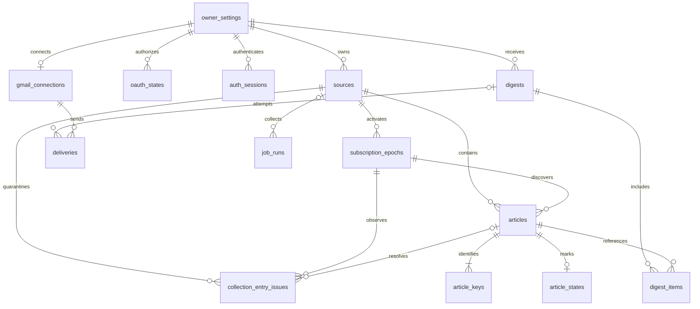

# 데이터베이스 설계서

| 항목 | 내용 |
|---|---|
| 프로젝트 | LevelUp — 개인용 웹사이트 / 모닝 테크 |
| 문서 ID | DBS-LEVELUP-v0.10 |
| 작성일·버전 | 2026-11-26 / v0.10 |
| 작성자 | Codex — 사용자 요청과 저장소 자료 기반 |
| 상태 | 검토용 설계 초안. G0·G1·G2 승인 기록 없음 |
| 검토·승인 담당 | 사이트 소유자. 고정 출시일 없이 실제 검토 수행 시 일자 기록 |
| 대상 | 첫 릴리스의 P1·P2 전체. 구현·연동·테스트 완료를 의미하지 않음 |

## 변경 이력

| 버전 | 날짜 | 변경 내용 | 승인 |
|---|---|---|---|
| v0.6 | 2026-11-25 | CR-MIN-001: Python 호스트 통합·당일 자동 재발송 제외·단일 호출 결과 통합·템플릿 적용 범위 분리 | 변경 범위 사용자 확인·전체 문서 미승인 |
| v0.7 | 2026-11-26 | 확정 PRD v0.28 대조·과거 문구/참조 정정, Mac Chrome + iPhone Safari·모든 글 목록 최신순 확정, 실행 검증과 분리 | PRD·기기 범위 사용자 확정 / 개별 단계 승인 전 |
| v0.8 | 2026-11-26 | 00~04 미결·권장안 통합, 확정/설계/환경/검증/후속 보류 구분·잔여 문구/참조 정정. 권장안 미채택·실행 미검증 | 정정 요청 반영 / 개별 문서 미승인 |
| v0.9 | 2026-11-26 | G2 검토 결정 반영(PRD v0.29): GitHub Actions 주간 백업(암호화 Artifact, 성공 뒤 4개 초과분 정리) | 소유자 결정 / G2 전체 승인 전 |
| v0.10 | 2026-11-26 | 사용자 채택: Services 한 프로젝트·DB 저장 세션(auth_sessions 추가, 총 14개)·외부 클라우드 자동 백업. 실제 설정/검증은 미완료 | 세 가지 설계 사용자 채택 / 전체 단계 미승인 |

## 참고 문서와 적용 기준

- [작성 가이드](../AGENTS.md), [PRD v0.30](../../PRD.md), [디자인 분석](../../DESIGN.md)
- [서비스 기획서 v0.12](../00-기획/서비스기획서.md), [비즈니스 정책서 v0.11](../00-기획/비즈니스정책서.md)
- [SRS v0.12](../01-요구사항분석/요구사항명세서-SRS.md), [유스케이스 v0.10](../01-요구사항분석/유스케이스명세서.md), [RTM v0.12](../01-요구사항분석/요구사항추적매트릭스-RTM.md)

요구사항의 FR/NFR·UC·SCR·BP 식별자를 유지한다. PRD v0.30의 제품 정책과 ISSUE-001의 지원 조합은 확정이며 재결정하지 않는다. DEC-001·002·003·006·007의 남은 구현 결정/환경 설정과 실제 검증, DEC-005·008·ISSUE-001의 실행 검증, DEC-004의 후속 보류를 구분한다. 통합 상태·권장안은 [서비스 기획서 7.4](../00-기획/서비스기획서.md#74-prd-확정-후-순차-검토-2026-11-26)를 따른다. 세 가지 채택 항목은 통합 표의 확정 기록을 따르고, 나머지 권장안 기재는 채택·개별 단계 승인·테스트 통과를 뜻하지 않는다.

## 1. 개요

### 1.1 설계 범위·원칙

DB 종류는 PostgreSQL, 호스팅은 Neon Free로 사용자 확정했다. 논리·물리 모델과 세부 제약은 설계 초안이다. 본 문서의 표는 생성된 DB나 실행된 마이그레이션이 아니다. 월 운영비 0원 제약(PRD 8.3) 안에서 실제 버전·Neon 프로젝트/리전·직접 연결·드라이버·무료 한도·백업 방식을 DEC-001·007에서 확정한다. 무료 DB를 선택했다는 이유로 자동 백업·PITR 제공을 가정하지 않는다.

- 단일 소유자이며 회원·역할·결제 테이블은 없다. `owner_settings`는 singleton 제약으로 한 행만 허용한다.
- 기술블로그 데이터와 공통 설정을 분리한다. 리포트 URL·요청문·외부 AI 결과 테이블은 만들지 않는다.
- PK는 UUID, 시각은 `timestamptz`, 브리핑 업무 날짜는 `date`다. UTC 저장·KST 해석을 일관되게 사용한다.
- 별도 표시가 없으면 NOT NULL이다. `?` 표시는 nullable, FK 삭제 기본값은 RESTRICT다. 자동 cascade 삭제로 기록을 지우지 않는다.
- source/글/발송의 소유자는 관계를 통해 확인한다. API는 클라이언트가 넘긴 owner ID를 신뢰하지 않는다.
- 상태 문자열은 CHECK 제약으로 제한하고 변경 시 마이그레이션한다. 아래 상태 이외 임의 문자열을 허용하지 않는다.

### 1.2 데이터 영역

| 영역 | 테이블 | 책임 |
|---|---|---|
| 공통 | owner_settings, auth_sessions | 인증 식별·알림·사이트 로그인 세션 만료/폐기 |
| Gmail 연결 | gmail_connections, oauth_states | 발송/수신 계정·암호화 refresh token·일회성 연결 상태 |
| 출처·글 | sources, subscription_epochs, articles, article_keys, article_states, collection_entry_issues | URL 구독·기준 수집·중복·개인 상태·항목 격리 |
| 브리핑·발송 | digests, digest_items, deliveries | 날짜별 전체 대상·예약·Gmail 접수/불명확 결과 |
| 실행 | job_runs | DB 큐·스케줄·임대·실행 이력 |

사용자 확인에 따라 **연결한 Gmail로 보내고 같은 Gmail로 받는다**. 수신 주소 자유 입력은 제공하지 않는다. 실제 계정 주소·Google Cloud 프로젝트·연결 완료 사실은 아직 없다.

## 2. ER 다이어그램



정기 deliveries는 digest FK를 갖고 테스트 deliveries는 digest FK가 없다. 한 digest의 여러 미접수 revision은 허용하지만 접수된 정기 메시지는 최대 하나다. article_states는 없으면 모두 false다.

## 3. 테이블 명세서

### 3.1 공통 컬럼 규약

변경 가능한 설정·출처·개인 상태에는 `created_at`, `updated_at`, `version bigint DEFAULT 1`을 둔다. 변경 API의 version 비교는 lost update를 막는다. 시각은 서버가 기록한다. 작업/발송 이력은 자체 시작·종료 시각을 사용하고 수정 가능한 필드를 제한한다.

<a id="db-owner-settings"></a>
### 3.2 owner_settings — 소유자·알림 설정

| 컬럼 | 자료형·키 | 의미·제약 |
|---|---|---|
| id | uuid PK | 설치 시 생성한 소유자 ID |
| singleton | boolean UNIQUE DEFAULT true | CHECK(singleton = true), 한 행만 허용 |
| auth_provider, auth_subject | text, UNIQUE 쌍 | auth_provider=google, 검증된 소유자 sub. Gmail google_subject와 동일해야 함 |
| notifications_enabled | boolean DEFAULT false | 현재 기술블로그 정기 알림만 제어. 중지해도 수집 계속, 테스트는 명시 요청 시 별도 |
| auth_email | text | Google ID token의 검증된 로그인 이메일. 로그인 때 갱신하며 소유자 판정 키로 사용하지 않음 |
| timezone | text DEFAULT 'Asia/Seoul' | v1 CHECK로 고정, 사용자 시간대 선택 기능 없음 |
| created_at, updated_at, version | 공통 규약 | 설정 변경 버전 |

연결 계정 표시 이메일은 owner_settings.auth_email에서 파생하고 연결 해제 후에도 유지한다. 발신·수신은 같은 sub의 유효 gmail_connections.email을 사용하며 email은 연결 시점의 검증값이다. 로그인에서 이메일 변경이 감지되면 기존 발송 연결을 reauth_required로 전환하고 재동의 전 발송하지 않는다. 자유 수정은 허용하지 않는다. 연결 해제 후 notifications_enabled가 true여도 발송 조건은 충족되지 않으며 화면은 ‘Gmail 연결 필요’를 표시한다.

<a id="db-section-preferences"></a>
### 3.3 섹션 등록과 브라우저 선호

tech·reports의 이름·경로는 정적 등록 정보에 두며 항상 제공한다. inbox-summary·daily-news는 홈의 준비 카드이며 실행 경로·DB 행·작업을 만들지 않는다. 마지막 AI 서비스 이름은 `levelup.reports.provider`, 테마는 `levelup.theme=dark|light`로 브라우저에만 저장한다. 기기 간 동기화는 제공하지 않는다.

<a id="db-gmail-connections"></a>
### 3.4 gmail_connections — Gmail 연결

| 컬럼 | 자료형·키 | 의미·제약 |
|---|---|---|
| id | uuid PK | 연결 기록 식별자 |
| owner_id | uuid UNIQUE FK | 소유자당 연결 1개 |
| google_subject, email | text | 검증한 Google ID token의 sub·verified email. sub는 owner_settings.auth_subject와 일치 |
| scopes | text[] | 허용된 범위. openid·email·gmail.send. 발송 미동의는 허용된 범위만 저장 |
| state | text | connected / reauth_required / disconnected |
| refresh_token_ciphertext | bytea? | 인증된 암호화로 보호. disconnected이면 NULL |
| encryption_key_id | text? | DB 밖 키 버전. 암호문과 nonce/tag는 저장 포맷으로 함께 관리 |
| connected_at, last_refresh_at, disconnected_at | timestamptz? | 연결·갱신·해제 시각 |
| last_error_code | text? | 토큰 내용 없는 오류 코드 |
| created_at, updated_at, version | 공통 규약 | 연결 변경 시 증가, 발송 직전 비교 |

refresh token은 서버/worker만 복호화한다. access token은 단기 메모리 캐시로 두고 로그·브라우저·API에 반환하지 않는다. 연결 해제 시 새 요청을 중단하고 로컬 토큰을 지운다. Google 권한 철회 실패는 별도 오류로 남겨 계정에서의 권한 제거 방법을 안내한다. 과거 발송 기록의 연결 FK·주소 스냅샷은 보존한다.

<a id="db-oauth-states"></a>
### 3.5 oauth_states — 일회성 OAuth 트랜잭션

| 컬럼 | 자료형·키 | 의미·제약 |
|---|---|---|
| state_hash | text PK | 충분한 난수 state의 hash, 원문은 저장하지 않음 |
| purpose | text | site_login / gmail_connect. 다른 용도의 callback 소비 금지 |
| owner_id | uuid FK | 연결 시작 소유자 |
| session_binding_hash | text | site_login은 일회성 pre-login cookie, gmail_connect는 인증 세션 바인딩의 hash |
| verifier_ciphertext, nonce_hash | bytea, text | PKCE verifier 보호·OIDC nonce 검증 |
| created_at, expires_at, consumed_at | timestamptz, timestamptz, timestamptz? | 만료 10분 제안, 원자적 1회 소비 |

첫 성공 로그인에서 gmail_connections 행을 생성한다. 발송 미동의는 disconnected·token=NULL이며 scopes는 실제 허용값만 저장한다. 따라서 이후 일반 로그인은 자동 발송 동의를 반복하거나 disconnected를 connected로 바꾸지 않는다. 최초 site_login은 로그인과 동일 계정의 발송 연결을 함께 완료할 수 있지만 후속 gmail_connect callback과 state를 혼용하지 않는다.

로그인 시작은 설치 시 구성한 단일 owner 행에 귀속하며 callback에서 검증된 OAuth subject가 그 소유자와 일치해야만 세션을 발급한다. pre-login 바인딩은 로그인 완료의 증거가 아니다. Python 서버가 보호된 세션 cookie를 검증하며 이 변경으로 회원/역할 테이블을 추가하지 않는다.

DB 저장 세션은 2026-11-26 사용자 채택으로 확정했다. 사이트 세션은 아래 auth_sessions를 사용하며 현재 설계 테이블 수는 14개다. 실제 DB 생성·migration 적용은 아직 수행하지 않았다.

OAuth code·토큰 응답은 저장하지 않는다. 사용/만료한 단기 상태는 삭제 가능하며 삭제 주기는 DEC-007에서 확정한다. 이 임시 데이터 삭제는 글·발송 기록 보존과 별개다.

<a id="db-sources"></a>
### 3.6 sources — 출처와 현재 구독

| 컬럼 | 자료형·키 | 의미·제약 |
|---|---|---|
| id, owner_id | uuid PK, uuid FK | 소유자 출처 |
| name | text | 확인된 표시 이름, HTML 그대로 출력 금지 |
| input_url, collection_url | text | 사용자가 입력한 주소·실제 정규화 수집 URL |
| collection_url_hash | text | SHA-256; UNIQUE(owner_id, collection_url_hash) |
| collector_type, adapter_key | text, text? | rss / atom / html. html은 지원 adapter 필수 |
| status | text | active / paused / deleted |
| generation | bigint DEFAULT 1 | 추가·끄기·켜기·삭제 때 증가하는 수집 fence |
| initialization_state | text | pending / running / ready / failed |
| etag, last_modified | text? | 조건부 요청용, 재활성 기준 수집은 캐시 없는 본문 요구 |
| last_attempt_at, last_success_at | timestamptz? | 최근 시도·마지막 완전 성공, partial은 last_success_at을 올리지 않음 |
| last_usable_at, last_result | timestamptz?, text? | 마지막 정상 항목 저장 또는 정상 빈 응답 시각, success / partial / failed |
| last_error_code, last_error_message | text? | 정제된 원인·수정 안내 |
| deleted_at | timestamptz? | status=deleted일 때 기록 |
| created_at, updated_at, version | 공통 규약 | UI 동시 변경 검사 |

삭제 행도 URL 고유성을 유지한다. 같은 URL 재추가는 기존 source ID를 복원하고 generation과 새 epoch만 만든다. 자동 seed로 삭제 항목을 부활시키지 않는다. 기본 기업 목록은 코드의 추가 후보 목록이며 사용자가 선택해 같은 검증 API로 등록한다.

hash는 긴 URL 인덱스용이며 동일 hash 충돌 시 원문 URL도 비교한다. host·기본 포트·fragment·공백만 정규화하고 의미 있는 query·path를 보존한다. URL 정규화 함수 버전 변경 시 기존 행의 충돌 검토를 선행한다.

<a id="db-subscription-epochs"></a>
### 3.7 subscription_epochs — 활성 구간·초기 기준

| 컬럼 | 자료형·키 | 의미·제약 |
|---|---|---|
| id, source_id | uuid PK, uuid FK | 활성 구간. UNIQUE(id, source_id)로 격리 이력의 같은 출처 FK 보장 |
| generation | bigint | UNIQUE(source_id, generation) |
| started_at, ended_at | timestamptz, timestamptz? | 켜진 시각·끄기/삭제 시각 |
| baseline_completed_at | timestamptz? | 최초 성공 기준 수집 완료 시각 |
| reason | text | first_add / resume / readd |

ended_at IS NULL인 epoch는 source당 최대 하나다. 최초 유효 응답의 새 글을 baseline 처리하며, 정상 빈 피드 또는 정상 항목 1개 이상인 partial도 기준을 완료할 수 있다. 모든 항목 무효·응답 전체 실패/절단이면 완료하지 않는다. 초기 격리 항목은 아래 collection_entry_issues에 최초 관측 mode를 보존한다. 기존 article ID·수동 상태·통지 완료는 유지한다.

first_add의 기준 수집 이후 늦게 발견한 글은 게시일이 started_at 전이어도 날짜 규칙의 후보가 된다. **resume/readd일 때만** 기준 응답과 새 epoch 시작 전 게시 글을 억제한다. 기존 baseline/suppressed/notified를 metadata 수정으로 pending으로 바꾸지 않는다(CR-FLOW-001).

<a id="db-articles"></a>
### 3.8 articles — 원문 메타데이터·알림 자격

| 컬럼 | 자료형·키 | 의미·제약 |
|---|---|---|
| id, source_id | uuid PK, uuid FK | 수집 글. UNIQUE(id, source_id)도 제공 |
| first_epoch_id | uuid FK | 처음 발견한 epoch, 최초 발견 관계 유지 |
| title, canonical_url | text | 제목·검증한 공개 원문 링크 |
| intro, tags | text?, text[] | 제공된 짧은 소개·태그. 원문 전체 HTML 없음 |
| published_at | timestamptz? | 출처별 규칙으로 해석한 게시 시각 |
| publication_precision | text | timestamp / date / missing / invalid |
| publication_raw | text? | 파싱 진단용 원문 날짜 문자열 |
| first_seen_at, last_seen_at, metadata_updated_at | timestamptz | 최초 발견은 재수집 시 변경 금지 |
| eligible_on | date? | 최소 알림 가능 KST 날짜. mutable pending만 최신 게시일로 재계산, baseline/suppressed는 NULL |
| notification_state | text | baseline / pending / suppressed / notified |
| suppression_reason | text? | initial_import / inactive_period / source_disabled / source_deleted |
| notified_digest_id | uuid? FK | Gmail 접수된 전체 브리핑에 포함된 경우, 실제 열람 증거 아님 |

제목 수정은 자격을 바꾸지 않는다. mutable pending의 게시일·precision 수정은 최신 값으로 eligible_on을 재계산한다. 게시일 있음은 max(게시 KST 날짜+1, 최초 발견 KST 날짜), 없음/무효는 최초 발견 KST 날짜+1이다. 최초 발견·수동 상태·notified 완료는 바꾸지 않는다. prepared 대상은 최종 검사에서 재평가하지만 sending/unknown/accepted 메시지의 포함 글은 snapshot/예약을 보존하고 자격을 바꾸지 않는다. 최종 검사와 sending 커밋은 source/해당 article 행 잠금으로 수집 갱신과 직렬화한다. `published_at ?? first_seen_at` 정렬은 조회 표현식이며 별도 수집 횟수와 혼동하지 않는다. 5가지 콘텐츠 유형을 모두 같은 경로로 저장하며 유형 배제 플래그는 없다.

<a id="db-article-keys"></a>
### 3.9 article_keys — 게시물 식별 별칭

| 컬럼 | 자료형·키 | 의미·제약 |
|---|---|---|
| source_id, key_type, key_hash | uuid, text, text / 복합 PK | guid / url과 정규화 값의 SHA-256 |
| article_id | uuid FK | (article_id, source_id) → articles(id, source_id) |
| key_value | text | 원문 비교·진단용 실제 식별값 |
| created_at | timestamptz | 별칭 최초 확인 |

GUID 또는 URL 어느 하나가 일치하면 같은 글을 갱신하고 새 별칭을 추가한다. GUID가 바뀌어도 URL이 같으면 새 알림이 아니다. 두 키가 서로 다른 기존 글을 가리키면 자동으로 읽기 기록을 합치지 않고 식별 충돌 오류를 기록한다. 서로 다른 출처의 같은 원문을 전역 병합하지 않는다.

<a id="db-article-states"></a>
### 3.10 article_states — 읽음·저장·숨김

| 컬럼 | 자료형·키 | 의미·제약 |
|---|---|---|
| article_id | uuid PK FK | 글당 소유자 상태 1개 |
| is_read, is_saved, is_hidden | boolean DEFAULT false | 독립된 수동 상태 |
| read_at, saved_at, hidden_at | timestamptz? | true 시 해당 시각, false 전환 시 NULL |
| created_at, updated_at, version | 공통 규약 | 변경 실패 시 기존 값 유지 |

원문 클릭·분석 클릭·수집·메일 처리에서는 이 테이블을 갱신하지 않는다. 삭제 출처의 글도 조회·상태 변경이 가능하다. hidden은 오늘/전체/저장 기본 목록 조회에만 적용하고 이메일 후보 선정에는 사용하지 않는다. 숨김 보기에서 확인·복원하며 읽음·저장·통지 상태를 바꾸지 않는다.

<a id="db-digests"></a>
### 3.11 digests — 날짜별 전체 브리핑

| 컬럼 | 자료형·키 | 의미·제약 |
|---|---|---|
| id, owner_id | uuid PK, uuid FK | 브리핑 식별자 |
| digest_date | date | UNIQUE(owner_id, digest_date), KST 업무 날짜 |
| state | text | draft / empty / paused / ready / sending / accepted / failed / unknown / cancelled / missed |
| reason_code | text? | NO_ELIGIBLE_ITEMS / NOTIFICATIONS_PAUSED / GMAIL_NOT_CONNECTED / GMAIL_REAUTH_REQUIRED / START_DEADLINE_MISSED / 안전한 발송 오류 코드 |
| scheduled_at, start_deadline_at | timestamptz | 해당 KST 날짜 08:00 / 08:20, 운영 지연 판정 근거 |
| started_at | timestamptz? | owner 잠금·첫 DB snapshot 확보 시점. 큐 claim 시각과 구분 |
| snapshot_at | timestamptz? | 전체 후보 확정 시각 |
| accepted_at | timestamptz? | Gmail API 접수 확인 시각, 받은편지함 도착 아님 |
| created_at, updated_at | timestamptz | 상태 변경 시각 |

오늘 미리보기는 API 계산 결과이며 첫 snapshot 전 확정 이력으로 저장하지 않는다. fullCount는 snapshot_at이 있을 때만 유효 digest_items COUNT이고 미확정/missed는 NULL이다. 이유 코드와 시각을 digests에 두므로 delivery 없는 날도 조회할 수 있다. missed는 미시작만 뜻하며 이미 시작한 sending/unknown을 덮어쓰지 않는다. 첫 snapshot 이후 새 글을 추가하지 않고 호출 전 부적격 item 제거만 허용한다. sending/unknown/accepted 이후 snapshot을 다시 쓰지 않는다. 예약/마감은 owner.created_at<=해당 날짜 08:00일 때 적용하며 그보다 늦은 설치일/설치 전 날짜는 조회상 not_scheduled다.

<a id="db-digest-items"></a>
### 3.12 digest_items — 전체 구성·중복 발송 예약

| 컬럼 | 자료형·키 | 의미·제약 |
|---|---|---|
| digest_id, article_id | uuid FK, uuid FK / 복합 PK | 날짜별 전체 포함 글 |
| title_snapshot, url_snapshot, source_name_snapshot | text | 당시 메타데이터, 과거 목록 보존 |
| sort_position | integer | 구성 시 COALESCE(published_at,first_seen_at) DESC, article_id DESC로 정한 순서. 1부터 시작, 확정 후 메타데이터 변경으로 재정렬하지 않음 |
| shown_in_email | boolean | 전체 유효 대상 중 최신 20개만 true |
| exclusion_reason | text? | 호출 전 source_deleted / source_disabled / connection_changed 등 제외 |
| reservation_state | text | none / held / released / consumed |
| created_at | timestamptz | 구성 시각 |

`reservation_state IN ('held','consumed')`인 article_id의 partial UNIQUE로 미확인 예약 또는 접수 완료 글의 재선정을 막는다. consumed는 접수된 통지 이력이다. 명확한 미접수 실패·호출 전 취소는 released로 전환한다. 이미 외부 요청을 시작한 unknown 예약은 source 삭제로도 임의 해제하지 않는다. accepted된 전체 21개는 모두 notified 처리하고 본문 노출 20개와 구분한다.

<a id="db-deliveries"></a>
### 3.13 deliveries — 불변 Gmail 발송 메시지

| 컬럼 | 자료형·키 | 의미·제약 |
|---|---|---|
| id, owner_id | uuid PK, uuid FK | 논리 발송 메시지 |
| kind, digest_id | text, uuid? FK | digest / test. kind=digest이면 digest 필수, test이면 NULL |
| gmail_connection_id, connection_version | uuid FK, bigint | 생성 때 연결과 버전. 전송 직전 재검사 |
| revision | integer | 브리핑 내 payload revision, UNIQUE(digest_id, revision) |
| request_key | text UNIQUE | 앱 내부 중복 키. Gmail 멱등 헤더가 아님 |
| mime_message_id | text UNIQUE | 고정 RFC Message-ID, Gmail 중복 제거 보장으로 사용 금지 |
| from_address, to_address | text | 생성 당시 연결 Gmail 주소, CHECK(from_address=to_address) |
| subject, mime_payload | text, bytea | 단일 외부 요청에 사용하는 불변 완성 MIME, UTF-8·HTML escape |
| payload_sha256 | text | 변조·의도치 않은 payload 변경 확인 |
| state | text | prepared / sending / accepted / failed / unknown / cancelled |
| provider_message_id | text? UNIQUE | 성공 응답의 Gmail message ID. RFC Message-ID와 다름 |
| prepared_at, submitted_at, accepted_at | timestamptz, timestamptz?, timestamptz? | 단계별 시각 |
| last_error_code | text? | 정제한 API/인증 오류 |
| finished_at, http_status | timestamptz?, integer? | 유일한 외부 요청의 관측 종료 시각·정제 HTTP 상태. sending/unknown/accepted와 함께 시도 테이블을 대체 |
| verification_outcome, verification_note | text?, text? | confirmed_accepted / confirmed_not_accepted / unresolved 및 확인 근거 |
| verified_at | timestamptz? | 소유자가 Gmail에서 대조한 시각 |

정기 accepted 메시지는 digest당 최대 하나이며, submitted_at IS NOT NULL인 메시지도 digest당 최대 하나로 제한해 실패 후 새 revision의 당일 외부 재호출을 차단한다. 내부 request_key는 DB/worker 중복을 막지만 Gmail의 원격 exactly-once를 제공하지 않는다. Gmail 접수 후 DB 기록 실패·timeout은 unknown으로 격리한다. 테스트 요청의 request_key는 클라이언트 UUID 기반으로 별도 관리한다.

수동 확인 기록 갱신은 운영 절차 OP-01 제안으로 제한하며 강제 재발송 UI를 만들지 않는다. ‘보낸편지함 검색 결과가 당장 없다’만으로 미접수를 확정하지 않는다. 확인 근거 부족 시 unknown을 유지한다. 확인은 소유자가 고정 기한 없이 필요할 때 수행하며 시간 경과만으로 unknown/held를 자동 해제하지 않는다. 해당 예약 이외의 정상 글은 계속 처리한다.

<a id="db-job-runs"></a>
### 3.14 job_runs — 영속 작업 큐·이력

| 컬럼 | 자료형·키 | 의미·제약 |
|---|---|---|
| id | uuid PK | 작업 조회 ID |
| kind | text | collect / collect_final / baseline / digest / test_email |
| source_id, source_generation | uuid? FK, bigint? | 수집 작업만 필수 |
| owner_id | uuid FK | 작업 소유자 |
| dedup_key | text UNIQUE | SAD 4.2의 시간 슬롯/요청 키 |
| input | jsonb | 검증된 ID·날짜만, URL/토큰/분석 입력 없음 |
| state | text | queued / running / succeeded / partial / failed / skipped. partial은 종료 상태 |
| available_at, started_at, finished_at | timestamptz, timestamptz?, timestamptz? | 실행 가능·시작·종료 |
| lease_token, lease_expires_at, heartbeat_at | uuid?, timestamptz?, timestamptz? | stale worker 갱신 차단 |
| attempt_count | integer DEFAULT 0 | 작업 실행 횟수, 글 수 아님 |
| result_code, result_summary | text?, jsonb? | 수집 수·신규 수·실패 코드·delivery ID 등 |

임대 만료 회수는 수집과 메일을 구분한다. 메일 job 재개가 `messages.send` 재호출을 바로 뜻하지 않는다. 관련 delivery의 sending은 unknown으로 복구·격리한다.

<a id="db-collection-entry-issues"></a>
### 3.15 collection_entry_issues — 항목 격리·초기 관측 표식

| 컬럼 | 자료형·키 | 의미·제약 |
|---|---|---|
| id, source_id, epoch_id | uuid PK, uuid FK, uuid FK | 출처·관측 구간. epoch가 같은 source인지 복합 FK로 보장 |
| entry_fingerprint | text | 강한 GUID/검증 URL 우선, 없으면 정규화된 항목 특징의 hash. UNIQUE(source_id, epoch_id, entry_fingerprint) |
| identity_hashes | text[] | GUID/검증 가능한 원문 URL의 유형을 포함한 hash. 있으면 동일성 재평가에 사용 |
| first_seen_at, last_seen_at | timestamptz | 최초 관측은 불변. 원문 데이터/비밀 URL을 로그에 저장하지 않음 |
| observed_as_baseline | boolean | 첫 관측이 기준 수집 중이면 true, 해소 후에도 보존 |
| error_code, state | text, text | ENTRY_INVALID / IDENTITY_CONFLICT 등 정제 코드, open / resolved |
| resolved_article_id, resolved_at | uuid? FK, timestamptz? | 안전한 동일성 확인 뒤 연결. article은 같은 source 관계여야 함 |
| last_job_id | uuid FK | 마지막 재평가 job. 생성·변경은 수집 transaction에 포함 |

항목 전체 원문·인증값·실행 가능한 잘못된 URL을 적재하지 않는다. 동일 오류의 반복은 같은 행의 관측 시각만 갱신한다. 다음 본문 수집에서 재평가하며 open 항목이 있으면 조건부 304 대신 본문을 요청한다. 초기 표식과 강한 식별 hash가 일치한 복구 글은 baseline을 유지하고 자동 합병하지 않는다. 안정 식별자도 같지 않고 내용도 바뀌면 동일성을 보장할 수 없다는 한계를 표시한다. 초기 억제 표식은 일반 로그 보존 정책으로 조용히 삭제하지 않는다. 자동 purge/수동 수정 UI는 추가하지 않는다.

출처의 open 격리 건수는 조회 COUNT로 계산한다. source의 마지막 완전 성공과 마지막 유효 저장을 별도로 표시한다. 정상 빈 목록은 success, 정상+오류는 partial, 모든 항목 무효는 failed다.

<a id="db-auth-sessions"></a>
### 3.16 auth_sessions — 사이트 로그인 세션

| 컬럼 | 자료형·키 | 의미·제약 |
|---|---|---|
| id | uuid PK | 서버 내부 세션 식별자, 브라우저 API에 반환하지 않음 |
| owner_id | uuid FK | 검증한 owner_settings.id |
| token_hash | text UNIQUE | 표준 보안 난수 32바이트 이상인 cookie token의 SHA-256 hash. 원문 token은 DB/로그에 저장하지 않음 |
| csrf_token | text | 해당 세션의 별도 난수 CSRF token. API-002가 인증된 동일 origin 요청에 반환 |
| created_at, expires_at | timestamptz, timestamptz | 로그인 성공 시각과 정확히 604,800초 뒤의 고정 만료. 방문으로 갱신하지 않음 |
| revoked_at | timestamptz? | 현재 세션 로그아웃 시각. NULL이고 현재 시각 < expires_at일 때만 사용 가능 |

소유자 검증과 세션 생성 성공을 확인한 뒤 Secure·HttpOnly·SameSite=Lax·host-only cookie를 발급한다. cookie에는 원문 난수 token만 담고 owner/provider token/개인 데이터를 담지 않는다. API는 token_hash로 조회해 소유자·만료·폐기를 확인한다. 로그아웃은 현재 행의 revoked_at을 기록하고 cookie를 만료시키며 다른 기기 세션을 일괄 폐기하지 않는다. 쿠키를 교체하더라도 최초 expires_at을 연장하지 않는다. 만료·폐기 세션 재사용은 401이다.

사이트 세션과 Google/Gmail OAuth 권한은 별도 수명이다. 세션 종료가 gmail_connections나 정기 job을 삭제하지 않는다. 사용/만료한 인증 임시 데이터와 같은 정리 범주이며 삭제 주기는 DEC-007에서 정하고 핵심 글·발송 이력 보존과 분리한다. token_hash UNIQUE와 owner/고정 만료·폐기 조건을 실제 PostgreSQL 통합 테스트로 확인한다.

## 4. 데이터 사전 (Data Dictionary)

### 4.1 자격 계산과 날짜 사례

이 문서의 표·ERD는 14개 테이블을 정의한다. 순환 FK(articles.notified_digest_id)는 테이블 생성 후 ALTER 단계에서 추가한다.

알림 후보는 active·기준 수집 완료 출처의 `notification_state=pending`, `eligible_on<=D`, 다른 held 예약 없음을 만족해야 한다. 날짜·읽음·저장·콘텐츠 종류로 추가 배제하지 않는다. source 초기·구독 경계가 날짜 계산보다 먼저 적용된다.

| 신규 발견 조건 | eligible_on 계산 | 포함 경계 |
|---|---|---|
| 게시 시각 있음 | max(게시 KST 날짜+1, 최초 발견 KST 날짜) | 실제 첫 작업 snapshot에 보이는 pending만 포함 |
| 당일 게시·미래 게시 | 게시 KST 날짜+1 이상 | 당일 알림 없음 |
| 게시일 없음/무효 | 최초 발견 KST 날짜+1 | 발견일 당일에는 미포함 |
| first_add 기준 이후 늦은 과거 글 | 위 날짜 계산, 등록 시각 전이라는 이유로 제외하지 않음 | 이미 확정 후 저장되면 다음 정상 아침 |
| baseline / resume·readd 시작 전 게시 / 기존 suppressed | NULL, 제외 상태 유지 | metadata 수정으로 소급 부활 없음 |

날짜 자격과 실제 snapshot 포함 시점은 비즈니스정책서 11.7의 경계를 따른다.

출처별 날짜만 있는 항목의 시간대/파싱은 DEC-003에 남긴다. CR-FLOW-001은 해당 파싱 결과를 사용하는 경계를 결정한다.

### 4.2 상태 전이·트랜잭션

| 처리 | 한 트랜잭션에서 변경하는 항목 | 실패/복구 |
|---|---|---|
| 구독 추가·재추가 | source+새 epoch+baseline job | URL unique 충돌은 기존 ID 안내, 작업 누락 방지 |
| 구독 끄기·삭제 | generation 증가+epoch 종료+미요청 pending 억제+미요청 예약 해제 | 소유자 발송 잠금 → source 행 잠금. unknown held는 보존 |
| 초기 수집 완료 | 기사/식별키+baseline 자격+epoch 완료+source ready | source generation·job lease 재검사 후 commit |
| 일반 수집 | 정상 기사/별칭·pending 날짜 재계산·격리 upsert·source 품질·job 종료 | 항목별 savepoint로 예측 가능한 오류 격리, generation/lease 실패는 시도 전체 rollback |
| 개인 상태 변경 | article_states version 비교 후 해당 필드만 | 원문/분석 클릭은 변경 없음 |
| 발송 준비 | digest_items 전체 예약+불변 delivery | 활성 출처·Gmail 버전·알림 켜짐 최종 검사 |
| Gmail 접수 확인 | delivery/digest accepted+전체 유효 글 notified+예약 consumed | 본문 20개가 아니라 전체 포함 글에 적용 |
| 명확한 미접수 | delivery failed+예약 released. 최신 게시일/epoch로 재계산하여 유효 글은 pending, 해제/삭제/기간 외 글은 suppressed | 향후 재선정 가능, 정기 완료로 기록 안 함 |
| 불명확 | delivery/digest unknown+예약 held 유지 | 확인 전 재선정·재시도 금지 |

연결 해제·교체도 소유자 발송 잠금과 connection version 검사를 사용한다. payload를 이미 전송한 후 Gmail이 처리한 결과는 계정 변경으로 취소할 수 없다. unknown의 접수 확인은 source가 삭제됐어도 실제 과거 이력으로 기록한다.

### 4.3 주요 무결성 제약·인덱스 예시

다음은 후속 마이그레이션에서 생성할 핵심 DDL의 일부다. 모든 테이블 생성 SQL을 대체하지 않으며 현재 실행되지 않았다.

```sql
CREATE UNIQUE INDEX uq_digest_submitted ON deliveries (digest_id)
  WHERE kind = 'digest' AND submitted_at IS NOT NULL;
CREATE UNIQUE INDEX uq_open_epoch ON subscription_epochs (source_id)
  WHERE ended_at IS NULL;
CREATE UNIQUE INDEX uq_article_reserved ON digest_items (article_id)
  WHERE reservation_state IN ('held', 'consumed');
CREATE UNIQUE INDEX uq_digest_accepted ON deliveries (digest_id)
  WHERE kind = 'digest' AND state = 'accepted';
CREATE INDEX ix_collection_issues_open ON collection_entry_issues (source_id, epoch_id)
  WHERE state = 'open';
CREATE INDEX ix_articles_pending ON articles (eligible_on, source_id)
  WHERE notification_state = 'pending';
CREATE INDEX ix_articles_order ON articles
  ((COALESCE(published_at, first_seen_at)) DESC, id DESC);
CREATE INDEX ix_jobs_ready ON job_runs (available_at, id)
  WHERE state = 'queued';
CREATE INDEX ix_saved_articles ON article_states (saved_at DESC, article_id)
  WHERE is_saved = true;
```

주요 UNIQUE는 표에서 지정한 owner/date, source/hash, source/key, job key, request key를 함께 적용한다. `shown_in_email=true` 20개 이하·동일 소유자의 교차 FK 관계·accepted 후 불변성은 서비스 트랜잭션과 통합 테스트로 확인한다. 개수 제한을 행 하나의 CHECK로 잘못 보장하지 않는다.

## 5. 마이그레이션 전략

순서가 있는 SQL 파일과 적용 이력으로 관리한다. `0001_core.sql` → `0002_gmail.sql` → `0003_tech.sql` → `0004_digest_jobs.sql`처럼 의존 순서를 따른다. 이는 파일명 예시이며 파일을 만들거나 적용한 상태가 아니다.

설정 기본값은 정기 알림 꺼짐이다. 기본 출처는 자동 등록하지 않는다. 변경은 개발 fixture DB에서 전후 제약·중복·보존을 확인하고, 운영 반영 전 백업·롤백 가능 범위를 확인한다. 컬럼 추가→전환→후속 제거를 우선하며, 데이터 손실을 일으키는 rollback을 자동 실행하지 않는다.

## 6. 성능 설계

오늘 미리보기·전체·저장 모두 게시일(누락 시 최초 발견 시각)·ID 내림차순으로 통일하며 saved_at은 상태 기록이고 목록 정렬 키가 아니다. 확정 브리핑은 sort_position을 사용한다. 목록은 커서 페이지네이션을 사용한다. 최신순 커서는 `(sort_at,id)`이며 검색/출처/읽음/저장/숨김/브리핑 날짜 조건을 함께 고정한다. 페이지 크기는 기본 20·최대 100 제안이다. 제목 포함 검색은 초기 ILIKE로 시작하고 실제 자료·EXPLAIN 근거가 있을 때 trigram 등 인덱스를 검토한다. 목표 데이터 규모·응답시간·가용성은 아직 미확정이다.

source별 짧은 저장 트랜잭션과 순서가 있는 잠금으로 deadlock을 줄인다. worker 임대와 발송 전용 연결의 수는 DB 풀 한도 안에서 산정한다. 수집기 상한 제안은 SAD 7.1을 단일 기준으로 삼는다. 모호한 성공을 줄이기 위해 snapshot/메일 payload·초기 격리 표식을 보존하되 무제한 로그 적재를 약속하지 않는다.

## 7. 백업/복구 정책

첫 릴리스에서는 글·출처 식별/구독 epoch·읽음·저장·브리핑·발송·중복 방지 근거를 자동 삭제하지 않는다. 상세 디버그 로그와 원본 HTTP 응답은 운영 DB에 장기 보관하지 않고 정제한 오류 코드·요약만 남긴다. 실제 무료 저장 용량을 확인한 뒤 보존 정책을 재검토하며 임의 삭제·자동 유료 전환은 하지 않는다. 발송 무결성에 필요한 고정 MIME·snapshot·held/consumed 예약과 초기 격리 식별 표식은 디버그 로그가 아니며 보존한다. OAuth 단기 상태·만료 세션의 정리는 핵심 이력 보존과 구분하고 기존 수명 규칙을 따른다.

Neon Free의 제공 복원 기능을 확인하고 별도 백업·암호화·격리 복원 시험을 설계한다. 무료 복원 기능을 장기 백업과 동일하게 취급하지 않는다. DB는 운영 DB 외부 클라우드로 주 1회 자동·암호화 백업하고 최근 성공한 백업 4개를 보관한다. 새 백업의 저장·검증 성공 후에만 초과한 가장 오래된 백업을 정리하며 실패/중단 시 이전 정상본을 지우지 않는다. 이 보관 기준은 백업 파일에만 적용하고 운영 DB의 글·구독·읽음·저장·발송 기록을 삭제하지 않는다. DB 장애로 사이트를 사용할 수 없으면 소유자가 장애를 확인한 시점부터 24시간 이내 복구를 운영 목표로 한다. 장애 확인 시각과 복구 완료 시각을 기록해 목표 충족 여부를 확인한다. 이는 무료 개인 서비스의 대응 목표이며 실제 복구 성능·가용성 보장이나 장애 발생 시점부터의 24시간 보장은 아니다. 실행 수단은 GitHub Actions 주간 예약 workflow로 확정했다(PRD 8.4). Neon 직접 연결로 덤프를 만들고 암호화한 파일을 소유자의 비공개 저장소에 Actions Artifact로 올린다. 업로드·검증이 성공한 뒤에만 같은 workflow가 4개를 넘는 오래된 백업을 지우며, 보관 기간 자동 만료만으로 정리하지 않는다. DB 연결 문자열·백업 암호화 키는 GitHub Secrets에만 둔다. 외부 클라우드 자동 보관은 확정했다. GitHub Actions 실행 선택은 유지하며 Artifact 자동 만료와 기존 정상본 4개 보존의 양립은 아직 검증되지 않았다. 요일/시각·별도 키 보관·무료 한도·복원 실측·영속 보관 보완 필요 여부를 DEC-007에서 확인한다. 주간 간격은 실제 복구 성능을 보장하지 않으며 백업 실패 시 최근 복원 지점이 더 오래될 수 있다. 복호화 키는 DB 백업과 분리해서 관리하고 키를 잃으면 Gmail 재연결이 필요하다.

복원 후 worker·메일 발송을 일단 중지한다. 백업 이후 Gmail에 이미 접수된 메시지가 있을 수 있으므로 복원된 pending/미완료 발송을 곧바로 보내지 않는다. 소유자가 Gmail 보낸편지함·앱 message ID/제목/시각을 대조하고 불명확 건을 격리한 뒤 재개한다. 토큰도 Google에서 철회됐을 수 있어 연결을 재검증한다. 이 복구 절차는 아직 실행한 시험이 아니다.

## 부록. 추적·검토

| 요구사항·정책 | 데이터 설계 | 확인할 경계 |
|---|---|---|
| FR-001·002·014·019 / BP-AUTH·SECTION | owner_settings, gmail_connections | 단일 소유자, 같은 Gmail 발신/수신 |
| FR-003~009 / BP-CONTENT·RESET | sources, epochs, articles, article_keys | 중복 URL·전체 5유형·기준 수집 실패·재추가·늦은 발견 |
| FR-010~013·023 / BP-CONTENT-005·006 | article_states, digest_items | 수동 상태·원문 직접 이동·삭제 뒤 기록 보존 |
| FR-015~018 / BP-NOTI·ERROR | digests, items, deliveries, attempts, jobs | 0/20/21, 테스트 분리, Gmail unknown·중단·잠금 |
| FR-020~022 / BP-AI | 분석 데이터 테이블 없음 | URL·편집 prompt·외부 결과가 DB/로그에 없음 |
| NFR-002·003·007·008 | 토큰 암호화·generation·예약·인덱스 | 비밀 노출·사설 주소·삭제 경합·백업 복원 |

DB 제약·날짜·발송 예약은 구현 단계의 통합 테스트 대상이다. 스키마 실행·성능 수치·백업 복구 통과로 기록하지 않는다. DEC-001·002·003·006·007과 ADR-005 채택 여부를 G2 전에 검토한다.

### CR-IMP-001 migration 주의

CR-IMP-001 당시의 기존 테이블·고유 제약을 보존하고 CR-FLOW-001로 collection_entry_issues를 추가했으며 CR-MIN-001에서 전송 시도 테이블을 통합했으며, 리포트 활성화 설정 제거 당시 13개였고, 이번 auth_sessions 추가로 현재 14개다. oauth_states에 purpose를 추가하는 migration이 필요하며 기존 연결 전용 행은 gmail_connect로 해석한다. 실제 schema가 아직 없으므로 적용 완료로 기록하지 않는다. Python API/worker가 같은 migration revision·직접/session 연결 규약을 사용한다.

<a id="db-delivery-attempts"></a>
### CR-MIN-001 최소 구현 기준

배포 구성·발송 최소화 범위는 서비스기획서의 CR-MIN-001 최소 구현 기준을 따른다.

별도 delivery_attempts 테이블을 제거하고 deliveries의 state·submitted_at·finished_at·http_status·오류·provider ID에 단일 호출 결과를 기록한다. 현재 14개 테이블이며 source 항목 격리·unknown 예약·고유 제약은 유지한다. 전송 시도 번호/재시도 관리 API는 만들지 않는다.

### Neon Free 연결 검증 기준 (2026-11-26)

호스팅 선택은 PRD 8.3에서 확정했다. session advisory lock을 사용하는 발송·계정 변경 경로와 migration/백업은 Neon 직접 연결을 사용한다. transaction pooler에 session 잠금을 맡기지 않는다. 실제 Vercel Python 런타임에서 SSL·직접 연결 동시성·예외 시 잠금 해제·연결 종료·DB 재개 지연·무료 한도 소진을 검증한다. 프로젝트/리전·접속 문자열·스키마 생성·백업/복원은 아직 미실행이다.
