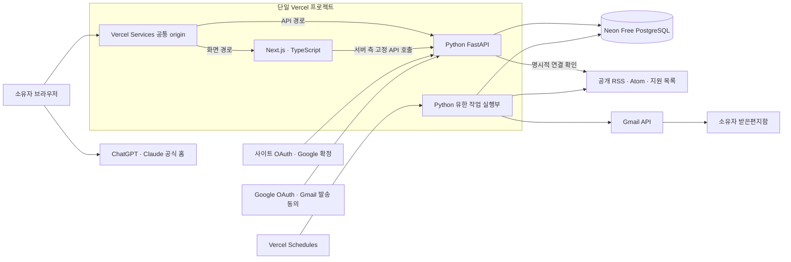
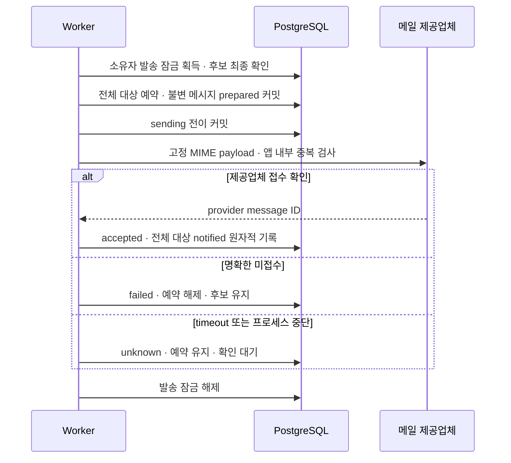

# 시스템 아키텍처 설계서 (SAD)

| 항목 | 내용 |
|---|---|
| 프로젝트 | LevelUp — 개인용 웹사이트 / 모닝 테크 |
| 문서 ID | SAD-LEVELUP-v0.10 |
| 작성일·버전 | 2026-11-26 / v0.10 |
| 작성자 | Codex — 사용자 요청과 저장소 자료 기반 |
| 상태 | 검토용 설계 초안. G0·G1·G2 승인 기록 없음 |
| 검토·승인 담당 | 사이트 소유자. 고정 출시일 없이 실제 검토 수행 시 일자 기록 |
| 대상 | 첫 릴리스의 P1·P2 전체. 구현·연동·테스트 완료를 의미하지 않음 |

## 변경 이력

| 버전 | 날짜 | 변경 내용 | 승인 |
|---|---|---|---|
| v0.6 | 2026-11-25 | CR-MIN-001: Python 호스트 통합·당일 자동 재발송 제외·단일 호출 결과 통합·템플릿 적용 범위 분리 | 변경 범위 사용자 확인·전체 문서 미승인 |
| v0.7 | 2026-11-26 | 확정 PRD v0.28 대조·과거 문구/참조 정정, Mac Chrome + iPhone Safari·모든 글 목록 최신순 확정, 실행 검증과 분리 | PRD·기기 범위 사용자 확정 / 개별 단계 승인 전 |
| v0.8 | 2026-11-26 | 00~04 미결·권장안 통합, 확정/설계/환경/검증/후속 보류 구분·잔여 문구/참조 정정. 권장안 미채택·실행 미검증 | 정정 요청 반영 / 개별 문서 미승인 |
| v0.9 | 2026-11-26 | G2 검토 결정 반영(PRD v0.29): 한 Vercel 프로젝트·같은 origin, Schedules 무료 15분 시작 지연 수용, GitHub Actions 주간 백업, OAuth 앱 프로덕션 게시(검증 미신청), ADR-001·004 승인 | 소유자 결정 / G2 전체 승인 전 |
| v0.10 | 2026-11-26 | 사용자 채택: Services 한 프로젝트·DB 저장 세션(auth_sessions 추가, 총 14개)·외부 클라우드 자동 백업. 실제 설정/검증은 미완료 | 세 가지 설계 사용자 채택 / 전체 단계 미승인 |

## 참고 문서와 적용 기준

- [작성 가이드](../AGENTS.md), [PRD v0.30](../../PRD.md), [디자인 분석](../../DESIGN.md)
- [서비스 기획서 v0.12](../00-기획/서비스기획서.md), [비즈니스 정책서 v0.11](../00-기획/비즈니스정책서.md)
- [SRS v0.12](../01-요구사항분석/요구사항명세서-SRS.md), [유스케이스 v0.10](../01-요구사항분석/유스케이스명세서.md), [RTM v0.12](../01-요구사항분석/요구사항추적매트릭스-RTM.md)

요구사항의 FR/NFR·UC·SCR·BP 식별자를 유지한다. PRD v0.30의 제품 정책과 ISSUE-001의 지원 조합은 확정이며 재결정하지 않는다. DEC-001·002·003·006·007의 남은 구현 결정/환경 설정과 실제 검증, DEC-005·008·ISSUE-001의 실행 검증, DEC-004의 후속 보류를 구분한다. 통합 상태·권장안은 [서비스 기획서 7.4](../00-기획/서비스기획서.md#74-prd-확정-후-순차-검토-2026-11-26)를 따른다. 세 가지 채택 항목은 통합 표의 확정 기록을 따르고, 나머지 권장안 기재는 채택·개별 단계 승인·테스트 통과를 뜻하지 않는다.

## 1. 문서 개요

### 1.1 목적·범위

소유자 한 명이 구독 출처를 관리하고, 모든 유형의 새 글을 서버에서 수집하여 다음 아침 이메일로 확인하는 시스템을 설계한다. 공개 문서의 요약 요청문을 준비하는 리포트 분석은 항상 접근 가능한 독립 섹션이다. 향후 섹션을 추가할 수 있으며 미설계 두 기능은 홈 준비 카드로만 미리 표시한다. 실제 기능·빈 실행 화면·범용 플러그인 플랫폼은 추가하지 않는다.

### 1.2 설계의 전제

- 저장소에는 애플리케이션·DB·실행 환경이 아직 없다. 아래 기술과 디렉터리는 구축 제안이다.
- TypeScript 웹과 Python 업무 코드는 같은 저장소에서 관리하고 Python API와 정기 실행부는 같은 Python 서비스를 사용한다. 정기 실행은 Vercel Schedules가 시작하는 유한 작업이며 상시 worker 프로세스를 요구하지 않는다. 브라우저 종료와 무관하게 동작한다.
- 외부 출처가 공개 피드·지원 목록에 노출하는 범위만 수집한다. 전 사이트의 모든 문서를 찾는 검색 엔진은 아니다.
- 리포트 URL은 서버 수집 경로에 전달하지 않는다. 내부 AI 호출·PDF 처리·결과 저장은 제외한다.

## 2. 아키텍처 개요

### 2.1 시스템 경계



마지막 연결은 사용자가 별도 버튼으로 여는 외부 탭이다. LevelUp 서버와 AI 서비스 사이의 통신은 없다. 사이트 인증은 Google로 확정했으며 메일은 사용자 확인에 따라 Gmail을 사용한다. OAuth 동의·실제 계정·지속 운영 설정은 미결이다.

### 2.2 모듈과 책임

| ID | 모듈 | 책임·공개 접점 | 접근 가능한 데이터 |
|---|---|---|---|
| CMP-01 | 공통 셸·섹션 등록 | `id, label, path, enabled, availability`로 활성 메뉴·홈 준비 카드 구성, 공통 UI | 소유자 설정·활성 섹션, 섹션이 제공한 요약 |
| CMP-02 | 인증·설정 | 소유자 검사, 동일 Google 계정의 읽기 전용 이메일·알림 중지 관리 | owner_settings, auth_sessions, gmail_connections |
| CMP-03 | 구독·수집 | URL 확인·등록·토글·삭제, 피드 발견·파싱·중복 처리 | sources, subscription_epochs, articles, article_keys |
| CMP-04 | 글 탐색 | 오늘/전체/저장 목록, 제목 검색·읽음·저장·숨김 | articles, article_states, digests, digest_items |
| CMP-05 | 브리핑·메일 | 날짜별 전체 대상, 메일 최대 20개, 발송·확인 기록 | digests, digest_items, deliveries |
| CMP-06 | 리포트 분석 | 브라우저에서 URL 문법 검사·요청문 편집·복사·외부 열기 | 메모리의 URL·요청문, 마지막 서비스 선택만 로컬 저장 |
| CMP-07 | 작업 실행·관측 | 시간 슬롯 등록, 작업 임대·재개, 상태·오류 기록 | job_runs와 각 기능의 서비스 인터페이스 |

registry의 availability는 available/planned이고 planned 항목은 path=null·enabled=false다. 메뉴는 available+enabled만, 홈은 available+enabled 및 지정 planned 항목을 표시한다. 준비 카드 이름/설명은 정적 metadata이며 새 업무 서비스·DB·작업을 만들지 않는다. 사용자 비활성 available 기능은 planned로 바꾸지 않는다.

공통 셸은 파서를 직접 호출하지 않는다. 리포트 모듈은 글 DB를 조회하지 않으며 기술블로그에서 URL만 전달받는다. 새 섹션은 해당 모듈과 정적 등록 항목을 추가한다. 새로운 섹션의 작업이 필요하면 그 작업만 별도로 등록한다.

### 2.3 코드 구성 제안

```text
apps/web/src/              # TypeScript 화면·공통 UI·API proxy
backend/src/levelup/api/   # Python FastAPI·schema·응답 변환
backend/src/levelup/core/  # 인증·설정·섹션 등록
backend/src/levelup/modules/tech/  # 구독·수집·목록·브리핑
backend/src/levelup/infra/ # DB·안전 HTTP·Gmail·암호화
backend/src/levelup/worker/# Python 스케줄·영속 작업 실행
db/migrations/            # SQL·제약 변경
```

작은 모듈 내부를 불필요한 계층으로 나누지 않는다. Python API와 worker는 같은 도메인 서비스를 호출한다. TypeScript 웹/SSR는 고정 Python API를 호출하며 DB나 Python 업무 정책을 중복 구현하지 않는다. 공통 섹션 등록 정보는 Python API가 제공하고 홈/메뉴가 같은 응답을 사용한다.

## 3. 기술 스택 선정

웹 프레임워크 Next.js·Python API 프레임워크 FastAPI·DB PostgreSQL과 Google 로그인·동일 계정 Gmail 연결은 사용자 확정 사항이다. 나머지 구체 스택·구현 방식은 **ADR-001~004의 채택 제안**이다. Gmail 사용과 같은 계정 발신·수신은 사용자 확인 사항이며, 실제 계정 설정·무료 운영 검증·배포 완료 사실로 해석하지 않는다.

| 영역 | 제안 | 선정 이유·대안 | 확정 조건 |
|---|---|---|---|
| 웹 | Next.js/React + TypeScript · Vercel | Next.js·TypeScript·Vercel 사용자 확정. API proxy·화면·로컬 reports 담당 | Next.js/React 버전·웹 프로젝트 설정 DEC-001 |
| 업무 서버 | Python + FastAPI · Vercel | FastAPI·Vercel API 배포 확정. 공개 경로/업무 정책 유지 | 한 Vercel 프로젝트·같은 origin 확정. Python/FastAPI 버전·라우팅·cookie·무료 한도 검증 |
| 데이터 | Neon Free PostgreSQL + SQL 마이그레이션 | DB·호스팅 사용자 확정. 관계·고유 제약·트랜잭션·작업 잠금 유지 | DB 버전·프로젝트/리전·직접 연결/드라이버·한도/백업 검증 DEC-001·007 |
| 작업 | Python 수집·메일 실행부 + DB 작업 큐 | API와 Python 코드 공유, claim·복구 유지. Vercel Schedules 채택 | 무료 15분 시작 지연 수용 확정. 실행 시간/자원·직접 DB 연결 DEC-001·002 |
| 인증 | Google OIDC·DB auth_sessions 확정, OAuth Authlib 제안 | 소유자 허용 목록·서버 권한 검사. Auth.js 의존 대체 | DB 저장·7일 고정·현재 세션 로그아웃 확정. OAuth 라이브러리·subject/앱 설정·실제 동작 검증 남음 |
| 이메일 | Gmail API + Google OAuth 발송 권한 | 사용자 확인: 연결한 Gmail에서 같은 Gmail로 발신·수신. SMTP/앱 비밀번호 대신 최소 발송 권한 제안 | 실제 계정·Google 프로젝트/동의·지속 운영·계정 한도·사용량 DEC-002 |
| UI | 의미 있는 HTML + 공통 CSS 토큰 | DESIGN 기준을 재사용, 거대한 컴포넌트 라이브러리 채택을 전제하지 않음 | DEC-008 테마·폰트 검토 |
| 검증 | Python pytest/Ruff/mypy + 웹 Vitest/Playwright/ESLint 제안 | 두 언어의 정책·통합·브라우저 검증 | 실제 도구/명령·Mac Chrome + iPhone Safari 실제 검증 |

Next.js 채택은 확정이며 서버/클라이언트 컴포넌트 경계와 Route Handler 활용 세부는 구현 설계에서 정한다. [공식 컴포넌트 문서](https://nextjs.org/docs/app/getting-started/server-and-client-components), [서버 경계 가이드](https://nextjs.org/docs/app/guides/backend-for-frontend)를 근거로 하며 특정 버전 설치를 가정하지 않는다.

## 4. 배포 아키텍처

### 4.1 실행 환경·설정

PRD 8.1·8.3의 현재 결정은 Next.js 웹과 FastAPI API를 Vercel에 배포하고 Neon Free PostgreSQL을 사용하는 것이다. 이전 공동 상시 Python 호스트/무료 VM 우선 검토는 대체되었다. Next.js 웹과 FastAPI API는 Vercel Services의 단일 프로젝트·공통 공개 origin으로 배포한다. `/api/auth/*`·`/api/v1/*`는 Python API로, 나머지 화면 경로는 웹으로 라우팅한다. 서비스의 코드/빌드 책임은 분리하되 배포는 함께 관리한다. 실제 Services 설정·SSR 호출 경로·cookie/OAuth callback·Schedules 연계·무료 한도는 실행 검증 대상이다. TypeScript가 Python 업무 정책을 중복 구현하지 않는다. 정기 수집·메일의 실행부는 같은 Python 업무 코드를 사용한다. 일반 Functions 안에 무한 worker 루프를 넣지 않으며 정기 실행은 Vercel Schedules로 확정한다. Asia/Seoul의 매시·07:30 수집과 08:00 브리핑을 예약하고(무료 플랜은 예약 시각 뒤 최대 15분 시작 분산·월 5,000회 한도를 수용, 한 번의 실행이 DB 작업 큐의 출처별 작업을 처리해 월 약 780회), 함수의 유한 실행·중단/복구·DB session 연결·무료 자원 한도를 검증한다. 예약 발생 ID와 scheduled time은 기존 업무 job 고유 키·실제 시작 시각 검사에 연결한다. 중복·늦은 전달은 기존 멱등/마감 규칙으로 처리하며 Schedules를 선택했다는 이유로 메일 자동 재발송을 추가하지 않는다. Queues·Daemons는 추가로 채택하지 않았다. 매시/07:30 수집과 08:00 목표·08:20 시작 마감 정책을 유지한다. Oracle 계정이나 VM 생성은 필수 절차가 아니다.

웹·API·작업 실행부는 동일 commit의 호환 artifact와 DB 스키마를 사용한다. 월 0원 제약으로 충족하지 못하는 조건이 있으면 변경안을 다시 검토한다. 플랫폼 지원은 실제 배포/작업 성공의 증거가 아니다. [구현·인계의 Vercel 검토](../04-구현/구현-테스트-인계서.md#02-vercel-적용-가능-범위선택지).

| 서버 설정 | 용도 |
|---|---|
| APP_ORIGIN | 인증 콜백·날짜별 전체 브리핑 링크의 고정 HTTPS origin |
| DATABASE_URL | Neon PostgreSQL 서버 연결. session 잠금 경로는 직접 연결 필수, TypeScript 웹/클라이언트 노출 금지 |
| AUTH_SECRET | Python API 세션 보호, 실제 변수명은 세션 라이브러리와 맞춤 |
| API 내부 호출 설정 | 같은 Services 프로젝트의 Python API를 고정 목적지로 호출. 브라우저 제공 origin은 금지. 바인딩/고정 route의 실제 호출 설정은 배포 검증에서 확인하며 별도 프로젝트 URL을 필수로 두지 않음 |
| OWNER_GOOGLE_SUBJECT | 변경 가능한 표시 이름 대신 검증할 소유자 ID |
| GOOGLE_CLIENT_ID, GOOGLE_CLIENT_SECRET, GOOGLE_REDIRECT_URI | Google 로그인·Gmail 권한에 사용하는 OAuth 앱·고정 callback, 서버 전용 |
| TOKEN_ENCRYPTION_KEY | Gmail refresh token 암호화 키. DB·저장소와 분리 |
| GitHub Secrets: 백업용 DB 직접 연결·백업 암호화 키 | 주간 백업 workflow 전용. Vercel 환경·저장소 파일과 분리하고 실제 이름은 구현 때 정함 |

AI API 키·문서 분석 서버 설정은 없다. Gmail 연결에 검증된 계정·암호화 refresh token을 저장하고 발신·수신 주소는 같은 연결 주소로 결정한다. 사이트 로그인과 Gmail은 동일 Google sub를 사용한다. 인증 세션과 발송 권한/token은 수명과 해제 처리를 분리하며 PRD 8.2를 따른다. 개발·테스트에서는 메일을 mock하고 운영 DB·실제 전체 출처를 자동 조회하지 않는다.

### 4.2 작업 시간과 중복 실행

| 작업 | 기준 | 멱등 키·복구 |
|---|---|---|
| 시간별 수집 | 매시 00분 Asia/Seoul | `collect/{source_id}/{generation}/{KST시간슬롯}` |
| 아침 최종 수집 | 매일 07:30 Asia/Seoul | `collect-final/{source_id}/{generation}/{KST날짜}` |
| 초기·재활성 기준 수집 | 추가/켜기 직후 | `baseline/{source_id}/{generation}` |
| 브리핑 구성·발송 | 매일 08:00, 주말 포함 | `digest/{owner_id}/{KST날짜}` |
| 테스트 메일 | 소유자의 명시적 요청 | `test/{owner_id}/{request_uuid}` |

UTC instant를 저장하고 업무 날짜·시간 슬롯만 KST로 계산한다. 작업 등록은 고유 키로 중복을 막고 worker는 임대와 heartbeat로 회수한다. 중단된 일반 수집은 재개할 수 있으나 외부 발송을 시작한 작업은 먼저 `deliveries`를 확인한다. CR-FLOW-001로 수집 슬롯 최대 2개와 발송 슬롯 1개를 분리하고 발송 슬롯에서는 digest가 test_email보다 우선한다. 첫 실제 snapshot은 [08:00,08:20)에서만 시작한다. 08:20 미시작/과거 누락은 missed와 사유를 기록하되 이미 시작한 외부 요청의 결과를 missed로 덮어쓰지 않는다. 서버 재시작 후 수집을 보충하고 누락된 발송 슬롯은 탐지하여 상태에 표시한다. 과거 여러 날짜의 메일을 한꺼번에 자동 발송하지 않고 다음 정상 아침에 미발송을 묶는 확정 정책을 따른다(PRD 4.4).

### 4.3 운영 관측

출처별 최근 시도·성공·오류, 작업 지연·임대 만료, 정기/테스트 메일 결과를 분리 기록한다. 화면은 ‘제공업체 접수’와 받은편지함 도착을 구분한다. URL query·메일 주소·인증값을 로그에 그대로 쓰지 않는다. 백업 주기·개수는 PRD 8.4의 주 1회·최근 성공본 4개로 확정했다. 실행은 GitHub Actions 주간 예약 workflow가 Neon 직접 연결로 덤프를 만들고 암호화해 비공개 저장소의 Actions Artifact로 올리며, 업로드·검증 성공 뒤에만 4개를 넘는 오래된 백업을 지운다(보관 기간 자동 만료만으로 정리하지 않음). 장애 확인 후 24시간 이내 복구 목표도 확정했다. 핵심 기록 보존은 PRD 6.2를 따른다. 상세 디버그/원본 HTTP 응답을 운영 DB에 장기 보관하지 않는다. 무료 저장 용량·백업 실행/보관·복원 실측 검증·장애 통보 채널은 DEC-007에서 확인하며 새 알림 채널을 임의로 추가하지 않는다.

## 5. 아키텍처 결정 기록 (ADR)

| ID·상태 | 결정 제안 | 이유·트레이드오프 | 상위 미결 |
|---|---|---|---|
| ADR-001 / 승인(2026-11-26)·실행 미검증 | Vercel Services 한 프로젝트의 Next.js·FastAPI 및 별도 유한 작업 책임 | 공통 origin·함께 배포. cookie/OAuth/SSR/Schedules와 무료 실행 검증 필요 | DEC-001 |
| ADR-002 / DB 종류 확정·구현 세부 미결 | PostgreSQL 채택 확정. 고유 제약·작업 큐·잠금 처리 세부는 설계 제안 | 별도 브로커 감소. DB 연결·잠금 만료 관리를 직접 수행 | DEC-001·007 |
| ADR-003 / 계정 정책 확정·구현 세부 미결 | Google OIDC 소유자 sub 비교, 로그인 계정과 Gmail 연결 계정 통일 | 최초 로그인 발송 동의·동일 sub 검증. 인증 세션과 발송 권한 수명 분리 | PRD 8.2 / DB 저장 세션·7일 수명 확정. OAuth 라이브러리·실제 세션/운영 검증 미완료 |
| ADR-004 / 승인(2026-11-26) | Gmail OAuth 발송 + 영속 메시지·앱 중복 키·불명확 격리. OAuth 앱은 프로덕션 게시(검증 미신청) | Gmail 자체 멱등 처리를 가정하지 않음. 미확인 건은 소유자 Gmail 대조 필요 | DEC-002 |
| ADR-005 / 핵심 정책 확정·실행 세부 검증 | CR-FLOW-001: 첫 등록/재활성 구분·pending 최신 게시일·실제 시작 snapshot·08:20 미시작 이월·부분 수집·날짜별 상태 | ①②⑤ 사용자 선택·③④⑥ 설계 보완. 기존 중복 방지와 개인 상태 보존 | DEC-003·006: 표본 상한·수동 확인 기록 위치 등 구현 세부는 미결 |
| ADR-006 / 테마 범위 확인·실행 미검증 | v1 다크 기본 + 다크/라이트 전환·브라우저별 선택 저장. 대비/UI 보완 채택 | 사용자 라이트 시안 만족·CR-UX-002 확인. 앱 전체 의미 토큰과 localStorage로 처리, API/DB 추가 없음 | DEC-008: 한국어 Pretendard 확정, 실제 로딩·전체 상태/렌더링 검증은 미결 |

사이트 세션은 Google 로그인 성공 시점부터 7일(604,800초) 고정 만료다. 일반 요청·페이지 방문·cookie 재발급으로 최초 만료 시각을 연장하지 않는다. 만료 시 개인 API는 401로 응답하고 화면은 Google 로그인 후 안전한 원래 내부 경로로 복귀한다. 로그아웃은 즉시 세션을 종료한다. 사이트 세션 만료·로그아웃은 Gmail 발송 token이나 정기 작업을 해제하지 않는다.

사이트 OAuth 완료 후 Python API가 고정 소유자 subject를 검사한다. cookie 세션에는 provider token을 넣지 않고 API 직접 URL 접근도 동일하게 검증한다. TypeScript 웹은 고정 API proxy를 제공하며 인증 우회 헤더를 생성하지 않는다. DB 저장 세션은 사용자 채택 사항이다. OAuth 라이브러리(Authlib 제안) 선정·호환 버전·실제 구현 검증은 남아 있다. [Authlib 서버 OAuth 문서](https://docs.authlib.org/en/stable/oauth2/client/web/index.html).

### 5.1 ADR-005: 브리핑·목록 정책과 구현 검증

CR-FLOW-001의 ①②⑤는 사용자 선택, ③④⑥는 검토 요청에 따른 설계 보완으로 BP·SRS·SC·RTM에 동기화한다. 2026-11-26 사용자 채택으로 숨김의 목록 전용 효과·구독 중지 시 기존 대기 억제·20개 초과 전체 통지를 추가 확정했다. 모든 목록 최신순도 사용자 선택으로 확정했으며 실행 세부는 구현 검증 대상으로 남긴다. 이는 전체 문서 게이트 승인을 뜻하지 않는다.

| 항목 | 설계 기본안 | 영향 |
|---|---|---|
| 오늘의 글 | 해당 KST 날짜의 전체 브리핑 대상. 08:00 전에는 동일 후보 규칙의 미리보기, 이후 날짜 스냅샷 | 오늘 게시된 글과 오늘 브리핑을 혼동하지 않음 |
| 대상 확정 / CR-FLOW-001 | KST [08:00,08:20) 실제 owner 잠금·첫 snapshot 확보 시 확정. 미시작은 missed·다음 정상 아침 합침 | 수집과 발송 실행 슬롯 분리·digest 우선. 첫 확정 이후 새 글은 추가하지 않음 |
| 구독 끄기 | 미발송 대기는 억제하고 현재 epoch 종료. 켜기는 새 기준 수집부터 시작 | 끄기 전 미요청 대기도 억제하며 재개로 되살리지 않음. sending/unknown/accepted는 불변 |
| 첫 등록/해제 기간 / CR-FLOW-001 | first_add 기준 이후의 늦은 과거 글은 허용. resume/readd는 새 기준 응답·epoch 시작 전 게시 글 억제 | 기존 baseline/suppressed/notified는 metadata 수정으로 되살리지 않음 |
| 게시일 정정 / CR-FLOW-001 | mutable pending은 최신 게시일로 재계산, prepared 최종 검사 | sending/unknown/accepted snapshot/예약은 불변 |
| 개별 항목 오류 / CR-FLOW-001 | 항목 격리·partial, 응답 전체 오류는 출처 실패 | 정상 글 처리 계속, 초기 격리 표식 보존 |
| 정기 상태 / CR-FLOW-001 | API-022는 날짜별 digests + nullable delivery, 테스트는 API-015 | 미확정/누락은 null, 실제 빈 snapshot만 0 |
| 숨김 | 오늘/전체/저장 기본 목록에서 숨김. ‘숨긴 글 보기’에서 복원 가능. 메일 후보에는 영향 없음 | 수동 목록 숨김과 구독/발송 제외를 구분 |
| 정렬 / 2026-11-26 소유자 확정 | 오늘/전체/저장 모두 `published_at ?? first_seen_at` 내림차순, 동률 article ID 내림차순. 별도 정렬 UI 없음 | 확정 브리핑은 같은 기준으로 구성한 sort_position 보존. 저장 시각으로 정렬하지 않음 |
| 이메일 20개 초과 | 전체 대상 중 최신 20개만 본문에 넣고 Gmail 접수 확인 후 전체 유효 snapshot을 통지 처리. 읽음은 유지하고 unknown은 전체 held | 나머지가 다음 날 중복 안내되지 않음 |
| 실패·중지 | 알려진 미접수 실패는 미발송 유지, 다음 정상 아침 재선정. 정지 중 후보 누적 | 중지·실패와 구독 해제의 다른 효과 보존 |
| 성공 불명확 | 자동 재전송·새 날짜 이월을 보류하고 제공업체 기록 확인 | 중복을 피하지만 확인 전 통지 지연 가능 |
| 같은 날 재실행 / CR-MIN-001 | 외부 send는 날짜당 최대 1회, 명확한 실패는 다음 정상 아침에 합침. unknown은 확인 전 held | 첫 외부 호출 전 prepared 정정만 새 revision, 결과 DB 기록 재시도는 가능 |

**관측 한계:** 날짜 없는 글이 기준 수집에 노출되지 않았다가 나중에 처음 등장하면 실제 게시 시기를 판별할 수 없다. 피드가 전체 이력을 제공한다는 보장은 하지 않는다. 재활성 기준에 나타난 글을 억제하고, 이후 무게시일 글은 발견일 규칙을 적용하는 안이다. DEC-003·006에서 이 한계와 검증 조건을 확인한다.

### 5.2 ADR-006: 라이트 채택·전환·저장 (CR-UX-002)

테마의 현재 구현 기준은 화면설계서 7.6을 따른다.

화면설계서 7.6의 테마 적용·저장·실패 처리 규칙을 따른다.

다크만 제공하는 이전 제안을 대체한다. 공통 웹 루트가 `data-theme`와 CSS 의미 토큰으로 모든 기능·로그인·drawer/dialog를 동일하게 바꾼다. TypeScript의 enum 검증·저장/복원만 필요하고 Python·작업·DB에 테마 상태를 만들지 않는다. 초기 저장값은 첫 화면 표시 전에 읽되 인증·개인 데이터 렌더링 경계를 바꾸지 않는다.

선택지 중 계정 DB 저장은 기기 간 동기화가 필요할 때 별도 검토한다. 현재는 동기화 요구가 없어 브라우저별 저장을 택한다. OS 자동 모드는 추가하지 않는다. 대비 토큰·disabled 변형·전체 목업 인계는 UIX 7.6, 실제 구현은 DDS 5.9.1/04 IMP-06을 따른다. 한국어는 Pretendard로 확정한다. 워드마크·영문 강조·숫자·URL은 Plus Jakarta Sans를 사용한다. system-ui는 대체 글꼴이며 실제 설치·로딩·줄바꿈·굵기 검증은 구현 단계에서 수행한다.

## 6. 비기능 요구사항 대응 설계

| 요구사항 | 설계 대응 | 후속 검증 조건 |
|---|---|---|
| <a id="nfr-001"></a>NFR-001 | CMP-02, 모든 페이지/API/서비스의 소유자 검사, 비공개 응답 no-store | 비로그인·비소유자의 직접 URL/API 접근 거절 |
| <a id="nfr-002"></a>NFR-002 | 서버 전용 비밀값·Gmail token 암호화, 리포트 메모리 처리·Referrer 차단 | 번들·로그·DB·브라우저 요청에서 평문 비밀정보·분석 이력 부재 |
| <a id="nfr-003"></a>NFR-003 | 공개 IP로 연결을 고정하는 전용 HTTP 클라이언트, 매 redirect 재검증 | IPv4/IPv6 사설·예약·메타데이터·DNS 재바인딩 차단 |
| <a id="nfr-004"></a>NFR-004 | CMP-07, DB 작업 큐, 출처별 트랜잭션·오류 격리 | 브라우저 종료·출처 1개 실패에서도 나머지 수집/발송 지속 |
| <a id="nfr-005"></a>NFR-005 | CMP-01 등록 + 기능 자체 데이터·작업 | 임시 섹션 추가 후 tech 서비스 diff 없음 |
| <a id="nfr-006"></a>NFR-006 | UIX 공통 44px 영역·라벨·포커스·오류 피드백 | 모바일·키보드 핵심 흐름, 색상 없이 상태 식별 |
| <a id="nfr-007"></a>NFR-007 | soft delete·epoch·상태 독립 테이블, 자동 purge 미설정 | 출처 삭제/재추가·날짜 변경 후 저장·읽음·발송 이력 유지 |
| <a id="nfr-008"></a>NFR-008 | 수집 timeout/크기/redirect/동시성 상한 강제 | 제안값 표본 측정 후 DEC-003에서 승인, 응답/가용성 수치 미확정 |
| <a id="nfr-009"></a>NFR-009 | DESIGN 토큰 + UIX 공통 컴포넌트 | 측정값·적용 제안 구분, 한국어 줄바꿈 검토 |
| <a id="nfr-010"></a>NFR-010 | 반응형 UI + 실제 지원 조합 합의 | ISSUE-001의 Mac Chrome + iPhone Safari에서 실행, 실제 OS/브라우저 버전·기기 정보 기록 |

## 7. 통합 패턴

### 7.1 공개 URL 확인·수집

사용자 ‘연결 확인’ → 소유자/CSRF 검사 → URL 문법·인증정보 검사 → DNS 전체 주소의 공개 여부 확인 → 검증한 IP에 연결 → 제한된 응답에서 RSS/Atom 탐색 → 발견한 각 feed URL과 redirect도 동일 검사 → 후보 표시 → 사용자가 선택·추가 → 서버에서 다시 검증·중복 검사 → 기준 수집 작업 등록 순서다.

일반 fetch의 DNS 검사 후 재조회 틈을 방치하지 않는다. HTTPS SNI·인증서 검증을 유지하며 검증한 목적 IP를 사용하고, 연결 경로가 바뀌면 다시 검사한다. 리다이렉트 자동 추적·임의 포트·XML 외부 엔티티·스크립트 실행은 허용하지 않는다. HTML은 기존 수집기가 있는 출처만 지원한다. 태그/유형은 수집 배제 조건이 아니다.

**DEC-003 검토용 상한 제안:** HTTP(S) 기본 포트만, URL UTF-8 2,048바이트 이하, 호출 전체 15초, redirect 최대 3회, 압축 해제 후 응답 5MiB, 소유자 수집 동시성 2개. 상한 초과를 명시적 오류로 처리한다. 한도가 원본 이력을 잘라내는 경우 성공·완전 수집으로 표시하지 않는다. 페이지 수집 범위·피드 truncation·출처별 날짜 해석은 표본과 지원 목록을 상세 설계에서 확정한다.

### 7.2 수집 결과·삭제 경합

worker는 source의 generation과 epoch를 읽고 네트워크 조회를 수행한다. 저장 트랜잭션에서 source 행을 잠근 후 `active + generation 일치`를 다시 검사한다. 삭제/끄기는 같은 행을 잠그고 generation을 증가시킨다. 불일치 결과는 버리고 중복 키·기사·초기 기준·작업 결과를 원자적으로 기록한다. 기존 글 metadata 갱신은 읽음/저장·최초 발견·통지 이력을 바꾸지 않는다.

### 7.3 브리핑·발송 경합



외부 HTTP와 DB를 하나의 원자적 트랜잭션으로 만들 수는 없다. 소유자별 **session advisory lock**을 전용 DB 연결에서 잡고, 호출 전 최종 검사부터 제한 시간의 외부 호출·결과 기록까지 유지한다. 삭제/구독/알림 설정 변경도 같은 잠금 후 source 행 잠금 순서를 따른다. Gmail 연결 저장·해제·교체는 같은 발송 잠금 후 connection 행 잠금 순서를 따른다. 긴 DB 트랜잭션을 HTTP 동안 열어 두지는 않는다. 잠금 획득에 실패한 UI는 처리 중으로 안내하며 실패를 삭제 완료로 표시하지 않는다.

잠금을 먼저 얻은 발송이 이미 외부 요청을 시작했다면 뒤따르는 삭제로 취소를 약속하지 않는다. 프로세스 단절 후 `sending`은 unknown으로 복구한다. 예약된 글은 다른 날짜 발송에 재사용하지 않는다. 이전 Gmail 요청의 접수 여부가 확인되기 전 payload를 바꿔 재전송하지 않는다. token 갱신·연결 해제/교체도 같은 발송 잠금과 연결 version 검사를 사용한다.

PostgreSQL의 session/transaction advisory lock 구분을 따른다. 연결 풀에 잠긴 session을 반환하지 않도록 전용 연결·finally 해제를 구현·검증해야 한다. [공식 잠금 문서](https://www.postgresql.org/docs/18/explicit-locking.html).

Gmail `messages.send`의 공개 계약에 원격 멱등 키가 명시되어 있지 않으므로 DB 내부 request_key나 고정 RFC Message-ID만으로 중복 제거를 보장하지 않는다. timeout·5xx·접수 후 DB 실패는 unknown으로 보류한다. Gmail send의 SDK 자동 재시도를 끄고 timeout을 원격 취소로 해석하지 않는다. 소유자가 기한 없이 필요할 때 Gmail 보낸편지함 기록과 대조하며 확인 전 해당 글/발송 건의 unknown 예약을 유지한다. 고정 기한에 따른 실패 전환이나 자동 재전송은 없다. 다른 정상 글의 발송은 계속하며 근거를 OP-01로 기록한 뒤에만 다음 정상 아침의 재선정 여부를 판단한다. 앱은 메일함 읽기 scope를 요청하지 않는다. Gmail 전송 요청 전체 15초 timeout을 검토용 시작값으로 제안하며 초과는 unknown으로 처리한다. token 갱신 실패 등 send 호출 전 실패는 미접수로 분리한다. Gmail 접수와 도착·열람을 구분한다. [Gmail send 계약](https://developers.google.com/workspace/gmail/api/reference/rest/v1/users.messages/send), [발송 오류·한도](https://developers.google.com/workspace/gmail/api/guides/handle-errors).

### 7.4 Gmail 연결 경계

첫 로그인 또는 동일 계정의 명시적 재연결에서 Google OAuth의 `openid email gmail.send` 최소 범위를 요청하고 offline refresh token을 암호화 보관한다. 로그인 Google sub와 같은 계정의 검증된 email만 발신/수신에 사용한다. 최초 로그인 발송 권한 누락은 사이트 로그인을 막지 않는다. access token은 서버 메모리에서만 사용하고 Gmail 비밀번호·앱 비밀번호·메일함 읽기 scope는 받지 않는다. 사용자 취소·권한 부족·token 철회는 재연결 상태로 안내하며 수집/읽기는 계속한다.

동의 화면은 외부 사용자 유형·프로덕션 게시(Google 검증 미신청)로 확정했다(PRD 8.2). 소유자는 ‘확인되지 않은 앱’ 경고를 직접 통과한다. **설정 현황(2026-11-26):** Google Cloud 프로젝트 `levelup-515910`에 Gmail API를 켜고, 외부 사용자 유형 동의 화면(LevelUp), 범위 `openid`·`userinfo.email`(민감하지 않음)·`gmail.send`(민감), 웹 클라이언트 `levelup-web`(리디렉션 `http://localhost:3000/api/auth/callback/google`), 테스트 사용자 소유자 1명을 구성했다. 게시 상태는 테스트 중이다. 콘솔은 홈페이지·개인정보처리방침 링크·승인된 도메인이 채워져야 게시를 허용하므로, 프로덕션 게시는 운영 도메인 배포·공개 개인정보처리방침 페이지 준비 뒤 [배포 계획서 체크리스트](../06-배포/배포계획서.md#levelup-google-oauth-앱-프로덕션-게시-배포-후)로 수행한다. 소유자 Google sub 확보·Gmail 한도 등 나머지 운영 조건은 DEC-002 미결이다. 외부 사용자 유형의 Testing 상태에서는 Gmail scope가 포함된 refresh token이 7일 만료 조건에 해당하므로 개발 테스트 설정을 영구 연결로 가정하지 않는다. [OAuth token 만료 조건](https://developers.google.com/identity/protocols/oauth2#expiration), [Gmail scope](https://developers.google.com/workspace/gmail/api/auth/scopes). 콘솔 설정만 했으며 앱 코드로 실제 로그인·Gmail 연결·발송은 아직 수행하지 않았다.

### 7.5 외부 AI 수동 인계

블로그의 버튼은 공통 클라이언트 메모리에 원문 URL만 일시 전달하고 `/reports`로 이동한다. 리포트 화면이 소비 후 비우며 URL·요청문을 query·영속 저장·서버 로그에 넣지 않는다. 새로고침하면 입력을 다시 받는다. 직접 URL 입력도 동일한 로컬 검증을 사용한다. 마지막 서비스 이름만 localStorage에 저장한다. 복사와 공식 홈 열기는 독립된 사용자 동작이다. 외부 탭에는 `noopener noreferrer`, 앱에는 `Referrer-Policy: no-referrer`를 적용한다. 실제 문서 공개 여부·PDF 텍스트 여부는 앱에서 검사하지 않는다.

## 부록 A. 요구사항 → 설계 연결

API 번호와 DB 테이블, 화면은 각각 [API 설계](API설계서.md), [DB 설계](데이터베이스설계서.md), [화면 설계](화면설계서.md)의 동일 ID를 참조한다. 아래는 설계 연결이며 테스트 통과표가 아니다.

| FR | 모듈·설계 지점 | DB | API | 화면·UC |
|---|---|---|---|---|
| <a id="fr-001"></a>FR-001 | CMP-02 / ADR-003 | owner_settings, auth_sessions | API-001·002 | SCR-001 / UC-001 |
| <a id="fr-002"></a>FR-002 | CMP-01 / 2.2·ADR-006 | 정적 섹션 등록. 테마는 브라우저 levelup.theme | API-003, 테마는 로컬 동작 | SCR-002·008 / UC-002·012 |
| <a id="fr-003"></a>FR-003 | CMP-03 / 7.1 | sources | API-004 | SCR-005 / UC-003 |
| <a id="fr-004"></a>FR-004 | CMP-03 / 7.2 | sources, subscription_epochs | API-006 | SCR-005 / UC-003 |
| <a id="fr-005"></a>FR-005 | CMP-03 / ADR-005 | sources, subscription_epochs | API-007 | SCR-005 / UC-004 |
| <a id="fr-006"></a>FR-006 | CMP-03·05 / 7.2·7.3 | sources, digest_items | API-008 | SCR-005 / UC-005 |
| <a id="fr-007"></a>FR-007 | CMP-03·07 / 4.2 | job_runs, sources | 내부 JOB-01·02 | SCR-006 / UC-006 |
| <a id="fr-008"></a>FR-008 | CMP-03 / 7.2 | articles, article_keys | 내부 JOB-01·02 | SCR-003 / UC-006 |
| <a id="fr-009"></a>FR-009 | CMP-05 / ADR-005 | articles, digests | 내부 JOB-03 | SCR-003 / UC-007 |
| <a id="fr-010"></a>FR-010 | CMP-04 | digests, digest_items, articles | API-009·012 | SCR-003 / UC-008 |
| <a id="fr-011"></a>FR-011 | CMP-04 | articles, article_states | API-009 | SCR-003 / UC-008 |
| <a id="fr-012"></a>FR-012 | CMP-04 | article_states | API-010 | SCR-003·004 / UC-009 |
| <a id="fr-013"></a>FR-013 | CMP-04 / ADR-005 | article_states | API-010 | SCR-003·004 / UC-009 |
| <a id="fr-014"></a>FR-014 | CMP-02·05 / 7.3 | owner_settings, gmail_connections, oauth_states | API-013·014·019~021 | SCR-008 / UC-010 |
| <a id="fr-015"></a>FR-015 | CMP-05 / 7.3 | digests, digest_items, deliveries | 내부 JOB-03 | SCR-003·006 / UC-007 |
| <a id="fr-016"></a>FR-016 | CMP-05 / 7.3 | deliveries | API-015·016 | SCR-006 / UC-007·011 |
| <a id="fr-017"></a>FR-017 | CMP-05 | deliveries, job_runs | API-017 | SCR-008 / UC-010 |
| <a id="fr-018"></a>FR-018 | CMP-07 / 4.3·CR-FLOW-001 | sources, collection_entry_issues, job_runs, digests, deliveries | API-011·015·022 | SCR-006 / UC-011 |
| <a id="fr-019"></a>FR-019 | CMP-01·02 | 정적 섹션 등록 | 로컬 진입 | SCR-007 / UC-012 |
| <a id="fr-020"></a>FR-020 | CMP-06 / 7.5 | 없음 · 로컬 메모리 | 로컬 REPORT-01 | SCR-007 / UC-013 |
| <a id="fr-021"></a>FR-021 | CMP-06 / 7.5 | 없음 | 로컬 REPORT-02·03 | SCR-007 / UC-013 |
| <a id="fr-022"></a>FR-022 | CMP-06 / 7.5 | 분석 이력 없음 | 서버 AI API 없음 | SCR-007 / UC-013 |
| <a id="fr-023"></a>FR-023 | CMP-04 | articles.canonical_url | 직접 원문 링크 | SCR-003·004 / UC-008 |

## 부록 B. 검토·후속 작업

| 결정·확인 | 담당·시점 | 현재 상태 |
|---|---|---|
| ADR-001~004, 실제 OAuth·DB·메일·호스팅 | 구현 담당 제안·소유자 / G2 확정 전 | ADR-001·004 승인, ADR-002·003 정책 확정(2026-11-26). 실제 계정·프로젝트 설정 없음 |
| ADR-005 및 무게시일·부분 피드 한계 | 소유자·구현 담당 / G1 수용 기준 보완·G2 전 | DEC-003·006 미결 |
| 발송 세션 잠금·중단 복구·Gmail 불명확 발송 계약 | 구현 담당 / 상세 설계 및 통합 테스트 | 설계 제안, 실행 증빙 없음 |
| 핵심 기록 자동 삭제 제외 정책의 무료 용량·백업 실행/보관·복원 검증 | 소유자·구현 담당 / 운영 구성 전 | 백업 주 1회·성공본 4개·장애 확인 후 24시간 복구 목표 확정, 실행/실측 등 나머지 DEC-007 미결 |
| 테마 전체 상태/대비·확정 글꼴 로딩·실기기 조합 | 소유자·화면 구현 담당 / 전체 목업·구현 검증 전 | CR-UX-002 테마 범위 확인, DEC-008·ISSUE-001의 나머지 검증 미결 |
| RTM 설계 열 동기화, 이후 코드·TC 연결 | 구현 담당 / 설계 검토 반영 시 | Gmail 추가 요청에 따라 PRD·00·01 및 RTM도 관련 범위 동기화 |

G2 검토 대상은 요구사항 연결, 정책 미결 처리, 네 문서의 키·상태·화면/API 일관성이다. 현재 구현·성능·호환성·복구 시험 통과나 게이트 승인 기록은 없다.

### 구현 변경 CR-IMP-001

[04 인계서](../04-구현/구현-테스트-인계서.md)의 기본안은 Python API/worker·TypeScript 웹이다. PRD 8.1·8.3에 따라 FastAPI API는 Vercel, 정기 실행은 Vercel Schedules다. 상시 worker 호스트를 추가하지 않으며 유한 작업의 진입점·호출 보안·자원·복구와 프로젝트/라우팅은 검증이 남았다. Queues·Daemons는 이번 기준선에 채택하지 않았다. 사이트 OAuth state와 Gmail 연결 state는 DB purpose로 구분한다. 실제 구현·배포는 아직 없다.

### CR-UX-001 홈/설정 확장 경계

API-003은 기존 활성 sections와 tech 요약을 유지하고 homeCards를 추가해 공통 홈에서 기능별 summary와 ready/planned/unavailable 표시를 처리한다. planned는 inbox-summary·daily-news 두 ID에 한정하며 모듈 요약을 호출하지 않는다. 섹션 등록 정보의 홈 표시 여부로 ready 카드를 고르며, 첫 릴리스는 tech만 홈에 표시하고 reports는 sections에만 둔다(CR-UX-004). 일반/연결 계정/기능별 설정으로 UI를 나누되 현재 notificationsEnabled의 영향은 기술블로그 정기 메일로 한정한다. 새 기능별 알림·권한·데이터·job은 후속 기획으로 추가한다.

### CR-UX-002 적용·검증 상태

테마 제공 범위와 네 가지 보완은 사용자 확인, 전체 문서 게이트·목업/제품 실행은 미완료다. ADR-006과 UIX 7.6을 현재 기준으로 사용한다.

### CR-FLOW-001 문서 적용 기준

수집·날짜·발송 경계는 비즈니스정책서 11.7을 따른다.

날짜 자격과 실제 snapshot 포함 시점은 비즈니스정책서 11.7의 경계를 따른다.

API-022와 collection_entry_issues를 추가하고 기존 API ID·개인 상태·테마 결정을 유지한다. 이 변경과 BPD 11.7은 현재 확정 PRD 4.4와 일치해야 한다. 충돌 시 PRD를 임의로 덮어쓰지 않고 원인·영향을 검토해 정정한다.

### CR-MIN-001 최소 구현 기준

배포 구성·발송 최소화 범위는 서비스기획서의 CR-MIN-001 최소 구현 기준을 따른다.

단일 외부 호출·실패 이월·불명확 예약은 비즈니스정책서의 CR-MIN-001 규칙을 따른다.
