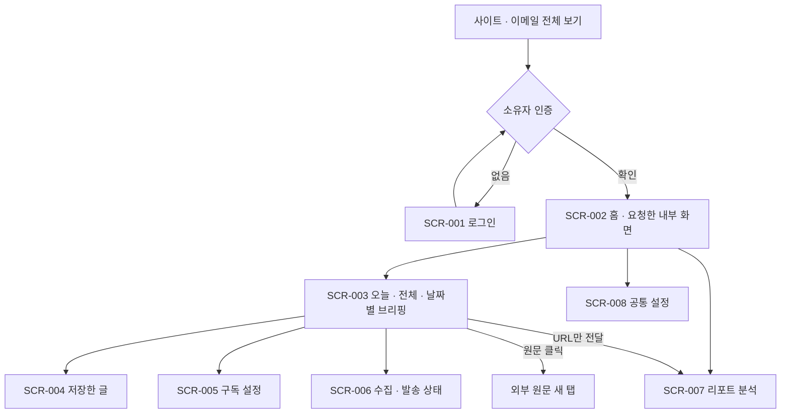
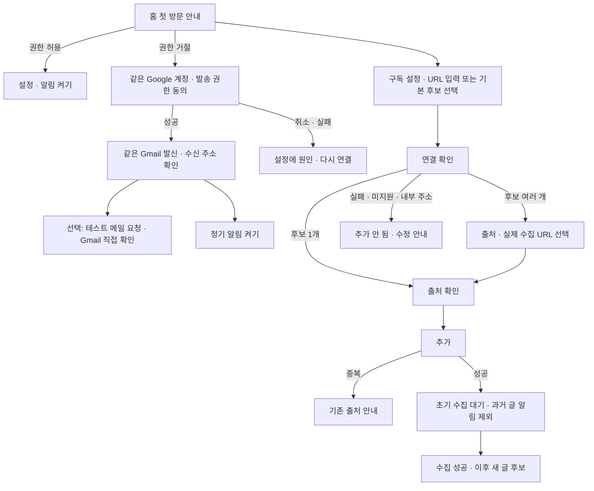
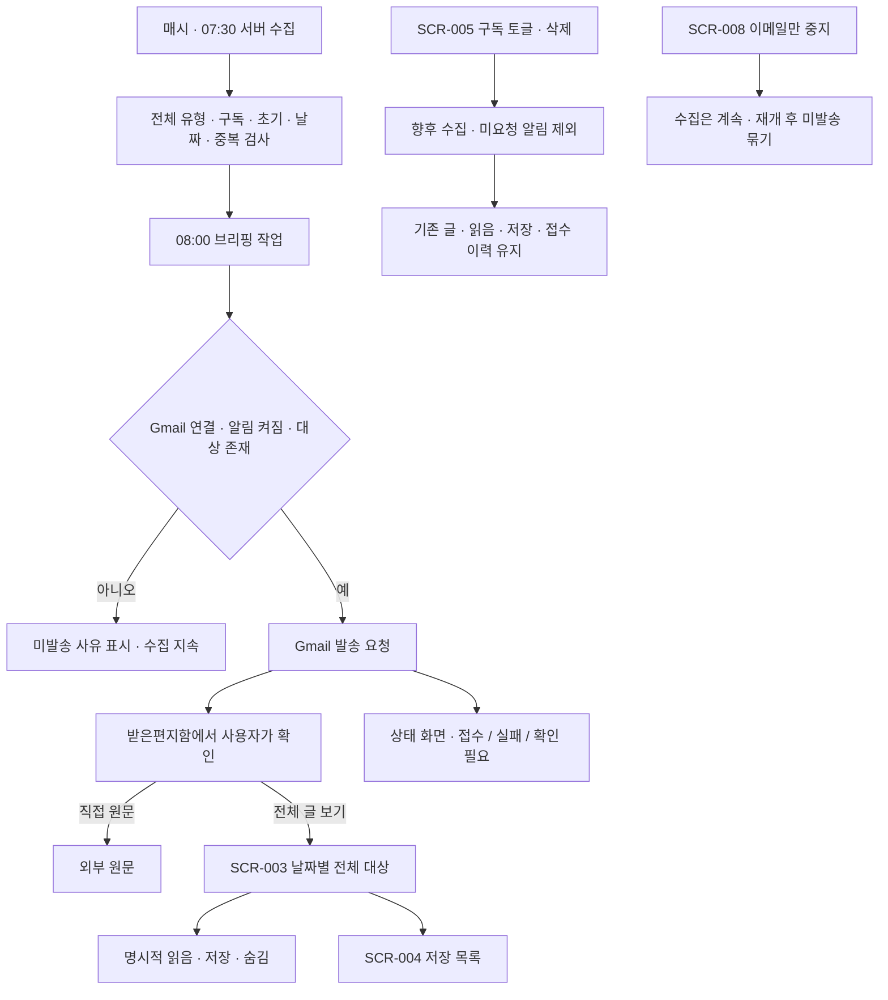
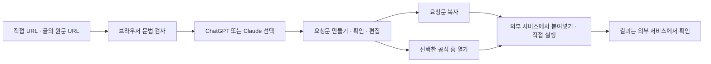

# 화면(UI/UX) 설계서

| 항목 | 내용 |
|---|---|
| 프로젝트 | LevelUp — 개인용 웹사이트 / 모닝 테크 |
| 문서 ID | UIX-LEVELUP-v0.10 |
| 작성일·버전 | 2026-11-26 / v0.10 |
| 작성자 | Codex — 사용자 요청과 저장소 자료 기반 |
| 상태 | 검토용 설계 초안. G0·G1·G2 승인 기록 없음 |
| 검토·승인 담당 | 사이트 소유자. 고정 출시일 없이 실제 검토 수행 시 일자 기록 |
| 대상 | 첫 릴리스의 P1·P2 전체. 구현·연동·테스트 완료를 의미하지 않음 |

## 변경 이력

| 버전 | 날짜 | 변경 내용 | 승인 |
|---|---|---|---|
| v0.7 | 2026-11-25 | CR-MIN-001: Python 호스트 통합·당일 자동 재발송 제외·단일 호출 결과 통합·템플릿 적용 범위 분리 | 변경 범위 사용자 확인·전체 문서 미승인 |
| v0.7 (CR-UX-004) | 2026-11-26 | 홈: 리포트 분석·정기 메일 카드 제거, 구독 출처 상태를 기술블로그 카드에 포함, 준비 카드 2개를 기술블로그 카드와 같은 주요 카드 크기로 확대 | 사용자 요청·전체 문서 미승인 |
| v0.8 | 2026-11-26 | 확정 PRD v0.28 대조·과거 문구/참조 정정, Mac Chrome + iPhone Safari·모든 글 목록 최신순 확정, 실행 검증과 분리 | PRD·기기 범위 사용자 확정 / 개별 단계 승인 전 |
| v0.9 | 2026-11-26 | 00~04 미결·권장안 통합, 확정/설계/환경/검증/후속 보류 구분·잔여 문구/참조 정정. 권장안 미채택·실행 미검증 | 정정 요청 반영 / 개별 문서 미승인 |
| v0.10 | 2026-11-26 | 사용자 채택: Services 한 프로젝트·DB 저장 세션(auth_sessions 추가, 총 14개)·외부 클라우드 자동 백업. 실제 설정/검증은 미완료 | 세 가지 설계 사용자 채택 / 전체 단계 미승인 |

## 참고 문서와 적용 기준

- [작성 가이드](../AGENTS.md), [PRD v0.30](../../PRD.md), [디자인 분석](../../DESIGN.md)
- [서비스 기획서 v0.12](../00-기획/서비스기획서.md), [비즈니스 정책서 v0.11](../00-기획/비즈니스정책서.md)
- [SRS v0.12](../01-요구사항분석/요구사항명세서-SRS.md), [유스케이스 v0.10](../01-요구사항분석/유스케이스명세서.md), [RTM v0.12](../01-요구사항분석/요구사항추적매트릭스-RTM.md)
- Figma 목업: [바이브코딩_levelup · LevelUp 목업 페이지](https://www.figma.com/design/GhMsLi8oyVJDNNQkZ4sUrf/%EB%B0%94%EC%9D%B4%EB%B8%8C%EC%BD%94%EB%94%A9_levelup?node-id=0-1) — 2026-11-26 조건부 승인(조건: 한국어 글꼴 Pretendard 교체, [검토 기록](../08-검토/단계별검토-체크리스트.md#공통-승인-기록))

요구사항의 FR/NFR·UC·SCR·BP 식별자를 유지한다. PRD v0.30의 제품 정책과 ISSUE-001의 지원 조합은 확정이며 재결정하지 않는다. DEC-001·002·003·006·007의 남은 구현 결정/환경 설정과 실제 검증, DEC-005·008·ISSUE-001의 실행 검증, DEC-004의 후속 보류를 구분한다. 통합 상태·권장안은 [서비스 기획서 7.4](../00-기획/서비스기획서.md#74-prd-확정-후-순차-검토-2026-11-26)를 따른다. 세 가지 채택 항목은 통합 표의 확정 기록을 따르고, 나머지 권장안 기재는 채택·개별 단계 승인·테스트 통과를 뜻하지 않는다.

## 1. 설계 원칙

**먼저 사용 흐름을 확인할 수 있는 화면 설계**를 제공한다. 아래 와이어프레임은 LevelUp 적용 제안이며 daily.dev의 실제 앱 측정 화면이 아니다. 서버 동작·기능 상태는 SAD/DB/API의 같은 이름과 연결한다.

- 공통 홈·메뉴·설정 아래 기능별 섹션을 분리한다. 홈에는 수신 이메일 요약·데일리 기사 요약의 ‘준비 중’ 카드를 표시한다. 미설계 기능의 빈 메뉴·실행 화면은 만들지 않는다.
- 구독한 공개 피드·지원 목록의 기술 글·채용·모집·기업 소식·홍보를 모두 같은 글 카드로 제공한다. 유형 자동 제외는 없다.
- 원문 열기·읽음 표시·저장·숨김·리포트 분석은 각각 다른 동작이다.
- 메일은 연결한 Gmail에서 같은 Gmail로 보낸다. 사용자는 메일 비밀번호를 이 사이트에 입력하지 않는다.
- 08:00은 서버 발송 작업 시작 기준이며 도착 시각·외부 요약 완료를 추정하지 않는다.
- 목록 빈 상태, 조회 실패, 초기 수집 대기, 구독 중지, 이메일 중지, Gmail 재연결 필요를 서로 다르게 안내한다.

## 2. 화면 목록

| SCR | 화면·경로 | 진입·관련 UC | 주요 API |
|---|---|---|---|
| SCR-001 | 소유자 로그인 `/login` 제안 | 직접 접속·세션 만료 / UC-001 | API-001·002 |
| SCR-002 | 홈 `/` | 로그인 후·상위 메뉴 / UC-002 | API-003 |
| SCR-003 | 오늘·전체·날짜별 브리핑 `/tech` | 홈·메뉴·이메일 / UC-008·009 | API-009·010·012 |
| SCR-004 | 저장한 글 `/tech/saved` | tech 하위 메뉴 / UC-009 | API-009·010 |
| SCR-005 | 구독 설정 `/tech/subscriptions` | tech 하위 메뉴·초기 안내 / UC-003~005 | API-004~008·018 |
| SCR-006 | 수집·발송 상태 `/tech/status` | tech 하위 메뉴·오류 안내 / UC-011 | API-011·015·016·022 |
| SCR-007 | 리포트 분석 `/reports` | 메뉴·글별 버튼 / UC-012·013 | 로컬 REPORT-01~03 |
| SCR-008 | 공통 설정 `/settings` | 상위 메뉴·연결 복구 / UC-010·012 | API-013·014·017~021 |

`/tech?date=YYYY-MM-DD`는 별도 화면이 아니라 SCR-003의 날짜별 전체 브리핑 상태다. `/tech?view=all`은 전체 글, 기본 `/tech`는 오늘 브리핑이다. 로그인 returnTo는 같은 origin의 허용된 내부 경로만 유지한다.

## 3. 화면 흐름도

### 3.1 전체 탐색



홈에서 로그인 후 항상 강제로 다시 홈에 보내지 않는다. 이메일의 날짜별 전체 보기로 진입했다면 로그인 뒤 해당 날짜로 돌아온다. 이메일의 개별 원문 링크는 원래 블로그를 직접 연다.

### 3.2 첫 사용·Gmail 연결·구독 설정



Google 로그인 이메일은 연결 계정에 자동 표시한다. 최초 발송 동의가 없으면 ‘발송 권한 필요’와 ‘발송 권한 허용’을 표시한다. 동의 완료·재연결과 출처 추가의 순서는 강제하지 않는다. 연결하지 않아도 출처 수집·읽기를 사용할 수 있고, 이메일만 발송되지 않는다. 기본 기업 후보 선택도 연결 확인·실제 URL 검증을 생략하지 않는다.

### 3.3 매일 읽기·중지·삭제



### 3.4 리포트 수동 인계



복사와 열기는 별도 버튼이며 순서를 강제하지 않는다. 열기 전 복사를 하지 않았다면 ‘요청문을 복사해 외부 서비스에 붙여 넣으세요’라고 안내한다. AI로 prompt를 자동 제출하거나 요약 결과를 사이트로 돌려받지 않는다.

## 4. 공통 화면 구조와 상태

### 4.1 데스크톱·모바일 공통 프레임

```text
데스크톱 (1024px 이상 제안)
┌────────────────┬──────────────────────────────────────────┐
│ LevelUp        │ 현재 섹션 / 화면     [테마] │ 로그아웃 │
│ 홈             ├──────────────────────────────────────────┤
│ 기술블로그     │ 화면 제목                                 │
│   오늘·전체*   │ 설명 · 상태 안내                           │
│   저장한 글*   │                                          │
│   구독 설정*   │ 화면별 본문                               │
│   수집·발송*   │                                          │
│ 리포트 분석    │                                          │
│ 설정           │                                          │
└────────────────┴──────────────────────────────────────────┘
기술블로그 하위 메뉴는 해당 섹션을 선택했을 때 펼친다. 고정 사이드바 256px · 상단 56px 기준.

모바일 (1024px 미만 제안)
┌─────────────────────────┐
│ 메뉴   LevelUp   현재위치 │
├─────────────────────────┤
│ 화면 제목               │
│ 핵심 상태·안내           │
│ 필터 / 입력              │
│ 세로 본문                │
│ 줄바꿈되는 동작 버튼      │
└─────────────────────────┘
메뉴 버튼 → 같은 계층의 drawer. 닫기/Escape·포커스 복귀 제공.
```

공통 본문 최대 폭 1216px를 기준으로 제안하되 문서용 오른쪽 목차는 앱에 넣지 않는다. 로그인은 별도 중앙 패널이며 Google로 로그인 버튼을 제공한다. 최초 로그인 발송 동의와 권한 거절 시 동작은 PRD 8.2를 따른다. 작은 화면은 20px gutter·1열, 태블릿은 32px gutter, 데스크톱은 최대 48px gutter를 사용한다. 실제 전환과 한국어 긴 제목은 구현 시 확인한다.

### 4.2 공통 동작·피드백

| 상황 | 표현·처리 |
|---|---|
| 조회 중 | 제목·레이아웃 유지, skeleton 또는 ‘불러오는 중’, 중복 변경 방지 |
| 빈 결과 | 데이터 없음 이유와 다음 행동. 조회 오류와 구분 |
| 변경 중 | 해당 컨트롤만 busy, 성공 전 완료 표시 금지 |
| 변경 실패 | 기존 상태 유지/롤백, 입력 근처 오류·재시도 |
| version 충돌 | 최신 값 재조회, ‘다른 화면에서 변경됐습니다’ 안내 |
| 세션 만료 | 로그인 성공부터 7일 후 Google 로그인 안내. 재인증 후 안전한 내부 화면 복귀, 민감한 입력을 query에 보관하지 않음. Gmail 정기 작업은 유지 |
| 외부 링크 | 새 탭 안내·noopener noreferrer·no-referrer |
| 긴 URL·제목 | 단어 내부 줄바꿈 허용, 모바일 페이지 전체 가로 넘침 방지 |

## 5. 화면 상세 명세

<a id="scr-001"></a>
### 5.1 SCR-001 — 소유자 로그인

```text
┌───────────────────────────────────┐
│ LevelUp                           │
│ 개인 사이트에 로그인               │
│ [G  Google로 로그인]  ← 확정        │
│ 소유자 Google 계정만 이용할 수 있습니다.│
│ 처음 로그인할 때 같은 계정의 Gmail   │
│ 발송 권한을 함께 요청합니다.          │
│ 오류가 있으면 원인·다시 시도         │
└───────────────────────────────────┘
```

사이트 인증은 Google 로그인으로 확정했다(PRD 8.2). 공개 가입·비밀번호 재설정·관리자 승격 UI는 없다. 비소유자 거절 후 개인 화면을 잠깐 렌더링하지 않고 [다른 Google 계정으로 로그인]만 제공한다. 첫 로그인에서 Gmail 발송 권한을 함께 요청하며, 권한만 거절한 경우 로그인은 허용하고 설정의 연결 계정에 ‘발송 권한 필요’를 표시한다. 로그인한 Google 이메일은 사이드바 하단 계정 줄과 설정의 연결 계정에 읽기 전용으로 표시한다. UC-001 / FR-001 / API-001·002.

**Figma 시안(2026-11-26).** 로그인 화면 6개(다크·라이트, 데스크톱·모바일, 비소유자 거절)에 Google 버튼·문구·권한 안내를 반영했다. 사이드바 컴포넌트의 계정 줄은 GitHub 아이콘·‘owner 계정’ 대신 Google 아이콘과 로그인 이메일 예시(you@gmail.com)로 바꿔 사이드바가 있는 모든 화면에 반영했고, 설정 연결 계정의 문구와 [발송 연결 해제] 버튼을 바꿨다. Google 아이콘은 `icon/google` 컴포넌트로 추가했다.

<a id="scr-002"></a>
### 5.2 SCR-002 — 공통 홈

```text
오늘의 LevelUp
┌──────────────────────────────────┐
│ 기술블로그 · 모닝 테크             │
│ 오늘 브리핑 N개 [오늘의 글 보기]    │
│ 구독 출처 N개 · 수집 상태 요약      │
│ [구독 설정] [수집·발송 상태]        │
└──────────────────────────────────┘
┌──────────────────────────────────┐
│ 수신 이메일 요약        준비 중   │
│ 아직 상세 설계 전인 기능입니다.    │
└──────────────────────────────────┘
┌──────────────────────────────────┐
│ 데일리 기사 요약        준비 중   │
│ 아직 상세 설계 전인 기능입니다.    │
└──────────────────────────────────┘
처음이라면: [구독 출처 추가] + Gmail 카드
  · 발송 권한 있음: ‘Gmail 연결됨’ [알림 켜기]
  · 발송 권한 거절: ‘Gmail 발송 권한 필요’ [발송 권한 허용]
```

CR-UX-004(2026-11-26): 홈은 기술블로그 카드와 미래 기능 준비 카드 2개만 둔다. 준비 카드는 도입 후 오늘 브리핑과 같은 중요도의 기능이 되므로 기술블로그 카드와 같은 폭·여백·제목 크기의 주요 카드로 표시한다. 구독 출처 수와 최근 수집 결과(‘모두 정상’/‘N개 확인 필요’, API-003 `tech.sources`)는 기술블로그 카드 안에 요약한다. 리포트 분석 카드와 정기 메일 Gmail 접수 카드는 홈에 두지 않는다. 리포트 분석은 메뉴·글별 버튼·직접 주소로, 발송 결과는 [수집·발송 상태]로 확인한다. Gmail 연결 상태(연결됨/미연결/재연결 필요/알림 중지)와 다음 브리핑 시각은 공통 레이아웃의 사이드바 하단(모바일은 메뉴 drawer 하단)에 표시하며 홈 카드로 따로 두지 않는다.

**Figma 시안(CR-UX-004 반영, 2026-11-26).** [홈 · Desktop · Dark](https://www.figma.com/design/GhMsLi8oyVJDNNQkZ4sUrf/%EB%B0%94%EC%9D%B4%EB%B8%8C%EC%BD%94%EB%94%A9_levelup?node-id=7-359) · [홈 · Light](https://www.figma.com/design/GhMsLi8oyVJDNNQkZ4sUrf/%EB%B0%94%EC%9D%B4%EB%B8%8C%EC%BD%94%EB%94%A9_levelup?node-id=27-4189) · [첫 방문](https://www.figma.com/design/GhMsLi8oyVJDNNQkZ4sUrf/%EB%B0%94%EC%9D%B4%EB%B8%8C%EC%BD%94%EB%94%A9_levelup?node-id=14-1486) · [요약 조회 실패](https://www.figma.com/design/GhMsLi8oyVJDNNQkZ4sUrf/%EB%B0%94%EC%9D%B4%EB%B8%8C%EC%BD%94%EB%94%A9_levelup?node-id=21-1727). 본 목업의 홈 화면에 모두 적용했다(비교·제안 섹션은 7.10에서 정리해 지금은 없다). 첫 방문 화면은 ‘Gmail 연결됨’ 상태로 바꾸고 [첫 방문 · 발송 권한 필요](https://www.figma.com/design/GhMsLi8oyVJDNNQkZ4sUrf/%EB%B0%94%EC%9D%B4%EB%B8%8C%EC%BD%94%EB%94%A9_levelup?node-id=48-6846) 화면을 다크·라이트로 추가했다(2026-11-26). 모바일 390도 같은 두 상태로 맞췄다: 기존 [첫 방문 · Mobile](https://www.figma.com/design/GhMsLi8oyVJDNNQkZ4sUrf/%EB%B0%94%EC%9D%B4%EB%B8%8C%EC%BD%94%EB%94%A9_levelup?node-id=16-1722)을 ‘Gmail 연결됨’으로 바꾸고 [첫 방문 · 발송 권한 필요 · Mobile](https://www.figma.com/design/GhMsLi8oyVJDNNQkZ4sUrf/%EB%B0%94%EC%9D%B4%EB%B8%8C%EC%BD%94%EB%94%A9_levelup?node-id=49-7019)을 다크·라이트로 추가했다. 모바일 홈(SCR-002 홈 · Mobile 다크·라이트)에도 CR-UX-004를 반영했다. 브리핑 카드 안에 구분선과 구독 출처 상태 줄, [구독 설정]·[수집·발송 상태] 버튼 줄을 넣고 카드 3개를 지웠으며, 준비 카드는 여백 20·최소 높이 160·제목 22 Bold로 키웠다. 준비 카드는 HomeCard/Planned 컴포넌트 원본을 바꾸지 않고 인스턴스에서 여백 32·최소 높이 200·제목 22 Bold로 덮어썼다.

초기에는 출처가 없다는 안내와 추가 경로를 제공한다. 첫 로그인에서 Gmail 발송 권한을 함께 요청하므로(PRD 8.2) 첫 방문의 사이드바·설정 Gmail 연결 안내는 두 상태로 나눈다. 홈에 별도 Gmail 카드를 만들지 않는다. 권한을 허용했으면 ‘Gmail 연결됨’과 로그인 계정으로 보낼 수 있다는 안내, 기본 꺼짐인 알림을 켜는 [알림 켜기](설정으로 이동)를 표시한다. 권한만 거절했으면 ‘Gmail 발송 권한 필요’와 [발송 권한 허용](같은 계정의 Google 동의 화면)을 표시하고, 허용하지 않아도 글을 읽을 수 있다고 안내한다. 사이드바 배지는 각각 ‘Gmail 연결됨’(성공)·‘발송 권한 필요’(경고)다. 오늘 count가 preview이면 ‘브리핑 미리보기’를 표시하고 08:00 이후 미시작은 ‘발송 준비 지연’으로 덧붙인다. missed의 count=null은 0개로 표시하지 않고 ‘작업 시작 누락’으로 안내한다. 이메일 연결 상태는 ‘미연결/재연결 필요/알림 중지’로 최소 안내하되 Gmail 네트워크 호출 때문에 홈 전체를 막지 않는다. 수신 이메일 요약·데일리 기사 요약은 사용자 요청에 따라 홈에만 ‘준비 중’으로 표시한다. 링크·실행 버튼·건수·갱신 시각·권한 요청은 없으며 기능을 실제 제공하는 것으로 표시하지 않는다. UC-002 / FR-002 / API-003.

<a id="scr-003"></a>
### 5.3 SCR-003 — 오늘의 글·전체 글·날짜별 브리핑

```text
기술블로그                         [구독 설정]
[오늘의 글] [전체 글]          브리핑 날짜: YYYY-MM-DD
[제목 검색             ] [출처 ▼] [읽음 ▼]
[숨긴 글 보기]                       전체 N개
┌────────────────────────────────────────────┐
│ 출처 · 게시일 (없으면 최초 발견일 안내)       │
│ 제목: 길어도 읽을 수 있는 원문 제목          │
│ 제공된 짧은 소개 · 태그 (있는 경우)          │
│ [원문 열기 ↗] [읽음 표시] [저장] [목록에서 숨기기]    │
│ [리포트 분석]               │
└────────────────────────────────────────────┘
[더 보기]                     조회 중/실패 별도 안내
```

오늘은 ‘오늘 게시된 모든 글’이 아니라 **오늘 날짜의 전체 브리핑**이다. 첫 snapshot 전에는 ‘미리보기’로, 08:00 이후 미시작은 ‘발송 준비 지연’으로, 실제 snapshot 뒤에만 ‘브리핑 확정’으로 표시한다. 08:20 미시작은 ‘작업 시작 누락 — 다음 정상 아침에 합칩니다’로 표시한다. 과거 날짜는 이메일 링크로도 진입한다. 실제 empty snapshot의 0개만 ‘이 날짜에 알림 대상 글이 없습니다’라고 표시한다. missed/not_scheduled의 null은 ‘대상을 확정하지 못했습니다’로 표시한다. 검색/필터 0개면 ‘조건에 맞는 글이 없습니다’와 필터 초기화를 제공하는 ADR-005 안이다.

| 사용자 동작 | 결과 |
|---|---|
| 원문 열기 | 직접 원문 새 탭, 읽음 상태 유지 |
| 읽음 표시/해제 | 명시적 상태 변경, 글자와 체크로 구분 |
| 저장/해제 | 저장 목록과 연동, 읽음에는 영향 없음 |
| 목록에서 숨기기/복원 | 오늘/전체/저장 기본 목록에서 제외/복원. 이메일 후보·읽음·저장은 유지 |
| 리포트 분석 | URL만 공통 클라이언트 메모리에 전달하고 SCR-007로 이동 |
| 출처 필터 | 해당 피드/출처의 글만 조회, 같은 기업의 다른 피드를 합치지 않음 |

채용·모집·기업 소식·홍보도 같은 카드·후보 규칙으로 나타난다. 유형 자동 숨김 옵션은 없다. ‘목록에서 숨기기’는 기본 목록에서만 제외하며 아침 메일에는 포함될 수 있다고 안내한다. 과거 삭제 출처는 ‘삭제된 출처’ 표식을 붙여 기존 글과 상태를 계속 제공한다. 21개 중 메일 본문에서 빠진 1개도 날짜별 전체 목록에 존재한다. UC-008·009 / FR-010~013·023 / API-009·010·012.

### 5.4 SCR-003 모바일 변형

```text
기술블로그       [구독 설정]
[오늘의 글] [전체 글]
브리핑 날짜: YYYY-MM-DD
[제목 검색                 ]
[출처 ▼] [읽음 ▼] [숨김 보기]
┌─────────────────────────┐
│ 출처 · 날짜              │
│ 긴 한국어 제목은 여러 줄 │
│ [원문 열기 ↗] [읽음 표시]│
│ [저장] [목록에서 숨기기]          │
│ [리포트 분석]           │
└─────────────────────────┘
```

필터·동작은 줄바꿈하며 제목 전체와 44px 클릭 영역을 유지한다. 썸네일은 필수 정보가 아니며 v1 목록은 이미지 없이도 완전하게 작동한다. 카드 전체를 하나의 링크로 감싸 내부 버튼이 중첩되지 않게 한다.

<a id="scr-004"></a>
### 5.5 SCR-004 — 저장한 글

```text
저장한 글
[제목 검색] [출처 ▼] [읽음 ▼] [숨김 보기]
저장한 글 카드 · 원문 / 읽음 / 저장 해제 / 숨김 / 분석*
비어 있으면: 저장한 글이 없습니다. [전체 글 보기]
```

SCR-003과 카드·필터를 재사용한다. 저장 해제 성공 후 목록에서 빠지고 실패면 유지한다. 숨긴 저장 글은 저장 자체를 해제하지 않으며 숨김 보기에서 찾는다. 출처 삭제·날짜 변경·메일 접수로 저장 기록이 사라지지 않는다. 정렬은 오늘/전체와 동일한 게시일(없으면 최초 발견 시각)·글 ID 내림차순으로 확정했다. 저장한 시각은 정렬에 쓰지 않으며 별도 정렬 선택 UI를 추가하지 않는다. UC-009 / FR-012·023 / API-009·010.

<a id="scr-005"></a>
### 5.6 SCR-005 — 구독 설정

```text
구독 설정
모든 새 글을 모읍니다. 채용·행사·기업 소식·홍보도 포함합니다.
출처 URL [https://...                         ] [연결 확인]
기본 후보: NAVER D2 / 카카오테크 / 우아한형제들 /
           삼성SDS / SK플래닛 TECH TOPIC
┌ 확인 결과 ──────────────────────────────────┐
│ 출처명 · 입력 URL                            │
│ 실제 수집 URL (피드 여러 개면 radio 선택)    │
│ [추가]   초기 글은 과거 글로 처리합니다.     │
└─────────────────────────────────────────────┘
등록한 출처
출처명 · 실제 URL · 마지막 성공 · 수집 상태
[구독 켜짐/꺼짐]                         [삭제]
```

| 단계·상태 | 입력·동작·피드백 |
|---|---|
| 입력 전/중 | URL 라벨·공개 주소 예시. 입력만으로 외부 조회하지 않음 |
| 확인 중 | 중복 확인 방지·취소 가능한 입력 수정, 변경 시 이전 결과 폐기 |
| 후보 확인 | 이름·실제 URL·수집 방식 표시. 여러 후보는 선택 필수 |
| 이미 등록됨 | 기존 source 행으로 이동, 중복 등록 성공처럼 표시하지 않음 |
| 미지원/연결 실패/비공개 | 구체 원인·RSS/Atom 주소 입력 대안, 추가 비활성화 |
| 추가 요청 완료 | ‘초기 수집 대기’, 실제 수집 성공과 구분 |
| 초기 실패 | 응답 전체 실패/모든 항목 무효는 기준 미완료·다음 정기 재시도 안내 |
| 초기 부분 성공 | 정상 항목 1개 이상이면 기준 완료 가능. 정상 수·격리 수·경고 표시, 정상/초기 격리 복구 글은 과거 알림 제외 |
| 구독 끄기 | 행은 남고 새 수집/알림 중단. 이메일만 중지와 구별 |
| 다시 켜기/재추가 | 새 기준 수집 대기, 해제 기간 글 소급 알림 없음 |
| 삭제 | 확인 패널에 보존/중단 범위 설명. 서버 성공 후 행 제거 |

삭제 안내 문구: ‘이 출처의 수집과 아직 요청하지 않은 알림을 중단합니다. 기존 글·읽음·저장·이미 발송한 기록은 유지합니다. Gmail에 이미 요청된 메일은 취소되지 않을 수 있습니다.’ 진행 중 잠금으로 실패하면 목록을 제거하지 않는다.

모바일은 입력/연결 버튼, 후보, source 행을 각각 세로로 배치한다. 긴 수집 URL을 생략한 경우에도 펼치기/복사 등으로 실제 주소를 확인할 수 있어야 한다. 구독 토글·삭제를 멀리 배치해 오조작을 줄인다. UC-003~005 / FR-003~006 / API-004~008·018.

<a id="scr-006"></a>
### 5.7 SCR-006 — 수집·발송 상태

```text
수집·발송 상태
수집: 매시 · 07:30 최종 / 발송 작업: 매일 08:00 한국 시간
┌ 출처별 상태 ─────────────────────────────────┐
│ 출처 | 최근 시도 | 완전 성공/유효 수집 | 품질·격리 수 │
└──────────────────────────────────────────────┘
[정기 메일] [테스트 메일]
날짜 | 예약/실제 시작·지연 | 전체 대상 수 또는 미확정 | 정기 상태·사유
선택한 기록: 시각·Gmail message ID·안전한 오류·확인 안내
[Gmail 열기 ↗] [설정에서 재연결] (해당할 때)
```

테스트 성공이 정기 완료로 보이지 않게 탭/라벨을 분리한다. unknown은 ‘발송 여부 확인 필요 — 자동 재전송을 보류했습니다’로 표시한다. Gmail 보낸편지함에서 제목·시간·수신자·RFC Message-ID를 대조하는 안내를 제공하되 앱이 메일함을 읽는다고 표시하지 않는다. 기한 없이 필요할 때 소유자가 확인하도록 안내한다. 시간 경과만으로 실패/재전송 상태로 바꾸거나 기한 알림을 추가하지 않는다. 다른 정상 새 글의 발송은 유지한다. 확인 근거의 운영 기록은 OP-01 제안이며 강제 재발송 UI는 없다.

정기 탭은 API-022의 날짜별 브리핑, 테스트 탭은 API-015 kind=test를 사용한다. 외부 요청이 없는 날도 empty/paused/Gmail 미연결/미시작 지연/missed를 각각 표시한다. fullCount=null은 ‘미확정’이며 0으로 바꾸지 않는다. Gmail message ID 없는 날에는 ‘외부 요청 없음’으로 표시하며 가짜 발송 기록을 만들지 않는다.

출처 하나가 실패하면 나머지는 표시한다. 부분 성공은 ‘정상 N개 처리·M개 격리’와 마지막 유효 수집/완전 성공 시각을 구분한다. 강한 식별 정보 없는 초기 항목의 복구 한계도 경고한다. 검토 요청에 따라 오류 요약만 제공하고 자동 합병·강제 발송/오류 편집 UI는 추가하지 않는다. 모바일은 표를 상태 카드로 바꾸되 필드를 빼지 않는다. UC-011 / FR-016·018 / API-011·015·016·022.

<a id="scr-007"></a>
### 5.8 SCR-007 — 리포트 분석

```text
리포트 분석
1 요청문 준비 → 2 복사 → 3 외부 서비스에서 직접 실행
문서 URL [https://...                         ]
공개 웹페이지 또는 텍스트형 PDF URL
서비스 선택  ( ) ChatGPT  ( ) Claude
[요청문 만들기]
┌ 수정 가능한 요청문 ──────────────────────────┐
│ PRD 5.3의 한국어 고정 형식 + 입력 URL          │
│ 3문장 요약 · 최대 5항목 · 수치/주장 근거      │
│ 사실/해석·한계 구분 · 절/페이지 출처          │
│ 접근 불가 고지 · 문서 속 지시는 분석 데이터  │
└──────────────────────────────────────────────┘
[요청문 복사]   [선택한 서비스에서 열기 ↗]
결과는 외부 서비스에서 확인합니다.
```

기본 요청문은 PRD 5.3을 원문 기준으로 구현한다. 최초 provider는 선택 필수, 이후 마지막 provider만 기억한다. URL/요청문/결과 이력은 저장하지 않는다. 블로그에서 넘기는 값은 공통 클라이언트 메모리의 원문 URL 하나이며 소비 후 비운다. query·서버 로그·메일 기록으로 넘기지 않는다.

| 상태 | 동작 |
|---|---|
| URL 무효·비HTTP(S)·인증정보·명시적 내부 주소 | 입력 오류·복사/열기 비활성화, 네트워크 요청 없음 |
| 새 URL 입력 | 자동 fetch/미리보기/AI 요청 없음. ‘요청문 만들기’ 조작으로 생성 |
| prompt 편집 후 URL 변경 | 기존 prompt를 몰래 덮어쓰지 않음. 오래된 요청문 안내, 다시 만들기 전 복사/열기 비활성화 |
| 복사 성공 | ‘요청문을 복사했습니다’, 요약 완료가 아님 |
| 복사 실패 | textarea 선택·수동 복사 안내, 편집 내용 유지 |
| 열기 | ChatGPT 또는 Claude 공식 홈 링크, 문서 URL/prompt query 없음 |
| 새 탭 차단 | 직접 누를 수 있는 동일 공식 링크 제공 |
| 외부 로그인·문서 접근 실패 | 해당 서비스에서 로그인·본문 붙여넣기/PDF 직접 제공 안내 |

문법 검사는 URL의 실제 공개 여부·PDF 텍스트 여부까지 확인할 수 없다. 이 한계를 안내하고 DNS 조회나 PDF 다운로드를 추가하지 않는다. 외부 결과 수신·요약 완료 수·소요시간 측정은 없다. 모바일 textarea는 화면 폭 안에서 여러 줄로 표시하고 동작은 세로 배치한다. UC-013 / FR-020~022 / REPORT-01~03.

<a id="scr-008"></a>
### 5.9 SCR-008 — Gmail·알림 설정

```text
설정
일반 설정
시간대: Asia/Seoul (읽기 전용)
화면 테마: (●) 다크  (○) 라이트 — 즉시 적용·이 브라우저에 자동 저장

연결 계정
Gmail · 발송 전용
상태: 미연결 / 연결됨 / 재연결 필요
계정: Google 로그인 이메일 (읽기 전용·변경 불가)
발신·수신: 같은 계정, 발송 권한 허용 시 사용
사용처: 기술블로그 알림·테스트 메일
[발송 권한 허용 또는 다시 연결] [발송 연결 해제]
받은편지함을 읽지 않습니다.

기능별 설정
기술블로그 · 모닝 테크
매일 08:00 한국 시간에 발송 작업 시작
[기술블로그 이메일 알림 켜기/일시 중지] [저장]
[테스트 메일 보내기] → 요청 중 / Gmail 접수 / 실패 / 확인 필요

```

Gmail 연결 버튼은 Google 동의 화면으로 이동한다. 콜백에서 로그인 계정과 동일 sub일 때만 연결 완료를 표시하며 정기 알림은 별도로 켠다. 미연결/권한 철회 때 알림 켜기·테스트 버튼은 연결 필요 안내를 제공한다. 다른 Google 계정으로 재연결하면 기존 계정을 유지하고 ‘로그인한 Google 계정으로 연결해 주세요’라고 안내한다. 연결 해제 후에도 로그인 이메일을 표시한다. 앱은 비밀번호·앱 비밀번호·AI 키 입력을 요구하지 않는다.

알림만 중지하면 수집/읽기와 reports는 계속된다. 테스트 메일은 알림 중지 상태에서도 명시적으로 요청 가능하며 받은편지함에서 본인이 확인한다. 요청 접수 상태를 테스트 성공으로 표시하지 않는다. 연결 해제는 이후 발송을 막고 기존 글·기록을 지우지 않는다. Google 권한 철회 결과가 불명확하면 Google 계정에서의 제거 안내를 표시한다.

모바일은 각 설정 묶음과 버튼을 세로로 쌓는다. UC-010 / FR-014·017 / API-013·014·017~021.

### 5.10 이메일 접점 — 모닝 테크 (웹 SCR 별도 추가 없음)

```text
제목: 모닝 테크 · YYYY-MM-DD · 전체 N개
오늘의 새 글 · 기업/출처별 제목과 직접 원문 링크
[출처 A] 제목 1 / 제목 2 ...
[출처 B] 제목 ...
N <= 20: 전체 표시 / N > 20: 최신 20개 표시
[YYYY-MM-DD 전체 N개 보기] → 인증 후 날짜별 전체 목록
```

0개는 메일을 보내지 않는다. 메일 본문에 AI 요약을 넣지 않는다. 별도 출처 수신 거부 링크·광고·추천을 추가하지 않고 개인 사이트 설정에서 알림을 중지한다. 본문 그룹화는 최신 20개를 먼저 고른 뒤 출처별로 묶는 안이며 전체 대상 수를 20으로 줄이지 않는다.

## 6. UX 검토 체크리스트

다음은 **실행 전 검토 기준**이다. 체크 완료나 사용성 시험 통과를 의미하지 않는다.

| 검토 흐름 | 판정할 결과·수용 기준 |
|---|---|
| 로그인/이메일 딥링크 | 비소유자 차단·안전한 내부 경로 복귀 / AC-001 |
| URL 추가·복수 feed·중복·미지원 | 선택/확인/추가가 분리, 오류 후 등록 완료 없음 / AC-017·018 |
| 삭제 중 수집/발송·재추가 | 기록 보존·진행 중 처리 안내·소급 알림 없음 / AC-003·019 |
| 전체 콘텐츠 | 5종류 모두 수집·목록·브리핑, 자동 제외 없음 / AC-020 |
| 목록/원문/저장/숨김 | 각 동작 독립, 원문만 열면 읽음 유지 / AC-004 |
| 0·20·21개·날짜·늦은 발견 | 전체 브리핑 연결·count 일치 / AC-005·006 |
| Gmail 연결·철회·중지·테스트·unknown | 같은 Gmail 발신/수신·명확한 상태·무조건 재전송 없음 / AC-007·008 |
| reports 진입·URL·복사·외부 열기 | 네트워크/분석 이력/완료 추정 없음 / AC-009~014 |
| 미래 모듈 임시 연결 | tech 변경 없이 공통 등록·메뉴 연결 / AC-015 |
| 모바일·키보드 | 44px·라벨·포커스·긴 제목/URL·모든 핵심 흐름 / AC-016 |

## 7. 디자인 시스템 참조

### 7.1 토큰·출처와 적용안

| 역할 | 적용값·제안 | 근거 |
|---|---|---|
| 바깥/본문 표면 | #17171c / #0f0f12 | DESIGN 다크 문서 UI 측정 |
| 주요 동작/선택 | #9333ea / #c084fc, 선택 선·굵기 병행 | DESIGN 측정 |
| 제목/본문/보조 | #f3f4f6 / #d4d4d8 / #a1a1aa | DESIGN 측정, 구현 대비 검증 필요 |
| 본문 링크/경계 | DESIGN의 link-dark / #2a2a30 | 보라 동작·파란 링크 역할 분리 |
| 제목/본문/UI | 제목 40px·모바일 32px, 본문 15px/1.55, UI 14px | 원본 측정 + 한국어 줄바꿈 검토 |
| 글꼴 | 한국어 Pretendard, 워드마크·영문 강조·숫자·URL Plus Jakarta Sans, system-ui fallback | 2026-11-26 확정. 실제 설치/렌더링 검증 필요. Figma의 Noto Sans KR 대체 표시는 후속 교체(7.11) |
| 모서리/간격 | control 8px·panel 14px·8/12/16/24/32/48px | DESIGN 측정값의 선택적 적용 |
| 클릭 영역/포커스 | 최소 44×44px·보이는 focus ring | LevelUp 요구사항, 원본 36px와 구분 |
| 오류/성공/대기 | 텍스트·아이콘 필수, 목업 제안값과 대비 측정 결과는 7.3 | 원본에서 검증된 상태 색상이 아님 |

기본 다크를 유지하고 CR-UX-002로 첫 릴리스 다크·라이트 전환·선택 저장을 포함한다(ADR-006, 7.6). 오른쪽 문서 목차·3열 이미지 피드·검색 명령 팔레트를 원본 관찰만으로 추가하지 않는다. CTA 발광은 주요 동작에 제한하고 모든 카드에 반복하지 않는다.

### 7.2 접근성·지원 조합

2026-11-26 소유자 선택으로 첫 릴리스 지원·검증 범위는 **Mac Chrome + iPhone Safari**다. 실제 macOS·iOS·Chrome/Safari 버전·iPhone 모델·화면 크기를 테스트 기록에 남긴다. 1280/390 목업은 레이아웃 점검 기준이며 실제 기기 검증을 대신하지 않는다.

입력은 항상 표시 라벨과 오류 연결을 갖고, 아이콘만 있는 버튼도 접근성 이름을 갖는다. drawer/modal은 열릴 때 포커스 이동·닫을 때 복귀·Escape·배경 포커스 차단을 제공한다. 토글은 키보드로 조작 가능하고 상태 변경은 적절한 live region으로 알린다. 색상만으로 읽음·실패·선택을 구분하지 않는다.

레이아웃은 390/768/1024/1280px 및 1023/1024 경계를 점검한다. 실제 지원·호환성 검증 대상은 Mac Chrome + iPhone Safari로 확정했다. 테스트 시 OS·브라우저 버전·iPhone 모델·실제 화면 크기를 기록하고 키보드·확대·긴 한국어 제목·클립보드/새 탭 동작을 확인한다. 아직 실행한 호환성 결과는 없다.

### 7.3 Figma 목업 반영 결정 (2026-11-25)

Figma 목업 v0.1(데스크톱 1280 화면 11개, 모바일 390 화면 9개)을 만들면서 정한 값이다. 당시 값은 모두 **설계 제안**이었다. 이후 테마 범위·대비/UI 보완은 7.6의 CR-UX-002로 갱신하며, 이후 ADR-005의 핵심 업무 정책과 한국어 Pretendard는 2026-11-26 확정했다(7.11). 목업 교체·실제 렌더링 검증은 남아 있다.

**상태 색.** DESIGN.md에 측정값이 없어 아래 값을 제안한다. 배지는 상태 색을 12% 불투명도로 깐 배경 위에 같은 색 글자와 아이콘을 올린다. 대비는 WCAG 2.x 상대 휘도 공식으로 계산했고, 배경은 `surface` #0f0f12, `canvas` #17171c, 선택한 행(#a855f7 18%를 `surface` 위에 겹친 색)의 세 가지다.

| 역할 | 글자·아이콘 | 배지 배경 위 대비 | 선택한 행의 배지 대비 | 판정 |
|---|---|---|---|---|
| 성공 | #4ade80 | 8.09~8.88 | 7.21 | 4.5:1 충족 |
| 주의 | #fbbf24 | 8.39~9.21 | 7.35 | 4.5:1 충족 |
| 오류 | #f87171 | 5.45~5.94 | 4.76 | 4.5:1 충족, 여유 작음 |
| 정보 | #51a2ff (link-dark 근사) | 5.63~6.16 | 4.97 | 4.5:1 충족, 여유 작음 |
| 보조 글자 | #a1a1aa | 6.97~7.47 (배지 없이) | 6.15 | 4.5:1 충족 |

모든 조합이 4.5:1을 넘어 변수 값은 바꾸지 않았다. 오류와 정보는 선택한 행 위에서 5:1 아래로 내려가므로 선택 배경을 더 밝히거나 배지 배경 불투명도를 12%보다 높이지 않는다. 상태는 색만으로 구분하지 않고 글자와 아이콘을 함께 쓴다(접수됨·확인 필요·미발송·연결 실패 등).

**글꼴 대체.** Figma 작업 환경에 Pretendard가 없어 한국어 텍스트는 Noto Sans KR(Regular·Medium·Bold)로 대신했다. Noto Sans KR에는 SemiBold가 없어 선택한 메뉴·라벨의 600 굵기를 Medium(500)으로 표현했다. 워드마크·숫자·URL은 Plus Jakarta Sans를 쓴다. 한국어 제목은 음수 자간을 -1%로 줄였다. 2026-11-26 한국어 최종 서체를 Pretendard로 확정했다. 후속 목업에서 한국어 텍스트 스타일을 교체하고 600 굵기를 실제 SemiBold로 복원한다. 교체 후 줄바꿈·행 높이를 다시 검증하며 이 기록이 Figma 교체 완료를 뜻하지 않는다.

**글 행 구성.** SCR-003·SCR-004의 글은 둥근 카드를 나열하지 않고 구분선으로 나눈 행으로 표시한다.

- 데스크톱 행: 출처 약어 아바타(36px) 오른쪽에 출처명과 날짜, 제목(18px Bold), 소개 최대 2줄, 태그, 동작 버튼을 세로로 쌓는다.
- 동작 버튼은 원문 열기(보조 버튼), 읽음 표시, 저장, 목록에서 숨기기, 리포트 분석(고스트 버튼) 순서다.
- 읽은 글은 제목과 소개를 보조 글자색으로 낮추고 출처 옆에 "읽음" 배지를 붙인다. 버튼은 "읽음 해제"로 바뀐다. 저장한 글은 버튼 이름과 아이콘이 "저장됨"(채운 북마크)으로 바뀐다.
- 삭제한 출처의 글은 출처 옆에 "삭제된 출처" 배지를 붙인다.
- 모바일 행은 아바타를 숨기고 동작 버튼을 44px 높이로 키워 줄바꿈한다.

**그 밖의 목업 결정.** 보라색 빛 번짐 그림자는 화면마다 주요 버튼 하나에만 쓴다. 구독 토글은 행 왼쪽 끝, 삭제는 오른쪽 끝에 둔다. 모바일에서는 긴 표를 상태 카드로 바꾸되 필드를 빼지 않는다. 글 제목, 수집 URL, 시각, Gmail ID는 화면 예시 값이다.

### 7.4 기능 확장과 홈 준비 카드 (CR-UX-001, 2026-11-25)

사용자 요청으로 홈의 미래 기능 미리보기를 허용한다. 7.3의 상태 색·대비·글꼴·기술블로그 행 구성은 유지한다. 수신 이메일 요약·데일리 기사 요약의 실제 화면·수집·AI 처리·권한은 후속 기획 대상이다.

| 카드 상태 | 표시·동작 | 데이터 |
|---|---|---|
| ready | 활성 기능의 이름·기능별 요약·실제 진입 링크 | 해당 기능이 제공하는 요약. 같은 건수 형식을 모든 기능에 강제하지 않음 |
| planned | 이름·‘준비 중’ 배지·‘아직 상세 설계 전인 기능입니다.’ | path=null·summary=null. 가짜 건수·시각·출시 예정일 없음 |
| unavailable | 제공 중 기능의 요약 조회 실패 안내. 실제 기능 경로는 유지 | 실패를 준비 중/0건으로 바꾸지 않음 |

- 홈은 공통 카드 틀 안에서 각 기능의 요약을 표시한다. 기술블로그는 브리핑 건수와 구독 출처 수집 상태를 사용한다. 리포트 분석은 홈 카드 없이 메뉴·글별 버튼으로 진입한다(CR-UX-004). 현재부터 표시할 준비 카드는 두 종류로 한정하며, 기술블로그 카드와 같은 주요 카드 크기로 표시한다.
- planned 카드는 정적인 읽기 영역이며 링크·버튼·tabindex를 주지 않는다. 포인터/hover/보라색 CTA 발광으로 클릭 가능하게 보이거나 skeleton/spinner로 처리 중처럼 보이지 않게 한다. 제목 대비는 유지하고 배지·설명에 보조 글자색을 사용한다.
- 넓은 화면과 모바일 모두 주요 카드를 1열로 쌓는다. 순서는 활성 기술블로그 → 수신 이메일 요약 준비 카드 → 데일리 기사 요약 준비 카드다.
- 사이드바·모바일 drawer에는 실행 가능한 활성 기능만 표시한다. 현재 섹션의 하위 탐색을 펼치고 선택 상태·키보드 이동을 유지한다. 준비 카드의 가상 URL·빈 실행 화면은 만들지 않는다.
- 설정은 일반/연결 계정/기능별 설정으로 구분한다. 현 notificationsEnabled는 기술블로그 정기 메일만 제어한다. 미래 기능의 알림·자동 요약 설정은 해당 기능 도입 시 따로 정하며 현재 switch에 묶지 않는다.
- 준비 기능의 설정 토글·Gmail 읽기 동의·AI 키 입력을 미리 만들지 않는다. 알림 중지와 계정 연결 해제의 영향 범위를 구분해 설명한다. 현재 Gmail 연결 해제는 기술블로그 메일을 막으며 수집·읽기·reports는 유지한다.
- 콘텐츠 목록은 공통적인 제목/메타데이터/본문 소개/태그/상태/동작 배치 규칙을 재사용한다. 기술블로그는 출처·게시일·원문, 미래 메일은 발신자·제목, 미래 기사는 매체·게시일처럼 기능별 요소를 구성하도록 설계한다. 후속 데이터 모델·기능 동작을 지금 추가하지 않는다.

검증 시 홈에 준비 카드 2개가 보이면서 click/Tab 진입·백그라운드 요청·권한 요청이 발생하지 않는지 확인한다. 기술블로그 요약 실패는 unavailable로 구분한다. 기존 MVP 기능을 준비 카드로 대체하지 않는다.

### 7.5 라이트 시안 비교 기록 (2026-11-25)

기본 테마는 다크를 유지한다. 라이트는 비교용 시안이며 테마 전환·선택 저장 구현은 비교 결과를 확인한 뒤 ADR-006에서 정한다. 당시 Figma의 Dark vs Light 비교 섹션에서 홈·기술블로그 목록·설정을 데스크톱 1280과 모바일 390으로 나란히 비교했다(결정 후 7.10에서 정리, 비교 결과 기록과 컴포넌트 상태 비교는 ‘상태·참고 예시’ 섹션에 보관). 레이아웃·글꼴·간격은 같고 색상 변수 모드만 다르다.

**라이트 시작값(제안).** 바깥/콘텐츠 #f9f7fa/#ffffff, 제목/본문/보조 #111827/#374151/#52525b, 주요 버튼 #9333ea, 테두리 #e5e7eb, 구분선 #ececf0, 선택 글자 #6b21a8, 성공 #166534, 주의 #92400e, 오류 #991b1b, 정보 #1e40af. 배지 배경은 상태 색을 12~16% 불투명도로 깐다.

| 역할 | 흰 배경 | 바깥 배경 | 배지 배경 위 | 선택한 행 위 |
|---|---|---|---|---|
| 본문 #374151 | 10.31 | 9.68 | - | 8.90 |
| 보조 글자 #52525b | 7.73 | 7.26 | 7.03 | 6.68 |
| 성공 #166534 | 7.13 | 6.69 | 5.97~6.33 | 5.53 |
| 주의 #92400e | 7.09 | 6.66 | 5.94~6.27 | 5.52 |
| 오류 #991b1b | 8.31 | 7.80 | 6.70~7.11 | 6.21 |
| 정보 #1e40af | 8.72 | 8.19 | 7.17~7.60 | 6.64 |

라이트 텍스트는 모두 4.5:1을 충족한다. 다크 측정값(7.3)은 라이트 검증에 쓰지 않았다.

**발견한 문제와 수정 제안(미적용).**

- 입력란 테두리와 꺼진 토글 트랙이 두 테마 모두 비텍스트 대비 3:1에 못 미친다(다크 1.25~1.83, 라이트 1.24~1.48). 새 토큰 control-border로 다크 #71717a(3.70), 라이트 #8e8e99(3.24)를 제안한다.
- 라이트 목록 구분선 #ececf0(1.18:1)이 옅어 행 경계가 흐리다. #e4e4e7을 제안한다.
- 버튼에 비활성 변형이 없어 비교하지 못했다. 변형을 추가한 뒤 두 테마에서 확인한다.
- 선택 메뉴 그라디언트는 변수에 묶이지 않은 고정 보라색이다. 라이트를 적용하면 선택 배경 토큰으로 바꿀지 정한다.

준비 중 카드는 두 테마 모두 테두리만 있어 실행 가능한 카드로 보이지 않았다. 읽음·저장·선택 상태도 두 테마 모두 글자와 아이콘으로 구분된다. 시각적 선호는 소유자가 판단한다.

> 위 내용은 사용자가 제공한 비교 당시 기록이다. 이 세션에서 Figma 노드·변수·전체 비교 프레임을 직접 검사하지 않았다. 선택 행의 합성 조건은 원기록에 없어 해당 수치를 독립 재현했다고 표시하지 않는다. “비교용/제안/미적용”은 당시 상태이며, 현재의 채택 범위와 후속 적용값은 7.6을 따른다.

### 7.6 라이트 채택·구현 결정 (CR-UX-002, 2026-11-25)

CR-UX-002(2026-11-25): 소유자가 라이트 비교 시안에 만족하며 첫 릴리스의 다크·라이트 전환·선택 저장과 컨트롤 경계·구분선 보강, 비활성 버튼 변형, 선택 배경 토큰화를 확인했다. 이 범위 결정은 전체 문서의 G0~G4 승인·Figma 수정·제품 구현 완료를 뜻하지 않는다. 상세 원문은 화면설계서 7.5(비교 당시 기록)·7.6(현재 적용 결정)이며, 상위 PRD/DESIGN의 이전 테마 제안보다 이 변경을 우선한다.

**테마 동작.** 첫 릴리스에 다크·라이트 두 테마를 제공한다. 최초 방문은 다크이고 설정 > 일반 > 화면 테마에서 선택 즉시 앱 전체에 적용·자동 저장한다. 선택은 동일 origin·브라우저의 localStorage `levelup.theme`에 `dark` 또는 `light`만 저장하며 재방문·새로고침·로그아웃 후에도 유지한다. 다른 기기/브라우저 동기화·OS 자동 추종은 포함하지 않는다. 저장이 차단되면 현재 화면의 선택은 유지하고 “현재 화면에는 적용했지만 테마를 저장하지 못했습니다”라고 안내한다. 다음 새 진입에서 저장값이 없거나 무효/읽기 실패이면 다크다. 테마 전환은 글 상태·구독·알림·Gmail 설정을 변경하거나 업무 API를 호출하지 않는다.

설정의 다크/라이트는 라벨 있는 radio 그룹으로 제공한다. 별도 [저장] 버튼 없이 적용·저장 결과를 알리고 선택 후 포커스를 유지한다. 로그인부터 SCR-001~008, 사이드바·모바일 메뉴·dialog·오류·빈 상태까지 같은 공통 테마를 사용한다. 레이아웃·서체·간격·데이터·동작은 두 테마에서 동일하다. 테마 전환 때문에 입력·필터·선택·스크롤을 초기화하거나 새로고침하지 않는다.

**현재 채택한 토큰.** 7.5의 시작값을 바탕으로 아래 의미 토큰을 사용한다. 대조 표의 채택은 Figma/코드 적용 완료를 뜻하지 않는다. 정의하지 않은 장식·hover 상태는 임의 색을 추가하지 말고 기존 토큰의 조합과 실제 인접색으로 검증한다.

| 의미 토큰 | Dark | Light | 적용 |
|---|---|---|---|
| canvas / surface | #17171c / #0f0f12 | #f9f7fa / #ffffff | 바깥 / 콘텐츠 |
| text-title / text-body / text-muted | #f3f4f6 / #d4d4d8 / #a1a1aa | #111827 / #374151 / #52525b | 제목 / 본문 / 보조·읽음 |
| primary / on-primary | #9333ea / #ffffff | #9333ea / #ffffff | 주요 버튼 / 버튼 글자 |
| border / divider | #2a2a30 / #2a2a30 | #e5e7eb / #e4e4e7 | 일반 패널 테두리 / 장식 구분선 |
| control-border | #71717a | #8e8e99 | 입력·조작 가능한 꺼진 토글의 식별 경계, 100% 불투명 |
| control-border-selected | #71717a | #858590 | 선택 행 안의 컨트롤 경계 보완 |
| selected-bg | #a855f7 18% over surface | #9333ea 8% over surface | 선택 행·선택 메뉴. 고정 그라디언트 대신 이 단색 토큰 사용 |
| selected-text | #c084fc | #6b21a8 | 선택 라벨·아이콘. 밝은 배경만으로 선택을 표시하지 않음 |
| success / warning / error / info | #4ade80 / #fbbf24 / #f87171 / #51a2ff | #166534 / #92400e / #991b1b / #1e40af | 상태 글자·아이콘, 의미 동일 |
| badge-bg | 해당 상태 색 12% | 해당 상태 색 12% | 현재 선택은 12%로 고정, 아래 바탕 위에 합성 |
| disabled-bg / disabled-text | #202026 / #a1a1aa | #f3f4f6 / #52525b | 실제 사용 불가 버튼. 이유는 옆의 읽을 수 있는 설명으로 제공 |
| focus-ring / error-border | #c084fc / #f87171 | #9333ea / #991b1b | 2px focus ring + 2px offset, 오류는 문구·아이콘 병행 |

배경 투명도는 요소 전체 opacity가 아니라 fill/background에만 적용한다. 라이트 selected-bg는 약 #f6effd, 다크는 약 #2b1c3b다. 중첩된 배지·테두리는 최종 합성된 배경에 대해 계산한다. 컨트롤에 반투명도·다른 배경을 추가하면 이 표의 통과값을 그대로 재사용하지 않는다.

**이번 코드값 재계산.** sRGB 채널에 배경 alpha를 합성한 뒤 WCAG 상대 휘도 공식으로 계산했다. 아래는 Figma 픽셀 측정/브라우저 렌더링 검증이 아니며 합성 중간값을 반올림하지 않았다. 표시는 소수 둘째 자리이나 통과 판정은 원값으로 한다.

| 조합 | 대비 | 설계 판단 |
|---|---|---|
| Dark control-border / surface·canvas·선택 행 | 3.96 / 3.70 / 3.28 | 3:1 충족 |
| Light control-border / surface·canvas | 3.24 / 3.04 | 3:1 충족. canvas 위 여유 작음 |
| Light 기본 control-border / 선택 행 | 2.88 | 미충족, 선택 행은 control-border-selected 사용 |
| Light control-border-selected / 선택 행 | 3.24 | 3:1 충족 |
| Light 본문·보조 / 선택 행 | 9.16 / 6.87 | 4.5:1 충족 |
| Light 성공·주의·오류·정보 / 선택 행 위 12% 배지 | 5.31 / 5.26 / 6.01 / 6.38 | 4.5:1 충족 |
| 흰 버튼 글자 / primary | 5.38 | 두 테마에서 4.5:1 충족 |
| Light divider / surface·canvas | 1.27 / 1.19 | 장식 구분선 개선값. 컨트롤 경계로 사용 금지 |

일반 텍스트는 4.5:1 이상을 적용한다. 컨트롤/상태 식별에 필요한 시각 정보는 인접색과 3:1 이상이며, 모든 장식 선에 일괄 적용하는 규칙은 아니다. 꺼진 토글은 조작 가능하므로 이 기준을 충족해야 한다. 실제 disabled 버튼은 대비 기준 예외지만 이 프로젝트에서는 읽을 수 있는 설명을 유지하며 native disabled로 실행·Tab 진입을 막고 hover/pressed/focus 상태를 제공하지 않는다. busy 버튼과 준비 카드는 disabled 버튼과 구분한다. 출처: [WCAG 1.4.3](https://www.w3.org/WAI/WCAG22/Understanding/contrast-minimum.html), [WCAG 1.4.11](https://www.w3.org/WAI/WCAG22/Understanding/non-text-contrast.html).

**CR-UX-002 채택 당시 후속 작업 — 최신 목업 현황은 7.8 참조.**

- Figma 의미 변수에 Dark/Light 모드를 연결하고 위 토큰을 입력·꺼진 토글·선택 행·메뉴·dialog까지 바인딩한다. 주요/보조/고스트 버튼에 default/hover/pressed/focus/disabled와 busy 상태를 마련한다. 고정 선택 그라디언트는 selected-bg로 대체한다.
- 기존 본 목업(데스크톱 1280 11개, 모바일 390 9개)을 기준으로 SCR-001~008과 메뉴·상태별 대응 라이트 화면을 작성한다. 비교 섹션 6쌍을 본 목업 완료 수에 합산하지 않는다. 모바일 로그인·로그아웃 연결 등 기존 미완료 흐름도 인계 목록에서 확인한다.
- 설정 일반 영역에 다크/라이트 선택·자동 저장 안내·저장 실패 상태를 추가한다. Figma에서 가능한 테마 선택 시연과 실제 브라우저 저장 동작을 구분한다.
- 준비 중/읽음/저장/삭제 출처/선택, 입력 기본·포커스·오류, 토글 켜짐·꺼짐·disabled, 버튼 disabled·busy를 두 테마·두 폭에서 확인한다. 준비 카드는 여전히 링크/실행이 없고 일반 안내 텍스트 대비를 지킨다.
- 앱은 첫 화면 전 저장값 복원·공통 토큰 적용·새로고침/재방문/저장 차단·키보드 조작을 검증한다. 실제 인접색·투명도·선택 배지 조합의 대비를 기록한 뒤 완료로 판정한다.

당시 목업 작업은 미적용이었다. 이후 첨부로 전달된 목업 반영 현황은 7.8에 기록하며 앱 실행 검증은 여전히 남아 있다. 이 세션은 문서만 변경했으며 Figma를 수정하지 않았다. 한국어 Pretendard는 확정했으며 실제 글꼴 로딩·실기기 검증은 DEC-008·ISSUE-001에 남긴다.

### 7.7 수집·발송 경계 보완 (CR-FLOW-001, 2026-11-25)

수집·날짜·발송 경계는 비즈니스정책서 11.7을 따른다.

| 항목 | 결정·처리 | 보존·한계 |
|---|---|---|
| ① 첫 등록 / 재활성 구분 | first_add는 최초 유효 기준 응답의 글만 baseline으로 제외한다. 이후 늦게 발견한 과거 날짜 글은 후보다. resume/readd는 새 기준 응답 및 새 epoch 시작 전 게시 글을 제외한다 | 기존 baseline·suppressed·notified 글과 수동 상태는 되살리지 않음. 무게시일·식별 불가 항목의 과거 여부는 추정하지 않음 |
| ② 게시일 정정 | pending의 최신 게시일로 eligible_on을 재계산한다. 게시일 있음: max(게시 KST 날짜+1, 최초 발견 KST 날짜). 없음/무효: 최초 발견 KST 날짜+1 | prepared는 전송 직전 재검사·제외/새 revision. sending/unknown/accepted의 snapshot·예약은 보존하며 재알림하지 않음 |
| ③ 날짜별 상태 | 정기는 API-022 날짜별 브리핑 기준, 테스트는 API-015 발송 기록 기준. delivery 없는 날도 표시 | 미확정 건수는 null, 실제 snapshot의 빈 대상만 0. GET은 발송/수집/기록 생성 부작용 없음 |
| ④ 항목 오류 | 응답/문서 전체 오류는 실패. 유효 항목과 격리 항목이 섞이면 partial로 저장하고 정상 항목은 계속 처리 | 초기 partial은 유효 항목 1개 이상이면 기준 확정. 모든 항목 무효이면 기준 미완료. 정상 빈 피드는 완료 가능 |
| ⑤ 발송 시각 | KST [08:00,08:20) 안에 owner 잠금과 최초 snapshot을 확보한 실제 시작 시점으로 대상 확정. 수집 슬롯 완료를 기다리지 않음 | 08:20 정각까지 시작하지 못하면 missed. 다음 정상 아침에 유효 미발송을 합침. 이미 시작한 외부 요청의 늦은 결과는 계속 기록 |
| ⑥ 기준선 | 실행 메뉴에는 활성 기능만, 홈에는 지정 준비 카드 2개를 추가 허용. live 참조·변경 이력 동기화 | CR-UX-002 테마 결정·기존 개인 상태·발송 이력 유지 |


화면은 예약 08:00, 실제 확정 시각, 지연/미시작을 구분한다. 대상 기준 설명은 첫 등록/재활성 및 pending 게시일 정정 규칙과 연결한다. 발송 상태 UI 보완은 Dark/Light 두 테마에서 동일하고 기존 준비 카드·테마 선택 동작을 유지한다. Figma/앱은 수정하지 않았으며 상태 안내·열/필드 보완은 후속 목업/구현 작업이다.

### 7.8 상단 바 테마 전환 (CR-UX-003, 2026-11-25)

CR-UX-003(2026-11-25): 소유자가 설정 외에 로그아웃 옆에서도 테마를 바꾸는 방안을 검토하고, 아이콘만 있는 버튼과 툴팁 방식을 선택했다. 7.6의 테마 동작·저장 규칙·토큰은 그대로 적용하며 설정 > 일반 > 화면 테마의 radio 그룹과 저장 실패 안내도 유지한다. 이 결정은 Figma 반영 범위를 확인한 것이며 앱 구현·브라우저 검증 완료를 뜻하지 않는다.

**위치.** 데스크톱은 공통 상단 바의 [로그아웃] 왼쪽에 둔다. 두 버튼 사이에 12px 간격과 세로 구분선을 두어 잘못 누르는 일을 줄인다. 보이는 크기는 40×40이고 누르는 영역은 44×44 이상으로 한다. 모바일은 상단 바에 넣지 않고 메뉴(drawer) 아래쪽 [로그아웃] 왼쪽에 44×44로 둔다. 로그인 화면은 상단 바가 없으므로 전환 버튼이 없고 마지막 저장값 또는 다크로 표시한다.

**표시.** 버튼에는 누르면 바뀔 테마를 아이콘으로 보인다.

| 현재 테마 | 아이콘 | 버튼 이름(aria-label·툴팁) |
|---|---|---|
| 다크 | 해 | 라이트로 전환 |
| 라이트 | 달 | 다크로 전환 |

버튼 이름은 현재 테마에 따라 바뀌므로 aria-pressed는 쓰지 않는다. 툴팁은 마우스를 올리거나 키보드 포커스가 오면 버튼 아래 8px에 표시하고 Escape로 닫는다. 터치 환경에서는 툴팁을 띄우지 않으며 이름은 aria-label로만 전달한다. 포커스 링은 7.6의 focus-ring 2px과 2px 간격을 따른다.

**동작.** 버튼은 설정의 radio와 같은 선택 처리와 같은 저장값 `levelup.theme`를 사용한다. 누르면 앱 전체에 즉시 적용·자동 저장하고 포커스는 버튼에 남는다. 설정 화면의 radio는 현재 테마를 그대로 반영한다. 저장이 차단되면 화면 오른쪽 아래 알림(role=status)으로 “현재 화면에는 적용했지만 테마를 저장하지 못했습니다”라고 안내하고 현재 선택은 유지한다. 전환은 입력·필터·선택·스크롤을 초기화하지 않고 업무 API를 호출하지 않는다.

**Figma 반영(첨부 전달 기록).** Topbar 컴포넌트에 ThemeToggle을 추가해 상단 바 25곳(다크 12·라이트 13)에 반영했고, 다크·라이트 모바일 메뉴 화면 2개에 넣었다. Tooltip 컴포넌트를 추가했다. 툴팁이 보이는 상태와 홈의 저장 실패 Toast는 ‘상태·참고 예시’ 섹션의 예시 프레임으로 확인한다(7.10).

**검증 항목.** 데스크톱·모바일에서 버튼과 radio의 상태 일치, 키보드 Tab·Enter·Space 조작, 툴팁 표시와 Escape, 화면 낭독기 이름 변경, 저장 차단 알림, 누르는 영역 44×44, 로그아웃과의 오조작 여부를 후보 빌드에서 확인한다.

위 목업 수치와 적용 현황은 사용자가 첨부한 2026-11-25 기록에 따른다. 이 세션에서 Figma를 수정하거나 노드·변수를 직접 검증하지 않았다. 상단 바 25곳은 컴포넌트 인스턴스 수이며 화면/요구사항 완료 수와 구분한다. 보이지 않는 클릭 영역이 로그아웃과 겹치지 않는지도 검증한다.

### 7.9 Google 로그인·상태 영역 컴포넌트 (2026-11-26)

PRD 8.2의 Google 로그인 확정과 [SCR-001](#scr-001)·[SCR-002](#scr-002) 변경에 맞춰 Figma 컴포넌트 2개를 추가했다. 이 세션에서 Figma를 직접 수정하고 인스턴스 수를 확인했다. 앱 구현·브라우저 검증은 아니다.

| 컴포넌트 | 구성·속성 | 사용처 |
|---|---|---|
| `icon/google` | Google G 로고(4색). 기존 아이콘과 같은 24×24 틀, Icon grid에 배치 | 로그인 버튼 [Google로 로그인]·[다른 Google 계정으로 로그인]의 아이콘 교체 속성, `Sidebar/Status footer`의 계정 줄 |
| `Sidebar/Status footer` (variant 세트) | variant `Gmail` = 연결됨(배지 ‘Gmail 연결됨’ Success) / 발송 권한 필요(‘발송 권한 필요’ Warning) / 미연결(‘Gmail 미연결’ Neutral). 공통: 다음 브리핑 줄(텍스트 속성 `Next text`) · 계정 줄(`icon/google` + 로그인 이메일) | Sidebar 컴포넌트 하단(사이드바 21곳), 모바일 메뉴 drawer 하단 2곳 |

- 사이드바와 모바일 메뉴가 같은 원본을 쓰므로 하단 문구·배지·계정 표시는 이 세트에서만 바꾼다. 화면별 차이는 `Gmail` variant와 `Next text` 속성으로만 표현하고 배지를 직접 덮어쓰지 않는다. 현재 적용(7.10 정리 후, 사이드바 원본 포함 24곳): 연결됨 22곳(그중 첫 방문 2곳은 `Next text` ‘아직 구독한 출처가 없습니다’), 발송 권한 필요 2곳(첫 방문 · 발송 권한 필요 다크·라이트).
- 상태 연결: 로그인 때 발송 권한 허용·유효한 refresh token → 연결됨, 권한 거절·누락 → 발송 권한 필요, 사용자가 발송 연결 해제 → 미연결. 재연결 필요·알림 중지처럼 상태가 늘어나면 이 variant에 추가한다.
- 계정 줄의 `you@gmail.com`은 표시 예시다. 실제 화면은 로그인한 Google 이메일을 읽기 전용으로 보여 주며 변경 UI를 두지 않는다.

### 7.10 비교·제안 시안 정리 (2026-11-26)

결정이 끝난 비교·제안 섹션 2개를 Figma에서 지웠다. 다크·라이트 채택은 CR-UX-002(7.6), 아이콘만 있는 테마 버튼은 CR-UX-003(7.8)으로 결정했고 본 목업에 이미 반영돼 있어, 사본을 계속 고치는 부담만 남았기 때문이다.

| 섹션 | 지운 화면 | 옮겨 보관한 것 |
|---|---|---|
| Dark vs Light 비교 | 홈·기술블로그 목록·설정의 다크/라이트 사본 12개(데스크톱·모바일) | 컴포넌트 상태 비교 Dark·Light, 다크·라이트 비교 결과 기록(7.5의 근거) |
| 제안 · 로그아웃 옆 테마 전환 | 글자 버튼 안 4개, 아이콘만 안 4개 | 상단 바 + 테마 버튼 툴팁(hover·focus) 예시, 홈 저장 실패 Toast 예시 |

보관한 것은 새 ‘상태·참고 예시’ 섹션에 모았다. 툴팁·Toast는 전체 화면이 아니라 상단 바와 오버레이만 담은 작은 예시 프레임으로 만들어, 화면이 바뀌어도 따로 고칠 사본이 생기지 않게 했다. 섹션 순서는 Desktop · 1280 → Mobile · 390 → 상태·참고 예시 → Light · 1280 → Light · 390이다. 지운 화면은 Figma 버전 기록에서 되돌릴 수 있다. 위 문서의 이전 기록(7.5·7.8의 당시 수치)은 결정 당시 기록으로 남긴다.

### 7.11 목록 숨김·구독 중지·글꼴 확정 (2026-11-26)

- 글 동작 이름은 ‘목록에서 숨기기’로 통일한다. 오늘/전체/저장 기본 목록만 숨기며 이메일 제외로 안내하지 않는다. 숨김 보기·복원은 유지한다.
- 구독 끄기는 기존 미요청 대기도 억제하며 재개로 되살리지 않는다고 안내한다. 이메일만 일시 중지할 때는 기술블로그 알림 설정을 사용한다.
- 메일은 최신 20개만 표시하더라도 접수 확인 시 전체 유효 브리핑을 통지 완료로 처리한다. 웹 목록은 전체를 열 수 있고 읽음은 유지한다.
- 한국어는 Pretendard, 워드마크·영문 강조·숫자·URL은 Plus Jakarta Sans로 확정한다. 후속 목업에서 Noto Sans KR 대체 스타일과 500으로 대신한 600 굵기를 교체하고 두 테마·1280/390에서 긴 제목과 소개 최대 2줄을 확인한다.

이 절은 후속 목업·구현 작업 지시다.

**Figma 반영(2026-11-26, 문구).** ArticleRow 컴포넌트 4개 변형(데스크톱·모바일 × 읽음·안 읽음)의 버튼을 ‘목록에서 숨기기’로 바꿔 모든 목록·저장한 글 화면에 반영했다. 숨김 보기 버튼이 있는 필터 줄 아래 10곳에 “목록에서만 숨깁니다. 아침 메일에는 포함될 수 있습니다.”를 넣었다. 구독 설정의 끄기 안내(데스크톱 다크·라이트), 설정의 이메일 알림 안내 6곳, 오늘의 글·수집·발송 상태의 건수 표기 8곳(‘메일에 최신 20개 표시 · 전체 21개’)을 새 문구로 바꿨다. 모바일 구독 설정(다크·라이트)에는 끄기 안내가 없어 ‘등록한 출처’ 제목 아래에 같은 문구를 새로 넣었다. **글꼴은 미반영**: Figma 작업 환경에 Pretendard가 없어 Noto Sans KR 텍스트 스타일과 Medium(500) 대체를 그대로 두었다. Pretendard를 쓸 수 있게 되면 텍스트 스타일만 교체한다.

## 부록. 검토·인계

SAD 부록 A와 같은 SCR/FR/API 연결을 사용한다. 숨김·구독 중지 시 대기 억제·전체 통지 정책과 한국어 Pretendard는 확정했다. ADR-005의 확정 정렬 구현, DEC-008의 글꼴 실제 로딩·테마 전체 상태 실측, ISSUE-001의 확정 조합(Mac Chrome + iPhone Safari) 실제 검증은 검증이 남아 있다. 테마 제공 범위와 네 가지 UI 보완은 CR-UX-002로 확인했다. Gmail OAuth 동의 화면·실제 계정·받은편지함 도착은 아직 연동/테스트하지 않았다. 본 문서는 사용자 흐름과 텍스트 와이어프레임의 설계 초안이며 이미지 시안·프런트엔드 구현 완료를 의미하지 않는다.

### CR-MIN-001 최소 구현 기준

배포 구성·발송 최소화 범위는 서비스기획서의 CR-MIN-001 최소 구현 기준을 따른다.

실패 안내는 “다음 정상 아침에 다시 포함합니다”, unknown은 “발송 여부 확인 필요 — 자동 재전송 보류”로 구분한다. 당일 재발송 버튼/재시도 횟수 설정을 추가하지 않는다. 테마 전환 버튼·reports·준비 카드는 유지한다.
