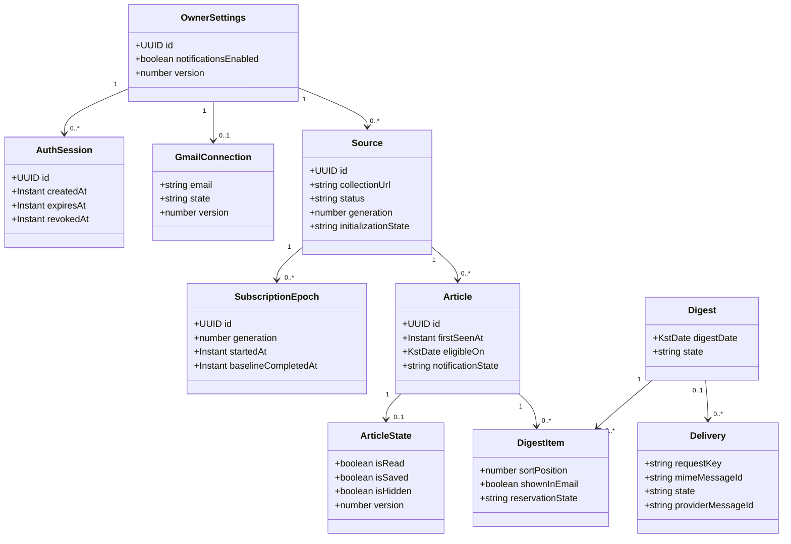
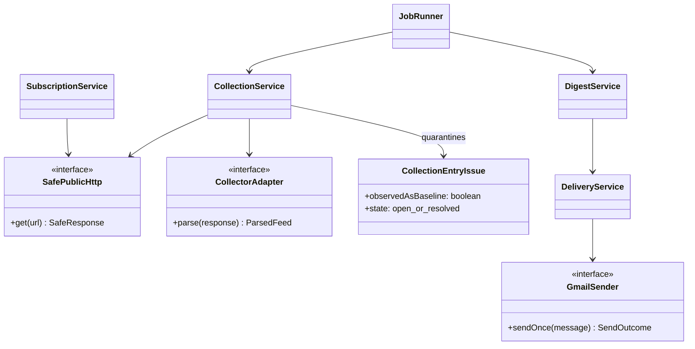
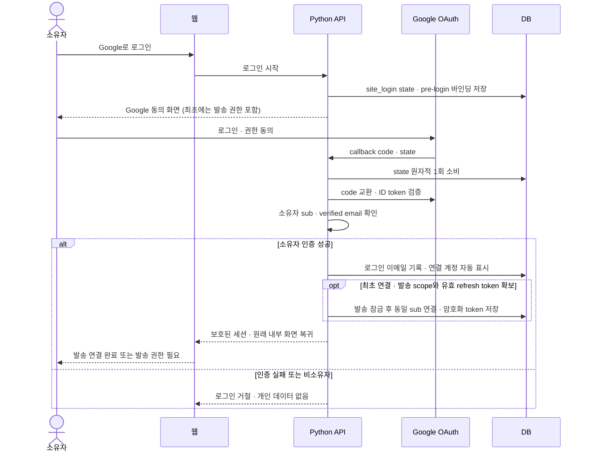
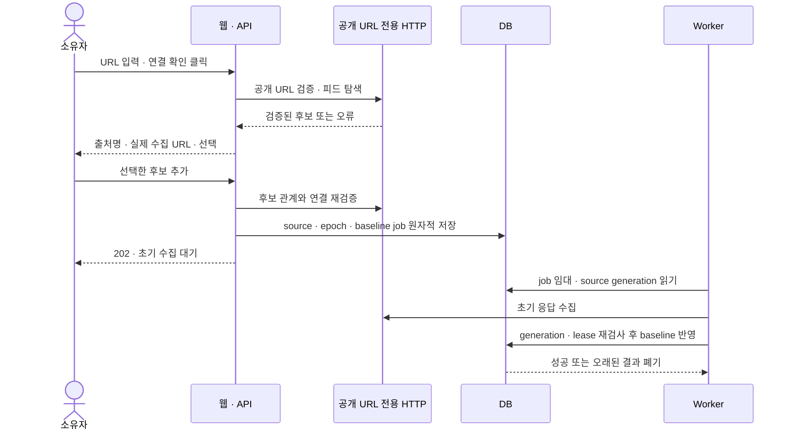
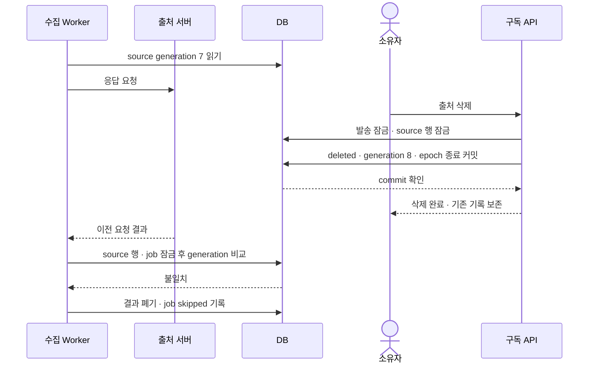
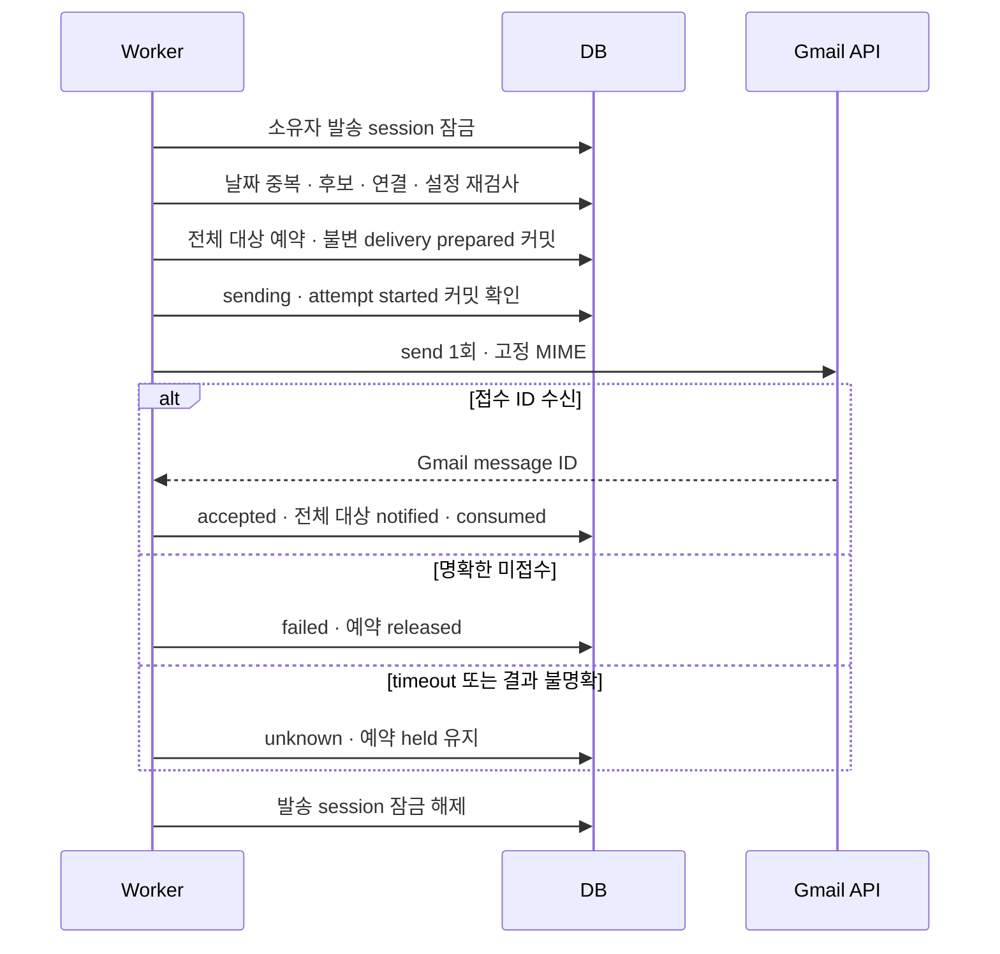
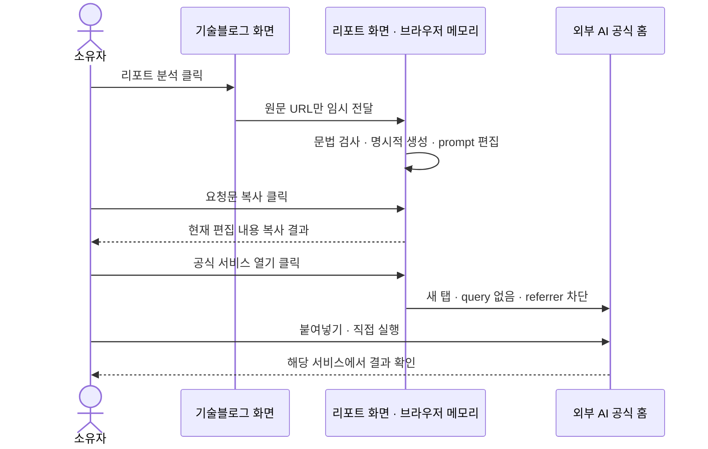
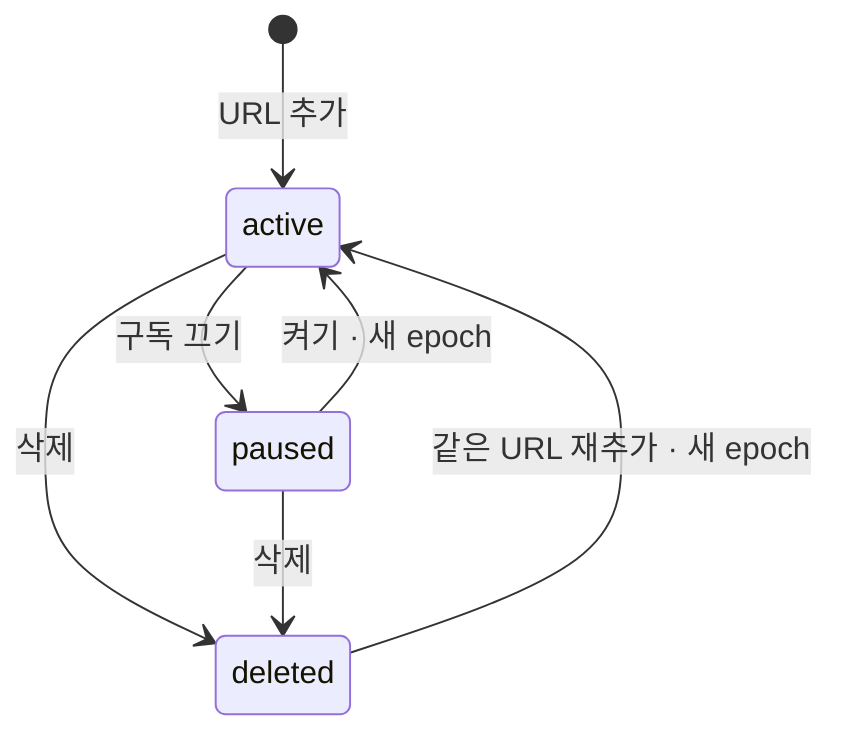
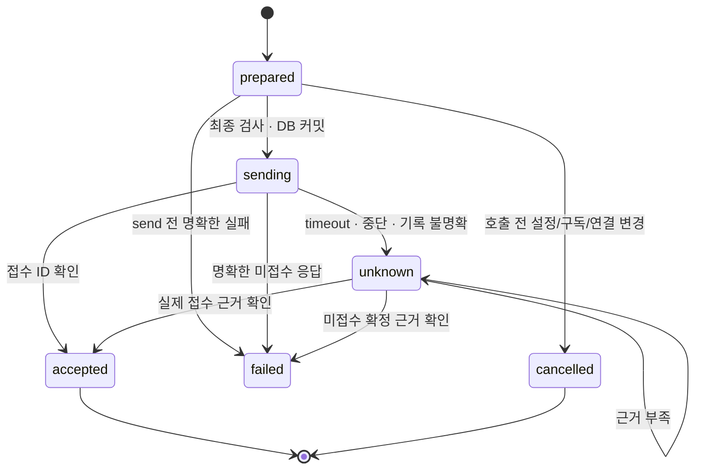

# 상세 설계서 (Detailed Design Document)

| 항목 | 내용 |
|---|---|
| 프로젝트명 | LevelUp — 개인용 웹사이트 / 모닝 테크 |
| 문서 ID·버전 | DDS-LEVELUP-v0.10 / v0.10 |
| 작성일 | 2026-11-25 |
| 최종 수정일 | 2026-11-26 |
| 작성자 | Codex — 사용자 요청과 저장소 자료 기반 |
| 승인자 | 사이트 소유자 — 검토·승인 미실시 |
| 상태 | 검토용 초안. G0·G1·G2·G3 승인이나 구현·제품 테스트 완료를 뜻하지 않음 |
| 대상 | 첫 릴리스의 P1·P2 전체. 기존 템플릿 7장의 코딩 표준을 함께 작성 |


남은 항목의 상태·권장 처리방식·채택 여부는 [서비스기획서 7.4](../00-기획/서비스기획서.md#74-prd-확정-후-순차-검토-2026-11-26)를 단일 통합 표로 사용한다. 단일 Services 프로젝트·DB 저장 세션·외부 클라우드 주간 자동 백업은 2026-11-26 사용자 채택이며 나머지 권장안은 채택 전이다. 채택과 개별 단계 승인·실제 실행 검증 완료는 구분한다.

## 1. 문서 개요

### 1.1 목적

02 시스템 설계를 함수·데이터 접근·트랜잭션·화면 상태·복구 절차로 구체화한다. 한 앱의 공통 영역과 기술블로그·리포트 분석을 분리하고, 서버 수집과 Gmail 발송은 브라우저와 독립적으로 실행한다. 문서의 경로·타입·SQL은 **구현 계약 제안**이며 현재 존재하는 코드·설치 명령이 아니다.

### 1.2 범위·적용 우선순위

사용자가 확인한 Gmail 동일 계정 발신·수신, 직접 URL 구독 관리, 모든 콘텐츠 유형 포함, 선택형 외부 AI 수동 인계, 향후 섹션 확장을 반영한다. 회원가입·결제·글 작성·파일 업로드·내부 AI 요약 등 템플릿 예시는 채택하지 않는다.

상위 제품 범위 → SRS 수용 기준 → 02 설계 → 본 상세 설계 순서로 대조한다. 사용자가 확인한 방향은 Python 서버·수집 + TypeScript 웹, Next.js 웹·FastAPI API의 Vercel 배포다. 정기 실행은 Vercel Schedules로 확정했으며 함수/DB 무료 적합성은 미결이다(PRD 8.3). 웹 프레임워크 Next.js·Python API 프레임워크 FastAPI·DB PostgreSQL은 확정이며 인증 라이브러리와 구현 세부는 **구체화 제안**이다. Google 로그인·동일 계정 Gmail 연결은 PRD 8.2에서 확정했다. 기존 TypeScript 업무 서버/Node worker·Auth.js 제안은 CR-IMP-001로 대체한다. 이를 사용자 승인으로 바꾸지 않는다. ADR-005의 숨김은 목록 전용·구독 끄기 전 대기 억제·접수 시 전체 통지는 2026-11-26 사용자 채택으로 확정했다. 기존 CR-FLOW-001의 날짜·snapshot 경계를 유지한다. ADR-006의 테마 제공 범위는 CR-UX-002로 확인했다. 한국어 Pretendard는 확정했으며 실제 글꼴 로딩·전체 상태 검증은 남아 있다. 상위 DEC를 승인·수정하면 관련 절·RTM·검증 조건을 함께 갱신한다.

### 1.3 참조 문서

| 문서 | 기준 버전·참조 |
|---|---|
| 작성 지침 | [루트 AGENTS](../../AGENTS.md), [waterfall AGENTS](../AGENTS.md) |
| 제품·디자인 | [PRD v0.30](../../PRD.md), [DESIGN.md](../../DESIGN.md) |
| 기획·정책 | [서비스 기획서 v0.12](../00-기획/서비스기획서.md), [비즈니스 정책서 v0.11](../00-기획/비즈니스정책서.md) |
| 요구사항 | [SRS v0.12](../01-요구사항분석/요구사항명세서-SRS.md), [유스케이스 v0.10](../01-요구사항분석/유스케이스명세서.md), [RTM v0.12](../01-요구사항분석/요구사항추적매트릭스-RTM.md) |
| 시스템 설계 | [SAD v0.10](../02-시스템설계/시스템아키텍처설계서-SAD.md), [DB v0.10](../02-시스템설계/데이터베이스설계서.md), [API v0.10](../02-시스템설계/API설계서.md), [화면 v0.10](../02-시스템설계/화면설계서.md) |

### 1.4 변경 이력

| 버전 | 날짜 | 작성자 | 변경 내용·상태 |
|---|---|---|---|
| v0.7 | 2026-11-25 | Codex | CR-MIN-001: Python 호스트 통합·당일 자동 재발송 제외·단일 호출 결과 통합·템플릿 적용 범위 분리. 실행 미완료 |
| v0.8 | 2026-11-26 | Codex | 확정 PRD v0.28 대조·과거 문구/참조 정정, Mac Chrome + iPhone Safari·모든 글 목록 최신순 확정, 실행 검증과 분리. 전체 상세 설계·실행 미승인 |
| v0.9 | 2026-11-26 | Codex | 00~04 미결·권장안 통합, 확정/설계/환경/검증/후속 보류 구분·잔여 문구/참조 정정. 권장안 미채택·실행 미검증 |
| v0.10 | 2026-11-26 | Codex | 사용자 채택: Services 한 프로젝트·DB 저장 세션(auth_sessions 추가, 총 14개)·외부 클라우드 자동 백업. 실제 설정/검증은 미완료 |

## 2. 클래스 다이어그램

### 2.1 도메인 모델 전체 뷰

아래 class는 언어 중립적인 도메인 자료형과 관계를 나타낸다. Python은 dataclass/Pydantic·타입 힌트로, TypeScript 웹은 API DTO로 표현한다. 모든 엔티티를 상속 가능한 클래스로 구현하라는 뜻은 아니다. 14개 테이블의 전체 컬럼·키는 DB 설계서를 기준으로 하고, 여기서는 처리에 필요한 핵심만 표시한다.



도식의 시각·날짜 중 실제 nullable 컬럼은 DB 표를 따른다. `providerMessageId`는 Gmail 응답 ID이며 RFC Message-ID와 구분한다. Article의 알림 상태와 ArticleState의 수동 읽기 상태도 별개다.

### 2.2 서비스 계층과 의존성

| 02 모듈 | 구현 단위 제안 | 공개 책임 | 직접 의존 |
|---|---|---|---|
| CMP-01 | sectionRegistry, HomeService | 활성 메뉴·홈·독립 요약 | 설정 조회, 기능별 요약 함수 |
| CMP-02 | OwnerGuard, SettingsService, GmailConnectionService | 소유자 인증·설정·Gmail 연결 | 세션, 설정/연결 DB, Google OAuth, TokenCipher |
| CMP-03 | SubscriptionService, CollectionService | URL 확인·구독·파싱·중복·기준 수집 | SafePublicHttp, CollectorAdapter, tech DB, JobQueue |
| CMP-04 | ArticleQueryService, ArticleStateService | 목록·상태·원문 링크 | tech 읽기 SQL·article_states |
| CMP-05 | DigestService, DeliveryService | 전체 브리핑·메일 구성·발송 결과 | 설정·연결·tech DB, GmailSender |
| CMP-06 | ReportController, promptTemplate | URL 문법·요청문·복사·공식 홈 | 브라우저 메모리·Clipboard·provider 로컬 선호 |
| CMP-07 | Scheduler, JobRunner, StatusQuery | 슬롯 등록·임대·복구·관측 | job_runs, 기능별 작업 함수 |



클라이언트 reports는 이 서버 의존 그래프에 포함하지 않는다. 런타임 의존성 주입 프레임워크 대신 함수 인자로 외부 경계와 clock을 전달한다. Python API와 worker가 같은 Python 서비스를 재사용한다. TypeScript 웹/SSR는 고정 Python API를 호출하고 DB/업무 서비스를 중복 구현하지 않는다.

### 2.3 Infrastructure 경계

| 경계 | 계약 | 구현 제약 |
|---|---|---|
| DB | 소유자 범위 query·짧은 transaction·전용 잠금 session | 파라미터 SQL, HTTP 중 열린 transaction 금지 |
| SafePublicHttp | 공개 주소 검증·검증 IP 연결·bounded body | 연결 확인/발견 feed/redirect/정기 수집이 같은 경로 사용 |
| CollectorAdapter | 응답 → 제목·URL·GUID·날짜·소개·태그 | RSS/Atom 공통, HTML은 코드에 등록된 지원 adapter만 |
| GmailSender | 불변 MIME → accepted/rejected/unknown | send HTTP/SDK 자동 재시도 금지 |
| GoogleOAuth·TokenCipher | 검증된 계정·서버 token 암호화 | 검증된 라이브러리 사용, 비밀을 DTO에 반환하지 않음 |
| Clock | 검증된 UTC instant 제공 | 테스트에서 KST 자정/08:00을 재현, 로컬 서버 시간대에 의존하지 않음 |

## 3. 시퀀스 다이어그램

### 3.1 소유자 로그인·Gmail 연결 (UC-001·010)



이후 일반 로그인은 해제된 발송 연결을 복원하지 않는다. 설정의 동일 계정 재동의는 gmail_connect state와 인증 세션에 바인딩한다. 사이트 로그인과 Gmail은 같은 Google sub를 사용하되 state purpose·인증 세션·발송 권한을 구분한다. 세부 검사·연결 해제는 5.1·5.2를 따른다.

### 3.2 URL 확인·추가·기준 수집 (UC-003·006)



복수 피드는 사용자 선택 없이 추가하지 않는다. 등록 후 최초 유효 기준 응답까지 과거 글 기준 처리를 유지한다. 정상 항목 1개 이상인 partial은 격리 표식과 함께 기준 완료할 수 있다. 입력/조회/등록 성공/수집 성공을 같은 상태로 표시하지 않는다.

### 3.3 삭제 중 수집 (UC-005·006)



삭제 완료 후 기사·source 성공 시각을 되살리지 않는다. 조회 중 네트워크 요청을 중단하는 것만으로 삭제 보장을 대신하지 않는다. 기존 읽음·저장·접수 이력은 삭제하지 않는다.

### 3.4 아침 브리핑·Gmail 요청 (UC-007)



Gmail HTTP와 DB는 원자적이지 않다. `sending` 저장 확인 전에는 외부 send를 호출하지 않는다. DB 기록이 끊기면 unknown을 보수적으로 유지하며 재호출하지 않는다. 세부 복구는 5.6·5.7을 따른다.

### 3.5 리포트 요청문 수동 인계 (UC-013)



직접 URL 입력은 tech DB 없이 같은 로직으로 작동한다. LevelUp 서버의 문서 조회/AI 호출이나 외부 결과 callback은 없다.

## 4. 상태 다이어그램

### 4.1 구독·초기 수집



`status`와 `initialization_state`는 별도 축이다. 활성화 직후 pending → running → ready이며 응답 전체 실패/모든 항목 무효는 failed다. 정상 빈 피드 또는 정상 항목 1개 이상인 partial 응답이면 기준 완료·ready가 가능하다. partial은 경고와 격리 수를 표시하며 완전 성공으로 표시하지 않는다. 미완료 기준은 다음 정기 수집에서 재시도한다. 삭제/끄기/켜기/재추가는 generation을 증가시키고 기존 결과를 무효화한다. 같은 목표 상태의 반복 요청은 epoch를 늘리지 않는다.

### 4.2 글 알림 자격과 개인 상태

| 현재·조건 | 다음 상태·변경 | 변경하지 않는 값 |
|---|---|---|
| 최초 유효 기준 응답의 정상 글·식별 가능한 초기 격리 복구 글 | baseline, eligible_on=NULL | 이후 재수집으로 pending 전환 안 함 |
| 일반 수집의 새 글 | pending + eligible_on 계산 | 콘텐츠 유형으로 제외하지 않음 |
| resume/readd 시작 전 게시 글·해제/삭제된 대기 | suppressed + 이유 | first_add의 기준 이후 늦은 과거 글은 이 이유로 제외하지 않음 |
| Gmail 접수된 전체 대상 | notified + digest FK | 읽음·저장·숨김 |
| 기존 pending 글 게시일 정정 | metadata·eligible_on 재계산, prepared 최종 검사 | 최초 발견·수동 상태·notified 완료·sending/unknown 예약 |
| 기존 글 제목만 수정 | metadata만 갱신 | 알림 자격·통지 완료 |
| 명시적 읽음/저장/숨김 | article_states의 지정 필드만 | articles의 알림 상태 |

held/consumed는 digest_items의 예약 상태다. unknown 메시지에 묶인 held 글을 source 변경으로 임의 해제하지 않는다. 구독 중지의 미요청 대기 억제와 숨김의 목록 전용 효과는 PRD 4.1.1·4.3에 따라 확정했다.

### 4.3 Gmail 발송 메시지



단일 외부 호출·실패 이월·불명확 예약은 비즈니스정책서의 CR-MIN-001 규칙을 따른다.

digests는 전체 구성/정기 상태, deliveries는 개별 불변 메시지 상태다. snapshot N=0은 empty를 우선하고 N>0에서 알림 중지 paused→Gmail 미연결 failed→ready 순으로 판정한다. sending/accepted/failed/unknown은 외부 요청 결과다. 08:20 미시작만 missed이며 시작한 메시지를 덮어쓰지 않는다. API-012·022의 scheduled/delayed/not_scheduled는 DB 행이 없을 때 계산하는 응답 상태다. missed는 행이 없으면 파생하고 worker 복구 시 저장할 수 있다. 미확정/missed 건수 null과 확정 empty의 0을 구분한다.

### 4.4 Gmail 연결·작업 상태

| 대상 | 전이 | 안전 조건 |
|---|---|---|
| Gmail | disconnected → connected | OAuth 완료·검증된 계정·사용 가능한 refresh token |
| Gmail | connected → reauth_required | 만료/철회 등 재동의 필요가 확인됨 |
| Gmail | reauth_required → connected | 재연결 성공, connection version 갱신 |
| Gmail | connected/reauth_required → disconnected | 새 발송 차단·로컬 token 삭제, 원격 철회 별도 시도 |
| Job | queued → running | 원자적 claim·새 lease token |
| Job | running → succeeded/partial/failed/skipped | 현재 lease를 확인하고 결과 코드·정상/격리 건수 저장, partial은 종료 상태 |
| 만료 Job | running → queued 또는 종료 | 수집과 메일 구분, sending 메일 재전송 금지 |

작업 succeeded는 Gmail 배달/열람 성공이 아니다. 메일 unknown은 job failed + `DELIVERY_UNKNOWN`으로 명시하고 관련 delivery ID를 남기는 상세안이다.

## 5. 모듈 상세 설계

### 공통 인터페이스 표기

입출력의 `UUID`, `Instant`, `KstDate`는 각각 검증된 UUID, UTC ISO 시각, KST 날짜 문자열이다. `OwnerContext`는 서버의 소유자 검사 또는 내부 worker가 만든 신뢰 문맥이며 요청 JSON으로 받지 않는다. 표의 camelCase 함수명은 논리 이름이며 Python 구현은 require_owner·resolve_source·collect_source처럼 snake_case·async/await를 사용한다. 공개 JSON은 camelCase를 유지하고 TypeScript 웹만 Promise를 사용한다.

<a id="dds-auth"></a>
### 5.1 공통 홈·인증·설정 (CMP-01·02)

| 함수 | 입력 → 출력 | 처리·오류 |
|---|---|---|
| requireOwner | cookie token → DB 세션 → OwnerContext | token hash·owner·revoked_at·고정 expires_at 검사. 비인증 401·비소유자 403, DB 오류 시 허용하지 않음 |
| listEnabledSections | OwnerContext → SectionSummary[] | 정적 등록의 제공 중 섹션 반환, 홈/메뉴 공통 사용 |
| getHome | OwnerContext → HomeDTO | 활성 기능 summary·정적 planned 카드 2개. 요약 실패는 unavailable로 격리 |
| getSettings | OwnerContext → SettingsDTO | Gmail 주소 읽기 전용, token 제외 |
| updateSettings | OwnerContext, expectedVersion, patch → SettingsDTO | 알림만 허용, 428/412·연결 필요 409 |

`sectionRegistry`는 id/label/path/availability를 정의한다. tech·reports는 available이고 둘 다 항상 표시한다. inbox-summary·daily-news는 planned·path=null로 등록한다. listEnabledSections는 활성 메뉴만 반환하고 getHome은 그 카드들과 planned 카드 2개를 조합한다. planned는 요약 함수를 호출하지 않고 정적 description·summary=null만 반환한다. 홈은 파서·Gmail API·prompt 내부 코드를 import하지 않는다. 후속 모듈은 자체 진입·요약 함수와 등록 정보만 추가한다.

설정 변경은 소유자 발송 잠금 후 owner_settings 행을 잠근다. `expectedVersion`을 비교하고 owner version을 같은 트랜잭션으로 갱신한다. 연결 없는 상태에서 알림을 새로 켜면 실패한다. 알림 중지는 글 후보를 suppressed로 바꾸지 않는다.

로그인 returnTo는 같은 origin의 내부 경로만 허용하고 `//외부주소`, 다른 scheme/origin을 거절한다. 개인 페이지/API는 no-store다. 인증 완료 전 데이터 조회·UI 렌더링을 시작하지 않는다. 사이트 인증은 Python API가 담당한다. 단일 Services 공통 origin에서 /api/*는 Python으로 라우팅하고 TypeScript SSR도 같은 API를 고정 목적지로 호출한다. 사이트 OAuth에는 purpose=site_login과 pre-login 바인딩을, Gmail 연결에는 purpose=gmail_connect와 인증 세션 바인딩을 사용한다. provider token을 cookie에 넣지 않는다. 사이트 세션은 Google 로그인 성공 시점부터 7일(604,800초) 고정 만료다. 일반 요청·페이지 방문·cookie 재발급으로 최초 만료 시각을 연장하지 않는다. 만료 시 개인 API는 401로 응답하고 화면은 Google 로그인 후 안전한 원래 내부 경로로 복귀한다. 로그아웃은 즉시 세션을 종료한다. 사이트 세션 만료·로그아웃은 Gmail 발송 token이나 정기 작업을 해제하지 않는다. 사이트 세션 저장 방식은 auth_sessions로 확정했다. OAuth 라이브러리·콜백 호환성과 실제 구현은 DEC-001에서 검증한다. 회전하더라도 최초 세션의 7일 만료는 연장하지 않는다.

**DB 저장 세션 처리**

Google 소유자 검증 성공 후 표준 보안 난수 32바이트 이상의 token과 별도 CSRF token을 만든다. DB에는 token의 SHA-256 hash·owner_id·csrf_token·created_at·expires_at=created_at+604800초·revoked_at=NULL을 저장하고 성공 뒤에만 원문 token을 보호된 cookie로 발급한다. require_owner는 매 요청마다 hash 조회·소유자·폐기 여부·고정 만료를 확인한다. API-002는 현재 세션의 CSRF token만 반환하고 세션 bearer token/hash는 노출하지 않는다.

POST /api/auth/signout은 동일 origin·CSRF 검사 뒤 현재 세션만 revoked_at 처리하고 cookie를 만료시킨다. 다른 기기의 세션·Gmail 연결·정기 작업은 유지한다. 한 기기 로그아웃 후 cookie 재사용 401, 다른 기기 계속 사용, 7일 정각 만료·방문 연장 없음·DB 오류 시 인증 허용 없음이 검증 기준이다. OAuth state의 gmail_connect 바인딩은 시작한 세션의 유효성도 확인한다. 새로운 로그인 세션을 생성하는 것과 기존 세션의 만료를 연장하는 것을 구분한다.

<a id="dds-gmail"></a>
### 5.2 Gmail 연결·token 보호 (CMP-02)

**연결 데이터:** owner_settings(google sub·검증 이메일) → 동일 sub의 gmail_connections, 일회성 oauth_states. API-019~021 / SCR-008 / UC-010 / FR-014·017.

| 함수 | 입력 → 출력 | 책임 |
|---|---|---|
| startGmailConnect | OwnerContext, sessionBinding → authorizationUrl | state·nonce·PKCE 생성, hash/암호문·만료 저장 |
| completeGmailConnect | 소유자 세션, code/state → redirect 결과 | 일회성 상태·계정·scope 검증 후 연결 저장 |
| getAccessToken | 연결 ID/version → 서버 전용 token | 갱신·캐시, 철회 시 재연결 상태. API 반환 금지 |
| disconnectGmail | OwnerContext, 연결 → 연결 해제 결과 | 로컬 차단·token 삭제, 원격 철회 시도 |

**연결 완료 순서**

1. 소유자 세션·CSRF를 확인하고 고정 callback URI를 사용한다. Google 권한은 `openid email gmail.send`만 요청하고 login_hint에 로그인 Google sub를 지정한다. 반환 sub가 owner auth_subject와 다르면 GOOGLE_ACCOUNT_MISMATCH로 기존 연결을 보존한다. 힌트만으로 계정 일치를 신뢰하지 않는다. offline access를 사용한다. 받은편지함 읽기 scope를 추가하지 않는다.
2. callback은 state hash·시작 세션·만료를 검사한다. 조건부 UPDATE로 consumed_at을 한 번만 기록한 뒤 code를 교환한다. 재사용·만료·동의 취소는 정상 연결을 변경하지 않고 설정으로 안내한다.
3. 라이브러리로 ID token의 서명·issuer·audience·nonce·verified email을 확인하고 필요한 발송 scope를 확인한다. 사용자가 입력한 email이나 unverified claim은 주소로 채택하지 않는다.
4. refresh token이 없으면 **동일한 검증 subject의 기존 유효 token**만 재사용한다. 다른 계정/미연결에 기존 token을 재사용하지 않으며 재동의를 안내한다.
5. 소유자 발송 잠금 → 연결 행 잠금 순으로 계정·scope·암호문·version을 저장하고 오래된 access token 캐시를 폐기한다. From/To는 이 계정 email로 동일하게 결정한다. 완료 후 `/settings?gmail=connected`로 이동한다. 정기 알림은 별도 조작으로 켠다.

**암호화 상세안:** AES-256-GCM과 난수 nonce를 사용하고 `formatVersion,keyId,nonce,tag,ciphertext` 봉투를 DB bytea로 저장한다. 키는 TOKEN_ENCRYPTION_KEY로 DB 밖에서 공급한다. owner ID·연결 ID·용도를 AAD에 바인딩하고 nonce를 재사용하지 않는다. 암호문/tag/key 불일치는 복호화 실패로 처리하고 발송하지 않는다. keyId에 맞는 키를 찾지 못하면 재연결을 안내하며 평문 저장으로 우회하지 않는다. 키 길이·인코딩·nonce/tag 길이는 선택 라이브러리 계약과 함께 G3에서 고정한다. [Python cryptography AESGCM](https://cryptography.io/en/stable/hazmat/primitives/aead/#cryptography.hazmat.primitives.ciphers.aead.AESGCM).

access token은 서버 메모리에서만 `(connectionId,version)`에 연결해 캐시한다. 재연결/해제/확정 철회 시 version을 올려 이전 캐시를 폐기한다. 갱신의 invalid_grant 등 영구 오류는 reauth_required, 일시적인 token endpoint 장애는 연결을 지우지 않는 실패로 구분한다. 갱신 실패가 send 호출 **전**이면 원격 발송 unknown으로 오인하지 않는다.

첫 로그인 처리는 PRD 8.2와 API-001 계약을 따른다. 발송 동의가 부족해도 검증된 소유자는 로그인시키고 disconnected 연결 행·로그인 이메일을 저장한다. 이후 일반 로그인으로 연결을 복원하지 않는다. getSettings는 로그인 이메일을 표시하고 발송 가능 여부는 state·scope·token으로 판단한다. 로그인 이메일 변경은 reauth_required로 전환한다. 로그아웃은 사이트 세션만 종료한다.

해제는 발송 잠금 안에서 disconnected·version 증가·로컬 token 삭제를 먼저 커밋한다. 이전 token으로 Google 철회를 제한 시간 내 시도하고 실패 시 remoteRevocation=unconfirmed를 표시한다. 기존 기록·글·설정·이미 접수된 메일은 지우지 않는다. Google Testing 상태의 지속 운영 조건·실제 계정·검증/게시 절차는 DEC-002에 남긴다. [Google 서버 OAuth 지침](https://developers.google.com/identity/protocols/oauth2/web-server).

<a id="dds-subscriptions"></a>
### 5.3 구독 URL·추가·토글·삭제 (CMP-03)

| 함수 | 입력 → 출력 | 저장/오류 |
|---|---|---|
| resolveSource | OwnerContext, inputUrl → ResolveDTO | 연결 확인만 수행, DB 출처 등록 없음 |
| addSource | OwnerContext, inputUrl, collectionUrl → SourceJobDTO | source+epoch+baseline job 원자 저장 |
| setSubscription | OwnerContext, sourceId, version, enabled → SourceDTO(끄기) 또는 SourceJobDTO(켜기) | 반복 요청은 epoch 중복 없음 |
| deleteSource | OwnerContext, sourceId, version → 보존 범위 | soft delete, 진행 중 generation 차단 |

**URL 확인·정규화**

1. 서버 URL 파서로 trim·scheme·userinfo·port·hostname을 확인한다. HTTP/HTTPS 기본 포트만 허용하는 02 제안을 따른다. 명시적 localhost·사설/예약 IPv4·IPv6·IPv4-mapped IPv6를 거절한다. 표현만 다른 숫자 IP도 파싱 후 검사한다.
2. 정규화는 hostname 대소문자·기본 포트·fragment·주변 공백을 정리한다. 경로 대소문자·끝 slash·query 순서/값을 임의로 합치거나 삭제하지 않는다. 같은 도메인의 다른 피드는 별도다.
3. DNS A/AAAA의 모든 목적지가 공개 허용 범위인지 확인하고 검증한 IP로 연결을 고정한다. TLS hostname/SNI·인증서 검증을 유지한다. 이 연결 제어를 지원하는 Python API/worker의 HTTP transport를 사용하고, 지원되지 않는 배포 환경에서 일반 fetch로 우회하지 않는다. redirect는 자동 추적하지 않고 hop마다 scheme/DNS/연결을 다시 검사한다.
4. RSS/Atom이면 해당 피드를 검증한다. HTML이면 최종 응답 URL 기준으로 rel=alternate의 RSS/Atom 링크를 해석하고 각 후보를 검증한다. 피드가 없으면 정적 host/path 등록에 맞는 HTML adapter만 허용한다. 사용자가 adapter 코드/경로를 지정할 수 없다.
5. 후보가 여러 개면 선택을 요구한다. 추가 시 선택 주소가 입력 URL의 재검증 결과에 속하는지 확인한다. 이미 확인한 클라이언트 결과를 신뢰하지 않는다.

XML DTD/외부 엔티티·브라우저 스크립트 실행·인증 쿠키 전달은 금지한다. 제한은 02 제안인 URL 2,048바이트·HTTP 전체 15초·redirect 3회·압축 해제 5MiB·수집 동시성 2를 따른다. 피드 후보 수/항목 수·HTML 페이지 범위는 adapter 지원 명세와 DEC-003에서 고정한다. 범위/상한 초과를 성공처럼 잘라내지 않는다.

**추가·재추가 트랜잭션**

네트워크 검증은 transaction 밖에서 끝낸다. 발송 잠금 후 정규화 URL hash로 기존 행을 확인한다. active/paused면 409와 existingSourceId, deleted면 같은 source ID를 사용한다. 새 행/복원 행의 generation·pending 상태·새 epoch와 `baseline/{sourceId}/{generation}` job을 한 번에 커밋하고 202를 반환한다. unique 충돌은 재조회하여 기존 등록/동시 재추가 결과로 판정한다.

**끄기·삭제 트랜잭션**

발송 잠금 → source 행 잠금 → version 검사 → generation 증가·epoch 종료 순서다. 아직 호출하지 않은 pending 글은 suppressed로, 미요청 reservation은 released로 바꾼다. prepared 메시지가 포함하던 글이 달라지면 기존 메시지를 cancelled로 보존하고 이후 유효 대상으로 새 revision을 구성한다. 이미 sending/unknown/accepted인 메시지와 그 snapshot/held·consumed 예약은 수정하지 않는다.

삭제는 status=deleted·deleted_at을 저장하고 목록에서 제거한다. 끄기는 paused로 남긴다. 켜기는 새 epoch와 baseline을 생성한다. 이미 삭제된 항목의 반복 삭제는 현재 삭제 상태를 반환한다. 잠금 대기 실패는 RESOURCE_BUSY이며 화면에서 완료로 처리하지 않는다. 기존 article_states/과거 digest·delivery는 변경하지 않는다.

<a id="dds-collection"></a>
### 5.4 정기 수집·중복·알림 날짜 (CMP-03, CR-FLOW-001)

| 함수 | 입력 → 출력 | 계약 |
|---|---|---|
| collectSource | sourceId, generation, JobLease → CollectResult | 응답 오류 / 항목 오류 / 완전 성공 구분 |
| parseFeed | 안전 응답·adapter → ParsedFeed | 정상 entries와 항목 errors 분리. 응답 전체 손상/절단은 실패 |
| upsertArticle | transaction, source/epoch, ParsedEntry → 생성/갱신 | GUID·URL alias, 항목별 savepoint로 예상 가능한 충돌 격리 |
| upsertEntryIssue | source/epoch, hash·mode·code → Issue | 원문 없이 초기 관측 표식·중복 오류·복구 이력 보존 |
| computeEligibility | mode·epoch·최신 게시일·최초 관측 날짜 → 자격 | 순수 함수. 날짜 자격과 실제 snapshot 포함을 분리 |

**실행 알고리즘**

1. source별 session 잠금 후 active/generation·job lease를 확인한다. 삭제는 이 네트워크 잠금을 기다리지 않고 generation으로 무효화한다.
2. baseline 미완료 또는 open 격리 항목이 있으면 ETag/Last-Modified 조건 없이 본문을 받는다. 정상 일반 304는 신규 0이며 미해결 격리를 해소했다고 기록하지 않는다. baseline의 본문 없는 304는 실패다.
3. 전체 요청 timeout·상한 초과/절단·XML/HTML 문서 전체 파싱 실패는 출처 시도 전체 실패다. 정상 문서의 title/공개 원문 URL/식별 충돌은 항목 오류로 분리한다. 날짜 누락/무효는 오류 격리 대신 precision=missing/invalid와 날짜 누락 규칙을 적용한다.
4. source 행 → 필요한 article 행 → job 행 순서의 짧은 transaction에서 generation/lease를 재검사한다. 정상 항목별 savepoint 안에서 alias를 조회한다. 하나의 기존 article이면 갱신하고 두 alias가 다른 article이면 그 항목만 rollback·IDENTITY_CONFLICT 격리한다. 자동 합병/기존 글 삭제는 하지 않는다. 예상하지 못한 DB 오류·lease/source 변경은 시도 전체 rollback한다.
5. 새 정상 글은 article/alias를 저장한다. 최초 기준 응답이면 baseline이다. 기존 글은 metadata/last_seen_at을 갱신하되 mutable pending의 게시일/precision이 바뀌면 아래 규칙으로 자격을 재계산한다. 기존 baseline/suppressed/notified와 sending/unknown/accepted에 예약된 글의 자격은 유지한다.
6. 항목 오류는 collection_entry_issues에 hash·first_seen_at·observed_as_baseline·정제 코드를 upsert한다. 다음 본문에서 강한 식별 hash로 복구가 확인되면 resolved_article_id를 연결한다. 초기 관측 항목은 baseline을 유지하고 일반 관측 항목은 최초 관측 날짜를 사용한다. 동일성 확인 없이 다른 article에 합병하지 않는다.
7. 정상 항목과 오류가 섞이면 partial·job partial이다. 정상 1개 이상인 baseline partial은 완료 가능하다. 모든 항목 무효이면 job failed·기준 미완료다. 정상 빈 응답은 success·기준 완료 가능하다. last_usable_at은 정상 저장/정상 빈 응답 때, last_success_at/ETag는 완전 성공 때만 갱신한다. partial에서 ETag를 진전시켜 오류 재평가를 생략하지 않는다.
8. 초기 완료·정상 글·격리 표식·source 결과·job 종료를 같은 transaction에 기록한다. 마지막에 generation/lease를 다시 확인하고 commit한다. 어떤 콘텐츠 유형도 이 처리에서 자동 배제하지 않는다.

**알림 자격 — CR-FLOW-001의 결정 범위**

```text
최초 유효 기준 응답 또는 식별 가능한 초기 격리 복구 글:
  baseline, eligibleOn=null
새 정상 글 또는 mutable pending:
  resume/readd이고 최신 게시 시각이 epoch.started_at 전이면 suppressed
  그 외 게시 시각이 있으면 max(KST 게시 날짜+1일, KST 최초 관측 날짜)
  게시 시각이 없거나 무효이면 KST 최초 관측 날짜+1일
기존 baseline/suppressed/notified 또는 sending/unknown/accepted 예약:
  metadata 수정으로 자격 재발급/예약 해제 안 함
```

날짜 자격과 실제 snapshot 포함 시점은 비즈니스정책서 11.7의 경계를 따른다.

prepared는 아직 외부 요청 전이므로 게시일 정정에 따라 부적격 item을 제거할 수 있다. 최종 검사는 owner 잠금 → source ID 순서 → article ID 순서의 행 잠금 안에서 최신 자격을 읽고 필요한 prepared 취소·예약 해제·새 revision을 만든다. 첫 대상에 없던 글은 추가하지 않는다. 동일 transaction에서 sending을 커밋한 이후는 취소 경계가 지났으므로 후속 metadata 수정으로 snapshot/통지 자격을 바꾸지 않는다. 수집은 source/article 잠금을 공유하여 이 경계와 직렬화하며 owner 잠금을 역으로 얻지 않는다.

| 사례 (KST) | 기대 |
|---|---|
| first_add 기준 이후 발견, 게시일은 최초 등록 전 | 날짜 자격을 만족하면 다음 실제 아침 snapshot 후보 |
| resume/readd 기준 이후 발견, 게시 시각은 새 epoch 시작 전 | suppressed, 소급 알림 없음 |
| 어제 게시 pending을 오늘 게시로 정정 | eligibleOn은 내일 이후, 전송 전이면 당일 대상에서 제거 |
| 과거 게시 글 08:03 commit / 첫 snapshot 08:05 | 당일 포함 가능 |
| 첫 snapshot 08:05 / 새 글 commit 08:06 | 다음 정상 아침 |
| 최초 owner 잠금·snapshot 확보 08:19:59 | 시작 허용, 이후 결과는 마감 뒤에도 보존 |
| 최초 owner 잠금·snapshot 미확보 08:20:00 | missed·미발송, 유효 pending은 다음 정상 아침 |
| 무게시일 글 08:03 발견 | 발견일 다음 날 이후 |
| 초기 정상 2개+오류 1개, 오류 글이 나중에 식별 가능하게 복구 | baseline 완료·정상 글 2개 제외·격리 경고, 복구 글도 초기 제외 |

안정 식별자도 없고 내용까지 바뀐 초기 오류는 같은 글인지 확정할 수 없다. 이 관측 한계와 미해결 격리를 상태 화면에 드러내며 임의 과거 판정·오류 은폐를 하지 않는다. 출처별 HTML 범위·시간대·피드 표본·자원 한도는 DEC-003의 나머지 미결이다.

<a id="dds-reading"></a>
### 5.5 목록·개인 상태 (CMP-04)

| 함수 | 입력 → 출력 | 처리 |
|---|---|---|
| listArticles | OwnerContext, ArticleQuery → Page<ArticleDTO> | 전체/저장, 제목 포함 검색·출처·읽음·숨김 |
| getDigest | OwnerContext, date, query → DigestDTO | 오늘 미리보기 또는 당시 전체 snapshot |
| patchArticleState | OwnerContext, articleId, expectedVersion, patch → StateDTO | 지정 boolean만 변경, 행 없으면 version=0 |

query enum·날짜·UUID·limit을 검사한다. ILIKE는 파라미터로 전달하고 검색어의 `%`, `_`, escape 문자는 문자 그대로 검색되게 escape한다. SQL 문자열에 검색어·정렬 키를 직접 연결하지 않는다.

정렬은 2026-11-26 소유자 확정에 따라 오늘 미리보기·전체·저장 모두 `(coalesce(published_at,first_seen_at),id)` 내림차순이다. 전체/저장은 같은 키의 커서를 사용하고 saved_at은 정렬에 쓰지 않는다. 별도 정렬 UI/옵션은 없다. 날짜별 확정 브리핑은 보존된 sort_position 순서를 사용한다. opaque cursor에는 mode·마지막 정렬 값/ID·동일 필터 확인값을 넣고 다른 mode/필터에 재사용하면 INVALID_CURSOR다. cursor는 권한 증명이 아니며 매 조회에 owner 관계를 확인한다. 다음 페이지 존재 여부는 limit+1로 확인한다.

오늘 첫 snapshot 전에는 08:00 이후 지연 중이어도 같은 후보 규칙을 읽기 전용으로 계산하고 예약하지 않는다. 작업 후에는 digest_items snapshot을 사용한다. API-022는 날짜별 정기 상태를 digests와 최신 delivery revision으로 조합하며 미연결/paused/empty/missed도 포함한다. 미확정 fullCount=null과 확정 empty=0을 구분한다. 실패/중지 날짜도 생성된 snapshot이 있으면 읽을 수 있게 한다. snapshot이 없는 과거/마감 후에는 API-022와 같은 missed/not_scheduled 상태·fullCount=null을 반환한다. 이전 not_created enum을 별도 외부 상태로 유지하지 않는다. 생성/발송을 GET의 부작용으로 실행하지 않는다. 확정 fullCount는 필터 전 전체 유효 대상, filteredCount는 사용자 필터 적용 후다. API-012의 isPreview=true에서만 이 두 값은 예상치이며 UI가 미리보기로 명시한다. API-022는 미확정 이력 건수 null을 유지하고, 마감 후 missed는 예상 목록을 반환하지 않는다. hidden은 목록 필터에만 사용하고 메일 후보·본문·필터 전 전체 건수에는 영향을 주지 않는다.

상태 변경은 article 소유 확인 후 version을 검사해 upsert한다. 기존 행 없는 동시 요청은 PK 충돌을 VERSION_CONFLICT로 바꾼다. 동일 값 재요청은 해당 시각을 새로 찍지 않는다. true 전환 시각을 서버가 기록하고 false면 NULL로 바꾼다. 원문·분석 클릭에서는 이 함수를 호출하지 않는다. 삭제 출처의 기존 글도 조회·저장·읽음 변경이 가능하다.

<a id="dds-digest"></a>
### 5.6 전체 브리핑·Gmail 발송·불명확 확인 (CMP-05)

| 함수 | 입력 → 출력 | 책임 |
|---|---|---|
| buildDigest | OwnerContext, KstDate, JobLease → DigestResult | 전체 후보 snapshot·0/20/21 처리 |
| prepareDelivery | 잠금 문맥, digest 또는 test → Delivery | 전체 예약과 불변 MIME 저장 |
| dispatchDelivery | 잠금 문맥, deliveryId, JobLease → SendOutcome | 최종 검사·sending 커밋 후 외부 1회 호출 |
| recordSendOutcome | deliveryId, payloadHash, outcome → 저장 결과 | 접수/미접수/불명확을 원자 반영 |
| enqueueTestEmail | OwnerContext, requestUuid → jobId | 정기 대상과 무관한 테스트 job |
| verifyDeliveryOutcome | 운영 문맥, deliveryId, 확인 근거 → 확인 기록 | OP-01 제안, UI의 강제 재발송 API 없음 |

```typescript
type SendOutcome =
  | { kind: 'accepted'; providerMessageId: string }
  | { kind: 'rejected'; code: string; httpStatus?: number }
  | { kind: 'unknown'; code: string; httpStatus?: number };
```

**후보·전체 snapshot 구성**

1. 날짜 D는 KST 업무 날짜다. owner 발송 잠금 후 lease와 기존 digest/delivery부터 읽는다. accepted는 ALREADY_ACCEPTED로 종료하고, sending/unknown은 결과 확인/복구로 보내며 missed로 덮어쓰지 않는다. 이미 submitted_at이 있는 정기 메시지는 결과가 failed여도 같은 날짜에 외부 호출하지 않는다. 그 뒤에만 최초 미시작의 [08:00,08:20) 경계를 검사하고, 08:20 이상 미시작은 missed/START_DEADLINE_MISSED와 skipped job을 기록한다. snapshot 없는 미시작과 기존 실행 복구를 혼동하지 않는다.
2. 첫 snapshot이 없을 때만 owner 잠금 안에서 DB 실제 시각과 단일 읽기 snapshot으로 active·baseline 완료 source의 pending+eligible_on<=D 중 held/consumed 아닌 글을 읽는다. 기존 snapshot이 있으면 기존 item ID 집합과 최초 started_at/snapshot_at을 재사용하고 신규 후보 조회로 확장하지 않는다. 이 시점을 digests.started_at·snapshot_at에 기록하며 job claim 시각과 구분한다. 08:00 수집 완료를 기다리지 않는다. snapshot 가시성 이후의 글은 추가하지 않는다. 정렬은 최신순이며 콘텐츠 유형·읽음·저장·숨김은 메일 제외 조건이 아니다.
3. 실제 시작 snapshot을 저장한다. N=0이면 empty/NO_ELIGIBLE_ITEMS, N>0이면 알림 중지 paused/NOTIFICATIONS_PAUSED, Gmail 미연결/재연결 필요 failed와 해당 reason_code 순서로 판정한다. 이 경우 delivery를 만들지 않고 snapshot은 읽을 수 있다. 미확정/missed는 fullCount=null이다. 날짜별 조회 원본은 digests이며 외부 메시지가 없는 상태를 숨기지 않는다.
4. 전체 N개를 먼저 확정하고 최신 min(N,20)개만 shown_in_email=true로 지정한 뒤 출처별로 묶는다. 전체 보기 링크는 APP_ORIGIN의 `/tech?date=D`다. 날짜당 fullCount는 20이 아니라 전체 유효 item 수다.
5. Gmail 연결·알림·source generation을 최종 확인하고 전체 items를 held로 예약한다. DB partial UNIQUE는 held/consumed 글의 다른 브리핑 예약을 막는다. source/설정 변경은 같은 owner 잠금으로 직렬화한다. payload 변경 전의 알려진 미접수 메시지는 이력으로 보존하고 revision을 올린다.

**MIME·불변 메시지**

제목은 `모닝 테크 · D · N개`, From=To=검증된 연결 Gmail이다. text/plain과 HTML 대체 본문을 생성하고 제목·링크·소개는 안전하게 인코딩/escape한다. 제목/주소의 header injection을 허용하지 않는다. 원문 링크는 공개 HTTP(S)만, 본문에는 전체 원문·AI 요약·추적 이미지가 없다.

정기 내부 키는 `digest/{ownerId}/{D}/{revision}`, 테스트는 `test/{ownerId}/{requestUuid}`다. RFC Message-ID는 delivery UUID와 검증한 APP_ORIGIN hostname으로 고정하고 payload hash를 저장한다. Gmail의 provider message ID는 별도 필드다. MIME/request_key/Message-ID는 단일 외부 요청·동일 receipt 재기록 중 바꾸지 않으며 **Gmail의 원격 중복 제거 기능으로 해석하지 않는다**.

**dispatch 순서·결과**

prepared 저장 후, 실제 send 직전에 연결 version·From/To·알림·구독·job lease와 현재 pending 게시일 자격을 computeEligibility로 다시 계산해 검사한다. source/article 행 잠금으로 수집 갱신과 직렬화하고 부적격 item을 제거한다. payload가 바뀌면 기존 prepared를 cancelled로 보존하고 새 revision으로 재구성한다. 처음 snapshot에 없던 글을 추가하지 않는다. 테스트는 정기 알림 켜짐을 요구하지 않는다. 외부 호출 직전 같은 digest의 기존 submitted_at 존재 여부도 재검사한다. 조건이 바뀌었고 아직 호출하지 않았다면 cancelled 또는 명확한 send 전 실패로 종료하고 예약을 해제한다. source 변경으로 전체 대상이 0이면 메일 없이 empty로 끝낸다.

`deliveries.state=sending + submitted_at + 불변 payload hash`를 DB에 커밋하고 **커밋 성공을 확인한 경우에만** Gmail send를 호출한다. 호출은 고정 raw MIME를 base64url로 인코딩하며 timeout 제안은 전체 15초다. SDK/HTTP의 send 자동 재시도는 끈다. abort/timeout을 Gmail 서버의 처리 취소로 간주하지 않는다. [Gmail send 공식 계약](https://developers.google.com/workspace/gmail/api/reference/rest/v1/users.messages/send).

| 관측 | 기록·다음 동작 |
|---|---|
| 정상 응답에 접수 ID | delivery/digest accepted + 모든 유효 item consumed + 전체 글 notified를 같은 transaction으로 저장 |
| send 전 로컬 검증/token 갱신 실패 | 명확한 미접수. 실패 코드·예약 해제, 유효 글 pending 유지 |
| 명확한 Gmail 거절 | rejected/failed. 예약 해제 시 최신 게시일/epoch로 자격 재계산, 완료로 기록하지 않음 |
| timeout·통신 단절·5xx·성공 응답 해석 불가 | unknown. 예약 held, 자동 재시도/다음 날 재선정 금지 |
| 접수 후 DB 쓰기 실패 | 외부 send는 반복하지 않고 동일 receipt의 DB 기록만 재시도 가능. 기록할 수 없으면 sending → 복구 시 unknown |

HTTP status만으로 모든 오류를 미접수라고 가정하지 않는다. Gmail 200도 받은편지함 도착·열람 확인이 아니므로 화면은 ‘Gmail 접수’다. [Gmail 오류·발송 한도](https://developers.google.com/workspace/gmail/api/guides/handle-errors).

늦게 도착한 확정 접수 ID는 source/계정 변경 뒤에도 해당 원래 메시지의 사실로 기록한다. lease를 잃었다는 이유로 receipt를 새로운 send로 대체하지 않는다. 필요하면 owner 잠금을 재획득하고 payload/attempt 일치를 검사하여 sending/unknown을 accepted로 조정한다. 이전 attempt의 늦은 미접수 응답은 이미 확인한 accepted를 뒤집지 못한다.

**테스트 메일 분리**

필수 request UUID를 내부 고유 키로 job을 생성한다. 같은 키 재요청은 기존 job을 반환한다. 테스트는 고정 템플릿·동일 Gmail 주소를 사용하고 digest FK·digest_items가 없다. 정기 글의 eligible_on·notification_state·예약·완료를 변경하지 않는다. 동일 UUID의 자동 재발송은 하지 않는다. 새 테스트 조작은 새 UUID이며 이전 요청의 unknown 기록/예약을 덮어쓰지 않는다.

**OP-01 수동 확인 — 담당·기한 확정, 기록 구현은 제안**

소유자가 Gmail 보낸편지함의 제목·시각·수신자·RFC Message-ID와 앱 기록을 대조한다. 앱이 메일함 읽기 scope로 자동 검색하지 않는다. 운영 함수는 owner 잠금 안에서 unresolved/confirmed_accepted/confirmed_not_accepted와 근거·시각만 저장한다. 본문·인증값·첨부 증거를 수집하지 않는다. 접수 확인이면 같은 전체 items를 consumed/notified로 기록하고, 확정 미접수이면 예약을 해제하고 mutable pending의 최신 게시일·현재 epoch로 eligible_on을 재계산한다. source가 이미 꺼졌거나 삭제됐거나 재활성 시작 전 게시 글이면 해당 글은 pending 대신 suppressed로 남긴다.

‘검색 결과가 당장 없다’는 미접수의 충분한 근거가 아니다. 근거 부족은 unknown을 유지한다. 수동 확인은 곧 재전송 명령이 아니며 강제 재발송 UI·API를 추가하지 않는다. 불명확 발송은 소유자가 고정 기한 없이 필요할 때 Gmail 보낸편지함과 앱의 제목·시각·수신자·RFC Message-ID를 대조한다. 미확인/근거 부족은 unknown·held를 유지하며 경과 시간만으로 실패 확정·예약 해제·자동 재전송하지 않는다. 확인 기한 알림을 새로 추가하지 않는다. 보류는 해당 글/발송 건에 한정하고 다른 정상 새 글의 수집·브리핑·발송은 계속한다. 운영 명령·기록 위치·권한·보존은 DEC-002·006·007에서 확정한다.

<a id="dds-jobs"></a>
### 5.7 스케줄·작업 큐·잠금·관측 (CMP-07)

| 함수 | 입력 → 출력 | 계약 |
|---|---|---|
| enqueueDueJobs | trusted owner, clock → 등록 건수 | 매시/07:30/08:00 KST 슬롯 고유 키 |
| claimJob | worker, clock → JobLease 또는 없음 | DB에서 한 번에 임대, 중복 실행 차단 |
| heartbeatJob | jobId, leaseToken → 갱신 여부 | 현재 running·동일 token일 때만 |
| recoverExpiredJobs | clock → 복구 결과 | 외부 발송 여부를 먼저 대조 |
| getStatus | OwnerContext, query → StatusDTO | source 품질/격리·job·날짜별 정기 API-022/테스트 API-015 분리 |

**실행 환경 확인:** 아래는 업무 동시성·claim·복구 계약이다. Vercel Schedules 채택은 PRD 8.3에서 확정했으며 하나의 상시 프로세스가 이 루프를 무한 실행한다고 가정하지 않는다. 유한 작업 단위·시간 초과·lease 갱신·session 잠금 해제를 실제 런타임에 맞춰 검증한 후 진입점을 확정한다.

**실행 분리·claim SQL** — 같은 job_runs 테이블에서 발송 슬롯 1개(digest/test_email)와 수집 슬롯 최대 2개(collect/collect_final/baseline)를 별도 task/연결로 실행한다. 수집이 발송 슬롯을 점유하지 않는다. 발송 슬롯 안에서는 digest를 test_email보다 우선한다. 수집 중인 작업을 강제로 취소하지 않으며 한 DB가 중단되면 08:20 정책으로 상태를 남긴다.

`$1`은 owner UUID, `$2`는 lease UUID, `$3`은 임대 초, `$4`는 worker가 고정한 해당 슬롯의 kind 배열이다. 브라우저 입력으로 종류를 바꾸지 않는다. kind 분리는 별도 브로커/큐 테이블을 추가하지 않는다.

```sql
WITH candidate AS (
  SELECT id FROM job_runs
  WHERE owner_id = $1 AND state = 'queued' AND available_at <= now()
    AND kind = ANY($4::text[])
  ORDER BY CASE WHEN kind = 'digest' THEN 0 ELSE 1 END, available_at, id
  LIMIT 1 FOR UPDATE SKIP LOCKED
)
UPDATE job_runs AS j
SET state = 'running', lease_token = $2,
    lease_expires_at = now() + ($3::integer * interval '1 second'),
    heartbeat_at = now(), started_at = COALESCE(started_at, now()),
    attempt_count = attempt_count + 1
FROM candidate AS c
WHERE j.id = c.id
RETURNING j.*;
```

SKIP LOCKED는 일반 사용자 목록의 일관성을 대신하지 않고 큐 claim에만 사용한다. [PostgreSQL SELECT 잠금 규격](https://www.postgresql.org/docs/18/sql-select.html).

임대 120초·heartbeat 30초·UI 잠금 대기 최대 2초를 **새 검토용 시작값**으로 제안한다. 승인 전 운영 보장 수치가 아니며 15초 외부 요청 상한·파싱/저장 비용을 표본 측정해 G3에서 조정한다. job 완료/heartbeat는 동일 leaseToken과 유효 임대 조건으로 UPDATE하며 0행이면 stale 실행 결과를 반영하지 않는다. 반복 실패를 무한 즉시 재시도로 만들지 않고 다음 수집 슬롯·확정 운영 정책에 맡긴다.

**잠금 규약**

- 발송/구독/설정/Gmail 변경은 소유자 발송 session 잠금 → source 또는 owner/connection 행 → 필요한 article 행 → digest/delivery/items → job 행 순이다. 여러 source/article은 각 ID 정렬 순으로 잠근다. 최종 자격 검사와 sending 커밋을 같은 짧은 transaction에서 수행하고 HTTP 동안 행 잠금을 유지하지 않는다.
- 수집은 별도 namespace의 source별 session 잠금 → source 행 → article/격리 행 → job 행 순이며 owner 발송 잠금을 역으로 획득하지 않는다. claim/heartbeat transaction은 네트워크 작업 전에 종료한다.
- session 잠금은 전용 DB 연결을 pin한다. transaction pooling만 제공하는 경로에서는 이 설계를 그대로 사용할 수 없으므로 직접/session 연결 지원을 DEC-001에서 확인한다. 잠금 해제를 확인하지 못한 연결은 풀로 돌려보내지 않고 폐기한다.
- 모든 프로세스가 같은 namespace·키 계산을 사용한다. 잠금은 finally에서 해제하고 서버/연결 소실은 lease 만료·영속 delivery 상태로 복구한다. [PostgreSQL session 잠금 지침](https://www.postgresql.org/docs/18/explicit-locking.html).

**중단 복구**

| 중단 지점 | 복구 |
|---|---|
| 일반 수집 fetch/저장 전 | 만료 lease를 새 token으로 재임대. source generation이 바뀌면 skipped |
| 수집 commit 후 job 종료 전 | 데이터·job 완료는 가능한 한 같은 transaction. 재실행도 article key로 중복 없음 |
| delivery prepared, send 미시작 | owner 잠금·현재 설정·lease를 확인한 뒤 dispatch 가능 |
| delivery sending, 응답 기록 없음 | 기존 owner 잠금이 해제되고 해당 lease가 만료됐음을 확인한 뒤 unknown. send 반복 금지 |
| delivery accepted, job 종료 전 | accepted를 읽고 job만 완료, Gmail 재호출 없음 |
| 알림 중지·대상 0 | job skipped와 별도 사유. 실패/빈 결과와 구분 |
| 백업 보관 | 새 백업 저장/검증 성공 후 최근 성공본 4개 유지. 실패 시 이전 정상본 보존, 운영 데이터 삭제 없음 |
| DB 백업 복원 | 소유자 장애 확인 후 24시간 이내 복구 목표. 확인/완료 시각 기록, worker 발송 중지 상태로 시작, Gmail 실제 이력 대조 후 재개. 백업의 pending을 바로 발송하지 않음 |

스케줄러는 해당 날짜의 08:00/08:20을 기록한다. [08:00,08:20) 재기동이면 누락된 당일 digest job을 고유 키로 등록하여 즉시 발송 슬롯에 맡긴다. 08:20 미시작/과거 누락은 missed 행과 skipped job을 멱등 기록하고 예약/send하지 않는다. owner.created_at>해당 날짜 scheduledAt이면 not_scheduled이며 가짜 missed를 만들지 않는다. GET 상태 조회는 이 쓰기를 실행하지 않는다. 과거 메일을 일괄 재생하지 않고 유효 pending은 다음 정상 아침에 합친다. 이미 시작한 외부 요청의 늦은 receipt는 마감 후에도 accepted로 기록한다. 이전 prepared만 남고 실행이 중단되어 마감 후 복구하는 경우 새 외부 요청을 시작하지 않고 failed/RECOVERY_WINDOW_EXPIRED로 종료·미요청 예약 해제 후 이월한다. sending/unknown은 예약을 유지한다. 당일 자동 재발송은 CR-MIN-001로 제외하고 명확한 미접수는 다음 정상 아침에 합친다. ‘마지막 성공’은 최근 시도와 별도이며 오래된 worker 실패가 최신 성공을 덮지 않게 generation/lease를 검사한다.

로그는 requestId/jobId/sourceId/deliveryId·상태·경과시간·정제한 코드만 allowlist로 기록한다. OAuth code/state 원문·token·MIME·전체 URL/query·분석 입력을 기록하지 않는다. 상태 조회는 저장된 관측만 반환하고 외부 메일함 조회나 새 수집을 시작하지 않는다.

<a id="dds-reports"></a>
### 5.8 리포트 분석 (CMP-06)

| 함수 | 입력 → 출력 | 부작용 경계 |
|---|---|---|
| validateReportUrl | input → 유효 URL 또는 필드 오류 | 문법만 검사, DNS/미리보기 없음 |
| buildPrompt | 유효 URL → 편집 가능한 문자열 | PRD 5.3 고정 템플릿 결합, LLM 호출 없음 |
| copyCurrentPrompt | 현재 textarea → 복사 결과 | Clipboard 실패 시 수동 선택 안내 |
| openProvider | chatgpt/claude → 공식 홈 링크 | 사용자 클릭, 문서/prompt query 없음 |
| handoffReportUrl | 원문 URL → 일회성 메모리 | 서버/query/영속 저장 없음, 소비 후 비움 |

**화면 상태안:** disabled / editing / invalid / ready / stale / copying / copied / copy_failed. 외부 요약 completed 상태는 없다. URL 변경은 기존 편집 prompt를 보존하되 stale로 만들고 재생성 전 복사/열기를 막는다. provider 변경은 요청문 내용을 자동 덮어쓰지 않는다. 생성된 prompt가 비거나 필요한 URL/provider가 없으면 실행 버튼을 비활성화한다.

브라우저 URL 파서와 IP 판별로 비HTTP(S)·userinfo·localhost·명시적 사설/예약 주소를 거절한다. 도메인이 실제로 공개 IP를 가리키는지나 PDF가 텍스트형인지는 확인할 수 없다고 안내한다. 이것을 확인하려고 서버 API·DNS·PDF 요청을 추가하지 않는다.

`prompt-template.ts`는 [PRD 5.3](../../PRD.md#53-요청문-기본-형식)의 문구를 기준으로 입력 URL만 대입한다. 3문장·최대 5항목·원문 수치 근거·사실/해석·절/페이지 출처·접근 불가 고지·문서 속 지시문 취급을 유지한다. 사용자의 현재 편집본을 그대로 복사하며 생성 원본을 대신 복사하지 않는다.

provider 목적지는 `chatgpt → https://chatgpt.com/`, `claude → https://claude.ai/` 고정 allowlist다. anchor에 target=_blank·rel=noopener noreferrer를 적용하고 Referrer-Policy는 no-referrer다. 복사와 열기는 별도 버튼이며 자동 붙여넣기/실행을 하지 않는다.

마지막 provider 이름만 `levelup.reports.provider`의 localStorage에 저장하고 값은 enum 검증한다. storage 사용이 막혀도 메모리 선택으로 계속 동작한다. URL·prompt·복사 내역·외부 결과는 저장/추적하지 않는다. 기술블로그와의 일회성 URL 전달은 공통 클라이언트 메모리로만 하고 소비·이탈·로그아웃 때 비운다. 새로고침 시 draft를 복원하지 않는다.

URL/편집/provider 동작 자체는 외부 원문·AI·분석 서버에 네트워크 요청을 발생시키지 않는다. 외부 계정 로그인·읽기·요약 결과는 사이트가 관측하지 않는다.

<a id="dds-ui"></a>
### 5.9 화면 컴포넌트·비동기 상태 상세

| 컴포넌트·화면 | 필요한 상태·이벤트 | 계약 |
|---|---|---|
| AppShell / SCR-002~008 | enabledSections·현재 경로·drawer | 활성 탐색만 표시, 선택한 섹션의 하위 메뉴 펼침. 준비 카드는 메뉴에서 제외 |
| HomeCards / SCR-002 | ready/planned/unavailable | planned 두 카드는 정적 본문이며 클릭·Tab·요약 조회·권한 요청 없음 |
| SourceManager / SCR-005 | editing/checking/verified/adding/error, inputRevision | 늦게 끝난 연결 확인이 수정된 입력의 후보를 덮지 않음 |
| SourceRow / SCR-005 | pending/ready/failed·enabled·busy·version | 서버 성공 후 토글/삭제 반영, 409/412는 재조회 |
| ContentRow의 tech 구성 / SCR-003·004 | StateDTO·각 변경 busy | 7.3의 구분선 행·metadata·동작 배치. 읽음/저장/숨김은 API-010, 원문/분석은 상태 변경 없음 |
| DigestView / SCR-003 | preview/snapshot/missed/not_scheduled·필터·cursor | 날짜/필터 변경 시 기존 cursor 폐기, 전체/필터 건수 분리 |
| StatusPanel / SCR-006 | source/정기/테스트 개별 결과 | Gmail 접수·배달·unknown 구분, 조회 실패를 빈 목록으로 표시하지 않음 |
| SettingsForm / SCR-008 | serverVersion·draft·Gmail state | 일반/연결 계정/기능별 그룹, 기술블로그 알림만 변경. 준비 기능 toggle 없음 |
| ReportForm / SCR-007 | 5.8의 로컬 상태 | prompt/URL을 route query·분석 로그로 넘기지 않음 |

SourceManager는 입력 수정 시 inputRevision을 증가시키고 이전 요청을 abort/무시한다. 동일 revision 결과만 반영한다. 연결 확인 성공은 추가 완료가 아니며 후보 선택 후 추가 버튼을 별도로 제공한다. 중복 source는 기존 행으로 이동하고 초기 job 결과는 API-018로 확인한다.

읽기/설정 변경은 우선 서버 확정 후 반영하는 단순 모델을 사용한다. 빠른 연속 클릭은 해당 컨트롤을 busy로 막고 실패 시 상태를 유지한다. job polling은 화면이 보일 때 5초 간격 제안으로 수행하고 종료/이탈 시 중단한다. RATE_LIMITED면 Retry-After를 따르며 기존 API 상한을 넘는 병렬 polling을 만들지 않는다.

UI는 UIX 7.6의 Dark/Light 의미 토큰을 사용한다. DESIGN의 canvas #17171c·surface #0f0f12·primary #9333ea·border #2a2a30은 Dark 모드 값이며 Light에 고정 적용하지 않는다. 256px 탐색·56px 상단·1024px drawer 전환은 02 적용안이다. 제목 40/모바일 32px, 본문 15px/1.55·한국어 Pretendard는 확정하며 Plus Jakarta Sans는 워드마크·영문 강조·숫자·URL에 쓴다. system-ui fallback과 실제 로딩·줄바꿈은 DEC-008에서 검증한다. 상태 색은 원본에서 측정됐다고 주장하지 않고 텍스트·아이콘을 병행한다.

모든 주요 클릭 영역은 44×44px 이상, 입력은 표시 라벨·aria-describedby 오류 연결, 진행은 aria-busy/live region을 사용한다. drawer/dialog는 초기 포커스·배경 포커스 차단·Escape·복귀를 구현한다. 카드 전체 링크 안에 버튼을 중첩하지 않으며 긴 URL/제목을 줄바꿈한다. 반응형·Clipboard·새 탭·키보드는 ISSUE-001의 실제 조합으로 검증한다.

<a id="dds-theme"></a>
### 5.9.1 공통 테마 상태·저장 (CR-UX-002)

테마의 현재 구현 기준은 화면설계서 7.6을 따른다.

화면설계서 7.6의 테마 적용·저장·실패 처리 규칙을 따른다.

| 함수·예정 위치 | 입력 → 출력 | 계약 |
|---|---|---|
| readTheme / `apps/web/src/core/theme.ts` | Storage 접근 → dark/light | enum만 허용. 키 없음·무효·읽기 예외는 dark |
| applyTheme | dark/light → 루트 반영 | `document.documentElement.dataset.theme`와 color-scheme 변경. 화면 subtree 재마운트·업무 API 호출 없음 |
| selectTheme | 사용자 선택 → 적용·저장 결과 | 검증 후 즉시 적용, `levelup.theme` 쓰기 성공/실패를 구분. 실패 시 현재 메모리 선택 유지·안내 |
| ThemeToggle / Topbar·모바일 drawer | 현재 테마 → 반대 테마 선택 | selectTheme 재사용. 다크면 해·“라이트로 전환”, 라이트면 달·“다크로 전환”을 aria-label·툴팁에 표시. aria-pressed 미사용, 누른 뒤 포커스 유지 |

SSR는 window/localStorage에 접근하지 않는다. 공통 문서의 작은 부트스트랩이 첫 paint 전에 enum을 읽어 루트에 적용한다. 서버 HTML은 테마와 무관한 구조로 렌더링하고 라벨/선택값은 복원된 client 상태와 맞춰 hydration 불일치를 막는다. 선택 UI는 native radio 그룹·44px 영역·키보드 포커스를 제공한다. 첫 paint의 색상 반전/밝은 깜박임과 저장 예외는 실제 브라우저에서 검증한다. 로그인/로그아웃은 이 시각 선호를 지우지 않으며 개인 URL/prompt는 함께 저장하지 않는다.

CSS는 기본 Dark `:root`와 `[data-theme="light"]` 재정의에 의미 토큰을 둔다. Figma의 selected-bg alpha는 배경 fill에만 합성한다. Light 선택 행 내부는 `control-border-selected`로 분기하고 장식 border를 입력 식별 경계에 재사용하지 않는다. button 상태/포커스/오류/disabled 기준은 UIX 7.6을 단일 원문으로 사용한다. Python API·worker·DB migration·메일 HTML 테마·외부 ChatGPT/Claude 테마를 변경하지 않는다.

CR-UX-003(2026-11-25): 테마 전환 진입점은 설정 radio, 데스크톱 상단 바 ThemeToggle, 모바일 drawer ThemeToggle 세 곳이며 모두 같은 테마 상태를 구독한다. 한 곳에서 바꾸면 나머지는 다시 렌더링만 하고 별도 저장을 하지 않는다. 상단 바에서 저장이 실패하면 설정 화면 밖이므로 공통 알림(role=status)으로 같은 실패 문구를 표시한다. 데스크톱 버튼은 보이는 크기 40×40, 누르는 영역 44×44 이상이다. 툴팁은 hover·focus-visible에서만 표시하고 Escape로 닫는다. 로그인 화면에는 진입점이 없다.

검증: 최초 방문, dark/light 저장·재방문, 무효/차단 Storage, 로그아웃 후 복원, 설정을 포함한 SCR-001~008 전환, 긴 제목·drawer/dialog·선택 배지·disabled/busy, 입력/필터/스크롤 보존, 테마 전환으로 업무 API 미호출을 확인한다. 실제 파일·테스트는 아직 없다. 상단 바·drawer 버튼과 설정 radio 상태 일치, 버튼 이름 변경 낭독, 툴팁 Escape, 상단 바 저장 실패 알림, 로그인 화면 전환 버튼 미노출도 확인한다.

## 6. 디자인 패턴 적용 기록

| 선택 | 적용 위치·이유 | 제한 |
|---|---|---|
| 기능별 모듈 | core/tech/reports가 자기 책임·데이터를 소유 | 마이크로서비스·플러그인 엔진 추가 없음 |
| 좁은 Adapter | SafePublicHttp·CollectorAdapter·GmailSender | 실제 외부 차이를 격리하고 fixture/mock으로 검증 |
| 순수 정책 함수 | 날짜·정규화·메일 선택·prompt 생성 | 숨은 now/DB/네트워크 호출 금지 |
| 명시적 트랜잭션 | source/epoch/job, 전체 예약, 접수 결과 | 서비스마다 필요한 작업만 묶고 HTTP와 혼합하지 않음 |
| 영속 상태·작업 큐 | job_runs와 delivery prepared/sending | 재시작을 복구하지만 원격 exactly-once를 주장하지 않음 |
| 명시적 query 함수 | 글 목록·상태·브리핑 조회 | 테이블마다 범용 Repository/Factory 계층을 만들지 않음 |

이벤트 버스·Observer·CQRS·Redis·범용 DI 컨테이너·Circuit Breaker를 예제라는 이유로 추가하지 않는다. 출처 실패는 source별 결과와 다음 슬롯으로 격리한다. 공유할 실제 호출자가 생기기 전 유틸리티/기반 클래스를 추출하지 않는다.

<a id="coding-standards"></a>
## 7. 코딩 표준

이 장이 현재 03 폴더의 통합 코딩 표준이다. 루트 AGENTS의 작업·Git 규칙을 대체하지 않는다. 주요 업무 서버는 Python, 웹은 TypeScript라는 사용자 확인 방향에 맞춘 구현 기준이며 아직 도구 설정 파일·script는 없다.

### 7.1 네이밍·타입·포맷

| 대상 | 규칙·예시 |
|---|---|
| 디렉터리/일반 파일 | kebab-case: subscription-service.ts, prompt-template.ts |
| React 컴포넌트/타입 | PascalCase: SourceManager, DigestDTO, SendOutcome |
| Python 함수/변수 | snake_case: compute_eligibility, source_generation |
| TypeScript 함수/변수·공개 JSON | camelCase: buildPrompt, sourceGeneration |
| boolean | isRead·isSaved·isHidden, notificationsEnabled처럼 API 기존 이름 유지 |
| 상수/환경변수 | UPPER_SNAKE_CASE: MAX_REDIRECTS, DATABASE_URL |
| DB | snake_case, 기존 14개 테이블·컬럼 이름 유지 |
| API | camelCase JSON, 소문자 복수 경로, 기존 API-001~021 유지·날짜별 상태 API-022 추가 |
| 테스트 | Python test_*.py, 웹 *.test.ts, E2E *.spec.ts |

Python 타입 힌트·mypy와 Pydantic 입력 검증을 사용하고 TypeScript strict를 켠다. Python 들여쓰기는 공백 4칸·Ruff, TypeScript는 공백 2칸·Prettier 기준이다. 공개 JSON alias와 null/선택 필드를 명시한다. TypeScript 경계 입력은 unknown으로 받아 runtime 검증한다. any·무근거 타입 단언·non-null 단언으로 실패를 숨기지 않는다. nullable 값·선택 필드를 구분하고 send 결과는 판별 union으로 exhaustive하게 분기한다. [TypeScript strict 문서](https://www.typescriptlang.org/tsconfig/strict.html).

TypeScript 포맷 제안은 공백 2칸·LF·UTF-8·세미콜론·작은따옴표·trailing comma이며 Prettier를 기준으로 통일한다. printWidth=100은 줄바꿈 선호값이지 함수 길이/하드 제한이 아니다. 기존 스타일이 생긴 뒤 변경할 때는 요청과 무관한 재포맷을 하지 않는다. [Prettier 옵션](https://prettier.io/docs/options).

### 7.2 코드 구조·의존성

```text
apps/web/src/app/              # TypeScript 화면·고정 Python API proxy
apps/web/src/core/             # 공통 UI·API에서 받은 섹션 정보
apps/web/src/modules/reports/  # 브라우저 전용 URL·prompt·provider
backend/src/levelup/api/       # FastAPI 경로·Pydantic schema·오류 변환
backend/src/levelup/core/      # Python 인증·설정·섹션 등록
backend/src/levelup/modules/tech/  # 수집·목록·브리핑 공통 서비스
backend/src/levelup/infra/     # DB·HTTP transport·Gmail·암호화
backend/src/levelup/worker/    # Python 작업 처리·claim·복구, Vercel 실행 진입점 미결
db/migrations/                # SQL·제약 변경
```

route는 인증·입력검사·서비스 호출·응답 변환만 담당한다. UI에 SQL·Gmail token·수집기를 넣지 않는다. reports에 tech DB import를 넣지 않으며 core가 미래 기능의 내부 테이블을 직접 읽지 않는다. 하나의 함수가 과도하게 길어지면 트랜잭션·정책·외부 호출 경계를 기준으로 나누고, 30줄/300줄 같은 예시 수치를 맞추기 위한 분할은 하지 않는다.

### 7.3 API·날짜·DB 코딩 규칙

API 성공은 `{data,meta?}`, 실패는 `{error:{code,message,fields?,requestId}}`다. **`?`는 필드를 생략할 수 있다는 문서/TypeScript 표기이며 실제 JSON 키에 붙이지 않는다.** DB의 nullable 표기와 구별한다. 예를 들어 publishedAt은 키가 존재하고 null일 수 있지만 meta/fields는 상황에 따라 키 자체가 없을 수 있다.

```typescript
type ApiSuccess<T> = { data: T; meta?: PageMeta };
type ApiFailure = {
  error: {
    code: string;
    message: string;
    fields?: Record<string, string>;
    requestId: string;
  };
};
```

성공 응답에 error를 섞지 않고 202는 작업 접수로 표현한다. 변경 입력의 알 수 없는 필드는 거절하며 boolean false를 누락으로 처리하지 않는다. If-Match 누락 428·충돌 412, 테스트 Idempotency-Key 반복은 기존 job 반환이다. 내부 send request_key와 공개 테스트 헤더를 혼동하지 않는다.

업무 날짜는 Asia/Seoul로 계산하고 DB instant는 UTC로 저장한다. `new Date()`의 로컬 날짜 추출이나 문자열 날짜의 사전식 비교에 날짜 계산을 맡기지 않는다. 선택한 시간대 도구/직렬화 방식을 한곳에 두고 자정·08:00 사례를 clock 고정으로 검증한다. DB bigint version을 JSON 숫자로 바꿀 때는 드라이버 반환·안전 정수 범위를 확인한다.

SQL은 값 바인딩·owner 관계·고유 제약을 사용한다. 예약 count/20개 상한을 행 CHECK 하나로 보장했다고 쓰지 않는다. 상태 전이는 조건부 UPDATE·현재 generation/version/lease 검사를 사용하고 영향 행 수를 확인한다. FK 삭제는 RESTRICT 기본, source는 soft delete다. schema 변경은 migration으로 기록하며 수동 운영 수정으로 이력을 우회하지 않는다.

### 7.4 에러·로깅·비밀

예상 가능한 입력/중복/version 오류는 하나의 AppError 구조(code/httpStatus/message/선택 fields)로 변환하고 route에서 API 규격으로 매핑한다. 임의 예외 상속 트리는 만들지 않는다. 네트워크 send의 불명확성은 5.6의 union으로 다루고 catch 전체를 ‘실패했으니 재시도’로 바꾸지 않는다.

서버 로그는 INFO(상태 전이·작업 요약), WARN(일시 실패·stale 결과·unknown), ERROR(DB/불변식·확정 조치 필요), DEBUG(개발용 안전한 코드/경과시간)를 구분한다. 요청/응답 body 전체를 INFO로 기록하지 않는다. 원문 예외/cause/SDK 응답도 비밀을 포함할 수 있으므로 그대로 직렬화하지 않는다.

token·OAuth code/state 원문·Authorization·MIME·연결 비밀·reports URL/prompt는 로그/오류/추적 도구에 넣지 않는다. 분석 화면의 입력 자동수집·session replay도 사용하지 않는다. .env와 token 키는 커밋하지 않고 .env.example에는 값 없는 이름/설명만 둔다. 클라이언트 번들에 비밀 환경변수를 공개하지 않는다.

**백업 실행 경계**

백업은 운영 DB 외부 클라우드로 주간 자동 실행·암호화 보관한다. 최근 성공본 4개 유지·새 백업 검증 실패 시 기존 정상본 보존·복구 키 분리 원칙을 적용한다. Mac의 전원 상태를 주 백업 실행 조건으로 삼지 않는다. 무료 실행/저장 업체·연결 자격증명·요일/시각·실제 용량과 복원 성능은 환경 구성 및 실행 검증에서 확인한다. 업체를 임의 선정하거나 유료 전환하지 않는다. 백업에는 인증 세션도 포함되므로 복원 후 기존 auth_sessions를 폐기한 상태로 시작해 재로그인을 요구한다. 이는 사이트 접근 세션의 복구 조치이며 핵심 글·발송 이력 삭제가 아니다. Gmail 발송 중지는 별도로 유지하고 실제 발송 이력을 대조한 후 재개한다.

### 7.5 개발 도구·명령·Git

Python은 uv·Ruff·mypy·pytest, 웹 TypeScript는 pnpm·ESLint·Prettier·Vitest·Playwright를 제안한다. Python API와 worker는 같은 uv.lock을, 웹은 별도 pnpm-lock.yaml을 사용한다. Node 버전은 Vercel 웹, Python 버전은 Vercel 런타임과 정기 실행 환경 지원 범위를 확인해 고정한다. 실제 package/script·도구 설정은 아직 없다.

| 작업 위치 | 계획 명령 | 용도 |
|---|---|---|
| backend/ | uv sync --frozen | Python lock 재현 |
| backend/ | uv run uvicorn levelup.api.app:app --reload --port 8000 | 로컬 API |
| backend/ | uv run python -m levelup.worker | 독립 worker |
| backend/ | uv run ruff check . / uv run ruff format --check . / uv run mypy src / uv run pytest | Python lint·format·타입·단위/통합 |
| apps/web/ | pnpm dev / pnpm lint / pnpm typecheck / pnpm test / pnpm build | 웹 script 제안, 아직 미구성 |

실제 환경·설치·명령 검증과 확정할 Vercel 프로젝트 구성과 API/유한 작업 artifact 식별은 [04 인계서](../04-구현/구현-테스트-인계서.md#2-빌드와-테스트-환경)에 기록한다. 구성되지 않은 명령을 실행 가능·통과로 표시하지 않는다.

커밋은 Conventional Commits(`feat:`, `fix:`, `docs:`), 브랜치는 `feature/<기능명>`·`fix/<버그명>`, main 직접 push는 금지다. 브랜치 생성/커밋 전에는 **루트 AGENTS의 후보 제안·사용자 선택 규칙**을 따른다. PR 전 lint+test 통과가 필수이고 미구성이면 먼저 구성한다. 이 문서 작성 요청만으로 브랜치 생성·커밋·push를 수행하지 않는다.

### 7.6 검증·코드 리뷰 기준

정책 순수 함수는 고정 clock·합성 fixture로 검증한다. DB 고유 제약·예약·동시성은 실제 PostgreSQL 테스트 DB에서, Gmail은 접수/거절/timeout·token 철회 mock으로 검증한다. 실 Gmail 테스트는 구현 후 연결 계정에서 별도로 수행하고 정기 글을 변형하지 않는다. 커버리지 수치는 아직 미확정이며 임의 목표 퍼센트를 넣지 않는다.

| 검토 항목 | 확인할 근거 |
|---|---|
| 범위 | 모든 변경이 FR/NFR·사용자 요청으로 추적되는가, 미정 기능이 추가되지 않았는가 |
| 보안 | 소유자/CSRF·SSRF/IP 고정·XML/XSS·token 암호화·로그 차단 경계가 실제로 적용되는가 |
| 상태·동시성 | 삭제/재추가 generation, If-Match, lease, 예약·accepted 불변성이 지켜지는가 |
| 날짜·전체 콘텐츠 | KST 경계·초기 과거 글·중복/수정·전체 5유형·0/20/21개가 맞는가 |
| 외부 발송 | Gmail 자동 retry 없음·unknown 격리·receipt 기록·테스트 분리인가 |
| UX·확장 | 수동 상태/분석 경계·44px/키보드·빈 결과/실패·섹션 독립성이 지켜지는가 |
| 변경 범위 | 무관한 코드/서식/기존 dead code를 건드리지 않았는가, 자신의 미사용 코드만 제거했는가 |

## 부록

### A. DTO 목록과 소유 경계

| DTO | 주요 필드·기준 | 노출 금지 |
|---|---|---|
| OwnerContext | ownerId, 서버가 생성하는 신뢰 문맥 | 세션/제공업체 token |
| SettingsDTO | version, notificationsEnabled, timezone, gmail 요약 | 암호문·복호화 키·refresh/access token |
| ResolveDTO | inputUrl, options, requiresSelection, 선택 existingSourceId | 임의 adapter 실행 경로 |
| SourceDTO·SourceJobDTO | source의 id/name/enabled/initializationState/version 등 API-005 필드. 추가·켜기 응답만 jobId 포함 | 내부 DB/HTTP 자격증명 |
| ArticleDTO·StateDTO | API-009의 metadata·nullable 게시일·수동 boolean/version | 원문 전체 HTML·메일 통지와 읽음의 혼용 |
| DigestDTO | API-012: date/state/isPreview, fullCount/filteredCount, items, deliveryState. 예상치/확정/null 구분 | 20개만 전체라고 집계하는 값 |
| DigestHistoryDTO | API-022: date/state/reasonCode, scheduledAt/startDeadlineAt/startedAt/snapshotAt, delaySeconds, fullCount, nullable delivery | 미확정 null을 실제 0으로 바꾸는 값 |
| PageMeta | nextCursor, hasMore; 끝이면 nextCursor=null | cursor를 권한 증명으로 사용 |
| DeliveryDTO | API-016의 안전한 ID/주소/시각/결과/확인 기록 | MIME·Google 원문 오류·token |
| JobLease·JobDTO | 내부 token/만료와 외부 job 상태/결과를 분리 | API-018에 lease token 반환 |
| ReportDraft | 브라우저 메모리의 URL/provider/편집 prompt | 서버 DTO·DB·영속 분석 이력으로 변환 |

API DTO와 DB 컬럼을 자동 전체 직렬화로 연결하지 않고 명시적으로 선택한다. 이 표는 기존 API-001~021과 CR-FLOW-001의 API-022 계약이며 새 회원/파일/AI API를 추가하지 않는다.

### B. 요구사항 → 상세 설계 연결

아래 연결은 설계 문서 추적이며 TC·코드·실행 증빙이 아니다. SC-FR-001~023·SC-NFR-001~010의 원문은 SRS를 따른다. 전체 SRS → UC·API·SCR 관계는 [02 SAD 추적표](../02-시스템설계/시스템아키텍처설계서-SAD.md#부록-a-요구사항--설계-연결)를 함께 참조한다.


| 요구사항 | 상세 설계 위치 | 대응 내용 |
|---|---|---|
| FR-001 | [dds-auth](#dds-auth) | 소유자 인증·모든 서버 경계 |
| FR-002 | [dds-auth](#dds-auth) · [dds-theme](#dds-theme) | 공통 홈·활성 섹션 등록·다크/라이트 선택 저장 |
| FR-003 | [dds-subscriptions](#dds-subscriptions) | 공개 URL·피드 선택 |
| FR-004 | [dds-subscriptions](#dds-subscriptions) | 추가·중복·재추가 transaction |
| FR-005 | [dds-subscriptions](#dds-subscriptions) | 토글·새 epoch·소급 제외 |
| FR-006 | [dds-subscriptions](#dds-subscriptions) | 삭제·진행 중 결과 차단 |
| FR-007 | [dds-jobs](#dds-jobs) | 서버 스케줄·작업 복구 |
| FR-008 | [dds-collection](#dds-collection) | 전체 5유형·중복·수정 처리 |
| FR-009 | [dds-collection](#dds-collection) | 게시일·발견일·KST 자격 계산 |
| FR-010 | [dds-reading](#dds-reading) | 오늘 미리보기·전체 snapshot |
| FR-011 | [dds-reading](#dds-reading) | 제목·출처·읽음 필터·cursor |
| FR-012 | [dds-reading](#dds-reading) | 읽음·저장 수동 변경 |
| FR-013 | [dds-reading](#dds-reading) | 숨김·복원·메일 경계 |
| FR-014 | [dds-gmail](#dds-gmail) | Gmail 발신/수신·연결 생명주기·5.1 알림 설정 |
| FR-015 | [dds-digest](#dds-digest) | 전체 브리핑·0/20/21개·Gmail |
| FR-016 | [dds-digest](#dds-digest) | 영속 발송·unknown·수동 확인 |
| FR-017 | [dds-digest](#dds-digest) | 별도 test job·정기 상태 보존 |
| FR-018 | [dds-jobs](#dds-jobs) | 수집 건강·발송 결과·안전 관측 |
| FR-019 | [dds-auth](#dds-auth) | reports 상시 진입·공통 탐색 반영 |
| FR-020 | [dds-reports](#dds-reports) | 로컬 URL·고정 요청문·편집 |
| FR-021 | [dds-reports](#dds-reports) | 현재 prompt 복사·공식 홈 열기 |
| FR-022 | [dds-reports](#dds-reports) | 외부 실행·결과 경계·이력 없음 |
| FR-023 | [dds-reading](#dds-reading) | 직접 원문·읽음 불변 |
| NFR-001 | [dds-auth](#dds-auth) | 소유자 문맥·서버 인가 |
| NFR-002 | [dds-gmail](#dds-gmail) | token 보호·7.4 로그·5.8 분석 데이터 최소화 |
| NFR-003 | [dds-subscriptions](#dds-subscriptions) | 검증 IP 연결·redirect·XML 경계 |
| NFR-004 | [dds-jobs](#dds-jobs) | 영속 작업·출처 실패 격리 |
| NFR-005 | [dds-auth](#dds-auth) | 정적 등록·모듈 독립·6장 패턴 제한 |
| NFR-006 | [dds-ui](#dds-ui) | 접근성·명확한 상태·44px |
| NFR-007 | [dds-subscriptions](#dds-subscriptions) | soft delete·기록 보존·5.7 복원 중 발송 중지 |
| NFR-008 | [dds-jobs](#dds-jobs) | 자원/lease/대기 상한·5.3 HTTP 상한 |
| NFR-009 | [dds-ui](#dds-ui) · [dds-theme](#dds-theme) | 두 테마 의미 토큰·확정 Pretendard·실제 글꼴 로딩/합성 대비 검증 |
| NFR-010 | [dds-ui](#dds-ui) | 실기기 조합·Clipboard·새 탭·7.6 검증 |

### C. 후속 검증 설계 조건

V 번호는 검증할 조건의 식별자이며 작성/실행한 TC 번호가 아니다. 실제 TC·환경·결과는 05 단계에서 작성하고 RTM에 연결한다.

| 조건 | 입력·경합 | 기대 결과 |
|---|---|---|
| V-01 | 미인증/비소유자·외부 returnTo·CSRF 누락 | 개인 데이터 부재·안전한 거절/로그인 복귀 |
| V-02 | feed 1개/복수/미지원·같은 feed 표현 차이 | 선택·중복 안내·미지원 실패, 자동 등록 없음 |
| V-03 | private/예약 IPv4/IPv6·DNS 재바인딩·redirect·크기 초과 | 내부 연결·무제한 조회 차단, 성공 기록 없음 |
| V-04 | 초기 실패·완료·꺼짐/재추가·수집 중 삭제 | baseline 제외·generation 폐기·기존 기록 유지 |
| V-05 | GUID/URL 일치·식별 충돌·제목 수정·5가지 콘텐츠 | 중복 통지/자동 합병 없음, 모든 유형 같은 후보 경로 |
| V-06 | KST 00:00·07:59:59·08:00·누락/늦은 발견 | 5.4의 고정 날짜 표와 일치, 경계안 승인 필요 |
| V-07 | 메일 대상 0/20/21개·숨김·읽음·저장 | 미발송/전체/20+전체 링크, 전체 21개 notified |
| V-08 | source 삭제·알림 중지·Gmail 교체와 dispatch 경합 | 호출 전 재검사·이후 접수 취소 약속 없음·잠금 순서 유지 |
| V-09 | sending 전/후 중단·timeout·늦은 receipt·DB 단절 | 원격 재전송 없이 unknown/accepted 복구, 예약 유지 |
| V-10 | 같은 test UUID·정기/테스트 동시 실행 | 같은 job 반환·정기 대상 불변·구분된 상태 |
| V-11 | Gmail 동의 취소·token 누락/철회·암호문 변조 | 기존 연결/기록 보존·재연결 안내·비밀 부재 |
| V-12 | 리포트 입력·수정·복사 실패·새 탭·저장소 차단 | 분석 네트워크/이력 없음·수동 대안·요약 완료 추정 없음 |
| V-13 | source 실패·reports 미사용·임시 섹션 추가 | 다른 기능 정상·tech 로직 수정 없는 등록. 임시 섹션 제거 |
| V-14 | 390/768/1023/1024/1280px·키보드·실제 기기 | 주요 동작·44px·포커스·긴 제목/URL 유지. ISSUE-001 확정 후 실행 |

### D. 상세 결정·승인 전 확인

| 항목 | 현재 제안·미결 | 담당·확정 시점 |
|---|---|---|
| DEC-001 | Next.js·TypeScript 웹, Python·FastAPI API, PostgreSQL·Neon Free, Google 로그인·동일 Gmail 계정, Vercel 배포·Schedules, 월 운영비 0원 확정. 남은 검토는 구성요소 버전·Neon 프로젝트/리전/직접 연결/드라이버/한도·Vercel Services 한 프로젝트의 작업 실행량/라우팅 검증·OAuth 라이브러리·DB 저장 세션 구현 검증이다. 세션 유지 기간은 PRD 8.2의 7일 고정으로 확정했다 | 구현 담당 제안·소유자 / G2·G3 전 |
| DEC-002 | Gmail 선택 확정. 실제 계정·OAuth 동의/게시·지속 운영·계정 한도·사용량·OP-01 운영 연결 미결 | 소유자·구현 담당 / 이메일 구현·운영 전 |
| DEC-003 | 02 HTTP 상한 유지 제안. 실제 5개 기본 출처·일반 feed/HTML adapter 표본·페이지/항목 범위·날짜 규칙 미결 | 구현 담당 / 수집기 구현·수용 기준 검토 전 |
| DEC-006 | CR-FLOW-001로 첫 등록/재활성·pending 게시일·실제 snapshot·08:20 미시작·날짜별 상태 반영. 숨김은 목록 전용, 구독 해제 전 미요청 대기는 suppressed·재개로 복원하지 않음, Gmail 접수 시 전체 유효 snapshot 통지로 확정. 읽음은 유지하고 unknown은 전체 held다. 당일 자동 재발송만 CR-MIN-001로 제외하며 수동 확인 기록의 운영 명령/위치는 설계 결정 필요 | 소유자·구현 담당 / 나머지 SRS 보완·G3 전 |
| DEC-007 | 백업 주 1회·최근 성공본 4개·장애 확인 후 24시간 복구 목표 확정(PRD 8.4). 핵심 운영 기록 자동 삭제 제외 확정. 디버그 로그·원본 응답은 운영 DB에 장기 보관하지 않고 정제 코드·요약만 기록한다. 무료 용량·백업 실행/요일/보관·복원 실측 검증·키 복구는 미결. 고정 MIME·snapshot·예약·격리 식별 표식은 기능상 이력으로 보존한다 | 소유자·구현 담당 / 운영 구성 전 |
| DEC-008·ISSUE-001 | CR-UX-002 테마 범위 확인, 한국어 Pretendard 확정. 실제 폰트 로딩·전체 상태/대비·브라우저/OS 조합 미검증 | 소유자·화면 담당 / UI 전체 목업·구현 검증 전 |
| 상세 실행 상수 | lease 120초·heartbeat 30초·UI 잠금 대기 2초·polling 5초 새 제안 | 구현 담당 / 표본 측정·G3 검토 전 |
| DEC-004·005 | DEC-004는 후속 보류·현재 비차단. DEC-005는 출시 판단·정성 평가 정책 확정·실행 검증 대기. 공수는 구현 시 참고 추정 | 소유자 / 미래 기능 PRD는 도입 전, 출시는 실제 검증·시범 운영 후 |

G3의 확인 대상은 함수/상태/DB/API/UI 정합성, 미결의 채택/변경 근거, 코딩 표준·개발 환경 준비다. 문서 연결만으로 G3 승인·구현 완료·TC 통과를 기록하지 않는다. 이번 CR-IMP-001에서는 상세 설계의 언어/인증/도구와 04 인계 준비를 동기화하며 제품 코드·실제 Gmail/AI 연동·단계 승인 기록은 생성하지 않는다.

### E. 다이어그램 목록

| 위치 | 유형·용도 |
|---|---|
| 2.1·2.2 | 도메인 자료형 관계·외부 경계 인터페이스 |
| 3.1 | 사이트 인증과 Gmail 연결 분리 |
| 3.2·3.3 | URL 확인/추가/초기 수집·삭제 경합 |
| 3.4 | 영속 메시지·Gmail 요청 결과 경계 |
| 3.5 | 브라우저 요청문·외부 서비스 수동 인계 |
| 4.1·4.3 | 구독 상태·메일 상태 전이 |

### F. CR-IMP-001 언어 경계

서버 알고리즘·상태·키·transaction은 유지하고 Python으로 구현한다. 문서의 TypeScript 타입 예시는 DTO/논리 계약 표현이며 서버 구현 언어 지시가 아니다. Python snake_case ↔ 공개 camelCase 변환은 schema에서만 수행한다. 사이트 로그인/Gmail state purpose를 분리하고 세션 cookie·CSRF를 Python에서 검사한다. TypeScript 웹은 proxy를 통하되 backend 직접 접근에도 같은 권한 검사가 적용된다. 실제 구현·배포 검증은 04 인계서에서 추적한다.

### G. CR-UX-001 확장 UI 처리 규칙

홈은 API-003의 homeCards를 상태별로 렌더링한다. planned는 링크/버튼/tabindex 없는 article 영역, ‘준비 중’ 배지·설명만 제공하며 모든 카드의 클릭 handler를 일괄 부착하지 않는다. tech 요약 실패는 unavailable로 남긴다. 임시 섹션 검증 데이터와 지정된 준비 카드 2개를 혼동하지 않는다.

일반/연결 계정/기능별 설정은 화면 그룹이며 기존 PATCH schema·version·DB를 변경하지 않는다. 기술블로그 알림 중지의 기존 효과를 다른 기능으로 확대하지 않는다. 공통 ContentRow는 제목/metadata/소개/태그/상태/동작의 배치만 공유한다. 원문·발신자·매체 등 자료와 행동은 각 기능이 구성하고 범용 콘텐츠 DB·설정 플러그인·미래 요약 파이프라인은 만들지 않는다.

추가 검증 조건 V-15: planned 카드 2개·path/summary=null·가짜 수치 부재·메뉴 제외·Tab/클릭 실행 없음·API/권한 호출 없음·제공 중 섹션과 unavailable 구분·현재 알림 범위·기술블로그 행 규칙을 확인한다. 실제 TC 작성/실행 결과가 아니라 후속 검증 조건이다.

### CR-MIN-001 최소 구현 기준

배포 구성·발송 최소화 범위는 서비스기획서의 CR-MIN-001 최소 구현 기준을 따른다.

단일 외부 호출·실패 이월·불명확 예약은 비즈니스정책서의 CR-MIN-001 규칙을 따른다.

인증/OAuth·SSRF·원자적 자격/예약·잠금·lease는 실제 장애/중복을 막으므로 유지한다. 임시 섹션 검증은 테스트 fixture의 등록 metadata만 사용하며 새 페이지·테이블·job을 제품에 추가했다 삭제하는 절차를 요구하지 않는다.
