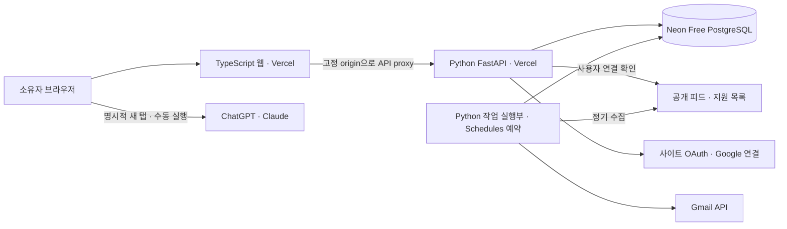

# 구현·테스트 인계서

상세 설계의 범위를 실제 코드·빌드·검증 증빙과 연결하는 문서다. 현재는 **1차 공통 기반의 로컬 구현·검증 기록**이다. 수집·발송·전체 제품 QA·운영 배포 완료를 의미하지 않는다.

| 항목 | 기록 |
|---|---|
| 문서 ID·버전 | ITH-LEVELUP-v0.11 / v0.11 |
| 프로젝트·릴리스 | LevelUp 첫 릴리스 — 모닝 테크 + 선택형 외부 AI 요청문 인계, P1·P2 전체 |
| 최종 수정일 | 2026-11-27 |
| 작성자·QA 인수자 | Codex / 사이트 소유자·구현 및 검증 담당, 구체 담당 지정 전 |
| 대상 기준선 | PRD v0.30 + CR-UX-002·003·004·CR-FLOW-001·CR-MIN-001, SPD v0.12, BPD v0.11, SRS v0.12, UCS v0.10, RTM v0.12, SAD/DB/API v0.10, UIX/DDS v0.10. PRD는 소유자 확정, G3 기반 착수는 08 START-001~003으로 승인. 기반 로컬 실행 증빙은 3.3 참조 |
| 테스트 대상 버전 | 미커밋 1차 기반 코드. backend/uv.lock·apps/web/pnpm-lock.yaml 기준 로컬 검증. deployment ID·제품 commit SHA 없음 |
| 인계 일시·상태 | 2026-11-26 Asia/Seoul / 공통 기반 로컬 검증 완료. 전체 G4·운영 인수 미승인 |
| 최신 사용자 확인 | 확정 PRD: Next.js 웹·FastAPI API Vercel, Vercel Schedules 유한 작업, Neon Free PostgreSQL, 월 운영비 0원. Mac Chrome + iPhone Safari 검증 |

## 변경 이력

| 버전 | 날짜 | 내용 | 상태 |
|---|---|---|---|
| v0.6 | 2026-11-25 | CR-MIN-001: Python 호스트 통합·당일 자동 재발송 제외·단일 호출 결과 통합·템플릿 적용 범위 분리 | 변경 범위 사용자 확인·전체 문서 미승인 |
| v0.7 | 2026-11-26 | 확정 PRD v0.28 대조·과거 문구/참조 정정, Mac Chrome + iPhone Safari·모든 글 목록 최신순 확정, 실행 검증과 분리 | PRD·기기 범위 사용자 확정 / 개별 단계 승인 전 |
| v0.8 | 2026-11-26 | 00~04 미결·권장안 통합, 확정/설계/환경/검증/후속 보류 구분·잔여 문구/참조 정정. 권장안 미채택·실행 미검증 | 정정 요청 반영 / 개별 문서 미승인 |
| v0.9 | 2026-11-26 | 사용자 채택: Services 한 프로젝트·DB 저장 세션(auth_sessions 추가, 총 14개)·외부 클라우드 자동 백업. 실제 설정/검증은 미완료 | 세 가지 설계 사용자 채택 / 전체 단계 미승인 |

| v0.10 | 2026-11-26 | START-001~003에 따른 환경·4개 업무 테이블·소유자 인증·홈/테마 기반 구현, PostgreSQL·서명 검증·브라우저 실행 기록 | 로컬 기반 검증 / 실제 계정·배포·전체 기능 미완료 |

| v0.11 | 2026-11-27 | 공통 셸·로그인·첫 방문 홈·설정 기반을 Figma와 대조, 테마·모바일 메뉴·OAuth 오류 복귀 보완 및 회귀 검사 | 기반 화면 범위 검증 / 전체 기능·실기기·운영 인수 전 |

## 0. 기술 구성과 설계 변경

<a id="implementation-stack"></a>
### 0.1 확정한 방향과 구현 제안

| 영역 | 언어·구성 | 결정 수준 |
|---|---|---|
| 웹 화면 | TypeScript + Next.js/React, Vercel | Next.js·TypeScript·Vercel 사용자 확정. Node 24·Next 16.4.6·React 19.3.1, lockfile·프로젝트 설정 구성 및 빌드 확인 |
| 업무 API·수집·메일·스케줄 | Python, FastAPI API + Schedules 유한 작업 실행부 | Python 3.12·FastAPI 0.165.0·Authlib 1.9.10 및 uv.lock 구성. 수집·발송 실행부는 후속 |
| API 배포 | FastAPI · Vercel | 사용자 확정(PRD 8.1). Services 한 프로젝트 확정, 실제 라우팅·버전·무료 실행 한도 검증 대기 |
| 웹/API 연결 | 단일 Services origin의 /api/*를 Python service로, 나머지는 Next.js service로 라우팅 | 사이트 cookie·Origin·CSRF 검사는 Python에서 수행. SSR 목적지·callback·Schedules 실제 검증 필요 |
| 작업 실행 | Python 수집·메일 업무 코드, Vercel Schedules 채택 | 월 0원 유지. Schedules 채택 확정. 실제 무료 한도·호출/분할·유한 실행/복구 적합성은 DEC-001·002 미결. VM 우선 검토 보류 |
| DB | Neon Free PostgreSQL, API/작업 동일 DB·스키마 | DB·호스팅 사용자 확정. 기존 관계·고유 제약·작업 큐 유지. 버전·리전·직접 연결/동시성·무료 한도·백업검증 미결 |
| 사이트 인증 | Python 서버의 소유자 OAuth·보호된 cookie 세션, Authlib 채택·구현 | Google 로그인·동일 계정·DB 저장 세션 확정(PRD 8.2). START-003으로 Authlib 확정. 로컬 서명/세션 검증 완료, Google 실제 계정 검증 남음 |
| 외부 AI | 브라우저 TypeScript에서 URL·prompt 준비·복사·공식 홈 열기 | 기존 기능 그대로. Python/LLM API·PDF 처리 추가 없음 |

**TypeScript를 포기할 필요는 없다.** 화면은 TypeScript, 업무 서버는 Python으로 분리할 수 있다. Vercel은 Python/FastAPI 실행을 공식 지원한다. 현재 기본안은 Next.js 웹·FastAPI API의 Vercel 배포다. 정기 실행은 Vercel Schedules로 확정했으며 아래 기능의 실행량·한도 적합성을 검증한다. [Vercel Python 문서](https://vercel.com/docs/functions/runtimes/python), [FastAPI](https://fastapi.tiangolo.com/).



기능별 모듈을 유지하는 단일 코드베이스이며 API/worker는 **같은 Python 도메인 코드**를 import한다. Python과 TypeScript에 날짜·구독·메일 정책을 이중 구현하지 않는다. SSR도 고정 API를 호출할 뿐 DB나 수집기를 직접 실행하지 않는다.

### 0.2 Vercel 적용 가능 범위·선택지

2026-11-25 공식 문서 확인 기준이며 실제 팀/프로젝트 플랜 검증 전이다.

| 항목 | 확인한 사실·영향 | 구현 방침 |
|---|---|---|
| Python 런타임 | Python 웹 앱을 Vercel Functions로 실행 가능 | Python API를 언어 문제만으로 포기하지 않음 |
| 일반 Functions | 요청 실행 시간·자원 상한 존재 | 요청은 유한하게 끝내고 서버 시작 훅/응답 뒤 무한 루프로 worker를 돌리지 않음 |
| 기존 Cron Jobs Hobby | 문서상 일 1회 간격·시간 단위 정밀도 제약 | 매시간 수집·07:30·08:00 요구의 기본 스케줄러로 사용하지 않음 |
| Vercel Services | Next.js + FastAPI 한 프로젝트 구성을 채택 | 공통 origin·함께 배포. Beta 기능의 실제 계정·무료 한도·라우팅·cookie·OAuth callback·Preview 검증 대기. 불가하면 분리안을 별도 결정 |
| Vercel Daemons | Python 포함 장기 worker용 Public Beta 제공, 현재 Preview 미지원 | Vercel 내 통합 worker 대안. 불가능하다고 단정하지 않으며 기능·할당량·비용·종료 복구 검증 후 채택 |
| 새 Schedules | 기존 Cron Jobs와 별도 제품·설정 | 채택 확정. 매시/07:30 수집·08:00 브리핑 예약. 실제 무료 한도·호출/복구 검증 필요 |

근거: [Functions 제한](https://vercel.com/docs/functions/limitations), [기존 Cron 요금·간격](https://vercel.com/docs/schedules/cron-jobs/usage-and-pricing), [Services](https://vercel.com/docs/services), [Daemons](https://vercel.com/docs/daemons), [Schedules](https://vercel.com/docs/schedules).

정기 실행은 Vercel Schedules Beta로 확정했다. 무료 조건을 검증하며 유료 플랜·외부 호스트 가입·Queues/Daemons 채택은 확정하지 않는다. worker는 매시·07:30 수집과 08:00 발송 시작을 KST로 등록한다. 서버 재시작/시간 지연은 영속 job·관측·복구로 처리하며 정확한 받은편지함 도착을 보장하지 않는다.

### 0.3 변경 요청 CR-IMP-001

| 변경 전 제안 | 변경 후 기준 | 영향·유지 |
|---|---|---|
| TypeScript로 웹·업무 서버·Node worker | TypeScript 웹 + Python API/worker | 언어 역할은 사용자 확인. 서버 함수는 Python snake_case, JSON camelCase 유지 |
| 웹 서버에서 DB/업무 서비스 직접 호출 | TypeScript 웹 → Python API, Python API/worker 간 서비스 공유 | 브라우저 공개 URL·API-001~022·SCR-001~008 유지 |
| Auth.js가 사이트 인증 처리 | Python OAuth·세션 서비스가 인증·CSRF·권한 검사 | Google 소유자만 접근·동일 계정 Gmail 자동 표시, 인증 세션과 발송 권한 분리. DB 저장 세션 채택, Authlib 채택·로컬 인증 구현. 실제 계정 검증 필요 |
| Node crypto·JS clock·Vitest로 서버 검증 | Python 암호화/clock·pytest·실제 PostgreSQL 통합 검증 | AES-GCM·epoch/generation·예약·unknown 정책 유지 |
| 상시 Node worker 배포처 미정 | Python 업무 코드 유지, Vercel Schedules 채택·실행 단위는 검증 후 확정 | 무한 루프를 일반 웹 함수에 넣지 않음 |

이 변경은 PRD·서비스 기획의 DEC-001, SRS, SAD·API·DB·DDS·RTM에 관련 범위만 반영한다. **사용자가 고른 언어/배포 방향**과 **아직 미승인인 라이브러리·계정·운영 정책**을 구분한다. 다른 기획 기능·디자인을 재작성하지 않는다.


남은 항목의 상태·권장 처리방식·채택 여부는 [서비스기획서 7.4](../00-기획/서비스기획서.md#74-prd-확정-후-순차-검토-2026-11-26)를 단일 통합 표로 사용한다. 단일 Services 프로젝트·DB 저장 세션·외부 클라우드 주간 자동 백업은 2026-11-26 사용자 채택이며 나머지 권장안은 채택 전이다. 채택과 개별 단계 승인·실제 실행 검증 완료는 구분한다.

## 1. 구현 범위

### 1.1 현재 상태·계획 경로

아래 경로는 **구현 예정 위치**다. 현재 결과 칸에서 1차 구현과 후속 범위를 구분한다. 첫 릴리스 기능을 보류/삭제한 표가 아니다. 실제 구현 시 해당 행을 커밋/PR/빌드와 연결한다.

| 요구사항 | 구현 예정 위치·책임 | 현재 결과 | 관련 변경 |
|---|---|---|---|
| FR-001·002 | `apps/web/`, `backend/src/levelup/core/` — 인증·홈 준비 카드 2개·공통/기능별 설정·브라우저 테마 선택 저장·상단 바/모바일 메뉴 테마 전환 | 부분 구현: 소유자 인증·홈/준비 카드·테마, 운영 인증/전체 화면 검증 전 | CR-IMP-001 인증 경계·언어 분리 |
| FR-003~006 | `backend/src/levelup/modules/tech/subscriptions.py` — URL 확인·추가·토글·삭제 | 미구현 | Python SafePublicHttp·generation 검사 |
| FR-007~009 | `backend/src/levelup/modules/tech/collection.py`, `worker/` — 수집·중복·날짜 | 미구현 | Python 공통 서비스·별도 스케줄러 |
| FR-010~013·023 | tech query/state API + 웹 목록 컴포넌트 | 미구현 | 기존 화면·수동 상태·직접 원문 유지 |
| FR-014·017·019 | Python 설정/Gmail 연결·테스트 API + 웹 설정 | 부분 구현: 최초 동의 저장·연결 요약만. 재연결/해제·테스트 메일 미구현 | 사이트 cookie·Gmail token 별도 보호 |
| FR-015·016 | `modules/tech/digest.py`, `infra/gmail.py`, `worker/` | 미구현 | Python Gmail 요청·영속 메시지·unknown 유지 |
| FR-018 | Python status query + 웹 상태 화면 | 미구현 | 수집·정기/테스트·Gmail 접수 상태 구분 |
| FR-020~022 | `apps/web/src/modules/reports/` | 미구현 | 로컬 TypeScript, 분석 서버 API 없음 |
| NFR-001~003 | Python 인증/CSRF·암호화·안전 HTTP, 웹 proxy | 미구현 | 직접 API URL 우회·사설 목적지·비밀 노출 검증 필요 |
| NFR-004·005·007·008 | Python jobs·DB 고유 제약·트랜잭션·모듈 경계 | 미구현 | 유한 작업 실행·직접/session DB 연결 검증 필요 |
| NFR-006·009·010 | 웹 공통 UI·반응형·키보드·한국어 | 미구현 | DESIGN·UIX 기준, Mac Chrome + iPhone Safari 실제 검증 필요 |

PRD의 모든 콘텐츠 유형·URL 직접 구독·초기 과거 글 제외·다음 아침 메일·수동 읽음/저장·reports를 유지한다. 리포트 기능은 첫 릴리스에 구현하고 필요할 때 직접 사용하는 방식이며 임의로 다음 버전으로 미루지 않는다.

### 1.2 구현 순서와 완료 증거

| 순서 | 작업 | 다음 작업 전 확인할 증거 |
|---|---|---|
| IMP-01 | Python/TS 환경·lockfile·공통 API schema·CI | 재현 설치·lint/typecheck·최소 테스트 실행 로그 |
| IMP-02 | 소유자 인증·same-origin proxy·설정·DB migration | 비소유자/CSRF·직접 backend URL·cookie/redirect 경계 통합 점검 |
| IMP-03 | URL 확인/다중 feed·구독 CRUD·baseline·정기/부분 수집·항목 격리 | 합성 feed·HTML·SSRF·첫 등록/재활성·게시일 정정·개별 오류/복구·삭제 경합·5유형 fixture 결과 |
| IMP-04 | 목록·검색·읽음·저장·숨김·날짜 브리핑 | 상태 보존·0/20/21개·KST 경계·전체 링크 대조 |
| IMP-05 | Gmail OAuth·테스트·정기 발송·실행 슬롯·08:20 마감·날짜별 상태·worker 복구 | mock + 명시적 실제 계정 테스트, unknown 무재전송·지연/누락·null/0·전체 예약 검증 |
| IMP-06 | reports·모바일·섹션 독립·홈 준비 카드·Dark/Light 전환 저장·상단 바 테마 전환 | 준비 카드 비대화형·reports 상시 진입·기능별 설정·테마 최초 다크/복원/차단/입력 보존·두 테마 대비·세 진입점 상태 일치 검증 |
| IMP-07 | Preview/QA 후보 빌드·인계 | 동일 commit·web deployment·공동 backend artifact/API·worker 실행 버전·DB revision·환경·실제 TC 식별 |

구현 순서와 릴리스 포함 범위를 혼동하지 않는다. IMP-01의 로컬 검사와 IMP-02의 기반 인증 범위는 3.3에서 확인했다. 나머지 단계·원격 CI·실제 배포를 완료로 표시하지 않는다.

## 2. 빌드와 테스트 환경

### 2.1 저장소·실행 단위 제안

```text
apps/web/                        # 단일 Services 프로젝트의 웹 service root
  src/app/                       # 화면과 고정 backend API proxy 설정
  src/core/                      # 공통 메뉴·홈·UI
  src/modules/reports/            # 브라우저 전용 prompt·provider
  package.json, pnpm-lock.yaml    # 웹 의존성
backend/                         # API/worker 공동 배포 root
  pyproject.toml, uv.lock
  src/levelup/api/                # FastAPI 경로·schema·오류 변환
  src/levelup/core/               # 소유자·설정·OAuth·세션
  src/levelup/modules/tech/       # 구독·수집·목록·브리핑 서비스
  src/levelup/infra/              # DB·안전 HTTP·Gmail·암호화
  src/levelup/worker/             # 유한 작업 진입점·스케줄·claim·복구
  tests/                         # Python 단위·통합 검증
db/migrations/                   # 14개 테이블·제약, 항목 격리와 oauth_states 용도 구분
tests/e2e/                       # 웹→proxy→API 계약·핵심 흐름
```

API와 worker는 같은 Python package·버전·migration 기준을 사용한다. TypeScript는 서버 JSON의 camelCase 계약에 맞춘 타입을 사용하고 Python 내부는 snake_case로 구현한다. Pydantic alias 등으로 경계를 명시하고 token/DB 모델을 통째로 직렬화하지 않는다.

### 2.2 계획 명령 — 아직 설정·실행하지 않음

START-003으로 Python 3.12·Node 24 LTS, uv·pnpm·Authlib·Ruff·mypy·pytest·ESLint·Prettier·Vitest·Playwright를 확정했다. 실제 의존성은 두 lockfile에 고정했다. 실행 명령의 원장은 루트 README이며 아래 표의 worker 명령은 후속 구현 제안이다.

| 작업 위치 | 예정 명령 | 전제·산출물 |
|---|---|---|
| `backend/` | `uv sync --frozen` | uv.lock·dev 그룹 구성, 재현 설치 확인 |
| `backend/` | `uv run uvicorn levelup.api.app:app --reload --port 8000` | package·app 진입점 구성, 로컬 실행 확인 |
| `backend/` | `uv run python -m levelup.worker` | 로컬 worker 실행 제안. Vercel 운영 진입점/수명은 무료 정기 실행 검증 후 확정 |
| `backend/` | `uv run ruff check .`, `uv run ruff format --check .`, `uv run mypy src` | 도구 설정 구성·정적 검사 통과 |
| `backend/` | `uv run pytest` | 별도 테스트 DB·합성 fixture·Gmail mock, 운영 자격증명 사용 금지 |
| `apps/web/` | `pnpm install --frozen-lockfile` | package.json·pnpm-lock.yaml 구성, 재현 설치 확인 |
| `apps/web/` | `pnpm dev`, `pnpm lint`, `pnpm typecheck`, `pnpm test`, `pnpm build` | script 구성·lint/typecheck/test/build 통과 |
| E2E 작업 위치 | pnpm --dir apps/web test:e2e | Chromium 1280·WebKit 390·실제 로컬 API/DB·Google mock으로 4개 통과 |

현재 기반의 명령·실행 결과는 README와 3.3에 기록했다. worker/운영 환경의 제안 명령은 아직 실행 완료로 표시하지 않는다.

### 2.3 QA 환경·외부 연동

| 항목 | 현재 기록·구성 계획 |
|---|---|
| QA URL·권한 | 환경 URL 없음. 웹/API 후보 배포 후 소유자·검증 담당에게 별도 전달 |
| 버전 식별 | 같은 commit SHA에 web deployment ID·backend artifact·API/worker 실행 버전·migration revision 연결 |
| Preview | 별도 DB·test OAuth/가짜 메일, 기본 정기 worker 없음. 실제 Gmail 발송·운영 수집 차단 |
| worker QA | 독립 테스트 호스트 또는 로컬 foreground 실행, 고정 clock으로 날짜 검증. 운영 worker와 격리 |
| 출처 | 합성 RSS/Atom·지원 HTML fixture 우선, 실제 5개 기본 출처는 adapter 검증 후 명시적 연결 확인 |
| Gmail | mock으로 접수/거절/timeout/철회/DB 실패를 먼저 확인. 실제 연결은 소유자가 Google 동의 화면에서 수행 |
| 리포트 | 공개 웹/PDF URL로 prompt만 생성. PDF 다운로드·OCR·AI API·외부 결과 수신 없음 |
| 테스트 데이터 | baseline·late discovery·누락 날짜·재추가·5유형·0/20/21·held/consumed 예약 사례 |
| migration | 실행 담당·revision·백업 근거 확인 후 통제된 절차로 적용. Vercel 요청/빌드마다 자동 migration 금지 |
| 초기화·복구 | 테스트 DB만 명시적 초기화. 운영 글·읽음·저장·발송 기록 purge 없음. 복원 후 발송부터 중지 |

### 2.4 환경 설정과 보안 경계

| 위치 | 필요한 설정 이름·접근 범위 |
|---|---|
| Vercel 웹 service | APP_ORIGIN·Python service의 서버 측 고정 호출 설정. 같은 프로젝트의 service binding/route 실제 설정 검증, 브라우저 값으로 목적지 변경 금지 |
| Vercel Python API | DATABASE_URL·AUTH_SECRET·사이트 OAuth client 설정·고정 Google owner subject·GOOGLE_CLIENT_ID/SECRET/REDIRECT_URI·TOKEN_ENCRYPTION_KEY |
| Python 작업 실행부(방식 미결) | DATABASE_URL·TOKEN_ENCRYPTION_KEY·Google token 갱신 client 설정·APP_ORIGIN. 웹 로그인 cookie는 필요 없음 |
| 공통 안전 기본값 | 정기 알림 꺼짐·Gmail 미연결, Preview 실발송 금지 |

사이트 세션은 Python 서버가 검증한다. 웹 proxy가 있다는 이유로 backend 직접 URL·내부 헤더를 신뢰하지 않는다. 모든 개인 API에 DB 세션 token hash·소유자·고정 만료·폐기 검사를 적용하고 변경 요청은 APP_ORIGIN·세션 CSRF를 검사한다. OAuth callback은 일회성 state·바인딩·nonce/PKCE 검증 경로를 사용한다.

cookie는 Secure·HttpOnly·SameSite=Lax·host-only로 두고 provider token은 담지 않는다. 로그인 OAuth의 비로그인 상태 바인딩과 Gmail 연결의 로그인 세션 바인딩은 DB oauth_states의 purpose로 분리한다. 로그인 유지 기간은 성공 시점부터 7일 고정(604,800초)이며 방문/cookie 회전으로 연장하지 않는다. 세션 저장은 auth_sessions로 확정했다. 원문 난수 cookie token은 hash 조회하고 만료·폐기를 DB에서 확인한다. 현재 세션 로그아웃·다른 기기 유지·고정 7일 경계를 검증하며 임의 암호 프로토콜을 직접 만들지 않는다.

Gmail From=To는 연결 Gmail로 고정한다. offline refresh token은 Python API/worker만 복호화한다. send SDK 자동 재시도 금지·영속 sending/unknown·전체 예약 보존은 언어가 바뀌어도 유지한다. API 직접/session DB 연결과 SSL·DNS/IP 고정·시간 상한을 실제 Vercel 웹 라우팅/Python 런타임 환경에서 검증한다.

비밀값은 문서/저장소/클라이언트에 기록하지 않는다. 실제 비밀 보관소·요청 경로는 아직 없으며 구성 후 보관소 이름·권한 담당만 기록한다. OAuth callback query·token·MIME·분석 URL/prompt가 앱·proxy·호스팅 로그에 노출되지 않는지 실제 QA에서 확인한다.

### 2.5 CI·배포 준비·소스 관리

CI 계획은 Python 설치/lock 재현 → Ruff/mypy/pytest → 웹 lock 설치/lint/typecheck/test/build → 별도 PostgreSQL 통합·E2E → 후보 artifact 식별 순이다. 두 언어의 검사가 모두 통과해야 구현 PR의 검증을 완료로 기록한다. 도구와 CI는 현재 미구성이다.

배포는 호환 가능한 DB 변경 → Python API·작업 코드 같은 버전 확인 → Vercel 웹·FastAPI 후보 → smoke test → 소유자 판단 순서로 준비한다. 실제 실행·승인·서비스 계정 생성은 이번 문서 작업에서 하지 않는다. Vercel 무료 실행 적합성·프로젝트 구성·region·OAuth 도메인·Schedules 예약 대상/실행량은 검증 전이다. 롤백 시 새 worker/메일을 중지하고 발송 이력을 확인한 뒤 호환 artifact로 되돌린다. DB 복원 직후 자동 메일 재생은 금지한다.

Git은 Conventional Commits, `feature/<기능명>`·`fix/<버그명>`, main 직접 push 금지를 따른다. 브랜치/커밋 전 후보 제안·선택은 루트 AGENTS 기준이다. 문서 작성만으로 브랜치 생성·커밋·배포를 진행하지 않는다.

### 2.6 CR-UX-001 구현 인계 경계

정적 registry에서 inbox-summary·daily-news를 planned/path=null로 두고 API-003 homeCards에만 포함한다. 실행 메뉴·개별 route·설정 토글·DB 데이터·수집/AI job·Gmail 읽기 scope를 추가하지 않는다. 기존 MVP 기능을 준비 카드로 대체하지 않는다. 일반/연결 계정/기능별 설정과 공통 행 배치는 UIX 7.4·DDS G절 기준으로 구현한다. 실제 미래 기능은 후속 PRD로 별도 개발한다.

### 2.7 CR-UX-002 테마 구현·목업 인계

테마의 현재 구현 기준은 화면설계서 7.6을 따른다.

화면설계서 7.6의 테마 적용·저장·실패 처리 규칙을 따른다.

- 구현 예정: `apps/web/src/core/theme.ts`, 공통 root/의미 CSS 토큰, 설정 일반 영역의 radio 그룹. 앱 최초 표시 전 복원, 화면 이동/로그아웃 후 유지, 저장 실패 안내를 구현한다. API·DB 테마 필드/마이그레이션은 없다.
- 디자인 작업(사용자 첨부 기록, 2026-11-25): UIX 7.6 토큰·선택 행 테두리·라이트 구분선·disabled/busy 변형·선택 배경 대체를 Figma에 적용했고 본 목업 데스크톱 12개·모바일 10개의 Light 대응 화면과 설정 테마 radio·저장 실패 상태를 작성했다고 전달됐다. 앱 렌더링·실제 대비 검증 완료로 취급하지 않는다.
- 완료 증거: SCR-001~008와 메뉴/dialog의 두 테마 대응, 1280/390·키보드·저장 오류·입력 보존·업무 API 미호출·첫 paint 복원·실제 합성 대비를 후보 빌드에서 확인한다. 계산값만으로 브라우저/접근성 테스트 통과를 기록하지 않는다.

사용자 만족은 비교 시안과 채택 범위의 확인이다. 이후 목업 반영은 첨부 기록으로 갱신하며 실제 테마 전환·저장 기능 구현/검증 결과와 구분한다.

### 2.8 CR-FLOW-001 구현·검증 인계

수집·날짜·발송 경계는 비즈니스정책서 11.7을 따른다.

| 변경 | 구현 예정 작업 | 완료 확인 사례 |
|---|---|---|
| 첫 등록/재활성·게시일 정정 | collection/eligibility 함수·prepared 최종 자격 검사 | first_add 늦은 과거 허용, resume/readd 시작 전 제외, pending의 어제→오늘 정정 연기, sending/unknown 불변 |
| 항목 격리 | collection_entry_issues migration·savepoint·source 품질/lastUsableAt·job partial | 정상 2+오류 1은 정상 저장, 오류만 1이면 기준 미완료, 정상 빈 피드 완료, 초기 격리 복구 재알림 없음 |
| 날짜별 상태 | API-022와 SCR-006 정기 탭, 테스트는 기존 API-015 | 미연결/paused/empty/지연/missed/null 표시·GET 쓰기 부작용 없음 |
| 발송 우선·마감 | 같은 job 테이블의 발송 슬롯 1/수집 슬롯 2, kind 필터·digest 우선·누락 복구 | 08:03 commit/08:05 첫 snapshot 포함, 확정 이후 수집은 다음 날, 08:20 미시작 이월·늦은 접수 결과 보존 |
| 추적 동기화 | 00~04 live 참조·FR/SC·API/DB·화면/인계 일치 | 33개 요구사항·기존 ID·테마/준비 카드 범위 보존 |

모든 행은 계획이며 실제 migration/API/worker/화면·테스트는 아직 없다. 동일 강한 식별자가 없는 복구 항목의 관측 한계와 나머지 DEC-003·006·007을 인수자가 확인한다. Figma/제품 구현 완료를 기록하지 않는다.

### 2.9 CR-UX-003 상단 바 테마 전환 인계

CR-UX-003(2026-11-25): 소유자가 설정 외에 로그아웃 옆에서도 테마를 바꾸도록 아이콘만 있는 버튼과 툴팁 방식을 확인했다. 2.7의 저장·복원·실패·업무 API 미호출 규칙은 그대로이며 설정 radio도 유지한다. 상세 원문은 화면설계서 7.8과 상세설계서 5.9.1이다.

- 구현 예정: Topbar와 모바일 drawer의 `ThemeToggle`, 공통 Tooltip, 설정 밖 저장 실패 알림(role=status). 세 진입점은 `apps/web/src/core/theme.ts`의 같은 selectTheme와 상태를 사용한다. 다크면 해·“라이트로 전환”, 라이트면 달·“다크로 전환”을 aria-label과 툴팁에 쓴다. 데스크톱은 보이는 크기 40×40·누르는 영역 44×44 이상, 모바일은 44×44다. API·DB 변경은 없다.
- 디자인 작업(첨부 전달 기록): Topbar 컴포넌트에 ThemeToggle을 추가해 상단 바 25곳(다크 12·라이트 13)에 반영했고, 다크·라이트 모바일 메뉴 화면과 Tooltip 컴포넌트를 추가했다. 툴팁 표시·저장 실패 알림의 현재 참고 위치는 Figma ‘상태·참고 예시’ 섹션이다(화면설계서 7.10). 당시 적용 수치는 전달 기록으로 유지하며 이번 작업에서 Figma를 재검증하지 않았다.
- 완료 증거: 상단 바·모바일 메뉴·설정 radio의 상태 일치, 키보드 Tab·Enter·Space, 툴팁 Escape, 화면 낭독기 이름 변경, 상단 바 저장 차단 알림, 누르는 영역 44×44, 로그인 화면 미노출을 후보 빌드에서 확인한다.

Figma 반영은 목업 범위의 확인이며 실제 전환·저장 기능의 구현/검증 결과가 아니다.

Figma 적용 현황은 사용자 첨부를 근거로 기록했으며 이 세션의 직접 검사/수정 결과가 아니다.

## 3. 구현에서 확인한 결과

### 3.1 제품 점검 결과

| 점검 | 대상 버전·환경 | 결과 | 증빙·이유 |
|---|---|---|---|
| 기반 웹 빌드·정적 검사 | 미커밋 코드·Node 24/Python 3.12 | 로컬 통과 | 명령·범위는 3.3, 원격 CI 미실행 |
| Python 단위·통합 테스트 | 임시 PostgreSQL 17·가짜 Google 응답/실제 RSA 검증 | 32개 통과 | 인증·7일 세션·CSRF·일회성 state·마이그레이션 |
| 웹 단위·E2E | Chromium 1280 / WebKit 390 + 실제 로컬 API·DB | 단위 2개·E2E 4개 통과 | Google만 테스트 공급자 주입, 실제 계정/실기기 검증 아님 |
| Vercel 웹·FastAPI API 배포 | 프로젝트·deployment 없음 | 미실행 | 공식 지원 조사와 실제 배포 성공은 구분 |
| 작업 실행·예약·중단 복구 | Schedules 채택·실제 등록/실행 미검증 | 미실행 | 스케줄/lease/unknown 복구는 후속 구현 검증 |
| Gmail 실연결·테스트 메일 | Google Cloud 설정 일부 기록(PRD 11), 앱 실행 환경 연결 전 | 미실행 | 토큰·실발송 없음 |
| 문서 정합성 | CR-UX-001 관련 설계 문서 | 작성 후 점검 | 문서 링크·추적·준비 카드 경계만 확인하며 제품 실행 테스트와 별도 |

### 3.2 남은 이슈·제약

| 이슈 | 영향·검증 차단 조건 | 담당·후속 시점 |
|---|---|---|
| IMP-ISS-001 기반 외 기능 미구현 | FR-001·002·연결 요약/테마 기반만 부분 구현. 수집·목록·발송·리포트 전체 QA 시작 전 | 구현 담당 / 기능별 G4 재검토 |
| IMP-ISS-002 Python/Vercel 배포 경계 | same-origin cookie·redirect·SSR·직접 backend 접근·세션 라이브러리 | 구현 담당·소유자 / G3 보완·최소 배포 검증 전 |
| IMP-ISS-003 무료 실행·DB 검증 | Schedules·Neon Free는 확정. 유한 작업의 호출/분할·매시/07:30/08:00·session 잠금·연결 수·복구 검증 | 구현 담당 / Vercel·Neon 환경 구성·실행 전 |
| IMP-ISS-004 수집기 실제 지원 미확인 | 다중 feed·HTML adapter·날짜·IP 고정·제한 경계 | 구현 담당 / DEC-003 및 수용 기준 확정 전 |
| IMP-ISS-005 Gmail 운영 미연결 | OAuth 동의/게시·token 수명·동일 계정 송수신·불명확 확인 | 소유자·구현 담당 / DEC-002·006·007 검토 전 |
| IMP-ISS-006 정책 구현 검증 | 숨김은 목록 전용·구독 끄기 전 대기 억제·접수 후 전체 통지·핵심 이력 자동 삭제 제외·Pretendard 확정. 무료 용량·백업 복원·실제 글꼴/테마/실기기는 미검증 | 구현 담당 / 후보 빌드·운영 검증 전 |
| IMP-ISS-007 운영 OAuth 공개 페이지 | PRD 11의 Google Cloud 설정 현황은 보존. 운영 도메인(`levelup-vibe.vercel.app`)·공개 개인정보처리방침(`/privacy`)·프로덕션 게시·실제 callback(로그인·Gmail 재연결)은 2026-11-27 완료([배포 계획서 6장](../06-배포/배포계획서.md#6-google-oauth-앱-프로덕션-게시)). 게시 8일 후(2026-12-05) 재확인은 남음 | 소유자·구현 담당 / 운영 인증 연결 전 |

기한은 단계 기준이다. 고정 출시일·개발 기간은 두지 않는다. 수용 기준 검증과 7일 시범 운영 후 소유자가 출시를 판단하며 실제 수행 일자를 기록한다. 임의의 완료일·예산·통과율을 만들지 않는다.

### 3.3 1차 기반 실행 기록 (2026-11-26)

- 구현: `apps/web/` 공통 셸·보호된 홈·준비 카드·읽기 전용 연결 설정·브라우저 테마; `backend/` Google OIDC·고정 소유자·DB 세션·CSRF 로그아웃. API-001·002·003·013의 기반 범위다. 수집/요약은 NOT_IMPLEMENTED 안내이며 0건 정상 결과를 만들지 않는다.
- DB: PostgreSQL 17 임시 클러스터의 테스트별 스키마에서 초기 SQL·반복 실행·소유자 변경 거절 확인. 업무 테이블 4개와 버전 관리용 schema_migrations 1개를 생성한다. 계획의 14개 업무 테이블을 전부 생성한 것이 아니다.
- 통과 명령: 루트 README의 Ruff check/format·mypy·pytest(32개), pnpm lint/typecheck/test(2개)/build, Playwright(4개). Chromium 1280×900·WebKit 390×844에서 로그인→홈→라이트 저장/복원→설정→로그아웃과 저장 차단 안내 확인. 화면 캡처는 로컬 test-results에 생성했다.
- 재현성: 두 lockfile 사용. CI workflow를 작성했으며 GitHub 원격 실행·Vercel Services 실제 배포는 미실시다. 로컬 Next rewrite로 웹→Python 경로·cookie 전달을 확인한 결과를 Services 배포 성공으로 대신하지 않는다.
- 제한: 실제 Google/Neon·Gmail 발송·Schedules·백업 복원·Safari 실기기·Figma 글꼴 교체 미검증. Authlib/Starlette의 httpx 사용 관련 deprecation 경고 2건은 기능 실패와 별도로 남아 있다. 운영 공개 전 플랫폼 OAuth query 로그·요청 제한도 확인한다.


### 3.4 공통 화면·로그인 UX 보완 (2026-11-27)

이번 범위는 SCR-001 로그인, SCR-002 첫 방문 홈, SCR-008 설정의 **공통 기반 화면**이다. 구독·수집은 다른 작업과 분리하며 해당 코드·마이그레이션을 수정하지 않았다. 전체 홈 상태·Gmail 설정 동작·전체 화면 디자인 완료를 의미하지 않는다.

| 대조 대상 | 읽기 전용 Figma 기준 노드 | 결과 |
|---|---|---|
| 로그인 | Desktop Dark `10:1155`, Light `27:4689`; Mobile Dark `35:6972`, Light `35:6990` | 패널 420/350px·여백·브랜드·Google 버튼·권한 설명 확인. 로그인 화면에 테마 버튼 없음 |
| 첫 방문 홈 | Desktop Dark `48:6846`, Light `48:6970`; Mobile Dark `49:7019`, Light `49:7067` | 데스크톱 시작 카드 2열·모바일 1열, 모바일 카드 제목/아이콘 가로 배치로 정정. 준비 카드 2개는 같은 전체 폭·비대화형 |
| 설정 | Desktop Dark `10:999`, Light `27:4610`; Mobile Dark `15:1658`, Light `27:5179` | 일반/연결 계정/기능별 설정 구조·테마 radio·실제 계정 상태 확인. 미연동 제어는 비활성 및 사유 안내 |
| 공통 탐색·메뉴 | 설정 공통 셸 및 Mobile 메뉴 `11:1404` | 256px 사이드바·56px 상단 바·300px drawer 확인. 데스크톱은 로그아웃 옆, 모바일은 메뉴 내부에서만 테마 전환 |

각 화면에서 **Figma 대조 → 배치/아이콘/테마 차이 수정 → Dark/Light × Chromium 1280px/WebKit 390px 캡처 확인**을 수행했다. 캡처는 `apps/web/test-results/foundation-Figma-comparison-matrix-{dark|light}-login-home-settings-{desktop-chromium|mobile-webkit}/`의 `login/home/settings-{dark|light}.png` 총 12개다. 모바일 메뉴 양 테마 캡처도 각 동작 테스트 폴더에 남긴다. 생성물은 Git 제외이며 `pnpm --dir apps/web test:e2e`로 재생성한다. 개발용 Next.js 표시만 캡처에서 숨긴다. 아이콘은 이 Figma 파일에서 읽은 SVG 29개를 로컬 보관하고, 마스크 아이콘은 원래 도형·크기를 유지하면서 테마 색을 적용한다.

**로그인 화면 후속 변경(2026-11-27, 소유자 요청).** Google 버튼 아래 안내 문장 두 개(Gmail 발송 권한 요청 안내, 공개 가입·비밀번호 재설정 없음 안내)를 지우고 "프로젝트 소개 보기 (GitHub README)" 링크 하나를 두었다. 위 표의 로그인 "권한 설명 확인"은 변경 전 기준이며, **Figma 시안은 수정하지 않아 로그인 화면은 시안과 달라졌다(design-unverified).** 검증: 웹 lint·타입 검사·prettier·단위 10개, 전체 E2E 16개(Chromium·WebKit) 통과. E2E가 Dark/Light × 1280/390 캡처를 다시 만들었고, 데스크톱 Light·Dark와 모바일 Light를 확인했다(모바일 Dark는 육안 확인하지 않음). Gmail 발송 권한 안내는 Google 동의 화면과 `/privacy`가 맡는다. 화면 명세는 [화면설계서 5.1](../02-시스템설계/화면설계서.md#scr-001).

**확정 정책에 따른 차이:** 코드 서체는 Pretendard이며 목업의 임시 Noto Sans KR과 줄바꿈이 달라질 수 있다. 첫 방문에도 리포트 메뉴를 항상 표시한다. 초기 기준 수집 글은 제외하되 나중에 발견한 과거 글은 알릴 수 있다는 확정 정책으로 오래된 목업 문구를 정정했다. 탐색/동작 영역은 최소 44px를 유지한다. 실제 Gmail 연결·알림·테스트 메일·구독 기능은 후속 단계이므로 버튼 비활성/안내로 표시하고, 목업의 예시 연결 성공·접수 시각·수집 건수는 복제하지 않았다. 따라서 시작 카드 높이·설정 도움말은 예시 화면과 다르다.

**회귀 검증:** 인증 Python 36개(`test_auth.py`, `test_google.py`, `test_security.py`), 웹 단위 2개, 브라우저 12개 통과. 웹 lint·타입 검사·production build, 변경 Python 파일 Ruff/format·mypy 통과. 임시 PostgreSQL에서 OAuth 오류·7일 세션·CSRF·로그아웃 및 migration 재실행을 확인했다. 마이그레이션 수를 1개로 가정하던 기존 검사를 적용 기록 불변 비교로 바꾸어 후속 SQL 추가와 독립시켰다. 다른 작업의 수집 테스트 전체 결과를 포함하지 않는다.

테마 저장/복원·저장 차단·radio 방향키, 모바일 Escape/바깥 클릭/포커스 복귀, 로그인 오류 후 재시도, 브라우저 오류 리다이렉트의 민감 query 제외와 기존 JSON 실패 계약을 확인했다. 실제 Google·Neon·Vercel·Gmail·Safari 실기기·전체 상태별 대비 및 Figma 글꼴 교체는 미검증이다. Figma·브랜치·커밋·push는 변경하지 않았다. 이 단위는 커밋 검토 가능하며 전체 G4/G5/G6 미승인 상태는 유지한다.

## 4. G4 테스트 인계 확인

- [ ] 검증할 commit·web deployment·공동 backend artifact/API·worker 실행 버전·migration revision이 식별됐다.
- [ ] QA가 격리된 웹·Python API·worker·DB 환경에 접근할 수 있다.
- [ ] 모든 릴리스 요구사항의 실제 코드/PR 참조와 CR-IMP-001 반영이 RTM에 연결됐다.
- [ ] 두 언어의 lint·타입·테스트·빌드 결과 및 실패/예외 근거가 기록됐다.
- [ ] Gmail·수집·브리핑·reports·모바일·복구의 QA 제약을 인수자가 확인했다.
- [ ] 준비 카드 2개가 비대화형이고 실행/건수/권한 요청이 없으며 기능별 설정·상태와 구분되는지 확인했다.
- [ ] CR-UX-004의 홈에 리포트 분석·정기 메일 카드가 없고, 준비 카드가 기술블로그 카드와 같은 폭으로 표시되며, 기술블로그 카드의 구독 출처 상태(`tech.sources`)와 사이드바 하단 Gmail 상태가 보이는지 실제 빌드에서 확인했다. 리포트 분석은 메뉴·글별 버튼·직접 주소로 진입된다.
- [ ] CR-UX-002의 Dark/Light 전체 화면·컨트롤 상태·대비와 최초 다크·선택 복원·저장 차단·입력 보존을 실제 빌드에서 검증했다.
- [ ] CR-UX-003의 상단 바·모바일 메뉴 테마 전환이 설정 radio와 같은 상태·저장값을 쓰고, 툴팁·aria-label·저장 실패 알림·44×44 누르는 영역을 실제 빌드에서 검증했다.
- [ ] CR-FLOW-001의 첫 등록/재활성·pending 게시일 정정·부분 수집/격리 복구·날짜별 상태·08:20 누락 이월을 실제 빌드에서 검증했다.
- [ ] [테스트 계획서](../05-테스트/테스트계획서.md)의 실제 진입 조건과 [G4 검토 기준](../08-검토/단계별검토-체크리스트.md)을 확인했다.

| 판단 | 승인자·일시 | 확인 근거·후속 조치 |
|---|---|---|
| 미판정 — 인계 준비 중 | 소유자/검증 담당, 승인 미실시 | 코드·후보 빌드·QA 환경·실행 증빙을 확보한 뒤 재검토 |

문서 작성 요청은 G4 승인이나 실제 애플리케이션 구현 요청으로 대체 해석하지 않는다. 제품 상태는 미구현·미실행이며 실제 결과가 생길 때만 갱신한다.

## 참고 문서

- [waterfall 작성 기준](../AGENTS.md), [PRD](../../PRD.md), [DESIGN](../../DESIGN.md)
- [서비스 기획](../00-기획/서비스기획서.md), [비즈니스 정책](../00-기획/비즈니스정책서.md)
- [SRS](../01-요구사항분석/요구사항명세서-SRS.md), [유스케이스](../01-요구사항분석/유스케이스명세서.md), [RTM](../01-요구사항분석/요구사항추적매트릭스-RTM.md)
- [SAD](../02-시스템설계/시스템아키텍처설계서-SAD.md), [DB](../02-시스템설계/데이터베이스설계서.md), [API](../02-시스템설계/API설계서.md), [화면](../02-시스템설계/화면설계서.md), [DDS](../03-상세설계/상세설계서.md)

### CR-MIN-001 최소 구현 기준

배포 구성·발송 최소화 범위는 서비스기획서의 CR-MIN-001 최소 구현 기준을 따른다.

구현 순서는 웹/Python 공동 artifact·proxy·인증 → 구독/수집/읽기 → Gmail 단일 호출/이월/unknown → reports/테마 → 핵심 E2E다. web deployment ID·Python API/유한 작업 artifact·DB revision으로 후보를 식별한다. Vercel Services 한 프로젝트로 확정했으며 실제 라우팅·무료 실행 검증은 남아 있고 API와 작업의 실행 책임은 구분한다.

### Google 로그인 확정에 따른 구현·검증 조건 (2026-11-26)

PRD 8.2와 API-001을 따른다. 최초 동의 후 동일 계정 자동 연결, 발송 권한만 거절한 로그인, 다른 Google sub 재연결 거절, 해제 후 재로그인 시 연결 미복원, 로그아웃 후 정기 작업 유지, 이메일 변경 시 재동의를 검증한다. 실제 Google 설정·코드·브라우저 검증은 미실시다.

### 로그인 유지 기간 검증 조건 (2026-11-26)

PRD 8.2의 7일 고정 만료를 따른다. 고정 clock으로 로그인 후 604,799초 허용·604,800초 거절, 반복 방문/회전 후 최초 만료 유지, 만료 후 Google 로그인과 안전한 내부 경로 복귀, 로그아웃 즉시 종료·Gmail 정기 작업 유지를 확인한다. 실제 코드·브라우저·테스트 실행은 아직 없다.

### 불명확 발송 확인 기한 검증 조건 (2026-11-26)

PRD 4.4의 소유자·고정 확인 기한 없음 정책을 따른다. 며칠이 지나도 미확인 unknown/held가 자동 해제·실패·재전송으로 바뀌지 않는지, 동일 글 재알림 없이 다른 정상 글의 브리핑/발송이 계속되는지 고정 clock·Gmail mock으로 검증한다. 확인 기한 알림·강제 재전송 UI는 만들지 않는다. 실제 테스트는 미작성·미실행이다.

### 주간 백업 검증 조건 (2026-11-26)

PRD 8.4의 주 1회·최근 성공본 4개 보관을 따른다. 운영 DB 외부 클라우드 주간 자동·암호화 보관을 채택했다. 무료 업체/실행/용량 검증 후 성공본 4개+새 성공본 정리, 새 백업 실패/중단 시 이전 4개 보존, 운영 DB 글/구독/개인 상태/발송 기록 무삭제, 격리 복원과 메일 자동 재생 차단을 확인한다. 실제 백업·복원·테스트 실행은 아직 없다.

### DB 복구 시간 목표 검증 조건 (2026-11-26)

PRD 8.4의 소유자 장애 확인 후 24시간 이내 복구 목표를 따른다. 격리 복원 시험에서 장애 확인/복구 완료 시각과 경과 시간을 기록하고 목표 충족 여부를 평가한다. 복구 직후 메일 자동 재생을 막고 기존 발송 이력 대조·재개 판단을 검증한다. 목표 채택을 실제 복구 성능 달성으로 기록하지 않는다. 실제 복구 시험은 아직 없다.

### 출시 판단 조건 (2026-11-26)

PRD 10절의 AC 검증·7일 시범 운영 후 소유자 출시 판단을 따른다. 후보 배포/commit·수용 기준 검증 기록·시범 운영 실제 시작/종료·누락/중복/결함·소유자 판단을 연결한다. 고정 마감일이나 7일 경과만으로 완료 처리하지 않는다. 실제 후보 배포·시범 운영·출시 판단은 미실시다.

### 사용 효과 평가 범위 (2026-11-26)

PRD 10절에 따라 첫 릴리스는 탐색 부담·아침 읽기·요청문 준비 편의를 소유자가 정성 평가한다. 시간/횟수 추적·절감률·수치 목표·최소 표본·분석 화면을 구현하지 않는다. AC 검증·수집 누락/중복 발송 검증·7일 시범 운영은 유지한다. 실제 제품 평가·테스트 통과 기록은 아직 없다.

### 확정 정책 검증 인계 (2026-11-26)

| 연결 | 구현 후 확인할 결과 |
|---|---|
| FR-010 / AC-004·006 | 오늘/전체/저장에 게시일 있음/없음·동률 fixture 적용. 게시일/최초 발견 시각·ID 내림차순, 저장 시각 무관. 확정 브리핑 순서 보존 |
| FR-013 / AC-004 | ‘목록에서 숨기기’ 후 오늘/전체/저장 기본 목록에서 제외·숨김 보기에서 복원. 메일 후보·읽음·저장은 동일 |
| FR-005 / AC-003·019 | 끄기 전 대기도 suppressed, 재개로 복원 안 됨. prepared는 제외·재구성하고 sending/unknown/accepted는 보존. 알림만 중지하면 후보 유지 |
| FR-015 / AC-006 | 21개이면 본문 20개·전체 링크 21개. 접수 확인 후 21개 notified·읽음 불변, 미표시 글 재알림 없음. unknown이면 전체 held |
| NFR-007 / PRD 6.2 | 핵심 이력·중복 방지 근거·MIME·snapshot·예약·격리 표식 자동 삭제 없음. 상세 디버그/원본 응답의 운영 DB 장기 보관 없음. 무료 용량 점검 |
| NFR-009 / UIX 7.11 | Pretendard 로딩과 굵기, Plus Jakarta Sans 역할, 두 테마·1280/390 긴 제목/소개 최대 2줄 검증. Figma 교체는 후속 작업 |

위 항목은 수용 기준이며 실제 테스트 통과 기록이 아니다. 05~08 템플릿은 이번 결정으로 수정하지 않는다.

### DB 저장 세션 채택 검증 (2026-11-26)

14개 테이블의 ERD/명세·migration revision을 맞춘다. 합성 시각으로 604799초 허용·604800초 401, 방문 시 expires_at 불변, 한 기기 로그아웃 후 해당 token 재사용 401·다른 기기 유지, Gmail 작업 유지, DB 조회 실패 시 인증 허용 없음, token/hash의 JSON·로그 미노출을 확인한다. 세션 row의 CSRF token만 기존 API-002 계약으로 반환한다. 백업 복원은 로그인 세션을 폐기해 재인증하고 메일 발송은 이력 대조 전 재개하지 않는다. 실제 schema 적용·제품 테스트는 미실행이다.


## 2026-11-27 기능 연결 및 운영 기반 보완

현재 구현 범위·검증·배포 전 순서는 [구현 진행 현황](구현진행현황.md)을 참조한다. 비공개 Artifact 최대 400일·최근 성공본 4개 정책을 사용자가 확정했다. 로컬 구현/테스트와 실제 클라우드 실행·운영 인수를 구분한다. 기존 기록의 미구현 표시는 해당 시점의 상태이며 새 현황을 우선한다.
