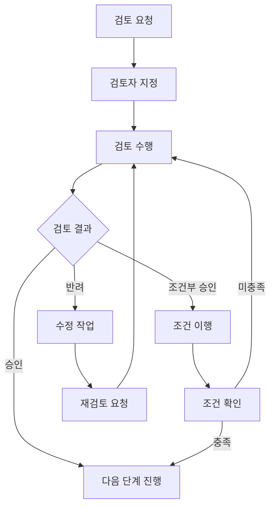

# 단계별 검토 체크리스트 (Phase Review Checklist)

> **LevelUp 적용 상태:** 2026-11-26 문서 검토·구현 착수 조건 기록. 공통 기반 코드·로컬 자동 검증을 추가했다. 2026-11-27 첫 운영 배포(출처 4곳)를 수행하고 같은 날 오후 OAuth 프로덕션 게시와 실발송 켜기, 테스트 메일 접수·도착을 확인했으나 전체 기능 검증과 G5·G6 승인은 미완료이며 기존 Figma 검토와 이번 브라우저 실행 결과를 구분한다. 아래 미작성 세부 양식은 후속 검증용이고 예시 수치·조직·일정은 자동 채택하지 않는다. [첫 버전 최소 적용 범위](../README.md#levelup-첫-버전의-최소-적용-범위)를 따른다.

> **프로젝트명:** LevelUp — 소유자 1명의 개인용 웹사이트
> **문서 버전:** v1.2
> **작성일:** 2026-11-26 (2026-11-27 갱신)
> **작성자:** Codex / 제품 결정·착수 조건 검토: 사이트 소유자

> **대상 기준선:** PRD v0.30; SPD v0.12·BPD v0.11; SRS v0.12·UCS v0.10·RTM v0.12; SAD/DB/API/UIX/DDS v0.10; ITH v0.10
> **실제 완료 범위:** 공통 기반의 로컬 구현·자동 검사(ITH v0.10 3.3)와 2026-11-27 첫 운영 배포 1회(증빙: [배포 계획서 7장](../06-배포/배포계획서.md#7-g6-운영-인수-기록), [테스트 결과 보고서 2.5](../05-테스트/테스트결과보고서.md#25-인수-테스트실환경)). 전체 G4·G5·G6 승인은 해당 없음.

---

## 단계별 검토

- [G0 기획](#phase-0-기획-검토)
- [G1 요구사항 분석](#phase-1-요구사항-검토)
- [G2 시스템 설계](#phase-2-시스템-설계-검토)
- [G3 상세 설계](#phase-3-상세-설계-검토)
- [G4 구현](#phase-4-구현-검토)
- [G5 테스트](#phase-5-테스트-검토)
- [G6 배포 및 운영 인수](#phase-6-배포-검토)

## 공통 승인 기록

각 단계에서 적용 항목과 검토자를 지정합니다. 검토 결과는 충족·미충족·미검토·해당 없음으로 기록하며, 해당 없음에는 사유를 적습니다.

| Gate | 대상 산출물·버전 | 판정 | 검토 근거 | 승인자·일시 | 조건·담당자·기한 및 재확인 |
| --- | --- | --- | --- | --- | --- |
| G0 범위·정책 | PRD v0.30, SPD v0.12, BPD v0.11 | 확정사항 반영·문서 검토 완료 | PRD 소유자 확정, Google·Gmail·전체 콘텐츠·보존·일정/정성 기준, 이후 세 가지 채택 | 사이트 소유자 / 2026-11-26 대화 결정 | 실제 사용 가치 평가는 AC 검증·7일 시범 운영 뒤. 이번 기록은 운영 성과 승인이 아님 |
| G1 요구사항 기준선 | SRS v0.12, UCS v0.10, RTM v0.12 | 문서 검토 완료·실행 검증 대기 | FR 23개·NFR 10개, UC 13개와 출처/SC/설계 연결. Mac Chrome+iPhone Safari·목록 최신순 확정 | 문서 대조: Codex / 2026-11-26, 소유자 START-001 채택 | 수집 adapter·날짜·HTTP/항목 상한은 수집 기능 구현 전에 표본/계약 확정. TC 통과로 표시하지 않음 |
| G2 시스템 기준선 | SAD/DB/API/UIX v0.10 | 주요 설계 선택 확정·실행 검증 대기 | Services 한 프로젝트·Neon Free·Schedules, auth_sessions 포함 14개 테이블·API 22개. 세 가지 사용자 채택 | 사이트 소유자 설계 채택 / 2026-11-26 | 실제 Services/라우팅/DB 잠금·OAuth·무료 한도 검증 필요. 아래 화면 시안의 기존 조건은 별도 유지 |
| G3 구현 착수 범위 | DDS v0.10, ITH v0.9 + START-001~003 | 공통 기반 단계적 착수 승인 | 공통 셸·인증·DB부터 시작, 개발 도구 채택, 목업 글꼴 교체 기한 조정 | 사이트 소유자 / 2026-11-26 대화에서 세 권장안 채택 | 환경 구성·최소 Services 배포·세션 검증을 첫 작업으로 수행. 수집/실발송은 아래 기능별 조건 충족 후 연결. G4~G6 승인 아님 |
| G4 기반 구현 | ITH v0.10·미커밋 기반 코드·두 lockfile | 로컬 부분 검증 완료 / 전체 인계 전 | PostgreSQL 포함 Python 32개·웹 단위 2개·E2E 4개, 웹 빌드·정적 검사 통과 | 실행 기록: Codex / 2026-11-26 | 실제 Google/Services/Neon·원격 CI·후속 기능 미검증. 전체 G4 승인 아님 |
| G5~G6 전체 테스트·배포 | [결과 보고서 v0.3](../05-테스트/테스트결과보고서.md) · [배포 계획서 v1.0](../06-배포/배포계획서.md) · 배포 `dpl_k5xFvzZv5AFgcxWGPkZnp8BqhjLE`(커밋 `15f2c45`) | G5 미승인 · 운영 배포 1회 수행(G6 미승인) | pytest 188개·E2E 16개·원격 CI 통과, TC 24개 중 PASS 16·BLOCKED 1·NOT RUN 7, AC 12/20 PASS. 운영: 배포 READY, 소유자 Google 로그인·Gmail 연결, 출처 4곳 등록, `hourly` 첫 실행(04:07·04:09 KST) 확인. 오후에 OAuth 프로덕션 게시(검증 미제출), `MAIL_DELIVERY_ENABLED=true` 재배포(`dpl_B45S…`), 테스트 메일 15:45 Gmail 접수·도착 확인 | 실행·기록: Claude Code / 2026-11-27, 소유자 직접 조작 | `final`·`digest` 정기 실행과 정기 브리핑 도착, 읽기 목록 글 유입, 게시 8일 후 재확인(2026-12-05), 다른 계정 거절, iPhone Safari, 백업 workflow·복원 훈련, 7일 시범 운영 미실시. 우아한형제들 출처 제외(`HTTP_ERROR`). 전체 출시 승인 아님 |
| G2 (화면 시안만) | [Figma 바이브코딩_levelup · LevelUp 목업](https://www.figma.com/design/GhMsLi8oyVJDNNQkZ4sUrf/%EB%B0%94%EC%9D%B4%EB%B8%8C%EC%BD%94%EB%94%A9_levelup?node-id=0-1) 2026-11-26 상태 (화면 48개, 상태·참고 예시) + [화면설계서](../02-시스템설계/화면설계서.md) UIX v0.7 · CR-UX-004 · 7.9~7.11 | 조건부 승인 | DESIGN.md 대조: 색상 변수 32개(다크·라이트), 간격·모서리 변수, 사이드바 256·상단 바 56, 패널 모서리 14/모바일 0, 화면당 보라색 발광 1개 이하, 모바일 터치 영역 44 이상 충족. DESIGN.md와 다른 값(selected-bg 단색, 라이트 링크 #1e40af, 섹션 제목 22px)은 화면설계서 7.3·7.6 결정으로 확인. 프로토타입 연결 251개 끊김 없음. 검토 중 모바일 홈 보조 버튼 높이(22→44)와 스타일 미연결 텍스트 16곳 수정 | 사이트 소유자 / 2026-11-26 | **조건: 한국어 글꼴 Pretendard 교체.** Figma 작업 환경에 Pretendard가 없어 텍스트 스타일 10개가 Noto Sans KR·Medium(500) 대체 상태다. 담당: 사이트 소유자(글꼴 설치) → 텍스트 스타일 교체·SemiBold 600 복원·긴 제목 줄바꿈 확인. 기한: 구현 착수(G3) 전. 충족 확인: 텍스트 스타일 10개 family 확인과 1280/390 스크린샷 기록. 참고: 테마 저장 실패 알림의 13px 문구 2곳은 맞는 스타일이 없어 미연결 |

### 구현 착수 전 결정과 후속 검증 경계

소유자는 2026-11-26 아래 세 권장안을 모두 채택했다. **공통 셸·인증·DB부터 단계적으로 착수한다.** 실제 운영 연동 검증은 해당 기능 연결 전에 수행한다. 이후 1차 구현에서 도구 설치·기반 코드·로컬 검증을 수행했다. 실제 배포는 미실시다(ITH 3.3).

| ID | 구현 착수 전에 결정할 내용 | 권장안·완료 기준 | 상태 |
|---|---|---|---|
| START-001 | 첫 구현 범위 | Services 최소 배포 가능성 확인 → 공통 셸·DB·서버 세션 → 출처/수집 → Gmail → reports/테마·통합 검증. 개발·검증 환경의 실제 메일은 기본 꺼짐·mock 우선. 제품의 확정 알림 정책은 유지 | 채택·착수 범위 확정 |
| START-002 | 기존 Pretendard 목업 교체 조건의 완료 시점 | 기존 G2 ‘구현 착수 전’을 ‘UI 검증·인수 전’으로 이관. 코드에 Pretendard·600 굵기 적용 후 줄바꿈/두 테마 검증. Figma 변경은 이번 작업에서 하지 않음 | 채택·기한 변경. 글꼴 교체/검증 자체는 미완료 |
| START-003 | 런타임·개발/검사 도구 | Python 3.12·Node 24 LTS, uv·pnpm·Authlib, Ruff/mypy/pytest·ESLint/Prettier/Vitest/Playwright. 세부 패키지 버전은 최초 설치·호환성 확인 후 lockfile 고정 | 채택·도구 선택 종료. 로컬 설치/검사 통과·배포 호환성 검증 대기 |

| 진행 시점 | 반드시 충족할 조건 | 미충족 시 허용 범위 |
|---|---|---|
| 기반/인증 구현 | START-001~003 확정에 따라 도구 설치·최초 검사 명령·Services 최소 검증·고정 Google owner 검증·DB 세션 7일/폐기계약 구현 | 기반 구현 착수 가능. 실제 인증 성공은 운영 계정 구성·검증 후 기록 |
| 실제 Vercel/DB 연결 | Services·Schedules 호출·same-origin cookie/callback·전용 DB 연결/잠금·무료 제한을 최소 예제로 확인 | 로컬·합성 테스트는 가능. 운영 가능/배포 성공 표시 금지 |
| 출처 수집 구현/연동 | 지원 피드/adapter·날짜 파싱·정규화·시간/크기/항목/페이지 제한·SSRF transport 검증 | UI/서비스 경계와 합성 fixture만 구성, 지원하지 않는 출처를 정상 표시하지 않음 |
| 실제 Gmail 발송 | 소유자 ID·OAuth 운영 설정·토큰 보호·send 단일 호출·unknown 예약·OP-01 절차·테스트 계정/메일 확인 | Gmail mock으로 상태 전이 검증, 실발송/실제 동의 대행하지 않음 |
| UI 검증·인수 | Figma Pretendard 교체·600 복원·1280/390 줄바꿈 기록, 코드의 글꼴 로딩·두 테마 대비·44px·Mac Chrome/iPhone Safari 핵심 흐름 | 폰트/실기기 검증 전 최종 UI 승인 금지 |
| 운영 배포·출시 | 자동 만료와 정상본 4개 보존이 양립하는 백업 저장/실행 구성·격리 복원, 전체 AC·7일 시범 운영·소유자 출시 판단 | 백업 미검증은 기반 구현을 막지 않지만 운영 준비 완료로 처리하지 않음 |

검토 근거: [확정 PRD](../../PRD.md), [미결/권장안 통합 표](../00-기획/서비스기획서.md#74-prd-확정-후-순차-검토-2026-11-26), [세션 명세](../02-시스템설계/데이터베이스설계서.md#db-auth-sessions), [상세 설계](../03-상세설계/상세설계서.md), [구현 인계](../04-구현/구현-테스트-인계서.md). 실제 비밀값·계정 생성은 기록하지 않는다. Node/Python 지원과 OAuth 통합은 [Vercel Node](https://vercel.com/docs/functions/runtimes/node-js/node-js-versions), [Vercel Python](https://vercel.com/docs/functions/runtimes/python), [Authlib](https://docs.authlib.org/en/stable/oauth2/client/web/index.html)를 확인했다. 설치 성공을 뜻하지 않는다.

**조건 변경·도구 확정의 우선 관계:** 기존 G2 화면 시안 행은 당시 승인 기록으로 보존한다. START-002가 그 행의 기한만 ‘UI 검증·인수 전’으로 변경하며 글꼴 교체 의무를 없애지 않는다. START-003은 00~04 기준선의 런타임·검사 도구·Authlib ‘제안/선정 대기’ 문구에 대한 후속 확정 기록이다. 해당 도구를 다시 선택하지 않고 설치·호환성 검증으로 넘긴다. Next.js/React·드라이버 등 나머지 패키지의 세부 버전은 최초 설치에서 정한다. 플랫폼이 관리하는 런타임 패치 버전까지 고정된다고 간주하지 않는다.

08의 현재 판정은 이 공통 기록을 원장으로 사용한다. 00~04의 ‘승인 기록 없음’은 해당 초안 작성 당시 상태이며, 이 기록만으로 아직 수행하지 않은 G4~G6을 승인하지 않는다. 아래 상세 양식의 미기입·빈 체크박스는 추가 기능 요청이나 실제 실패 결과가 아니다.

## Phase 0 기획 검토

- [x] [서비스 기획서](../00-기획/서비스기획서.md)의 사용자 문제와 근거를 확인했다.
- [x] MVP 포함·제외 범위와 재검토 조건을 합의했다.
- [x] 사용 효과는 정성 평가만 적용하고 수용 기준 검증·7일 시범 운영과 구분했다.
- [x] 적용할 [비즈니스 정책](../00-기획/비즈니스정책서.md)과 주요 예외를 확인했다.
- [x] 가정·의존성의 영향과 미결 결정의 담당자·기한을 기록했다.
- [x] 요구사항 분석에 넘길 기획 기준선과 승인 근거를 기록했다.

---

## Phase 1 요구사항 검토

### 1.1 검토 목적

요구사항 명세서(SRS)의 **완전성(Completeness)**, **일관성(Consistency)**, **추적 가능성(Traceability)**, **테스트 가능성(Testability)** 을 확인하여, 후속 단계에서 발생할 수 있는 재작업과 비용을 최소화한다.

### 1.2 검토 범위

| 항목 | 대상 문서 | 버전 |
|---|---|---|
| 기능·비기능 | SRS FR-001~023·NFR-001~010 | v0.12 |
| 유스케이스 | UC-001~013 | UCS v0.10 |
| 인터페이스·데이터 | SRS 5·6, DB/API 설계 연결 | SRS v0.12, DBS/API v0.10 |
| 추적 | MVP 9개·AC 20개·BP 37개·SC/설계 연결 | RTM v0.12 / 실제 TC/코드 미작성 |

### 1.3 요구사항 검토 체크리스트

#### A. 완전성 (Completeness)

- [ ] 모든 기능 요구사항에 고유 ID(예: FR-001)가 부여되었는가?
- [ ] 모든 비기능 요구사항에 고유 ID(예: NFR-001)가 부여되었는가?
- [ ] 각 요구사항에 출처(이해관계자, 비즈니스 규칙 등)가 명시되었는가?
- [ ] 시스템 경계(Scope)가 명확히 정의되었는가?
- [ ] 제외 범위(Out of Scope)가 명시되었는가?
- [ ] 모든 사용자 역할(Actor)이 식별되고 정의되었는가?
- [ ] 각 유스케이스의 기본 흐름(Main Flow)과 대안 흐름(Alternative Flow)이 기술되었는가?
- [ ] 예외 흐름(Exception Flow)이 모든 유스케이스에 포함되었는가?
- [ ] 외부 시스템 인터페이스가 모두 식별되었는가?
- [ ] 데이터 입출력 형식이 정의되었는가?

#### B. 일관성 (Consistency)

- [ ] 용어 정의(Glossary)가 작성되고 문서 전체에서 일관적으로 사용되는가?
- [ ] 요구사항 간 충돌(Conflict)이 없는가?
- [ ] 동일 기능에 대한 중복 기술이 없는가?
- [ ] 유스케이스 간 데이터 흐름이 일관적인가?
- [ ] 비기능 요구사항이 기능 요구사항과 상충하지 않는가?

#### C. 추적 가능성 (Traceability)

- [ ] 요구사항 추적 매트릭스(RTM)가 작성되었는가?
- [ ] 비즈니스 요구사항 → 기능 요구사항 추적이 가능한가?
- [ ] 승인 범위의 FR·NFR 출처와 수용 기준을 RTM에서 찾을 수 있는가? 상세 TC는 테스트 설계에서 연결한다.
- [ ] 각 요구사항이 기획 목표, 정책, 이해관계자 요청 또는 외부 제약 등 출처와 연결되는가?

#### D. 테스트 가능성 (Testability)

- [ ] 각 요구사항이 검증 가능한(Verifiable) 형태로 기술되었는가?
- [ ] 비기능 요구의 검증 조건과 근거가 있는가? 미정 HTTP/항목 한도는 담당/완료 시점을 연결하고 임의 응답시간·가용성 목표는 추가하지 않는다.
- [ ] 수용 기준(Acceptance Criteria)이 각 요구사항에 정의되었는가?
- [ ] 모호한 표현("빠르게", "적절히", "대부분" 등)이 제거되었는가?

#### E. 우선순위 및 승인

- [ ] 모든 요구사항에 우선순위(Must/Should/Could/Won't)가 부여되었는가?
- [ ] 우선순위 결정 근거가 기록되었는가?
- [ ] 핵심 이해관계자의 검토가 완료되었는가?
- [ ] 이해관계자 서명/승인이 확보되었는가?
- [ ] 변경 이력(Change Log)이 관리되고 있는가?

### 1.4 요구사항 검토 피드백 양식

**검토 정보**

| 항목 | 내용 |
|------|------|
| 검토자 | |
| 검토일 | YYYY-MM-DD |
| 검토 대상 문서 | |
| 문서 버전 | |
| 검토 결과 | [ ] 승인 / [ ] 조건부 승인 / [ ] 반려 |
| 조건부 승인 조건 | |

**피드백 상세**

| # | 항목 | 위치(섹션/페이지) | 심각도 | 피드백 내용 | 조치사항 | 담당자 | 상태 |
|---|------|-------------------|--------|-------------|----------|--------|------|
| 1 | | | Critical / Major / Minor / Info | | | | Open / In Progress / Resolved / Deferred |
| 2 | | | | | | | |
| 3 | | | | | | | |

> **심각도 기준:**
> - **Critical:** 프로젝트 진행 불가, 즉시 해결 필요
> - **Major:** 기능 또는 품질에 중대한 영향, 다음 단계 전 해결 필요
> - **Minor:** 품질 개선 필요, 일정 내 해결 권장
> - **Info:** 참고 사항, 향후 고려

### 1.5 요구사항 검토 회의록

| 항목 | 내용 |
|------|------|
| 회의명 | 요구사항 검토 회의 |
| 일시 | YYYY-MM-DD HH:MM ~ HH:MM |
| 장소/채널 | |
| 참석자 | |
| 서기 | |

**안건:**

1. 요구사항 명세서 전체 검토
2. 미결 사항 논의
3. 결정 사항 확인

**논의 내용:**

| # | 논의 항목 | 의견 | 결정사항 | 담당자 | 기한 |
|---|-----------|------|----------|--------|------|
| 1 | | | | | |
| 2 | | | | | |

**액션 아이템:**

| # | 내용 | 담당자 | 기한 | 상태 |
|---|------|--------|------|------|
| 1 | | | | |
| 2 | | | | |

---

## Phase 2 시스템 설계 검토

### 2.1 검토 목적

시스템 아키텍처 설계, 데이터베이스 설계, API 설계가 요구사항을 올바르게 반영하고, 품질 속성(성능, 보안, 확장성, 유지보수성)을 충족하는지 검증한다.

### 2.2 아키텍처 검토 체크리스트

#### A. 요구사항 충족성

- [ ] 모든 기능 요구사항이 아키텍처 컴포넌트에 매핑되었는가?
- [ ] 비기능 요구사항(성능, 보안, 확장성)이 아키텍처 결정에 반영되었는가?
- [ ] 요구사항 추적 매트릭스(RTM)가 설계 항목으로 확장되었는가?

#### B. 기술 스택 및 구조

- [ ] 기술 스택 선정에 대한 합리적 근거(ADR)가 문서화되었는가?
- [ ] 기술 스택의 성숙도, 커뮤니티 지원, 라이선스가 확인되었는가?
- [ ] 아키텍처 다이어그램(C4 Model 등)이 제공되었는가?
- [ ] 컴포넌트 간 의존성이 명확하고 순환 의존이 없는가?
- [ ] 계층(Layer) 분리가 적절한가? (Presentation, Business, Data)
- [ ] 모듈 간 결합도(Coupling)가 낮고 응집도(Cohesion)가 높은가?

#### C. 확장성 및 가용성

- [ ] 수평 확장(Scale-out) 전략이 정의되었는가?
- [ ] 장애 지점(Single Point of Failure)이 식별되고 대비책이 있는가?
- [ ] 로드밸런싱 전략이 정의되었는가?
- [ ] 캐싱 전략이 적절한가? (Cache invalidation 포함)
- [ ] 비동기 처리가 필요한 영역이 식별되었는가?

#### D. 보안 아키텍처

- [ ] 인증(Authentication) 메커니즘이 정의되었는가?
- [ ] 인가(Authorization) 모델이 설계되었는가? (RBAC, ABAC 등)
- [ ] 데이터 암호화 전략(전송 중/저장 시)이 정의되었는가?
- [ ] 시크릿 관리 방안이 있는가? (Vault, KMS 등)
- [ ] OWASP Top 10 위협에 대한 대응이 설계에 반영되었는가?

#### E. 운영 및 관측성

- [ ] 로깅 전략(로그 수준, 저장, 보관 기간)이 정의되었는가?
- [ ] 모니터링 및 알림(Alert) 전략이 정의되었는가?
- [ ] 장애 복구(Disaster Recovery) 계획이 있는가?
- [ ] CI/CD 파이프라인 아키텍처가 설계되었는가?
- [ ] 환경(Dev/Staging/Prod) 구성이 정의되었는가?

### 2.3 데이터베이스 설계 검토 체크리스트

#### A. 데이터 모델링

- [ ] ERD(Entity-Relationship Diagram)가 제공되었는가?
- [ ] 정규화(Normalization)가 적절히 수행되었는가? (의도적 비정규화의 경우 근거 기록)
- [ ] 엔티티/테이블 명명 규칙이 일관적인가?
- [ ] 컬럼 명명 규칙이 일관적인가?
- [ ] 데이터 타입 선택이 적절한가?
- [ ] NULL 허용 정책이 적절한가?

#### B. 무결성 및 관계

- [ ] 기본키(PK) 전략이 적절한가? (자연키 vs 대리키)
- [ ] 외래키(FK) 관계가 올바르게 설정되었는가?
- [ ] CASCADE, SET NULL 등 참조 무결성 규칙이 적절한가?
- [ ] 유니크 제약조건이 필요한 곳에 설정되었는가?
- [ ] CHECK 제약조건이 필요한 곳에 설정되었는가?

#### C. 성능 및 운영

- [ ] 인덱스 전략이 주요 쿼리 패턴을 고려하여 설계되었는가?
- [ ] 대용량 테이블에 대한 파티셔닝 전략이 있는가?
- [ ] 데이터 마이그레이션 전략이 수립되었는가?
- [ ] 백업 및 복구 전략이 정의되었는가?
- [ ] 감사(Audit) 로그 테이블이 설계되었는가?
- [ ] Soft Delete vs Hard Delete 정책이 정의되었는가?

### 2.4 API 설계 검토 체크리스트

#### A. 설계 규약

- [ ] RESTful 규약(리소스 명명, HTTP 메서드 사용)을 따르는가?
- [ ] API 버전 관리 전략(URL path, Header 등)이 정의되었는가?
- [ ] URI 네이밍이 일관적이고 직관적인가? (복수형, kebab-case 등)
- [ ] HTTP 상태 코드 사용이 표준적인가?
- [ ] Content-Type 및 Accept 헤더 처리가 적절한가?

#### B. 인증 및 보안

- [ ] 인증(Authentication) 방식이 정의되었는가? (JWT, OAuth2 등)
- [ ] 인가(Authorization) 검증이 모든 엔드포인트에 적용되는가?
- [ ] Rate Limiting 정책이 정의되었는가?
- [ ] CORS 정책이 적절히 설정되었는가?
- [ ] 민감 데이터가 요청/응답에서 마스킹 처리되는가?

#### C. 요청/응답 설계

- [ ] 요청/응답 본문 형식(JSON Schema 등)이 정의되었는가?
- [ ] 에러 응답 형식이 일관적인가? (error code, message, details)
- [ ] 페이지네이션(Pagination) 방식이 표준적인가? (cursor-based, offset-based)
- [ ] 필터링/정렬 파라미터가 일관적인가?
- [ ] 대용량 응답에 대한 처리 전략이 있는가? (페이징, 스트리밍)
- [ ] API 문서(OpenAPI/Swagger)가 작성되었는가?
- [ ] Idempotency가 필요한 엔드포인트에 적용되었는가?

### 2.5 설계 검토 피드백 양식

**검토 정보**

| 항목 | 내용 |
|------|------|
| 검토자 | |
| 검토일 | YYYY-MM-DD |
| 검토 대상 | [ ] 아키텍처 / [ ] DB 설계 / [ ] API 설계 |
| 문서 버전 | |
| 검토 결과 | [ ] 승인 / [ ] 조건부 승인 / [ ] 반려 |

**피드백 상세**

| # | 영역 | 항목 | 위치 | 심각도 | 피드백 내용 | 조치사항 | 담당자 | 상태 |
|---|------|------|------|--------|-------------|----------|--------|------|
| 1 | Arch / DB / API | | | Critical / Major / Minor / Info | | | | Open |
| 2 | | | | | | | | |
| 3 | | | | | | | | |

---

### 2.6 G2 시스템 설계 승인

> 기존 Figma 조건부 승인 기록을 보존한다. 현재 시스템 설계 선택과 근거 문서는 공통 기록에 연결했으며, 실제 환경 검증·글꼴 조건 조정은 미완료다. G2 선택 확정과 전체 운영 검증 완료를 혼동하지 않는다.

- [ ] 적용되는 아키텍처·데이터·API·화면 간 계약과 요구사항의 관계를 확인했다.
- [ ] 시스템 경계, 주요 설계 결정과 미결 항목의 담당자를 기록했다.

---

## Phase 3 상세 설계 검토

- [ ] [상세 설계서](../03-상세설계/상세설계서.md)의 구현 단위와 담당 요구사항이 연결된다.
- [ ] 정상 흐름, 상태 전이, 권한 경계, 실패·복구 동작이 정의되었다.
- [ ] 데이터·API·화면의 계약과 용어가 일치한다.
- [ ] 실행 환경, 코딩·검증 기준과 미결 사항의 담당자·기한을 확인했다.
- [ ] 구현에 넘길 상세 설계 기준선을 승인했다.

---

> 적용 제외: 수평 확장·로드밸런서·파티셔닝·회원 RBAC·별도 Vault/감사 서비스는 첫 버전 필수 도입 대상이 아니다. 기능 없는 파일 업로드·결제·조직 승인도 해당 없음이다. 커버리지 80% 등 예시 수치는 미채택이다. 수집·메일·토큰 보호·소유자 인증 등 실제 위험은 테스트한다.

## Phase 4 구현 검토

### 4.1 검토 목적

구현된 코드가 설계 명세와 코딩 표준을 준수하고, 보안 취약점 및 성능 이슈가 없는지 검증한다. 코드의 가독성, 유지보수성, 테스트 가능성을 확인한다.

### 4.2 코드 검토 체크리스트

#### A. 기능 정확성

- [ ] 기능 요구사항이 올바르게 구현되었는가?
- [ ] 비즈니스 로직이 설계 명세와 일치하는가?
- [ ] Edge Case(경계값)가 처리되었는가?
- [ ] 입력 값 검증(Validation)이 적절히 수행되는가?
- [ ] 반환 값/출력이 명세와 일치하는가?

#### B. 코드 품질

- [ ] 코딩 표준(Coding Convention)을 준수하는가?
- [ ] 린터(Linter) 및 포맷터(Formatter) 경고가 없는가?
- [ ] 함수/메서드 길이가 적절한가? (SRP 준수)
- [ ] 클래스/모듈의 책임이 명확하고 단일한가?
- [ ] 변수/함수/클래스 명명이 의미를 잘 전달하는가?
- [ ] 불필요한 코드(Dead Code)가 없는가?
- [ ] 주석이 꼭 필요한 곳에만 적절히 사용되었는가?
- [ ] 매직 넘버(Magic Number)나 하드코딩된 값이 상수로 추출되었는가?
- [ ] DRY(Don't Repeat Yourself) 원칙을 따르는가?
- [ ] 복잡도(Cyclomatic Complexity)가 적절한 수준인가?

#### C. 보안

- [ ] SQL Injection 취약점이 없는가? (Parameterized Query 사용)
- [ ] XSS(Cross-Site Scripting) 취약점이 없는가? (Output Encoding)
- [ ] CSRF(Cross-Site Request Forgery) 방어가 적용되었는가?
- [ ] 인증/인가 검증이 누락된 엔드포인트가 없는가?
- [ ] 민감 정보(비밀번호, 토큰 등)가 로그에 출력되지 않는가?
- [ ] 파일 업로드 검증(확장자, 크기, MIME 타입)이 적절한가?
- [ ] 사용자 입력이 sanitize 되었는가?
- [ ] 의존성(Dependencies)에 알려진 취약점이 없는가?

#### D. 에러 처리

- [ ] 예외 처리(try-catch)가 적절히 사용되었는가?
- [ ] 에러 메시지가 사용자에게 내부 정보를 노출하지 않는가?
- [ ] 예외 발생 시 리소스 정리(cleanup)가 보장되는가?
- [ ] 에러가 적절한 수준에서 처리되고 전파되는가?
- [ ] 전역 에러 핸들러가 구현되었는가?

#### E. 성능

- [ ] N+1 쿼리 문제가 없는가?
- [ ] 불필요한 데이터 로딩(Over-fetching)이 없는가?
- [ ] 메모리 누수(Memory Leak) 가능성이 없는가?
- [ ] 대량 데이터 처리 시 배치(Batch) 또는 스트림(Stream) 방식이 적용되었는가?
- [ ] 적절한 캐싱이 적용되었는가?
- [ ] 데이터베이스 쿼리가 최적화되었는가? (인덱스 활용 등)

#### F. 테스트

- [ ] 단위 테스트(Unit Test)가 작성되었는가?
- [ ] 테스트 커버리지가 기준(예: 80%)을 충족하는가?
- [ ] 통합 테스트(Integration Test)가 필요한 경우 작성되었는가?
- [ ] 테스트가 독립적으로 실행 가능한가? (외부 의존성 Mock 처리)
- [ ] 경계값, 비정상 입력에 대한 테스트가 포함되었는가?

#### G. 로깅 및 관측성

- [ ] 로깅이 적절한 수준(Level)으로 구현되었는가? (DEBUG, INFO, WARN, ERROR)
- [ ] 로그 메시지가 디버깅에 충분한 컨텍스트를 포함하는가?
- [ ] 분산 추적(Distributed Tracing)을 위한 Correlation ID가 전파되는가?
- [ ] 메트릭(Metrics) 수집 포인트가 적절히 설정되었는가?

#### H. 접근성 (Frontend)

- [ ] 시맨틱 HTML이 적절히 사용되었는가?
- [ ] ARIA 속성이 필요한 곳에 사용되었는가?
- [ ] 키보드 네비게이션이 가능한가?
- [ ] 색상 대비가 WCAG AA 기준을 충족하는가?
- [ ] alt 텍스트가 모든 이미지에 제공되는가?

### 4.3 PR/MR 리뷰 템플릿

```markdown
## PR 정보

- **제목:** [PR 제목]
- **작성자:** @username
- **리뷰어:** @reviewer1, @reviewer2
- **관련 이슈:** #123, #456
- **변경 유형:** [ ] 기능 추가 / [ ] 버그 수정 / [ ] 리팩토링 / [ ] 설정 변경 / [ ] 문서

## 변경 사항 요약

[변경 내용을 간결하게 설명]

## 변경 이유

[왜 이 변경이 필요한지 설명]

## 테스트 결과

- [ ] 단위 테스트 통과
- [ ] 통합 테스트 통과
- [ ] 수동 테스트 완료
- **테스트 커버리지:** XX%

## 체크리스트

- [ ] 코딩 표준 준수
- [ ] 보안 검토 완료
- [ ] 성능 영향 확인
- [ ] 문서 업데이트 (해당 시)
- [ ] DB 마이그레이션 (해당 시)
- [ ] 환경 변수 변경 (해당 시)

## 스크린샷 / 실행 결과

[해당 시 첨부]

## 리뷰 요청 사항

[특별히 중점적으로 봐주길 원하는 부분]
```

### 4.4 코드 리뷰 피드백 분류

| 접두어 | 의미 | 설명 |
|--------|------|------|
| `[MUST]` | 필수 수정 | 반드시 수정 후 재리뷰 필요 |
| `[SHOULD]` | 권장 수정 | 강력히 권장하지만, 합리적 사유 시 유지 가능 |
| `[COULD]` | 선택적 개선 | 개선하면 좋지만 현재로도 수용 가능 |
| `[QUESTION]` | 질문 | 코드 의도 또는 설계 결정에 대한 질문 |
| `[PRAISE]` | 칭찬 | 좋은 코드/접근 방식에 대한 인정 |
| `[NIT]` | 사소한 지적 | 스타일, 네이밍 등 사소한 사항 |

---

### 4.5 G4 테스트 인계

- [ ] [구현·테스트 인계서](../04-구현/구현-테스트-인계서.md)에 QA 후보 커밋·빌드, 환경과 실행 방법이 있다.
- [ ] 단위 테스트·코드 리뷰 증빙, 테스트에 영향을 주는 제약과 담당자가 연결되어 있다.
- [ ] 현재 릴리스의 테스트 대상 요구사항을 TC에 연결했다.
- [ ] QA가 접근과 테스트 데이터를 확인했고 [테스트 계획서](../05-테스트/테스트계획서.md)의 진입 기준을 충족했다.

---

## Phase 5 테스트 검토

### 5.1 검토 목적

테스트 계획의 완전성과 테스트 결과의 신뢰성을 검증하여, 릴리스 품질 기준 충족 여부를 판단한다.

### 5.2 테스트 계획 검토 체크리스트

#### A. 테스트 범위 및 전략

- [ ] 테스트 범위가 요구사항 추적 매트릭스(RTM)의 모든 항목을 커버하는가?
- [ ] 테스트 유형(단위, 통합, 시스템, 인수)별 범위가 정의되었는가?
- [ ] 테스트 제외 항목과 그 사유가 기록되었는가?
- [ ] 위험 기반 테스트(Risk-based Testing) 접근이 적용되었는가?
- [ ] 회귀 테스트(Regression Test) 전략이 수립되었는가?

#### B. 테스트 환경 및 데이터

- [ ] 테스트 환경이 운영 환경과 유사하게 구성되었는가?
- [ ] 테스트 데이터 준비 전략이 정의되었는가?
- [ ] 테스트 데이터에 개인정보가 포함되지 않았는가? (마스킹/익명화)
- [ ] 외부 시스템 연동 테스트를 위한 Mock/Stub 전략이 있는가?
- [ ] 테스트 환경 초기화/정리 절차가 정의되었는가?

#### C. 진입/종료 기준

- [ ] 테스트 진입 기준(Entry Criteria)이 명확히 정의되었는가?
- [ ] 테스트 종료 기준(Exit Criteria)이 명확히 정의되었는가?
- [ ] 중단 기준(Suspension Criteria)이 정의되었는가?
- [ ] 재개 기준(Resumption Criteria)이 정의되었는가?

#### D. 비기능 테스트

- [ ] 성능 테스트(Performance Test)가 계획에 포함되었는가?
- [ ] 부하 테스트(Load Test) 시나리오가 현실적인가?
- [ ] 보안 테스트(Security Test)가 포함되었는가? (OWASP 기반)
- [ ] 접근성 테스트(Accessibility Test)가 포함되었는가? (WCAG 2.1 AA)
- [ ] 호환성 테스트(Compatibility Test) 대상 브라우저/OS가 정의되었는가?

#### E. 결함 관리

- [ ] 결함 보고 절차가 정의되었는가?
- [ ] 결함 심각도(Severity) 및 우선순위(Priority) 기준이 정의되었는가?
- [ ] 결함 생명주기(Lifecycle)가 정의되었는가?
- [ ] 결함 에스컬레이션 절차가 있는가?

### 5.3 테스트 결과 검토 체크리스트

#### A. 테스트 실행 결과

- [ ] 대상 빌드의 실행률과 통과율을 승인된 종료 기준으로 확인했는가?
- [ ] 테스트 종료 기준(Exit Criteria)이 충족되었는가?
- [ ] 미실행 테스트 케이스에 대한 사유가 기록되었는가?
- [ ] 테스트 케이스 통과율(Pass Rate)이 기준을 충족하는가?

#### B. 결함 현황

- [ ] 출시를 차단하는 결함이 해소되고 재검증되었는가?
- [ ] 미해결 결함(Open Defects)의 위험이 수용 가능한 수준인가?
- [ ] 미해결 결함에 대한 우회 방안(Workaround)이 문서화되었는가?
- [ ] 결함 밀도(Defect Density)가 허용 범위 내인가?
- [ ] 결함 추세(Trend)가 안정화(수렴) 추세인가?

#### C. 비기능 테스트 결과

- [ ] 성능 테스트 결과가 요구 기준을 충족하는가?
- [ ] 부하 테스트에서 병목 지점이 식별되고 해결되었는가?
- [ ] 보안 취약점 스캔 결과가 수용 가능한가?
- [ ] 접근성 검사 결과가 WCAG 2.1 AA를 충족하는가?
- [ ] 합의된 사용자 경험 성능 지표의 목표가 달성되었는가?

#### D. 코드 품질 메트릭

- [ ] 코드 커버리지(Code Coverage)가 기준을 충족하는가?
- [ ] 정적 분석(Static Analysis) 이슈가 해결되었는가?
- [ ] 기술 부채(Technical Debt) 수준이 수용 가능한가?

### 5.4 테스트 검토 피드백 양식

**검토 정보**

| 항목 | 내용 |
|------|------|
| 검토자 | |
| 검토일 | YYYY-MM-DD |
| 검토 대상 | [ ] 테스트 계획 / [ ] 테스트 결과 |
| 검토 결과 | [ ] 승인 (릴리스 가능) / [ ] 조건부 승인 / [ ] 반려 (추가 테스트 필요) |

**테스트 요약 메트릭**

| 메트릭 | 기준 | 실적 | 충족 여부 |
|--------|------|------|-----------|
| 실행률·통과율 | 승인된 테스트 계획서의 목표 | [실적] | [판정] |
| 출시 차단 결함 | 승인된 테스트 계획서의 기준 | [건수] | [판정] |
| 부문별 종료 기준 | [성능·보안·인수 등 적용 기준] | [실적·승인 증빙] | [판정] |

G5는 [테스트 결과 보고서](../05-테스트/테스트결과보고서.md#8-종료-기준-충족-판정)에 근거합니다. 허용된 예외에는 영향과 완화 조치, 담당자·기한·승인 근거를 기록합니다.

---

## Phase 6 배포 검토

### 6.1 검토 목적

안정적인 운영 환경 배포를 위해 기술적 준비 상태, 운영 준비 상태, 롤백 계획을 검증한다.

### 6.2 배포 전 검토 체크리스트 (Pre-Deployment)

#### A. 테스트 완료 확인

- [ ] 배포 후보 아티팩트가 G5 승인 대상과 일치하고 종료 판정과 예외 기록을 확인했는가?
- [ ] 인수 테스트가 범위에 해당하면 합격 승인 기록이 있는가?
- [ ] 미해결 결함에 대한 위험 수용이 결정/승인되었는가?
- [ ] 회귀 테스트(Regression Test)가 완료되었는가?

#### B. 배포 아티팩트 준비

- [ ] 배포 대상 빌드 아티팩트가 확정되었는가? (버전, 해시)
- [ ] 릴리스 노트(Release Notes)가 작성되었는가?
- [ ] 변경 이력(Changelog)이 업데이트되었는가?
- [ ] 배포 스크립트/파이프라인이 검증되었는가?
- [ ] 환경 변수 및 설정 파일이 운영 환경에 맞게 준비되었는가?

#### C. 데이터베이스 변경

- [ ] DB 마이그레이션 스크립트가 준비되고 Staging에서 검증되었는가?
- [ ] 마이그레이션 롤백 스크립트가 준비되었는가?
- [ ] 대용량 테이블 변경 시 성능 영향이 분석되었는가?
- [ ] 데이터 백업이 완료되었는가?

#### D. 인프라 및 운영 준비

- [ ] 인프라 변경(서버, 네트워크, 스토리지)이 완료되었는가?
- [ ] SSL 인증서가 유효한가?
- [ ] DNS 변경이 필요한 경우 계획되었는가?
- [ ] 모니터링 대시보드가 설정되었는가?
- [ ] 알림(Alert) 규칙이 설정되었는가?
- [ ] 로그 수집 파이프라인이 정상 작동하는가?

#### E. 롤백 계획

- [ ] 롤백 기준(Rollback Criteria)이 정의되었는가?
- [ ] 롤백 절차가 문서화되었는가?
- [ ] 롤백 소요 시간이 추정되었는가?
- [ ] 롤백 담당자가 지정되었는가?
- [ ] 롤백 시 데이터 정합성 보장 방안이 있는가?

#### F. 커뮤니케이션

- [ ] 배포 일정이 관련 부서(운영, CS, 영업 등)에 공유되었는가?
- [ ] 사용자 공지(점검 안내 등)가 준비되었는가?
- [ ] 비상 연락망이 최신화되었는가?
- [ ] 배포 당일 핵심 담당자 가용성이 확인되었는가?
- [ ] 장애 발생 시 에스컬레이션 경로가 확인되었는가?

#### G. 보안 및 컴플라이언스

- [ ] 보안 취약점 스캔 결과가 기준을 충족하는가?
- [ ] 개인정보 처리 관련 법적 검토가 완료되었는가?
- [ ] 접근 권한(IAM)이 최소 권한 원칙에 따라 설정되었는가?
- [ ] 감사 로그(Audit Log)가 활성화되어 있는가?

### 6.3 배포 후 검토 체크리스트 (Post-Deployment)

#### A. 즉시 확인 (배포 후 30분 이내)

- [ ] 배포된 버전이 정확한가? (Health Check Endpoint)
- [ ] 핵심 기능(Critical Path)이 정상 동작하는가?
- [ ] 에러 로그에 비정상 패턴이 없는가?
- [ ] 응답 시간이 정상 범위인가?
- [ ] CPU/메모리 사용량이 정상 범위인가?
- [ ] 외부 연동 시스템이 정상 통신하는가?

#### B. 안정화 모니터링 (배포 후 24~72시간)

- [ ] 에러율(Error Rate)이 기준 이내인가?
- [ ] 사용자 보고 이슈가 수집/대응되고 있는가?
- [ ] 성능 지표(Latency, Throughput)가 안정적인가?
- [ ] DB 쿼리 성능이 정상인가? (Slow Query 모니터링)
- [ ] 캐시 히트율이 정상인가?

#### C. 배포 완료 확인

- [ ] 배포 결과 보고서가 작성되었는가?
- [ ] 롤백 기준 시한이 경과하여 배포가 확정되었는가?
- [ ] 임시 배포용 권한이 회수되었는가?
- [ ] 배포 관련 문서(운영 매뉴얼 등)가 업데이트되었는가?
- [ ] Lessons Learned가 기록되었는가?

### 6.4 배포 검토 피드백 양식

**배포 정보**

| 항목 | 내용 |
|------|------|
| 릴리스 버전 | |
| 배포 일시 | YYYY-MM-DD HH:MM |
| 배포 환경 | Production / Staging |
| 배포 담당자 | |
| 배포 방식 | Blue-Green / Canary / Rolling / Big Bang |
| 배포 소요 시간 | |

**배포 전 검토 결과**

| 항목 | 담당자 | 확인일 | 상태 |
|------|--------|--------|------|
| 테스트 완료 | | | Approved / Pending |
| 아티팩트 준비 | | | |
| DB 마이그레이션 | | | |
| 인프라 준비 | | | |
| 롤백 계획 | | | |
| 커뮤니케이션 | | | |
| 보안 검토 | | | |

**최종 Go/No-Go 결정**

| 항목 | 내용 |
|------|------|
| 결정 | [ ] Go / [ ] No-Go |
| 결정 사유 | |
| 결정권자 | |
| 결정 일시 | |

---

### 6.5 G6 운영 인수

- [ ] [배포 계획서의 G6 기록](../06-배포/배포계획서.md#7-g6-운영-인수-기록)에 배포 버전·환경과 배포 후 점검 근거가 있다.
- [ ] 운영 담당자가 알림, 모니터링, 장애 대응 및 복구 절차에 접근할 수 있다.
- [ ] 남은 이슈와 대응 담당자·기한, 운영 인수자·인수 일시가 기록되었다.

**2026-11-27 상태:** 첫 항목은 배포 계획서 7장에 배포 `dpl_k5xF…`(커밋 `15f2c45`)와 배포 후 점검(로그인·출처 4곳·`hourly` 첫 실행), 오후의 실발송 켜기 재배포·테스트 메일 접수·도착을 기록했다. 둘째 항목은 소유자가 모든 서비스에 접근하지만 알림·모니터링이 없어 미충족으로 둔다([운영 가이드](../06-배포/운영가이드.md)). 셋째 항목은 남은 이슈를 [유지보수 계획서 4장](../07-유지보수/유지보수계획서.md#4-기술-부채후속-항목-대장)에 기록했으나 인수 판정·일시가 없어 미충족이다. G6 승인은 하지 않았다.

---

## 부록

### A. 심각도(Severity) 기준 정의

| 등급 | 명칭 | 설명 | 대응 기한 |
|------|------|------|-----------|
| S1 | Critical | 시스템 전체 장애, 데이터 손실 위험 | 즉시 |
| S2 | Major | 주요 기능 불가, 우회 방법 없음 | 24시간 |
| S3 | Minor | 기능 불편, 우회 방법 존재 | 1주일 |
| S4 | Info | 사소한 개선 사항, 화면 오류 | 다음 릴리스 |

### B. 검토 결과 구분

| 결과 | 설명 | 후속 조치 |
|------|------|-----------|
| 승인 (Approved) | 모든 기준 충족, 다음 단계 진행 가능 | 없음 |
| 조건부 승인 (Conditionally Approved) | 경미한 이슈 존재, 조건 충족 시 진행 가능 | 조건 이행 후 재확인 |
| 반려 (Rejected) | 중대한 이슈 존재, 수정 후 재검토 필요 | 수정 후 재검토 요청 |

### C. 검토 프로세스 흐름



### D. 단계별 검토자 매트릭스

| 검토 단계 | PM | 아키텍트 | 개발 리드 | QA 리드 | 보안 담당 | UX 담당 | DBA |
|-----------|:--:|:--------:|:---------:|:-------:|:---------:|:-------:|:---:|
| 기획 검토 | O | | | | | O | |
| 요구사항 검토 | O | O | O | O | | O | |
| 아키텍처 검토 | O | O | O | | O | | O |
| DB 설계 검토 | | O | O | | | | O |
| API 설계 검토 | | O | O | O | O | | |
| 상세 설계 검토 | | O | O | O | | | |
| 구현 검토 | | | O | O | O | | |
| 테스트 검토 | O | | O | O | O | O | |
| 배포 검토 | O | O | O | O | O | | O |

> `O` = 참여 역할 예시

---

*본 문서는 프로젝트 특성에 따라 체크리스트 항목을 추가/수정하여 사용하십시오.*
