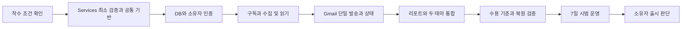

# 프로젝트 관리 산출물 (Project Management Artifacts)

> **LevelUp 적용 상태:** 2026-11-26 문서 검토·구현 착수 조건 기록. 공통 기반 코드·로컬 자동 검증을 추가했다. 2026-11-27 첫 운영 배포(출처 4곳, 메일 발송 꺼짐)를 수행했으나 전체 기능 검증과 G5·G6 승인은 미완료이며 기존 Figma 검토와 이번 브라우저 실행 결과를 구분한다. 아래 미작성 세부 양식은 후속 검증용이고 예시 수치·조직·일정은 자동 채택하지 않는다. [첫 버전 최소 적용 범위](../README.md#levelup-첫-버전의-최소-적용-범위)를 따른다.

> 일정은 고정하지 않는다. 소유자가 제품·출시를 판단하고 Codex가 문서/구현/검증을 지원한다. 아래 현재 WBS·위험·결정 기록을 사용하며 남은 빈 양식은 필요할 때 작성한다.

> **프로젝트명:** LevelUp — 소유자 1명의 개인용 웹사이트
> **문서 버전:** v1.2
> **작성일:** 2026-11-26 (2026-11-27 갱신)
> **작성자:** Codex / 제품 결정·착수 조건 검토: 사이트 소유자

> **대상 기준선:** PRD v0.30; SPD v0.12·BPD v0.11; SRS v0.12·UCS v0.10·RTM v0.12; SAD/DB/API/UIX/DDS v0.10; ITH v0.10
> **실제 완료 범위:** 공통 기반의 로컬 구현·자동 검사(ITH v0.10 3.3)와 2026-11-27 첫 운영 배포 1회(증빙: [배포 계획서 7장](../06-배포/배포계획서.md#7-g6-운영-인수-기록), [테스트 결과 보고서 2.5](../05-테스트/테스트결과보고서.md#25-인수-테스트실환경)). 전체 G4·G5·G6 승인은 해당 없음.

---

## 목차

1. [WBS (Work Breakdown Structure)](#1-wbs-work-breakdown-structure)
2. [위험 관리 대장 (Risk Register)](#2-위험-관리-대장-risk-register)
3. [커뮤니케이션 계획](#3-커뮤니케이션-계획)
4. [변경 관리 계획](#4-변경-관리-계획)
5. [프로젝트 완료 보고서](#5-프로젝트-완료-보고서)

---

## 1. WBS (Work Breakdown Structure)

### 1.1 WBS 작성 원칙

첫 릴리스 MVP-001~009의 P1·P2 전체를 결과물 단위로 나눈다. 임의 공수·8/80 규칙·최소 분해 단계·고정 출시일을 강제하지 않는다. 실제 구현 기록은 ITH 3.3에 연결하며 공수·고정 일정·deployment ID는 추정해 채우지 않는다.

### 1.2 워터폴 프로젝트 일정 (Gantt Chart)

고정 날짜가 없어 Gantt 날짜 예시를 적용하지 않는다. 아래는 의존 순서이며 일정·진척 실적이 아니다.

### 1.3 WBS 상세 테이블

| WBS-ID | 작업명 | 시작일 | 종료일 | 기간(일) | 담당자 | 상태 | 산출물 |
|---|---|---|---|---|---|---|---|
| 0 | 00~04 문서 정합성·선택 기록 | 2026-11-26 검토 | 고정 없음 | 추정 없음 | 소유자·Codex | 문서 검토 완료·실행 검증 전 | PRD v0.30·00~04 기준선 |
| 1 | 착수 조건 START-001~003 | 2026-11-26 | 2026-11-26 | 해당 없음 | 소유자 | 세 권장안 채택 완료 | 단계별검토 G3·확정 결정 |
| 2 | Services/DB 최소 실행·공통 셸·인증 | 2026-11-26 | 고정 없음 | 추정 없음 | 구현 담당 | 운영 배포·실제 Google 로그인·Neon 직접 연결 확인(2026-11-27) | ITH 3.3·인증/세션·두 lockfile |
| 3 | 출처 지원·수집·읽기 | 2026-11-27 병합(PR #2) | 고정 없음 | 추정 없음 | 구현 담당 | 구현·로컬 테스트 통과. 운영 `hourly` 첫 수집 확인(04:07), 읽기 목록 유입은 미확인 | 피드 fixture·상한/SSRF·중복/날짜 테스트 |
| 4 | Gmail 발송·실패·unknown·OP-01 | 2026-11-27 병합(PR #2) | 고정 없음 | 추정 없음 | 구현 담당·소유자 | 구현·가짜 Gmail 테스트 통과. 운영은 Gmail 연결됨·발송 꺼짐(`DELIVERY_DISABLED`), 실발송 미검증 | mock/실계정 분리 검증 |
| 5 | reports·테마·반응형 | 2026-11-27 병합(PR #2) | 고정 없음 | 추정 없음 | 구현 담당 | 구현·로컬 E2E 16개 통과. Figma 전체 대조·실기기 미완료 | 기반 E2E·나머지 SCR 후속 검증 |
| 6 | AC·보안·동시성·백업 복원 | 2026-11-27 | 고정 없음 | 추정 없음 | 구현·검증 담당 | 일부 실행: AC 12/20 PASS·7 NOT RUN·1 BLOCKED(결과 보고서 v0.3). 백업은 CI 복원 테스트만 통과, 클라우드 복원 훈련 미실시 | 실제 TC·동일 빌드·복원 증빙 |
| 7 | 시범 운영·출시 판단 | 미시작(시작 가능) | 고정 없음 | 시범 운영 7일 | 소유자 | 미실시. 운영 배포와 `hourly` 확인은 완료했고 시작일은 소유자가 정한다(출처 4곳 기준) | 실제 시작/종료·정성 평가·출시 판단 |

## 2. 위험 관리 대장 (Risk Register)

현재 위험 원장은 2.4다. 2.1~2.3의 범용 분류/수치 매트릭스는 참고 방법이며 확률·영향 점수를 실제 측정값으로 채우거나 별도 조직을 만들지 않는다.

### 2.1 위험 식별 카테고리

| 카테고리 | 설명 | 예시 |
|----------|------|------|
| 기술 (Technical) | 기술 스택, 아키텍처, 성능 관련 위험 | 신기술 도입 실패, 성능 미달 |
| 일정 (Schedule) | 마감일, 마일스톤 지연 관련 위험 | 요구사항 변경에 의한 일정 지연 |
| 리소스 (Resource) | 인력, 예산, 장비 관련 위험 | 핵심 인력 이탈, 예산 초과 |
| 외부 (External) | 외부 의존성, 규제, 시장 관련 위험 | 3rd Party API 변경, 법규 변경 |
| 비즈니스 (Business) | 비즈니스 요구사항, 이해관계자 관련 위험 | 요구사항 불명확, 우선순위 충돌 |

### 2.2 위험 평가 매트릭스

**확률 (Probability)**

| 등급 | 수치 | 설명 |
|------|:----:|------|
| 매우 낮음 | 1 | 발생 가능성 10% 미만 |
| 낮음 | 2 | 발생 가능성 10~30% |
| 보통 | 3 | 발생 가능성 30~50% |
| 높음 | 4 | 발생 가능성 50~70% |
| 매우 높음 | 5 | 발생 가능성 70% 초과 |

**영향 (Impact)**

| 등급 | 수치 | 설명 |
|------|:----:|------|
| 매우 낮음 | 1 | 프로젝트에 미미한 영향 |
| 낮음 | 2 | 일부 작업에 경미한 지연 |
| 보통 | 3 | 마일스톤 지연 또는 예산 초과 |
| 높음 | 4 | 주요 목표 달성 위험 |
| 매우 높음 | 5 | 프로젝트 실패 가능성 |

**위험도 = 확률 x 영향**

|  | 영향 1 | 영향 2 | 영향 3 | 영향 4 | 영향 5 |
|:-:|:------:|:------:|:------:|:------:|:------:|
| **확률 5** | 5 | 10 | 15 | 20 | **25** |
| **확률 4** | 4 | 8 | 12 | 16 | **20** |
| **확률 3** | 3 | 6 | 9 | 12 | 15 |
| **확률 2** | 2 | 4 | 6 | 8 | 10 |
| **확률 1** | 1 | 2 | 3 | 4 | 5 |

> **위험도 등급:** 낮음(1~4) / 보통(5~9) / 높음(10~15) / 매우 높음(16~25)

### 2.3 위험 대응 전략

| 전략 | 설명 | 적용 시점 |
|------|------|-----------|
| 회피 (Avoid) | 위험 원인을 제거하여 발생 자체를 방지 | 위험도가 매우 높고 대응 가능 시 |
| 완화 (Mitigate) | 위험 발생 확률 또는 영향을 줄이는 조치 | 대부분의 위험에 적용 |
| 전가 (Transfer) | 위험을 제3자(보험, 외주 등)에게 이전 | 전문성 부족, 재무적 위험 |
| 수용 (Accept) | 위험을 인지하되 별도 조치 없이 감수 | 위험도가 낮거나 대응 비용이 과도 |

### 2.4 위험 관리 테이블

확률·점수는 실측 근거가 없어 산정하지 않는다. 아래 영향과 해소 시점을 기준으로 관리한다.

| RISK-ID | 카테고리 | 위험 설명 | 확률 | 영향 | 위험도 | 대응 전략 | 대응 계획 | 담당자 | 상태 |
|---|---|---|---|---|---|---|---|---|---|
| RSK-LU-001 | 실행 환경 | Services·Schedules·DB session 잠금이 무료 환경에서 함께 동작하는지 미검증 | 미산정 | 실제 작업/로그인 연결 차단 가능 | 기능 연결 전 검증 | 완화 | 최소 배포·라우팅/callback·DB 직접 연결/중복·마감 확인 | 구현 담당 | 일부 검증(2026-11-27): 운영 Services·라우팅·Neon 직접 연결·`hourly` 첫 실행 확인. 무료 한도, `final`·`digest` 중복·마감은 미확인 |
| RSK-LU-002 | 백업 | Artifact 자동 만료가 실패 중 정상본 4개 보존과 충돌 가능 | 미산정 | 복구 지점 손실 | 운영 전 차단 | 완화 | 만료 없는 영속 보관 보완/정책 양립·무료 용량 검증, 복구 키 분리·격리 복원 | 소유자·구현 담당 | 미해결·운영 전 필수 |
| RSK-LU-003 | 수집 | 피드·날짜 형식·DNS/HTTP transport·상한이 실제 출처와 다를 수 있음 | 미산정 | 누락·오판정·SSRF 위험 | 수집 기능 전 검증 | 완화 | 지원 명세·합성/실제 표본·시간/크기/항목/페이지 상한·안전 연결 확인 | 구현 담당 | 미검증 |
| RSK-LU-004 | 메일 | timeout/접수 후 DB 실패에서 재발송 위험 | 미산정 | 중복 메일 | 실발송 전 차단 | 완화 | 단일 send·held·receipt 재기록·OP-01, SDK 자동 재시도 금지 | 구현 담당 | 설계 있음·미실행 |
| RSK-LU-005 | 인증 | OAuth 게시/실제 owner 설정·세션/토큰 경계 미검증 | 미산정 | 접근/발송 실패·자격증명 노출 | 실계정 연동 전 검증 | 완화 | 고정 owner sub·scope·cookie·CSRF·7일/현재 세션 폐기·비밀 마스킹 | 소유자·구현 담당 | 소유자 로그인·Gmail 연결 확인(2026-11-27). 프로덕션 게시·8일 후 재확인은 미실시 |
| RSK-LU-006 | UI | Figma Pretendard 조건과 실제 로딩/줄바꿈 검증 미완료 | 미산정 | 목업/구현 줄바꿈·굵기 차이 | START-002로 UI 검증·인수 전 완료 확정 | 완화 | 확정 글꼴·600·두 테마·1280/390·실기기 기록 | 소유자·화면 담당 | 기한 확정·실제 교체/검증 대기 |
| RSK-LU-007 | 범위 | 템플릿 예시나 준비 카드가 추가 구현 범위로 번질 수 있음 | 미산정 | 불필요한 기능·공수 | 상시 범위 점검 | 회피 | PRD MVP/EX·23개 표 기준, 별도 회원/결제/AI API/다부서 회의 제외 | 소유자·Codex | 범위 제한 적용 |
| RSK-LU-008 | 운영 | 환경 변수가 누락·삭제된 채 재배포하면 API가 시작하지 못함(2026-11-27 03:25 배포에서 `APP_ORIGIN` 누락으로 500 경험) | 미산정 | 사이트 불능 | 재배포 전 점검 | 완화 | 배포 계획서 2.1의 이름 10개 점검, 운영 가이드 4.1 | 소유자 | 문서화 완료·재배포마다 점검 |
| RSK-LU-009 | 운영 | 알림·모니터링이 없고 Hobby 런타임 로그는 1시간만 보관되어 장애·수집 실패를 늦게 발견할 수 있음 | 미산정 | 수집·메일 누락 | 시범 운영 중 매일 점검 | 수용 후 완화 | 구독 화면 "마지막 성공" 시각과 메일 상태를 매일 확인(운영 가이드 7.1) | 소유자 | 시범 운영 중 적용 |

## 3. 커뮤니케이션 계획

### 3.1 이해관계자 분석 매트릭스

| 이해관계자 | 역할 | 관심도 | 영향력 | 분류 | 커뮤니케이션 전략 |
|---|---|---|---|---|---|
| 사이트 소유자 | 제품 범위·정책·조건·출시 판단, 실제 계정 동의 | 직접 사용 | 최종 결정 | 단일 제품 책임 | 이 대화와 문서의 결정 기록 |
| Codex / 구현·검증 담당 | 설계 정합성·구현·검증 증빙 | 작업 수행 | 권장/구현 | 지원 역할 | 확인한 사실·남은 조건·실제 결과 보고 |

### 3.2 커뮤니케이션 매트릭스

| 대상 | 빈도 | 방법 | 주요 내용 | 담당자 |
|---|---|---|---|---|
| 소유자 | 실제 선택·위험·완료가 생길 때 | 대화·문서/PR | 범위/정책 변경, 착수 조건, 실제 검증 결과 | Codex/구현 담당 |
| 구현 인수자(동일인 가능) | 단계 인계 시 | ITH·RTM·후보 빌드 | commit·배포·migration·TC 식별 | 구현 담당 |

### 3.3 회의 체계

#### 일일 스탠드업 (Daily Standup)

별도 회의·운영 조직은 적용하지 않는다. 필요한 결정과 실제 작업 결과만 소유자에게 기록한다.

#### 주간 진척 보고 (Weekly Status Meeting)

별도 회의·운영 조직은 적용하지 않는다. 필요한 결정과 실제 작업 결과만 소유자에게 기록한다.

#### 월간 운영위 (Monthly Steering Committee)

별도 회의·운영 조직은 적용하지 않는다. 필요한 결정과 실제 작업 결과만 소유자에게 기록한다.

### 3.4 에스컬레이션 경로

범위·예산·보존/발송 정책 변경이나 해결 불가능한 외부 제약은 근거·영향·권장 대안과 함께 소유자에게 검토 요청한다. 실제 비밀값은 문서·대화에 적지 않는다. 정기 회의·임의 확인 기한·새 알림 채널을 추가하지 않는다.

## 4. 변경 관리 계획

### 4.1 변경 요청 프로세스

요청/근거 → 관련 MVP·BP·FR/NFR·데이터/진행 중 건 영향 확인 → 소유자 결정 → 해당 문서/RTM 갱신 → 구현/검증 → 동일 빌드 증빙과 출시 판단 순서다. 구현 세부가 확정 정책을 바꾸지 않으면 일반 코드 리뷰로 처리한다. 별도 CCB는 운영하지 않는다.

| 현재 결정 | 근거 | 영향 | 상태 |
|---|---|---|---|
| PRD와 기존 제품 정책 | PRD v0.30·사용자 확정 대화 | 00~04 기준선 | 확정 |
| Services 한 프로젝트·DB 세션·외부 클라우드 자동 백업 | 세 가지 권장안 사용자 채택 | API 라우팅·14개 DB 테이블·백업/키 분리 | 설계 선택 확정·실행 미검증 |
| START-001~003 | 2026-11-26 소유자 채택 | 공통 셸·인증·DB 단계적 착수 / Pretendard 목업 교체는 UI 인수 전 / Python 3.12·Node 24 LTS 및 지정 도구 확정 | 결정 완료·기반 로컬 검사 통과·운영 연동 검증 대기 |

### 4.2 변경 요청서 (CR: Change Request) 템플릿

| 항목 | 내용 |
|------|------|
| **CR-ID** | CR-XXXX |
| **요청일** | YYYY-MM-DD |
| **요청자** | |
| **변경 유형** | [ ] 요구사항 변경 / [ ] 설계 변경 / [ ] 범위 변경 / [ ] 일정 변경 / [ ] 기타 |
| **우선순위** | [ ] 긴급 / [ ] 높음 / [ ] 보통 / [ ] 낮음 |

**변경 내용:**

| 항목 | 상세 |
|------|------|
| 변경 제목 | |
| 현재 상태 (As-Is) | |
| 요청 사항 (To-Be) | |
| 변경 사유 | |
| 영향 받는 산출물 | |
| 관련 기획·정책·요구사항 ID | |
| 변경 전·후 승인 기준선 | [버전 또는 승인 기록] |
| RTM 갱신 위치·재검증 대상 | [링크, TC 또는 영향 범위] |
| 재검토 단계 | [Gate / 승인자 / 재검토 기록] |

**승인 정보:**

| 단계 | 승인자 | 승인일 | 결과 | 비고 |
|------|--------|--------|------|------|
| PM 검토 | | | 승인 / 반려 / CCB 회부 | |
| CCB 결정 | | | 승인 / 반려 / 보류 | |

### 4.3 변경 영향 분석 템플릿

| 분석 항목 | 내용 |
|-----------|------|
| **CR-ID** | CR-XXXX |
| **분석 담당자** | |
| **분석 완료일** | YYYY-MM-DD |

**영향 범위 분석:**

| 영역 | 영향 유무 | 영향 상세 | 예상 공수 |
|------|:---------:|-----------|-----------|
| 요구사항 명세 | Yes / No | | 인일 |
| 아키텍처 설계 | | | |
| DB 설계 | | | |
| API 설계 | | | |
| UI/UX 설계 | | | |
| Backend 코드 | | | |
| Frontend 코드 | | | |
| 테스트 케이스 | | | |
| 문서 | | | |
| 인프라 | | | |

**일정 영향:**

| 항목 | 기존 | 변경 후 | 차이 |
|------|------|---------|------|
| 개발 완료일 | | | +N일 |
| 테스트 완료일 | | | |
| 릴리스일 | | | |

**비용 영향:**

| 항목 | 추가 비용 | 비고 |
|------|-----------|------|
| 인건비 | | |
| 인프라 비용 | | |
| 라이선스 비용 | | |
| **합계** | | |

**위험 평가:**

| 위험 | 확률 | 영향 | 위험도 | 대응 방안 |
|------|:----:|:----:|:------:|-----------|
| | | | | |

### 4.4 CCB (변경통제위원회) 구성 및 역할

개인용 첫 버전에는 CCB를 구성하지 않는다. 최종 제품/정책 결정자는 소유자이며 구현·검증 담당은 영향을 설명하고 문서·증빙을 갱신한다. 다부서 서명·정족수·주간 회의는 적용하지 않는다.

공통 기반은 로컬 구현·검증했고 2026-11-27 첫 운영 배포(출처 4곳, 메일 발송 꺼짐)를 수행했으나 전체 기능 검증과 G5·G6 승인은 미완료다. 아래 완료 보고 양식은 사용 전이며 사용자 수·완료율·통과율·공수·서명·종료일을 채우거나 달성한 것으로 보지 않는다. 최종 출시는 AC 검증·7일 시범 운영 후 소유자가 판단한다.

## 5. 프로젝트 완료 보고서

### 5.1 프로젝트 개요

| 항목 | 내용 |
|------|------|
| 프로젝트명 | |
| 프로젝트 기간 | YYYY-MM-DD ~ YYYY-MM-DD |
| 프로젝트 목표 | |
| 총 투입 인원 | 명 |
| 총 투입 공수 | 인월 (Man-Month) |
| 총 예산 | 원 |

### 5.2 주요 성과 (계획 vs 실적)

**일정 현황:**

| 마일스톤 | 계획일 | 실적일 | 차이 | 사유 |
|----------|--------|--------|------|------|
| 요구사항 확정 | | | | |
| 설계 완료 | | | | |
| 개발 완료 | | | | |
| 테스트 완료 | | | | |
| 릴리스 | | | | |

**일정 준수율:** `(기한 내 완료 마일스톤 수 / 전체 마일스톤 수) x 100 = ___%`

**예산 현황:**

| 항목 | 계획 (원) | 실적 (원) | 차이 (원) | 비율 |
|------|-----------|-----------|-----------|------|
| 인건비 | | | | % |
| 인프라 | | | | |
| 라이선스 | | | | |
| 교육/컨설팅 | | | | |
| 기타 | | | | |
| **합계** | | | | **%** |

**예산 준수율:** `(실적 / 계획) x 100 = ___%`

### 5.3 품질 지표

| 지표 | 목표 | 실적 | 충족 여부 |
|------|------|------|-----------|
| 결함 밀도 (결함 수 / KLOC) | | | |
| Critical/Major 미해결 결함 | 0건 | | |
| 테스트 커버리지 | >= 80% | | |
| 테스트 통과율 | >= 95% | | |
| 성능 목표 달성률 | 100% | | |
| 접근성(WCAG AA) 적합률 | 100% | | |
| 보안 취약점 (High 이상) | 0건 | | |

### 5.4 범위 달성 현황

| 요구사항 분류 | 계획 수 | 완료 수 | 이월 수 | 취소 수 | 달성률 |
|--------------|:-------:|:-------:|:-------:|:-------:|:------:|
| 기능 요구사항 | | | | | % |
| 비기능 요구사항 | | | | | % |
| **합계** | | | | | **%** |

### 5.5 교훈 (Lessons Learned)

| # | 분류 | 내용 | 원인 | 개선방안 |
|---|------|------|------|----------|
| 1 | 요구사항 | | | |
| 2 | 설계 | | | |
| 3 | 개발 | | | |
| 4 | 테스트 | | | |
| 5 | 배포 | | | |
| 6 | 커뮤니케이션 | | | |
| 7 | 위험 관리 | | | |
| 8 | 도구/프로세스 | | | |

### 5.6 잔여 위험 및 권고사항

**잔여 위험:**

| # | 위험 설명 | 위험도 | 대응 권고 | 담당 |
|---|----------|:------:|-----------|------|
| 1 | | 높음/보통/낮음 | | |
| 2 | | | | |
| 3 | | | | |

**권고사항:**

| # | 분류 | 권고 내용 | 우선순위 | 대상 |
|---|------|-----------|:--------:|------|
| 1 | 기술 부채 | | High / Medium / Low | |
| 2 | 성능 개선 | | | |
| 3 | 운영 | | | |
| 4 | 보안 | | | |
| 5 | 프로세스 | | | |

### 5.7 프로젝트 종료 승인

| 역할 | 이름 | 서명 | 일자 |
|------|------|------|------|
| PM | | | |
| PO / 스폰서 | | | |
| 개발 리드 | | | |
| QA 리드 | | | |
| 운영 담당 | | | |

---

*프로젝트 완료 보고서는 프로젝트 종료 후 2주 이내에 작성하여 주요 이해관계자에게 배포한다.*
